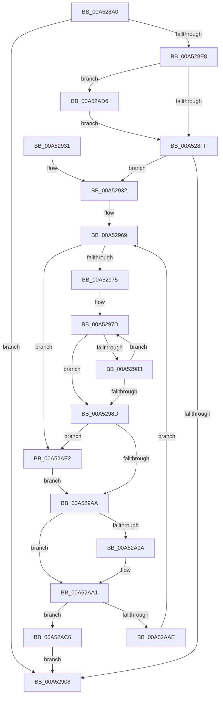

# PpmEventTraceProfiles

- RVA: `0x00A528A0`–`0x00A52AEA` (길이 `586` bytes)
- VA: `0x0000000140A528A0`
- 실행 섹션: `PAGE`
- PDB 이름 있음: `예`; PDB Function 태그: `아니요`
- unwind 정보 RVA: `0x000B0D34`
- 디코드: `131`개 명령, `586/586` bytes 표시
- 미해석 바이트: `0` (있으면 어셈블리에 `.byte`로 보존)

> 이 문서는 커널 이미지의 기계어와 PDB 기호를 분석해 생성했습니다. 4번과 5번은 함수 원형과 자료형을 바이너리 사용 방식에서 추정한 C 해석이며 원본 소스 복구 결과는 아닙니다.

## 1. Dependencies

- 직접 호출 지점: **4**; 고유 호출 대상: **4**
- 직접 호출자로 확인된 함수: **2**
- RIP 상대 이미지 참조: **9**

### Outgoing calls
- `0x00A528FF` → [EtwEventEnabled](../../text/39/EtwEventEnabled_function_00392450.md) (function, `0x00392450`)
- `0x00A5290F` → [_security_check_cookie](../../text/6A/_security_check_cookie_function_006AC640.md) (function, `0x006AC640`)
- `0x00A5295A` → [PpmEndProfileAccumulation](PpmEndProfileAccumulation_function_00A52FB8.md) (function, `0x00A52FB8`)
- `0x00A52AA1` → [EtwWrite](../../text/41/EtwWrite_function_0041C720.md) (function, `0x0041C720`)

### Direct callers
- [PpmRegisterProfiles](../77/PpmRegisterProfiles_function_007709F0.md) at `0x00770B8C`
- [PpmEventTraceControlCallback](PpmEventTraceControlCallback_function_00A51F60.md) at `0x00A5226D`

### Static image references
- `0x00A528BF` → RVA `0x00E0A740` (`.data`; read)
- `0x00A528D3` → RVA `0x00E67A39` (`.data`; read)
- `0x00A528E8` → RVA `0x00F083E8` (`.data`; read)
- `0x00A528EF` → RVA `0x0001A6D8` (`.rdata`; read)
- `0x00A52932` → RVA `0x00E08380` (`.data`; read)
- `0x00A52939` → RVA `0x00F077C0` (`.data`; read)
- `0x00A52A71` → RVA `0x0001A6C8` (`.rdata`; read)
- `0x00A52AA6` → RVA `0x00F07BE8` (`.data`; read)
- `0x00A52AB8` → RVA `0x00F07BE0` (`.data`; read)

## 2. Other-region calls and transfers

- 다른 실행 섹션으로 향하는 call: **3**
  - `0x00A528FF` → [EtwEventEnabled](../../text/39/EtwEventEnabled_function_00392450.md) (`PAGE` → `.text`)
  - `0x00A5290F` → [_security_check_cookie](../../text/6A/_security_check_cookie_function_006AC640.md) (`PAGE` → `.text`)
  - `0x00A52AA1` → [EtwWrite](../../text/41/EtwWrite_function_0041C720.md) (`PAGE` → `.text`)
- 별도 외부 분기/꼬리 이동을 확인하지 못했습니다.

## 3. Assembly (complete function range)

```asm
00A528A0  48 8B C4                        mov rax, rsp
00A528A3  48 89 58 08                     mov qword ptr [rax + 8], rbx
00A528A7  48 89 70 10                     mov qword ptr [rax + 0x10], rsi
00A528AB  48 89 78 18                     mov qword ptr [rax + 0x18], rdi
00A528AF  55                              push rbp
00A528B0  41 56                           push r14
00A528B2  41 57                           push r15
00A528B4  48 8D 68 A1                     lea rbp, [rax - 0x5f]
00A528B8  48 81 EC F0 00 00 00            sub rsp, 0xf0
00A528BF  48 8B 05 7A 7E 3B 00            mov rax, qword ptr [rip + 0x3b7e7a]
00A528C6  48 33 C4                        xor rax, rsp
00A528C9  48 89 45 37                     mov qword ptr [rbp + 0x37], rax
00A528CD  45 33 FF                        xor r15d, r15d
00A528D0  44 8A F1                        mov r14b, cl
00A528D3  44 38 3D 5F 51 41 00            cmp byte ptr [rip + 0x41515f], r15b
00A528DA  4C 89 7D 87                     mov qword ptr [rbp - 0x79], r15
00A528DE  4C 89 7D 8F                     mov qword ptr [rbp - 0x71], r15
00A528E2  4C 89 7D 97                     mov qword ptr [rbp - 0x69], r15
00A528E6  74 20                           je 0x140a52908
00A528E8  48 8B 0D F9 5A 4B 00            mov rcx, qword ptr [rip + 0x4b5af9]
00A528EF  48 8D 15 E2 7D 5C FF            lea rdx, [rip - 0xa3821e]
00A528F6  45 84 F6                        test r14b, r14b
00A528F9  0F 85 D7 01 00 00               jne 0x140a52ad6
00A528FF  E8 4C FB 93 FF                  call 0x140392450
00A52904  84 C0                           test al, al
00A52906  75 2A                           jne 0x140a52932
00A52908  48 8B 4D 37                     mov rcx, qword ptr [rbp + 0x37]
00A5290C  48 33 CC                        xor rcx, rsp
00A5290F  E8 2C 9D C5 FF                  call 0x1406ac640
00A52914  4C 8D 9C 24 F0 00 00 00         lea r11, [rsp + 0xf0]
00A5291C  49 8B 5B 20                     mov rbx, qword ptr [r11 + 0x20]
00A52920  49 8B 73 28                     mov rsi, qword ptr [r11 + 0x28]
00A52924  49 8B 7B 30                     mov rdi, qword ptr [r11 + 0x30]
00A52928  49 8B E3                        mov rsp, r11
00A5292B  41 5F                           pop r15
00A5292D  41 5E                           pop r14
00A5292F  5D                              pop rbp
00A52930  C3                              ret
00A52931  CC                              int3
00A52932  48 8B 3D 47 5A 3B 00            mov rdi, qword ptr [rip + 0x3b5a47]
00A52939  4C 8D 05 80 4E 4B 00            lea r8, [rip + 0x4b4e80]
00A52940  48 BE 08 00 00 00 80 F7 FF FF   movabs rsi, 0xfffff78000000008
00A5294A  48 8B CF                        mov rcx, rdi
00A5294D  41 8A DF                        mov bl, r15b
00A52950  48 8B 36                        mov rsi, qword ptr [rsi]
00A52953  48 8B D6                        mov rdx, rsi
00A52956  48 89 75 9F                     mov qword ptr [rbp - 0x61], rsi
00A5295A  E8 59 06 00 00                  call 0x140a52fb8
00A5295F  48 BE CD CC CC CC CC CC CC CC   movabs rsi, 0xcccccccccccccccd
00A52969  4D 8B 08                        mov r9, qword ptr [r8]
00A5296C  4D 85 C9                        test r9, r9
00A5296F  0F 84 6D 01 00 00               je 0x140a52ae2
00A52975  BA FF FF FF 7F                  mov edx, 0x7fffffff
00A5297A  49 8B C1                        mov rax, r9
00A5297D  66 44 39 38                     cmp word ptr [rax], r15w
00A52981  74 0A                           je 0x140a5298d
00A52983  48 83 C0 02                     add rax, 2
00A52987  48 83 EA 01                     sub rdx, 1
00A5298B  75 F0                           jne 0x140a5297d
00A5298D  B9 FF FF FF 7F                  mov ecx, 0x7fffffff
00A52992  48 8B C2                        mov rax, rdx
00A52995  48 2B CA                        sub rcx, rdx
00A52998  48 F7 D8                        neg rax
00A5299B  48 1B C0                        sbb rax, rax
00A5299E  48 23 C1                        and rax, rcx
00A529A1  48 85 D2                        test rdx, rdx
00A529A4  0F 84 38 01 00 00               je 0x140a52ae2
00A529AA  48 8B 0D 37 5A 4B 00            mov rcx, qword ptr [rip + 0x4b5a37]
00A529B1  8D 04 45 02 00 00 00            lea eax, [rax*2 + 2]
00A529B8  89 45 AF                        mov dword ptr [rbp - 0x51], eax
00A529BB  49 8D 40 08                     lea rax, [r8 + 8]
00A529BF  48 89 45 B7                     mov qword ptr [rbp - 0x49], rax
00A529C3  49 8D 40 20                     lea rax, [r8 + 0x20]
00A529C7  48 89 45 C7                     mov qword ptr [rbp - 0x39], rax
00A529CB  49 8D 40 1C                     lea rax, [r8 + 0x1c]
00A529CF  48 89 45 D7                     mov qword ptr [rbp - 0x29], rax
00A529D3  49 8D 40 0C                     lea rax, [r8 + 0xc]
00A529D7  48 89 45 E7                     mov qword ptr [rbp - 0x19], rax
00A529DB  48 8B C6                        mov rax, rsi
00A529DE  4C 89 4D A7                     mov qword ptr [rbp - 0x59], r9
00A529E2  41 B9 09 00 00 00               mov r9d, 9
00A529E8  44 89 7D B3                     mov dword ptr [rbp - 0x4d], r15d
00A529EC  48 C7 45 BF 01 00 00 00         mov qword ptr [rbp - 0x41], 1
00A529F4  48 C7 45 CF 01 00 00 00         mov qword ptr [rbp - 0x31], 1
00A529FC  48 C7 45 DF 04 00 00 00         mov qword ptr [rbp - 0x21], 4
00A52A04  48 C7 45 EF 10 00 00 00         mov qword ptr [rbp - 0x11], 0x10
00A52A0C  49 F7 A0 08 04 00 00            mul qword ptr [r8 + 0x408]
00A52A13  48 8B C6                        mov rax, rsi
00A52A16  48 C1 EA 03                     shr rdx, 3
00A52A1A  48 89 55 87                     mov qword ptr [rbp - 0x79], rdx
00A52A1E  49 F7 A0 10 04 00 00            mul qword ptr [r8 + 0x410]
00A52A25  48 8B C6                        mov rax, rsi
00A52A28  48 C1 EA 03                     shr rdx, 3
00A52A2C  48 89 55 8F                     mov qword ptr [rbp - 0x71], rdx
00A52A30  49 F7 A0 18 04 00 00            mul qword ptr [r8 + 0x418]
00A52A37  49 8D 80 00 04 00 00            lea rax, [r8 + 0x400]
00A52A3E  48 C7 45 FF 08 00 00 00         mov qword ptr [rbp - 1], 8
00A52A46  48 89 45 F7                     mov qword ptr [rbp - 9], rax
00A52A4A  45 33 C0                        xor r8d, r8d
00A52A4D  48 C1 EA 03                     shr rdx, 3
00A52A51  48 8D 45 87                     lea rax, [rbp - 0x79]
00A52A55  48 89 45 07                     mov qword ptr [rbp + 7], rax
00A52A59  48 8D 45 8F                     lea rax, [rbp - 0x71]
00A52A5D  48 89 45 17                     mov qword ptr [rbp + 0x17], rax
00A52A61  48 8D 45 97                     lea rax, [rbp - 0x69]
00A52A65  48 89 45 27                     mov qword ptr [rbp + 0x27], rax
00A52A69  48 8D 45 A7                     lea rax, [rbp - 0x59]
00A52A6D  48 89 55 97                     mov qword ptr [rbp - 0x69], rdx
00A52A71  48 8D 15 50 7C 5C FF            lea rdx, [rip - 0xa383b0]
00A52A78  48 89 44 24 20                  mov qword ptr [rsp + 0x20], rax
00A52A7D  48 C7 45 0F 08 00 00 00         mov qword ptr [rbp + 0xf], 8
00A52A85  48 C7 45 1F 08 00 00 00         mov qword ptr [rbp + 0x1f], 8
00A52A8D  48 C7 45 2F 08 00 00 00         mov qword ptr [rbp + 0x2f], 8
00A52A95  45 84 F6                        test r14b, r14b
00A52A98  75 07                           jne 0x140a52aa1
00A52A9A  48 8D 15 37 7C 5C FF            lea rdx, [rip - 0xa383c9]
00A52AA1  E8 7A 9C 9C FF                  call 0x14041c720
00A52AA6  3A 1D 3C 51 4B 00               cmp bl, byte ptr [rip + 0x4b513c]
00A52AAC  74 18                           je 0x140a52ac6
00A52AAE  0F B6 C3                        movzx eax, bl
00A52AB1  4C 69 C0 20 04 00 00            imul r8, rax, 0x420
00A52AB8  4C 03 05 21 51 4B 00            add r8, qword ptr [rip + 0x4b5121]
00A52ABF  FE C3                           inc bl
00A52AC1  E9 A3 FE FF FF                  jmp 0x140a52969
00A52AC6  48 8B 75 9F                     mov rsi, qword ptr [rbp - 0x61]
00A52ACA  48 89 B7 F8 03 00 00            mov qword ptr [rdi + 0x3f8], rsi
00A52AD1  E9 32 FE FF FF                  jmp 0x140a52908
00A52AD6  48 8D 15 EB 7B 5C FF            lea rdx, [rip - 0xa38415]
00A52ADD  E9 1D FE FF FF                  jmp 0x140a528ff
00A52AE2  49 8B C7                        mov rax, r15
00A52AE5  E9 C0 FE FF FF                  jmp 0x140a529aa
```

## 4. C-style interpretation (structured pseudocode)

```c
__int64 __fastcall PpmEventTraceProfiles(unsigned __int8 a1)
{
    __int64 result;
    __int64 v_r15;
    __int64 v_rbx;
    __int64 v_rsp;
    unsigned __int64 v_stack_m18;
    unsigned __int64 v_stack_mD0;

    *(unsigned __int64 *)(v_rsp + 8) = v_rbx;
    *(unsigned __int64 *)(v_rsp + 16) = v_rsi;
    *(unsigned __int64 *)(v_rsp + 24) = v_rdi;
    v_rsp = (v_rsp) - (240);
    result = (*(unsigned __int64 *)(v_rip + 3899002)) ^ (v_rsp);
    *(unsigned __int64 *)(v_rsp - 95 + 55) = result;
    v_r15 = 0;
    *(unsigned __int64 *)(v_rsp - 95 - 121) = 0;
    *(unsigned __int64 *)(v_rsp - 95 - 113) = 0;
    *(unsigned __int64 *)(v_rsp - 95 - 105) = 0;
    if ((*(unsigned __int8 *)(v_rip + 4280671)) == 0) goto loc_00A52908;
    if (a1 != 0) goto loc_00A52AD6;
loc_00A528FF:
    result = EtwEventEnabled(*(unsigned __int64 *)(v_rip + 4938489), v_rip - 10715678, a3, a4);
    if ((unsigned __int8)(result) != 0) goto loc_00A52932;
loc_00A52908:
    a1 = (*(unsigned __int64 *)(v_rsp - 95 + 55)) ^ (v_rsp);
    result = _security_check_cookie(a1, v_rip - 10715678, a3, a4);
    return result;
loc_00A52932:
    *(unsigned __int64 *)(v_rsp - 95 - 97) = *(unsigned __int64 *)(*(unsigned __int64 *)(v_stack_m18 + 40));
    result = PpmEndProfileAccumulation(*(unsigned __int64 *)(v_rip + 3889735), *(unsigned __int64 *)(*(unsigned __int64 *)(v_stack_m18 + 40)), v_rip + 4935296, a4);
loc_00A52969:
    if (*(unsigned __int64 *)(v_rip + 4935296) == 0) goto loc_00A52AE2;
loc_00A5297D:
    if ((*(unsigned __int16 *)(*(unsigned __int64 *)(v_rip + 4935296))) == 0) goto loc_00A5298D;
    result = (*(unsigned __int64 *)(v_rip + 4935296)) + (2);
    a2 = ((unsigned int)(0x7FFFFFFFULL)) - (1);
    if (condition_is_not_equal) goto loc_00A5297D;
loc_00A5298D:
    a1 = ((unsigned int)(0x7FFFFFFFULL)) - (a2);
    result = -(a2);
    result = (result) & (a1);
    if (a2 == 0) goto loc_00A52AE2;
loc_00A529AA:
    *(unsigned int *)(v_rsp - 95 - 81) = (unsigned int)(result * 2 + 2);
    *(unsigned __int64 *)(v_rsp - 95 - 73) = v_rip + 4935296 + 8;
    *(unsigned __int64 *)(v_rsp - 95 - 57) = v_rip + 4935296 + 32;
    *(unsigned __int64 *)(v_rsp - 95 - 41) = v_rip + 4935296 + 28;
    *(unsigned __int64 *)(v_rsp - 95 - 25) = v_rip + 4935296 + 12;
    *(unsigned __int64 *)(v_rsp - 95 - 89) = *(unsigned __int64 *)(v_rip + 4935296);
    *(unsigned int *)(v_rsp - 95 - 77) = 0;
    *(unsigned __int64 *)(v_rsp - 95 - 65) = 1;
    *(unsigned __int64 *)(v_rsp - 95 - 49) = 1;
    *(unsigned __int64 *)(v_rsp - 95 - 33) = 4;
    *(unsigned __int64 *)(v_rsp - 95 - 17) = 16;
    a2 = (a2) >> (3);
    *(unsigned __int64 *)(v_rsp - 95 - 121) = a2;
    a2 = (a2) >> (3);
    *(unsigned __int64 *)(v_rsp - 95 - 113) = a2;
    *(unsigned __int64 *)(v_rsp - 95 - 1) = 8;
    *(unsigned __int64 *)(v_rsp - 95 - 9) = v_rip + 4935296 + 1024;
    a3 = 0;
    a2 = (a2) >> (3);
    *(unsigned __int64 *)(v_rsp - 95 + 7) = v_rsp - 95 - 121;
    *(unsigned __int64 *)(v_rsp - 95 + 23) = v_rsp - 95 - 113;
    *(unsigned __int64 *)(v_rsp - 95 + 39) = v_rsp - 95 - 105;
    *(unsigned __int64 *)(v_rsp - 95 - 105) = a2;
    v_stack_mD0 = v_rsp - 95 - 89;
    *(unsigned __int64 *)(v_rsp - 95 + 15) = 8;
    *(unsigned __int64 *)(v_rsp - 95 + 31) = 8;
    *(unsigned __int64 *)(v_rsp - 95 + 47) = 8;
    if (a1 == 0) {
        a2 = v_rip - 10716105;
    }
    result = EtwWrite(*(unsigned __int64 *)(v_rip + 4938295), a2, a3, 9);
    if (0 == (*(unsigned __int8 *)(v_rip + 4935996))) goto loc_00A52AC6;
    a3 = (a3) * (0);
    a3 = (a3) + (*(unsigned __int64 *)(v_rip + 4935969));
    v_rbx = (unsigned __int8)((0) + 1);
    goto loc_00A52969;
loc_00A52AC6:
    *(unsigned __int64 *)(*(unsigned __int64 *)(v_rip + 3889735) + 1016) = *(unsigned __int64 *)(v_rsp - 95 - 97);
    goto loc_00A52908;
loc_00A52AD6:
    goto loc_00A528FF;
loc_00A52AE2:
    goto loc_00A529AA;
}
```

## 5. (Beta) C Style

```c
int64_t PpmEventTraceProfiles(uint8_t Arg1)
{
    int64_t result;
    int64_t local_r15;
    int64_t local_rbx;
    int64_t local_rsp;
    uint64_t v_stack_m18;
    uint64_t v_stack_mD0;

    *(uint64_t *)(local_rsp + 0x8) = local_rbx;
    *(uint64_t *)(local_rsp + 0x10) = local_rsi;
    *(uint64_t *)(local_rsp + 0x18) = local_rdi;
    local_rsp = (local_rsp) - (240);
    result = (*(uint64_t *)(v_rip + 0x3B7E7A)) ^ (local_rsp);
    *(uint64_t *)(local_rsp - 0x5F + 0x37) = result;
    local_r15 = 0;
    *(uint64_t *)(local_rsp - 0x5F - 0x79) = 0;
    *(uint64_t *)(local_rsp - 0x5F - 0x71) = 0;
    *(uint64_t *)(local_rsp - 0x5F - 0x69) = 0;
    if ((*(uint8_t *)(v_rip + 0x41515F)) == 0) goto loc_00A52908;
    if (Arg1 != 0) goto loc_00A52AD6;
loc_00A528FF:
    result = EtwEventEnabled(*(uint64_t *)(v_rip + 0x4B5AF9), v_rip - 10715678, a3, a4);
    if ((uint8_t)(result) != 0) goto loc_00A52932;
loc_00A52908:
    Arg1 = (*(uint64_t *)(local_rsp - 0x5F + 0x37)) ^ (local_rsp);
    result = _security_check_cookie(Arg1, v_rip - 10715678, a3, a4);
    return result;
loc_00A52932:
    *(uint64_t *)(local_rsp - 0x5F - 0x61) = *(uint64_t *)(*(uint64_t *)(v_stack_m18 + 0x28));
    result = PpmEndProfileAccumulation(*(uint64_t *)(v_rip + 0x3B5A47), *(uint64_t *)(*(uint64_t *)(v_stack_m18 + 0x28)), v_rip + 4935296, a4);
loc_00A52969:
    if (*(uint64_t *)(v_rip + 0x4B4E80) == 0) goto loc_00A52AE2;
loc_00A5297D:
    if ((*(uint16_t *)(*(uint64_t *)(v_rip + 0x4B4E80))) == 0) goto loc_00A5298D;
    result = (*(uint64_t *)(v_rip + 0x4B4E80)) + (2);
    a2 = ((uint32_t)(0x7FFFFFFFULL)) - (1);
    if (condition_is_not_equal) goto loc_00A5297D;
loc_00A5298D:
    Arg1 = ((uint32_t)(0x7FFFFFFFULL)) - (a2);
    result = -(a2);
    result = (result) & (Arg1);
    if (a2 == 0) goto loc_00A52AE2;
loc_00A529AA:
    *(uint32_t *)(local_rsp - 0x5F - 0x51) = (uint32_t)(result * 2 + 2);
    *(uint64_t *)(local_rsp - 0x5F - 0x49) = v_rip + 4935296 + 8;
    *(uint64_t *)(local_rsp - 0x5F - 0x39) = v_rip + 4935296 + 32;
    *(uint64_t *)(local_rsp - 0x5F - 0x29) = v_rip + 4935296 + 28;
    *(uint64_t *)(local_rsp - 0x5F - 0x19) = v_rip + 4935296 + 12;
    *(uint64_t *)(local_rsp - 0x5F - 0x59) = *(uint64_t *)(v_rip + 0x4B4E80);
    *(uint32_t *)(local_rsp - 0x5F - 0x4D) = 0;
    *(uint64_t *)(local_rsp - 0x5F - 0x41) = 1;
    *(uint64_t *)(local_rsp - 0x5F - 0x31) = 1;
    *(uint64_t *)(local_rsp - 0x5F - 0x21) = 4;
    *(uint64_t *)(local_rsp - 0x5F - 0x11) = 16;
    a2 = (a2) >> (3);
    *(uint64_t *)(local_rsp - 0x5F - 0x79) = a2;
    a2 = (a2) >> (3);
    *(uint64_t *)(local_rsp - 0x5F - 0x71) = a2;
    *(uint64_t *)(local_rsp - 0x5F - 0x1) = 8;
    *(uint64_t *)(local_rsp - 0x5F - 0x9) = v_rip + 4935296 + 1024;
    a3 = 0;
    a2 = (a2) >> (3);
    *(uint64_t *)(local_rsp - 0x5F + 0x7) = local_rsp - 95 - 121;
    *(uint64_t *)(local_rsp - 0x5F + 0x17) = local_rsp - 95 - 113;
    *(uint64_t *)(local_rsp - 0x5F + 0x27) = local_rsp - 95 - 105;
    *(uint64_t *)(local_rsp - 0x5F - 0x69) = a2;
    v_stack_mD0 = local_rsp - 95 - 89;
    *(uint64_t *)(local_rsp - 0x5F + 0xF) = 8;
    *(uint64_t *)(local_rsp - 0x5F + 0x1F) = 8;
    *(uint64_t *)(local_rsp - 0x5F + 0x2F) = 8;
    if (Arg1 == 0) {
        a2 = v_rip - 10716105;
    }
    result = EtwWrite(*(uint64_t *)(v_rip + 0x4B5A37), a2, a3, 9);
    if (0 == (*(uint8_t *)(v_rip + 0x4B513C))) goto loc_00A52AC6;
    a3 = (a3) * (0);
    a3 = (a3) + (*(uint64_t *)(v_rip + 0x4B5121));
    local_rbx = (uint8_t)((0) + 1);
    goto loc_00A52969;
loc_00A52AC6:
    *(uint64_t *)(*(uint64_t *)(v_rip + 0x3B5A47) + 0x3F8) = *(uint64_t *)(local_rsp - 0x5F - 0x61);
    goto loc_00A52908;
loc_00A52AD6:
    goto loc_00A528FF;
loc_00A52AE2:
    goto loc_00A529AA;
}
```

## 6. Execution-region graph

[열기: 2D/3D 그래프와 함수 탐색 컨트롤 패널](../../../control-panel.html?section=page&rva=0x00A528A0&view=graph)

- 2D 그래프는 위에서 아래로 흐르고, 3D 그래프는 빈 공간을 드래그해 회전합니다. Shift+드래그는 이동, 휠은 확대·축소, 함수 노드 선택은 대상 보고서 이동입니다.

### Static fallback


