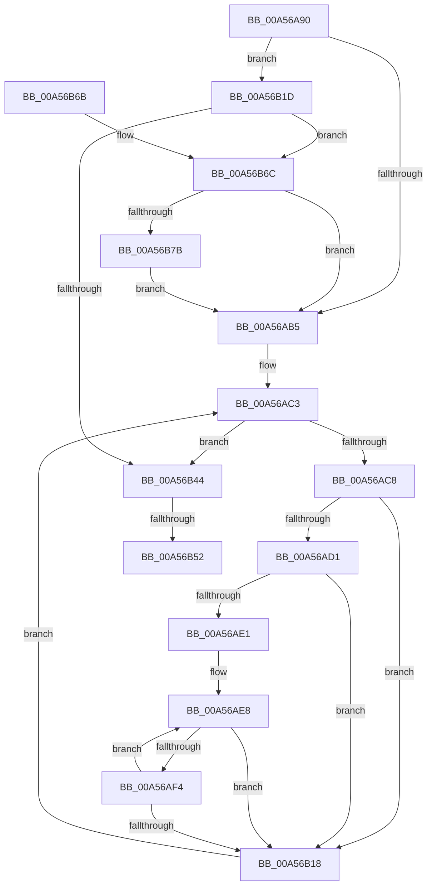

# PpmHeteroComputeMinRelativePerformane

- RVA: `0x00A56A90`–`0x00A56B8A` (길이 `250` bytes)
- VA: `0x0000000140A56A90`
- 실행 섹션: `PAGE`
- PDB 이름 있음: `예`; PDB Function 태그: `예`
- unwind 정보 RVA: `0x000B1554`
- 디코드: `58`개 명령, `250/250` bytes 표시
- 미해석 바이트: `0` (있으면 어셈블리에 `.byte`로 보존)

> 이 문서는 커널 이미지의 기계어와 PDB 기호를 분석해 생성했습니다. 4번과 5번은 함수 원형과 자료형을 바이너리 사용 방식에서 추정한 C 해석이며 원본 소스 복구 결과는 아닙니다.

## 1. Dependencies

- 직접 호출 지점: **2**; 고유 호출 대상: **2**
- 직접 호출자로 확인된 함수: **1**
- RIP 상대 이미지 참조: **5**

### Outgoing calls
- `0x00A56B33` → [ExAllocatePool2](../../poolcode/B8/ExAllocatePool2_function_00B820F0.md) (function, `0x00B820F0`)
- `0x00A56B5D` → [_security_check_cookie](../../text/6A/_security_check_cookie_function_006AC640.md) (function, `0x006AC640`)

### Direct callers
- [PopInitializeHeteroProcessors](PopInitializeHeteroProcessors_function_00A53570.md) at `0x00A5379B`

### Static image references
- `0x00A56A99` → RVA `0x00E0A740` (`.data`; read)
- `0x00A56AAB` → RVA `0x00FC6D80` (`ALMOSTRO`; read)
- `0x00A56AB5` → RVA `0x00FC6BA8` (`ALMOSTRO`; read)
- `0x00A56AD1` → RVA `0x00E0B800` (`.data`; read)
- `0x00A56B38` → RVA `0x00FC6D80` (`ALMOSTRO`; write)

## 2. Other-region calls and transfers

- 다른 실행 섹션으로 향하는 call: **2**
  - `0x00A56B33` → [ExAllocatePool2](../../poolcode/B8/ExAllocatePool2_function_00B820F0.md) (`PAGE` → `POOLCODE`)
  - `0x00A56B5D` → [_security_check_cookie](../../text/6A/_security_check_cookie_function_006AC640.md) (`PAGE` → `.text`)
- call이 아닌 외부 분기/꼬리 이동: **1**
  - `0x00A56B4C` → [sub_00B3D7D8](../B3/Unknown_function_00B3D7D8.md) (`tail-transfer`)

## 3. Assembly (complete function range)

```asm
00A56A90  40 57                           push rdi
00A56A92  48 81 EC 90 00 00 00            sub rsp, 0x90
00A56A99  48 8B 05 A0 3C 3B 00            mov rax, qword ptr [rip + 0x3b3ca0]
00A56AA0  48 33 C4                        xor rax, rsp
00A56AA3  48 89 84 24 80 00 00 00         mov qword ptr [rsp + 0x80], rax
00A56AAB  48 83 3D CD 02 57 00 00         cmp qword ptr [rip + 0x5702cd], 0
00A56AB3  74 68                           je 0x140a56b1d
00A56AB5  48 8B 3D EC 00 57 00            mov rdi, qword ptr [rip + 0x5700ec]
00A56ABC  4C 8D 1D E5 00 57 00            lea r11, [rip + 0x5700e5]
00A56AC3  49 3B FB                        cmp rdi, r11
00A56AC6  74 7C                           je 0x140a56b44
00A56AC8  83 BF 30 01 00 00 00            cmp dword ptr [rdi + 0x130], 0
00A56ACF  75 47                           jne 0x140a56b18
00A56AD1  44 0F B6 0D 27 4D 3B 00         movzx r9d, byte ptr [rip + 0x3b4d27]
00A56AD9  45 33 C0                        xor r8d, r8d
00A56ADC  45 85 C9                        test r9d, r9d
00A56ADF  74 37                           je 0x140a56b18
00A56AE1  4C 8B 15 98 02 57 00            mov r10, qword ptr [rip + 0x570298]
00A56AE8  0F B6 87 2C 01 00 00            movzx eax, byte ptr [rdi + 0x12c]
00A56AEF  44 3B C0                        cmp r8d, eax
00A56AF2  77 24                           ja 0x140a56b18
00A56AF4  41 8B 12                        mov edx, dword ptr [r10]
00A56AF7  48 8B 87 38 01 00 00            mov rax, qword ptr [rdi + 0x138]
00A56AFE  48 8B 08                        mov rcx, qword ptr [rax]
00A56B01  8B 41 40                        mov eax, dword ptr [rcx + 0x40]
00A56B04  3B D0                           cmp edx, eax
00A56B06  0F 43 D0                        cmovae edx, eax
00A56B09  41 FF C0                        inc r8d
00A56B0C  41 89 12                        mov dword ptr [r10], edx
00A56B0F  49 83 C2 04                     add r10, 4
00A56B13  45 3B C1                        cmp r8d, r9d
00A56B16  72 D0                           jb 0x140a56ae8
00A56B18  48 8B 3F                        mov rdi, qword ptr [rdi]
00A56B1B  EB A6                           jmp 0x140a56ac3
00A56B1D  0F B6 15 DC 4C 3B 00            movzx edx, byte ptr [rip + 0x3b4cdc]
00A56B24  B9 40 00 00 00                  mov ecx, 0x40
00A56B29  48 C1 E2 02                     shl rdx, 2
00A56B2D  41 B8 50 50 4D 70               mov r8d, 0x704d5050
00A56B33  E8 B8 B5 12 00                  call 0x140b820f0
00A56B38  48 89 05 41 02 57 00            mov qword ptr [rip + 0x570241], rax
00A56B3F  48 85 C0                        test rax, rax
00A56B42  75 28                           jne 0x140a56b6c
00A56B44  48 83 3D 34 02 57 00 00         cmp qword ptr [rip + 0x570234], 0
00A56B4C  0F 84 86 6C 0E 00               je 0x140b3d7d8
00A56B52  48 8B 8C 24 80 00 00 00         mov rcx, qword ptr [rsp + 0x80]
00A56B5A  48 33 CC                        xor rcx, rsp
00A56B5D  E8 DE 5A C5 FF                  call 0x1406ac640
00A56B62  48 81 C4 90 00 00 00            add rsp, 0x90
00A56B69  5F                              pop rdi
00A56B6A  C3                              ret
00A56B6B  CC                              int3
00A56B6C  0F B6 0D 8D 4C 3B 00            movzx ecx, byte ptr [rip + 0x3b4c8d]
00A56B73  85 C9                           test ecx, ecx
00A56B75  0F 84 3A FF FF FF               je 0x140a56ab5
00A56B7B  48 8B F8                        mov rdi, rax
00A56B7E  B8 00 00 01 00                  mov eax, 0x10000
00A56B83  F3 AB                           rep stosd dword ptr [rdi], eax
00A56B85  E9 2B FF FF FF                  jmp 0x140a56ab5
```

## 4. C-style interpretation (structured pseudocode)

```c
__int64 __fastcall PpmHeteroComputeMinRelativePerformane(__int64 a1, __int64 a2, int a3)
{
    __int64 result;
    __int64 v_r10;
    __int64 v_rsp;
    unsigned __int64 v_stack_m18;

    v_rsp = (v_rsp) - (144);
    result = (*(unsigned __int64 *)(v_rip + 3882144)) ^ (v_rsp);
    v_stack_m18 = result;
    if ((*(unsigned __int64 *)(v_rip + 5702349)) == 0) goto loc_00A56B1D;
loc_00A56AB5:
loc_00A56AC3:
    if ((*(unsigned __int64 *)(v_rip + 5701868)) == (v_rip + 5701861)) goto loc_00A56B44;
    if ((*(unsigned int *)(*(unsigned __int64 *)(v_rip + 5701868) + 304)) != 0) goto loc_00A56B18;
    a3 = 0;
    if ((unsigned int)(*(unsigned __int8 *)(v_rip + 3886375)) == 0) goto loc_00A56B18;
loc_00A56AE8:
    if (0 > ((unsigned int)(*(unsigned __int8 *)(*(unsigned __int64 *)(v_rip + 5701868) + 300)))) goto loc_00A56B18;
    a2 = (unsigned int)(*(unsigned int *)(*(unsigned __int64 *)(v_rip + 5702296)));
    if (((unsigned int)((unsigned int)(*(unsigned int *)(*(unsigned __int64 *)(v_rip + 5702296))))) >= ((unsigned int)((unsigned int)(*(unsigned int *)(*(unsigned __int64 *)(*(unsigned __int64 *)(*(unsigned __int64 *)(v_rip + 5701868) + 312)) + 64))))) { a2 = (unsigned int)((unsigned int)(*(unsigned int *)(*(unsigned __int64 *)(*(unsigned __int64 *)(*(unsigned __int64 *)(v_rip + 5701868) + 312)) + 64))); }
    a3 = (unsigned int)((a3) + 1);
    *(unsigned int *)(*(unsigned __int64 *)(v_rip + 5702296)) = (unsigned int)(a2);
    v_r10 = (*(unsigned __int64 *)(v_rip + 5702296)) + (4);
    if (a3 < ((unsigned int)(*(unsigned __int8 *)(v_rip + 3886375)))) goto loc_00A56AE8;
loc_00A56B18:
    goto loc_00A56AC3;
loc_00A56B1D:
    a2 = (*(unsigned __int8 *)(v_rip + 3886300)) << (2);
    result = ExAllocatePool2(64, a2, (unsigned int)(0x704D5050ULL), *(unsigned __int8 *)(v_rip + 3886375));
    *(unsigned __int64 *)(v_rip + 5702209) = result;
    if (result != 0) goto loc_00A56B6C;
loc_00A56B44:
    a1 = (v_stack_m18) ^ (v_rsp);
    result = _security_check_cookie(a1, a2, (unsigned int)(0x704D5050ULL), *(unsigned __int8 *)(v_rip + 3886375));
    v_rsp = (v_rsp) + (144);
    return result;
loc_00A56B6C:
    if ((unsigned int)(*(unsigned __int8 *)(v_rip + 3886221)) == 0) goto loc_00A56AB5;
    goto loc_00A56AB5;
}
```

## 5. (Beta) C Style

```c
int64_t PpmHeteroComputeMinRelativePerformane(int64_t Arg1, int64_t Arg2, int32_t Arg3)
{
    int64_t result;
    int64_t local_r10;
    int64_t local_rsp;
    uint64_t v_stack_m18;

    local_rsp = (local_rsp) - (144);
    result = (*(uint64_t *)(v_rip + 0x3B3CA0)) ^ (local_rsp);
    v_stack_m18 = result;
    if ((*(uint64_t *)(v_rip + 0x5702CD)) == 0) goto loc_00A56B1D;
loc_00A56AB5:
loc_00A56AC3:
    if ((*(uint64_t *)(v_rip + 0x5700EC)) == (v_rip + 5701861)) goto loc_00A56B44;
    if ((*(uint32_t *)(*(uint64_t *)(v_rip + 0x5700EC) + 0x130)) != 0) goto loc_00A56B18;
    Arg3 = 0;
    if ((uint32_t)(*(uint8_t *)(v_rip + 0x3B4D27)) == 0) goto loc_00A56B18;
loc_00A56AE8:
    if (0 > ((uint32_t)(*(uint8_t *)(*(uint64_t *)(v_rip + 0x5700EC) + 0x12C)))) goto loc_00A56B18;
    Arg2 = (uint32_t)(*(uint32_t *)(*(uint64_t *)(v_rip + 0x570298)));
    if (((uint32_t)((uint32_t)(*(uint32_t *)(*(uint64_t *)(v_rip + 0x570298))))) >= ((uint32_t)((uint32_t)(*(uint32_t *)(*(uint64_t *)(*(uint64_t *)(*(uint64_t *)(v_rip + 0x5700EC) + 0x138)) + 0x40))))) { Arg2 = (uint32_t)((uint32_t)(*(uint32_t *)(*(uint64_t *)(*(uint64_t *)(*(uint64_t *)(v_rip + 0x5700EC) + 0x138)) + 0x40))); }
    Arg3 = (uint32_t)((Arg3) + 1);
    *(uint32_t *)(*(uint64_t *)(v_rip + 0x570298)) = (uint32_t)(Arg2);
    local_r10 = (*(uint64_t *)(v_rip + 0x570298)) + (4);
    if (Arg3 < ((uint32_t)(*(uint8_t *)(v_rip + 0x3B4D27)))) goto loc_00A56AE8;
loc_00A56B18:
    goto loc_00A56AC3;
loc_00A56B1D:
    Arg2 = (*(uint8_t *)(v_rip + 0x3B4CDC)) << (2);
    result = ExAllocatePool2(64, Arg2, (uint32_t)(0x704D5050ULL), *(uint8_t *)(v_rip + 0x3B4D27));
    *(uint64_t *)(v_rip + 0x570241) = result;
    if (result != 0) goto loc_00A56B6C;
loc_00A56B44:
    Arg1 = (v_stack_m18) ^ (local_rsp);
    result = _security_check_cookie(Arg1, Arg2, (uint32_t)(0x704D5050ULL), *(uint8_t *)(v_rip + 0x3B4D27));
    local_rsp = (local_rsp) + (144);
    return result;
loc_00A56B6C:
    if ((uint32_t)(*(uint8_t *)(v_rip + 0x3B4C8D)) == 0) goto loc_00A56AB5;
    goto loc_00A56AB5;
}
```

## 6. Execution-region graph

[열기: 2D/3D 그래프와 함수 탐색 컨트롤 패널](../../../control-panel.html?section=page&rva=0x00A56A90&view=graph)

- 2D 그래프는 위에서 아래로 흐르고, 3D 그래프는 빈 공간을 드래그해 회전합니다. Shift+드래그는 이동, 휠은 확대·축소, 함수 노드 선택은 대상 보고서 이동입니다.

### Static fallback


