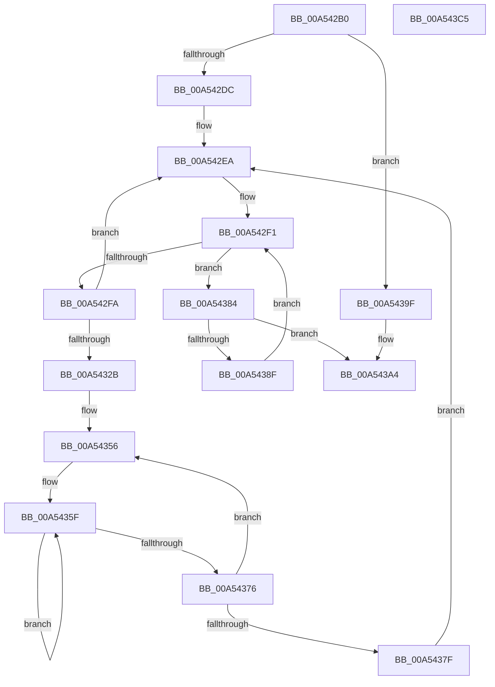

# PpmPerfGetFrequencyBandStats

- RVA: `0x00A542B0`–`0x00A543C6` (길이 `278` bytes)
- VA: `0x0000000140A542B0`
- 실행 섹션: `PAGE`
- PDB 이름 있음: `예`; PDB Function 태그: `아니요`
- unwind 정보 RVA: `0x000701D4`
- 디코드: `72`개 명령, `278/278` bytes 표시
- 미해석 바이트: `0` (있으면 어셈블리에 `.byte`로 보존)

> 이 문서는 커널 이미지의 기계어와 PDB 기호를 분석해 생성했습니다. 4번과 5번은 함수 원형과 자료형을 바이너리 사용 방식에서 추정한 C 해석이며 원본 소스 복구 결과는 아닙니다.

## 1. Dependencies

- 직접 호출 지점: **3**; 고유 호출 대상: **3**
- 직접 호출자로 확인된 함수: **1**
- RIP 상대 이미지 참조: **4**

### Outgoing calls
- `0x00A542CC` → [PpmAcquireLock](../../text/2D/PpmAcquireLock_function_002D9AA4.md) (function, `0x002D9AA4`)
- `0x00A5431A` → [KeGetPrcb](../../text/2D/KeGetPrcb_function_002D85D0.md) (function, `0x002D85D0`)
- `0x00A543AB` → [PpmReleaseLock](../../text/2D/PpmReleaseLock_function_002DA428.md) (function, `0x002DA428`)

### Direct callers
- [PopPowerInformationInternal](../A8/PopPowerInformationInternal_function_00A8B7C0.md) at `0x00A8CAC1`

### Static image references
- `0x00A542C5` → RVA `0x00F0CC00` (`.data`; read)
- `0x00A542DC` → RVA `0x00E0B5A8` (`.data`; read)
- `0x00A542EA` → RVA `0x00E0B5A0` (`.data`; read)
- `0x00A54310` → RVA `0x00F231B8` (`.data`; read)

## 2. Other-region calls and transfers

- 다른 실행 섹션으로 향하는 call: **3**
  - `0x00A542CC` → [PpmAcquireLock](../../text/2D/PpmAcquireLock_function_002D9AA4.md) (`PAGE` → `.text`)
  - `0x00A5431A` → [KeGetPrcb](../../text/2D/KeGetPrcb_function_002D85D0.md) (`PAGE` → `.text`)
  - `0x00A543AB` → [PpmReleaseLock](../../text/2D/PpmReleaseLock_function_002DA428.md) (`PAGE` → `.text`)
- 별도 외부 분기/꼬리 이동을 확인하지 못했습니다.

## 3. Assembly (complete function range)

```asm
00A542B0  48 89 5C 24 10                  mov qword ptr [rsp + 0x10], rbx
00A542B5  48 89 6C 24 18                  mov qword ptr [rsp + 0x18], rbp
00A542BA  56                              push rsi
00A542BB  57                              push rdi
00A542BC  41 56                           push r14
00A542BE  48 83 EC 20                     sub rsp, 0x20
00A542C2  48 8B E9                        mov rbp, rcx
00A542C5  48 8D 0D 34 89 4B 00            lea rcx, [rip + 0x4b8934]
00A542CC  E8 D3 57 88 FF                  call 0x1402d9aa4
00A542D1  33 DB                           xor ebx, ebx
00A542D3  48 85 ED                        test rbp, rbp
00A542D6  0F 84 C3 00 00 00               je 0x140a5439f
00A542DC  48 8B 35 C5 72 3B 00            mov rsi, qword ptr [rip + 0x3b72c5]
00A542E3  44 8D 73 01                     lea r14d, [rbx + 1]
00A542E7  0F B7 FB                        movzx edi, bx
00A542EA  0F B7 0D AF 72 3B 00            movzx ecx, word ptr [rip + 0x3b72af]
00A542F1  48 85 F6                        test rsi, rsi
00A542F4  0F 84 8A 00 00 00               je 0x140a54384
00A542FA  48 0F BC D6                     bsf rdx, rsi
00A542FE  0F B7 CF                        movzx ecx, di
00A54301  0F B6 C2                        movzx eax, dl
00A54304  48 0F B3 C6                     btr rsi, rax
00A54308  C1 E1 06                        shl ecx, 6
00A5430B  0F B6 C2                        movzx eax, dl
00A5430E  03 C8                           add ecx, eax
00A54310  48 8B 05 A1 EE 4C 00            mov rax, qword ptr [rip + 0x4ceea1]
00A54317  8B 0C 88                        mov ecx, dword ptr [rax + rcx*4]
00A5431A  E8 B1 42 88 FF                  call 0x1402d85d0
00A5431F  4C 8B 88 C0 89 00 00            mov r9, qword ptr [rax + 0x89c0]
00A54326  4D 85 C9                        test r9, r9
00A54329  74 BF                           je 0x140a542ea
00A5432B  0F B6 80 08 8A 00 00            movzx eax, byte ptr [rax + 0x8a08]
00A54332  41 8B CE                        mov ecx, r14d
00A54335  41 3A C6                        cmp al, r14b
00A54338  41 BA 30 00 00 00               mov r10d, 0x30
00A5433E  0F 42 C8                        cmovb ecx, eax
00A54341  0F B6 C1                        movzx eax, cl
00A54344  48 8D 0C C0                     lea rcx, [rax + rax*8]
00A54348  48 C1 E1 07                     shl rcx, 7
00A5434C  4C 2B C9                        sub r9, rcx
00A5434F  4C 2B CD                        sub r9, rbp
00A54352  48 8D 14 29                     lea rdx, [rcx + rbp]
00A54356  48 8B CA                        mov rcx, rdx
00A54359  41 B8 03 00 00 00               mov r8d, 3
00A5435F  49 8B 84 09 F8 00 00 00         mov rax, qword ptr [r9 + rcx + 0xf8]
00A54367  48 01 01                        add qword ptr [rcx], rax
00A5436A  48 8D 89 80 01 00 00            lea rcx, [rcx + 0x180]
00A54371  4D 2B C6                        sub r8, r14
00A54374  75 E9                           jne 0x140a5435f
00A54376  48 83 C2 08                     add rdx, 8
00A5437A  4D 2B D6                        sub r10, r14
00A5437D  75 D7                           jne 0x140a54356
00A5437F  E9 66 FF FF FF                  jmp 0x140a542ea
00A54384  66 41 03 FE                     add di, r14w
00A54388  0F B7 FF                        movzx edi, di
00A5438B  3B F9                           cmp edi, ecx
00A5438D  73 15                           jae 0x140a543a4
00A5438F  48 8D 35 12 72 3B 00            lea rsi, [rip + 0x3b7212]
00A54396  48 8B 34 FE                     mov rsi, qword ptr [rsi + rdi*8]
00A5439A  E9 52 FF FF FF                  jmp 0x140a542f1
00A5439F  BB 0D 00 00 C0                  mov ebx, 0xc000000d
00A543A4  48 8D 0D 55 88 4B 00            lea rcx, [rip + 0x4b8855]
00A543AB  E8 78 60 88 FF                  call 0x1402da428
00A543B0  48 8B 6C 24 50                  mov rbp, qword ptr [rsp + 0x50]
00A543B5  8B C3                           mov eax, ebx
00A543B7  48 8B 5C 24 48                  mov rbx, qword ptr [rsp + 0x48]
00A543BC  48 83 C4 20                     add rsp, 0x20
00A543C0  41 5E                           pop r14
00A543C2  5F                              pop rdi
00A543C3  5E                              pop rsi
00A543C4  C3                              ret
00A543C5  CC                              int3
```

## 4. C-style interpretation (structured pseudocode)

```c
__int64 __fastcall PpmPerfGetFrequencyBandStats(__int64 a1)
{
    __int64 result;
    __int64 v_r10;
    __int64 v_rbx;
    __int64 v_rdi;
    __int64 v_rsp;
    unsigned __int64 v_stack_p10;
    unsigned __int64 v_stack_p18;

    v_stack_p10 = v_rbx;
    v_stack_p18 = v_rbp;
    v_rsp = (v_rsp) - (32);
    result = PpmAcquireLock(v_rip + 4950324, a2, a3, a4);
    v_rbx = 0;
    if (a1 == 0) goto loc_00A5439F;
loc_00A542EA:
loc_00A542F1:
    if (*(unsigned __int64 *)(v_rip + 3896005) == 0) goto loc_00A54384;
    a1 = (unsigned int)((0) << (6));
    a1 = (unsigned int)((a1) + ((unsigned int)((unsigned __int8)(a2))));
    result = KeGetPrcb((unsigned int)(*(unsigned int *)(*(unsigned __int64 *)(v_rip + 5041825) + a1 * 4)), a2, a3, a4);
    if (*(unsigned __int64 *)(result + 35264) == 0) goto loc_00A542EA;
    a1 = (unsigned int)((unsigned int)(v_rbx + 1));
    if (((unsigned __int8)(*(unsigned __int8 *)(result + 35336))) < ((unsigned __int8)(v_rbx + 1))) { a1 = (unsigned int)(*(unsigned __int8 *)(result + 35336)); }
    a1 = ((unsigned __int8)(a1) + (unsigned __int8)(a1) * 8) << (7);
    a4 = (*(unsigned __int64 *)(result + 35264)) - (a1);
    a4 = (a4) - (a1);
loc_00A54356:
loc_00A5435F:
    a3 = (3) - (v_rbx + 1);
    if (condition_is_not_equal) goto loc_00A5435F;
    a2 = (a1 + a1 * 1) + (8);
    v_r10 = (48) - (v_rbx + 1);
    if (condition_is_not_equal) goto loc_00A54356;
    goto loc_00A542EA;
loc_00A54384:
    v_rdi = (unsigned __int16)((0) + ((unsigned __int16)(v_rbx + 1)));
    if (((unsigned int)((unsigned __int16)(v_rdi))) >= ((unsigned int)(a1 + a1 * 1 + 384))) goto loc_00A543A4;
    goto loc_00A542F1;
loc_00A5439F:
loc_00A543A4:
    result = PpmReleaseLock(v_rip + 4950101, a2, a3, a4);
    v_rsp = (v_rsp) + (32);
    return (unsigned int)((unsigned int)((unsigned int)(0xC000000DULL)));
}
```

## 5. (Beta) C Style

```c
int64_t PpmPerfGetFrequencyBandStats(int64_t Arg1)
{
    int64_t result;
    int64_t local_r10;
    int64_t local_rbx;
    int64_t local_rdi;
    int64_t local_rsp;
    uint64_t v_stack_p10;
    uint64_t v_stack_p18;

    v_stack_p10 = local_rbx;
    v_stack_p18 = local_rbp;
    local_rsp = (local_rsp) - (32);
    result = PpmAcquireLock(v_rip + 4950324, a2, a3, a4);
    local_rbx = 0;
    if (Arg1 == 0) goto loc_00A5439F;
loc_00A542EA:
loc_00A542F1:
    if (*(uint64_t *)(v_rip + 0x3B72C5) == 0) goto loc_00A54384;
    Arg1 = (uint32_t)((0) << (6));
    Arg1 = (uint32_t)((Arg1) + ((uint32_t)((uint8_t)(a2))));
    result = KeGetPrcb((uint32_t)(*(uint32_t *)(*(uint64_t *)(v_rip + 0x4CEEA1) + Arg1 * 4)), a2, a3, a4);
    if (*(uint64_t *)(result + 0x89C0) == 0) goto loc_00A542EA;
    Arg1 = (uint32_t)((uint32_t)(local_rbx + 1));
    if (((uint8_t)(*(uint8_t *)(result + 0x8A08))) < ((uint8_t)(local_rbx + 1))) { Arg1 = (uint32_t)(*(uint8_t *)(result + 0x8A08)); }
    Arg1 = ((uint8_t)(Arg1) + (uint8_t)(Arg1) * 8) << (7);
    a4 = (*(uint64_t *)(result + 0x89C0)) - (Arg1);
    a4 = (a4) - (Arg1);
loc_00A54356:
loc_00A5435F:
    a3 = (3) - (local_rbx + 1);
    if (condition_is_not_equal) goto loc_00A5435F;
    a2 = (Arg1 + Arg1 * 1) + (8);
    local_r10 = (48) - (local_rbx + 1);
    if (condition_is_not_equal) goto loc_00A54356;
    goto loc_00A542EA;
loc_00A54384:
    local_rdi = (uint16_t)((0) + ((uint16_t)(local_rbx + 1)));
    if (((uint32_t)((uint16_t)(local_rdi))) >= ((uint32_t)(Arg1 + Arg1 * 1 + 384))) goto loc_00A543A4;
    goto loc_00A542F1;
loc_00A5439F:
loc_00A543A4:
    result = PpmReleaseLock(v_rip + 4950101, a2, a3, a4);
    local_rsp = (local_rsp) + (32);
    return (uint32_t)((uint32_t)((uint32_t)(0xC000000DULL)));
}
```

## 6. Execution-region graph

[열기: 2D/3D 그래프와 함수 탐색 컨트롤 패널](../../../control-panel.html?section=page&rva=0x00A542B0&view=graph)

- 2D 그래프는 위에서 아래로 흐르고, 3D 그래프는 빈 공간을 드래그해 회전합니다. Shift+드래그는 이동, 휠은 확대·축소, 함수 노드 선택은 대상 보고서 이동입니다.

### Static fallback


