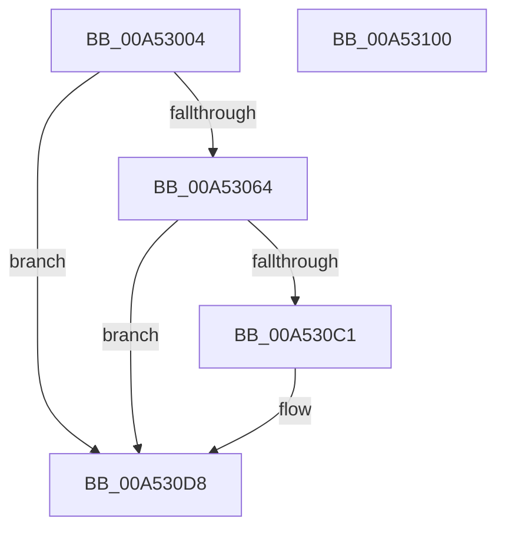

# PpmPostProcessMediaBuffering

- RVA: `0x00A53004`–`0x00A53101` (길이 `253` bytes)
- VA: `0x0000000140A53004`
- 실행 섹션: `PAGE`
- PDB 이름 있음: `예`; PDB Function 태그: `아니요`
- unwind 정보 RVA: `0x000B0DBC`
- 디코드: `59`개 명령, `253/253` bytes 표시
- 미해석 바이트: `0` (있으면 어셈블리에 `.byte`로 보존)

> 이 문서는 커널 이미지의 기계어와 PDB 기호를 분석해 생성했습니다. 4번과 5번은 함수 원형과 자료형을 바이너리 사용 방식에서 추정한 C 해석이며 원본 소스 복구 결과는 아닙니다.

## 1. Dependencies

- 직접 호출 지점: **9**; 고유 호출 대상: **6**
- 직접 호출자로 확인된 함수: **1**
- RIP 상대 이미지 참조: **4**

### Outgoing calls
- `0x00A53042` → [memset](../../text/6C/memset_function_006C6C40.md) (function, `0x006C6C40`)
- `0x00A53050` → [memset](../../text/6C/memset_function_006C6C40.md) (function, `0x006C6C40`)
- `0x00A53055` → [PpmCheckApplyResetNotification](../../text/3B/PpmCheckApplyResetNotification_function_003BE978.md) (function, `0x003BE978`)
- `0x00A53078` → [memset](../../text/6C/memset_function_006C6C40.md) (function, `0x006C6C40`)
- `0x00A53081` → [PoCopyDeepIdleMask](../../text/3C/PoCopyDeepIdleMask_function_003C04C8.md) (function, `0x003C04C8`)
- `0x00A5309D` → [memset](../../text/6C/memset_function_006C6C40.md) (function, `0x006C6C40`)
- `0x00A530B8` → [KiSubtractAffinityEx](../../text/2D/KiSubtractAffinityEx_function_002D61E8.md) (function, `0x002D61E8`)
- `0x00A530D3` → [PopExecuteOnTargetProcessors](../../text/2D/PopExecuteOnTargetProcessors_function_002DD834.md) (function, `0x002DD834`)
- `0x00A530E2` → [_security_check_cookie](../../text/6A/_security_check_cookie_function_006AC640.md) (function, `0x006AC640`)

### Direct callers
- [PpmApplyProfile](PpmApplyProfile_function_00A52B08.md) at `0x00A52CDC`

### Static image references
- `0x00A53022` → RVA `0x00E0A740` (`.data`; read)
- `0x00A5305A` → RVA `0x00FC6AD0` (`ALMOSTRO`; read)
- `0x00A530B1` → RVA `0x00FC7120` (`ALMOSTRO`; read)
- `0x00A530C4` → RVA `0x004B3430` (`PpmResetInterruptRate`; read)

## 2. Other-region calls and transfers

- 다른 실행 섹션으로 향하는 call: **9**
  - `0x00A53042` → [memset](../../text/6C/memset_function_006C6C40.md) (`PAGE` → `.text`)
  - `0x00A53050` → [memset](../../text/6C/memset_function_006C6C40.md) (`PAGE` → `.text`)
  - `0x00A53055` → [PpmCheckApplyResetNotification](../../text/3B/PpmCheckApplyResetNotification_function_003BE978.md) (`PAGE` → `.text`)
  - `0x00A53078` → [memset](../../text/6C/memset_function_006C6C40.md) (`PAGE` → `.text`)
  - `0x00A53081` → [PoCopyDeepIdleMask](../../text/3C/PoCopyDeepIdleMask_function_003C04C8.md) (`PAGE` → `.text`)
  - `0x00A5309D` → [memset](../../text/6C/memset_function_006C6C40.md) (`PAGE` → `.text`)
  - `0x00A530B8` → [KiSubtractAffinityEx](../../text/2D/KiSubtractAffinityEx_function_002D61E8.md) (`PAGE` → `.text`)
  - `0x00A530D3` → [PopExecuteOnTargetProcessors](../../text/2D/PopExecuteOnTargetProcessors_function_002DD834.md) (`PAGE` → `.text`)
  - `0x00A530E2` → [_security_check_cookie](../../text/6A/_security_check_cookie_function_006AC640.md) (`PAGE` → `.text`)
- 별도 외부 분기/꼬리 이동을 확인하지 못했습니다.

## 3. Assembly (complete function range)

```asm
00A53004  48 8B C4                        mov rax, rsp
00A53007  48 89 58 08                     mov qword ptr [rax + 8], rbx
00A5300B  48 89 70 10                     mov qword ptr [rax + 0x10], rsi
00A5300F  48 89 78 18                     mov qword ptr [rax + 0x18], rdi
00A53013  55                              push rbp
00A53014  48 8D A8 A8 FE FF FF            lea rbp, [rax - 0x158]
00A5301B  48 81 EC 50 02 00 00            sub rsp, 0x250
00A53022  48 8B 05 17 77 3B 00            mov rax, qword ptr [rip + 0x3b7717]
00A53029  48 33 C4                        xor rax, rsp
00A5302C  48 89 85 40 01 00 00            mov qword ptr [rbp + 0x140], rax
00A53033  BE 00 01 00 00                  mov esi, 0x100
00A53038  48 8D 4C 24 28                  lea rcx, [rsp + 0x28]
00A5303D  44 8B C6                        mov r8d, esi
00A53040  33 D2                           xor edx, edx
00A53042  E8 F9 3B C7 FF                  call 0x1406c6c40
00A53047  44 8B C6                        mov r8d, esi
00A5304A  48 8D 4D 38                     lea rcx, [rbp + 0x38]
00A5304E  33 D2                           xor edx, edx
00A53050  E8 EB 3B C7 FF                  call 0x1406c6c40
00A53055  E8 1E B9 96 FF                  call 0x1403be978
00A5305A  48 83 3D 6E 3A 57 00 00         cmp qword ptr [rip + 0x573a6e], 0
00A53062  74 74                           je 0x140a530d8
00A53064  83 65 34 00                     and dword ptr [rbp + 0x34], 0
00A53068  48 8D 4D 38                     lea rcx, [rbp + 0x38]
00A5306C  44 8B C6                        mov r8d, esi
00A5306F  C7 45 30 01 00 20 00            mov dword ptr [rbp + 0x30], 0x200001
00A53076  33 D2                           xor edx, edx
00A53078  E8 C3 3B C7 FF                  call 0x1406c6c40
00A5307D  48 8D 4D 30                     lea rcx, [rbp + 0x30]
00A53081  E8 42 D4 96 FF                  call 0x1403c04c8
00A53086  83 64 24 24 00                  and dword ptr [rsp + 0x24], 0
00A5308B  48 8D 4C 24 28                  lea rcx, [rsp + 0x28]
00A53090  44 8B C6                        mov r8d, esi
00A53093  C7 44 24 20 01 00 20 00         mov dword ptr [rsp + 0x20], 0x200001
00A5309B  33 D2                           xor edx, edx
00A5309D  E8 9E 3B C7 FF                  call 0x1406c6c40
00A530A2  44 0F B7 4C 24 22               movzx r9d, word ptr [rsp + 0x22]
00A530A8  4C 8D 44 24 20                  lea r8, [rsp + 0x20]
00A530AD  48 8D 55 30                     lea rdx, [rbp + 0x30]
00A530B1  48 8D 0D 68 40 57 00            lea rcx, [rip + 0x574068]
00A530B8  E8 2B 31 88 FF                  call 0x1402d61e8
00A530BD  85 C0                           test eax, eax
00A530BF  74 17                           je 0x140a530d8
00A530C1  45 33 C9                        xor r9d, r9d
00A530C4  48 8D 15 65 03 A6 FF            lea rdx, [rip - 0x59fc9b]
00A530CB  45 33 C0                        xor r8d, r8d
00A530CE  48 8D 4C 24 20                  lea rcx, [rsp + 0x20]
00A530D3  E8 5C A7 88 FF                  call 0x1402dd834
00A530D8  48 8B 8D 40 01 00 00            mov rcx, qword ptr [rbp + 0x140]
00A530DF  48 33 CC                        xor rcx, rsp
00A530E2  E8 59 95 C5 FF                  call 0x1406ac640
00A530E7  4C 8D 9C 24 50 02 00 00         lea r11, [rsp + 0x250]
00A530EF  49 8B 5B 10                     mov rbx, qword ptr [r11 + 0x10]
00A530F3  49 8B 73 18                     mov rsi, qword ptr [r11 + 0x18]
00A530F7  49 8B 7B 20                     mov rdi, qword ptr [r11 + 0x20]
00A530FB  49 8B E3                        mov rsp, r11
00A530FE  5D                              pop rbp
00A530FF  C3                              ret
00A53100  CC                              int3
```

## 4. C-style interpretation (structured pseudocode)

```c
__int64 __fastcall PpmPostProcessMediaBuffering(__int64 a1, int a2)
{
    __int64 result;
    __int64 v_rsp;
    unsigned __int64 v_stack_m230;
    unsigned int v_stack_m234;
    unsigned __int16 v_stack_m236;
    unsigned int v_stack_m238;
    unsigned __int64 v_stack_m8;

    *(unsigned __int64 *)(v_rsp + 8) = v_rbx;
    *(unsigned __int64 *)(v_rsp + 16) = v_rsi;
    *(unsigned __int64 *)(v_rsp + 24) = v_rdi;
    v_rsp = (v_rsp) - (592);
    result = (*(unsigned __int64 *)(v_rip + 3897111)) ^ (v_rsp);
    *(unsigned __int64 *)(v_rsp - 344 + 320) = result;
    a2 = 0;
    result = memset(v_stack_m230, a2, 256, a4);
    a2 = 0;
    result = memset(v_rsp - 344 + 56, a2, 256, a4);
    result = PpmCheckApplyResetNotification(v_rsp - 344 + 56, a2, 256, a4);
    if ((*(unsigned __int64 *)(v_rip + 5716590)) == 0) goto loc_00A530D8;
    *(unsigned int *)(v_rsp - 344 + 48) = 0x200001ULL;
    a2 = 0;
    result = memset(v_rsp - 344 + 56, a2, 256, a4);
    result = PoCopyDeepIdleMask(v_rsp - 344 + 48, a2, 256, a4);
    v_stack_m238 = 0x200001ULL;
    a2 = 0;
    result = memset(v_stack_m230, a2, 256, a4);
    result = KiSubtractAffinityEx(v_rip + 5718120, v_rsp - 344 + 48, v_stack_m238, v_stack_m236);
    if ((unsigned int)(result) != 0) {
        a4 = 0;
        a2 = v_rip - 5897371;
        a3 = 0;
        a1 = v_stack_m238;
        result = PopExecuteOnTargetProcessors(a1, a2, a3, a4);
    }
    a1 = (*(unsigned __int64 *)(v_rsp - 344 + 320)) ^ (v_rsp);
    result = _security_check_cookie(a1, a2, a3, a4);
    return result;
}
```

## 5. (Beta) C Style

```c
int64_t PpmPostProcessMediaBuffering(int64_t Arg1, int32_t Arg2)
{
    int64_t result;
    int64_t local_rsp;
    uint64_t v_stack_m230;
    uint32_t v_stack_m234;
    uint16_t v_stack_m236;
    uint32_t v_stack_m238;
    uint64_t v_stack_m8;

    *(uint64_t *)(local_rsp + 0x8) = local_rbx;
    *(uint64_t *)(local_rsp + 0x10) = local_rsi;
    *(uint64_t *)(local_rsp + 0x18) = local_rdi;
    local_rsp = (local_rsp) - (592);
    result = (*(uint64_t *)(v_rip + 0x3B7717)) ^ (local_rsp);
    *(uint64_t *)(local_rsp - 0x158 + 0x140) = result;
    Arg2 = 0;
    result = memset(v_stack_m230, Arg2, 256, a4);
    Arg2 = 0;
    result = memset(local_rsp - 344 + 56, Arg2, 256, a4);
    result = PpmCheckApplyResetNotification(local_rsp - 344 + 56, Arg2, 256, a4);
    if ((*(uint64_t *)(v_rip + 0x573A6E)) == 0) goto loc_00A530D8;
    *(uint32_t *)(local_rsp - 0x158 + 0x30) = 0x200001ULL;
    Arg2 = 0;
    result = memset(local_rsp - 344 + 56, Arg2, 256, a4);
    result = PoCopyDeepIdleMask(local_rsp - 344 + 48, Arg2, 256, a4);
    v_stack_m238 = 0x200001ULL;
    Arg2 = 0;
    result = memset(v_stack_m230, Arg2, 256, a4);
    result = KiSubtractAffinityEx(v_rip + 5718120, local_rsp - 344 + 48, v_stack_m238, v_stack_m236);
    if ((uint32_t)(result) != 0) {
        a4 = 0;
        Arg2 = v_rip - 5897371;
        a3 = 0;
        Arg1 = v_stack_m238;
        result = PopExecuteOnTargetProcessors(Arg1, Arg2, a3, a4);
    }
    Arg1 = (*(uint64_t *)(local_rsp - 0x158 + 0x140)) ^ (local_rsp);
    result = _security_check_cookie(Arg1, Arg2, a3, a4);
    return result;
}
```

## 6. Execution-region graph

[열기: 2D/3D 그래프와 함수 탐색 컨트롤 패널](../../../control-panel.html?section=page&rva=0x00A53004&view=graph)

- 2D 그래프는 위에서 아래로 흐르고, 3D 그래프는 빈 공간을 드래그해 회전합니다. Shift+드래그는 이동, 휠은 확대·축소, 함수 노드 선택은 대상 보고서 이동입니다.

### Static fallback


