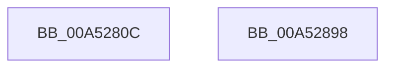

# PpmProfileAcDcUpdate

- RVA: `0x00A5280C`–`0x00A52899` (길이 `141` bytes)
- VA: `0x0000000140A5280C`
- 실행 섹션: `PAGE`
- PDB 이름 있음: `예`; PDB Function 태그: `아니요`
- unwind 정보 RVA: `0x000AB2E4`
- 디코드: `31`개 명령, `141/141` bytes 표시
- 미해석 바이트: `0` (있으면 어셈블리에 `.byte`로 보존)

> 이 문서는 커널 이미지의 기계어와 PDB 기호를 분석해 생성했습니다. 4번과 5번은 함수 원형과 자료형을 바이너리 사용 방식에서 추정한 C 해석이며 원본 소스 복구 결과는 아닙니다.

## 1. Dependencies

- 직접 호출 지점: **4**; 고유 호출 대상: **4**
- 직접 호출자로 확인된 함수: **1**
- RIP 상대 이미지 참조: **6**

### Outgoing calls
- `0x00A5282F` → [PpmAcquireLock](../../text/2D/PpmAcquireLock_function_002D9AA4.md) (function, `0x002D9AA4`)
- `0x00A5283B` → [PopAcquireRwLockExclusive](../../text/43/PopAcquireRwLockExclusive_function_00430B44.md) (function, `0x00430B44`)
- `0x00A52880` → [PpmCompareAndApplyPolicySettings](PpmCompareAndApplyPolicySettings_function_00A52CEC.md) (function, `0x00A52CEC`)
- `0x00A5288D` → [_security_check_cookie](../../text/6A/_security_check_cookie_function_006AC640.md) (function, `0x006AC640`)

### Direct callers
- [PopBatteryApplyCompositeState](../AE/PopBatteryApplyCompositeState_function_00AE0CD0.md) at `0x00AE0D57`

### Static image references
- `0x00A52812` → RVA `0x00E0A740` (`.data`; read)
- `0x00A52821` → RVA `0x00F0CE0C` (`.data`; read)
- `0x00A52828` → RVA `0x00F0CC00` (`.data`; read)
- `0x00A52834` → RVA `0x00F0CA70` (`.data`; read)
- `0x00A52840` → RVA `0x00E08380` (`.data`; read)
- `0x00A52847` → RVA `0x00F0B200` (`.data`; read)

## 2. Other-region calls and transfers

- 다른 실행 섹션으로 향하는 call: **3**
  - `0x00A5282F` → [PpmAcquireLock](../../text/2D/PpmAcquireLock_function_002D9AA4.md) (`PAGE` → `.text`)
  - `0x00A5283B` → [PopAcquireRwLockExclusive](../../text/43/PopAcquireRwLockExclusive_function_00430B44.md) (`PAGE` → `.text`)
  - `0x00A5288D` → [_security_check_cookie](../../text/6A/_security_check_cookie_function_006AC640.md) (`PAGE` → `.text`)
- 별도 외부 분기/꼬리 이동을 확인하지 못했습니다.

## 3. Assembly (complete function range)

```asm
00A5280C  40 53                           push rbx
00A5280E  48 83 EC 40                     sub rsp, 0x40
00A52812  48 8B 05 27 7F 3B 00            mov rax, qword ptr [rip + 0x3b7f27]
00A52819  48 33 C4                        xor rax, rsp
00A5281C  48 89 44 24 30                  mov qword ptr [rsp + 0x30], rax
00A52821  48 63 1D E4 A5 4B 00            movsxd rbx, dword ptr [rip + 0x4ba5e4]
00A52828  48 8D 0D D1 A3 4B 00            lea rcx, [rip + 0x4ba3d1]
00A5282F  E8 70 72 88 FF                  call 0x1402d9aa4
00A52834  48 8D 0D 35 A2 4B 00            lea rcx, [rip + 0x4ba235]
00A5283B  E8 04 E3 9D FF                  call 0x140430b44
00A52840  4C 8B 0D 39 5B 3B 00            mov r9, qword ptr [rip + 0x3b5b39]
00A52847  0F 10 05 B2 89 4B 00            movups xmm0, xmmword ptr [rip + 0x4b89b2]
00A5284E  48 69 CB E8 01 00 00            imul rcx, rbx, 0x1e8
00A52855  F3 0F 7F 44 24 20               movdqu xmmword ptr [rsp + 0x20], xmm0
00A5285B  4D 8D 41 28                     lea r8, [r9 + 0x28]
00A5285F  4C 03 C1                        add r8, rcx
00A52862  48 8D 4C 24 20                  lea rcx, [rsp + 0x20]
00A52867  F7 DB                           neg ebx
00A52869  48 1B D2                        sbb rdx, rdx
00A5286C  48 81 E2 18 FE FF FF            and rdx, 0xfffffffffffffe18
00A52873  48 81 C2 10 02 00 00            add rdx, 0x210
00A5287A  49 03 D1                        add rdx, r9
00A5287D  41 B1 01                        mov r9b, 1
00A52880  E8 67 04 00 00                  call 0x140a52cec
00A52885  48 8B 4C 24 30                  mov rcx, qword ptr [rsp + 0x30]
00A5288A  48 33 CC                        xor rcx, rsp
00A5288D  E8 AE 9D C5 FF                  call 0x1406ac640
00A52892  48 83 C4 40                     add rsp, 0x40
00A52896  5B                              pop rbx
00A52897  C3                              ret
00A52898  CC                              int3
```

## 4. C-style interpretation (structured pseudocode)

```c
__int64 __fastcall PpmProfileAcDcUpdate(__int64 a1, __int64 a2)
{
    __int64 result;
    __int64 v_rbx;
    __int64 v_rsp;
    unsigned __int64 v_stack_m18;
    unsigned __int64 v_stack_m28;

    v_rsp = (v_rsp) - (64);
    result = (*(unsigned __int64 *)(v_rip + 3899175)) ^ (v_rsp);
    v_stack_m18 = result;
    result = PpmAcquireLock(v_rip + 4957137, a2, a3, a4);
    result = PopAcquireRwLockExclusive(v_rip + 4956725, a2, a3, a4);
    a1 = (v_rip + 4956725) * ((int)(*(unsigned int *)(v_rip + 4957668)));
    v_stack_m28 = v_xmm0;
    a3 = (*(unsigned __int64 *)(v_rip + 3889977) + 40) + (a1);
    v_rbx = (unsigned int)(-((int)(*(unsigned int *)(v_rip + 4957668))));
    a2 = (a2) & (-488);
    a2 = (a2) + (528);
    a2 = (a2) + (*(unsigned __int64 *)(v_rip + 3889977));
    result = PpmCompareAndApplyPolicySettings(v_stack_m28, a2, a3, 1);
    a1 = (v_stack_m18) ^ (v_rsp);
    result = _security_check_cookie(a1, a2, a3, 1);
    v_rsp = (v_rsp) + (64);
    return result;
}
```

## 5. (Beta) C Style

```c
int64_t PpmProfileAcDcUpdate(int64_t Arg1, int64_t Arg2)
{
    int64_t result;
    int64_t local_rbx;
    int64_t local_rsp;
    uint64_t v_stack_m18;
    uint64_t v_stack_m28;

    local_rsp = (local_rsp) - (64);
    result = (*(uint64_t *)(v_rip + 0x3B7F27)) ^ (local_rsp);
    v_stack_m18 = result;
    result = PpmAcquireLock(v_rip + 4957137, Arg2, a3, a4);
    result = PopAcquireRwLockExclusive(v_rip + 4956725, Arg2, a3, a4);
    Arg1 = (v_rip + 4956725) * ((int32_t)(*(uint32_t *)(v_rip + 0x4BA5E4)));
    v_stack_m28 = v_xmm0;
    a3 = (*(uint64_t *)(v_rip + 0x3B5B39) + 40) + (Arg1);
    local_rbx = (uint32_t)(-((int32_t)(*(uint32_t *)(v_rip + 0x4BA5E4))));
    Arg2 = (Arg2) & (-488);
    Arg2 = (Arg2) + (528);
    Arg2 = (Arg2) + (*(uint64_t *)(v_rip + 0x3B5B39));
    result = PpmCompareAndApplyPolicySettings(v_stack_m28, Arg2, a3, 1);
    Arg1 = (v_stack_m18) ^ (local_rsp);
    result = _security_check_cookie(Arg1, Arg2, a3, 1);
    local_rsp = (local_rsp) + (64);
    return result;
}
```

## 6. Execution-region graph

[열기: 2D/3D 그래프와 함수 탐색 컨트롤 패널](../../../control-panel.html?section=page&rva=0x00A5280C&view=graph)

- 2D 그래프는 위에서 아래로 흐르고, 3D 그래프는 빈 공간을 드래그해 회전합니다. Shift+드래그는 이동, 휠은 확대·축소, 함수 노드 선택은 대상 보고서 이동입니다.

### Static fallback


