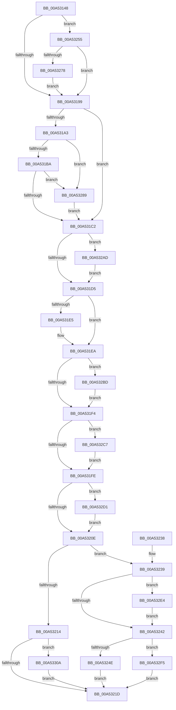

# PpmReapplyPerfPolicy

- RVA: `0x00A53148`–`0x00A5331B` (길이 `467` bytes)
- VA: `0x0000000140A53148`
- 실행 섹션: `PAGE`
- PDB 이름 있음: `예`; PDB Function 태그: `아니요`
- unwind 정보 RVA: `0x000B0DE0`
- 디코드: `114`개 명령, `467/467` bytes 표시
- 미해석 바이트: `0` (있으면 어셈블리에 `.byte`로 보존)

> 이 문서는 커널 이미지의 기계어와 PDB 기호를 분석해 생성했습니다. 4번과 5번은 함수 원형과 자료형을 바이너리 사용 방식에서 추정한 C 해석이며 원본 소스 복구 결과는 아닙니다.

## 1. Dependencies

- 직접 호출 지점: **11**; 고유 호출 대상: **11**
- 직접 호출자로 확인된 함수: **4**
- RIP 상대 이미지 참조: **10**

### Outgoing calls
- `0x00A531A9` → [PopInitializeHeteroProcessors](PopInitializeHeteroProcessors_function_00A53570.md) (function, `0x00A53570`)
- `0x00A531DA` → [PpmUpdateProcessorPolicy](PpmUpdateProcessorPolicy_function_00A53324.md) (function, `0x00A53324`)
- `0x00A531E5` → [PpmParkApplyPolicy](../../text/4B/PpmParkApplyPolicy_function_004B613C.md) (function, `0x004B613C`)
- `0x00A5324E` → [PpmCheckApplyParkConstraints](../../text/3B/PpmCheckApplyParkConstraints_function_003BE994.md) (function, `0x003BE994`)
- `0x00A532B3` → [PpmHeteroHgsCheckContainmentDecision](../../text/3B/PpmHeteroHgsCheckContainmentDecision_function_003BEFF8.md) (function, `0x003BEFF8`)
- `0x00A532BD` → [PpmPerfResizeHistoryAll](../75/PpmPerfResizeHistoryAll_function_0075ADF8.md) (function, `0x0075ADF8`)
- `0x00A532C7` → [PpmCheckReInit](../A8/PpmCheckReInit_function_00A84DD8.md) (function, `0x00A84DD8`)
- `0x00A532DA` → [PpmPerfUpdateDomainPolicy](../A9/PpmPerfUpdateDomainPolicy_function_00A97030.md) (function, `0x00A97030`)
- `0x00A532EB` → [PpmAcquireLock](../../text/2D/PpmAcquireLock_function_002D9AA4.md) (function, `0x002D9AA4`)
- `0x00A53300` → [PpmCheckInitProcessors](../A8/PpmCheckInitProcessors_function_00A84AE8.md) (function, `0x00A84AE8`)
- `0x00A53311` → [PpmReleaseLock](../../text/2D/PpmReleaseLock_function_002DA428.md) (function, `0x002DA428`)

### Direct callers
- [PpmPerfProcCapFloorSettingCallback](../76/PpmPerfProcCapFloorSettingCallback_function_007641B0.md) at `0x00764264`
- [PpmInfoApplySettingUpdate](../91/PpmInfoApplySettingUpdate_function_009160A8.md) at `0x00916133`
- [PpmCompareAndApplyPolicySettings](PpmCompareAndApplyPolicySettings_function_00A52CEC.md) at `0x00A52EC2`
- [PpmReinitializeHeteroEngine](PpmReinitializeHeteroEngine_function_00A53108.md) at `0x00A53136`

### Static image references
- `0x00A53161` → RVA `0x00E08380` (`.data`; read)
- `0x00A5316B` → RVA `0x00F0CE0C` (`.data`; read)
- `0x00A5318D` → RVA `0x00FC5274` (`ALMOSTRO`; read)
- `0x00A531C9` → RVA `0x00FC5188` (`ALMOSTRO`; read)
- `0x00A53255` → RVA `0x00FC6B40` (`ALMOSTRO`; read)
- `0x00A5325D` → RVA `0x00FC5274` (`ALMOSTRO`; write)
- `0x00A5326C` → RVA `0x00FC5038` (`ALMOSTRO`; read)
- `0x00A53278` → RVA `0x00FC5038` (`ALMOSTRO`; write)
- `0x00A532AD` → RVA `0x00FC5188` (`ALMOSTRO`; write)
- `0x00A532E4` → RVA `0x00F0CC00` (`.data`; read)

## 2. Other-region calls and transfers

- 다른 실행 섹션으로 향하는 call: **5**
  - `0x00A531E5` → [PpmParkApplyPolicy](../../text/4B/PpmParkApplyPolicy_function_004B613C.md) (`PAGE` → `.text`)
  - `0x00A5324E` → [PpmCheckApplyParkConstraints](../../text/3B/PpmCheckApplyParkConstraints_function_003BE994.md) (`PAGE` → `.text`)
  - `0x00A532B3` → [PpmHeteroHgsCheckContainmentDecision](../../text/3B/PpmHeteroHgsCheckContainmentDecision_function_003BEFF8.md) (`PAGE` → `.text`)
  - `0x00A532EB` → [PpmAcquireLock](../../text/2D/PpmAcquireLock_function_002D9AA4.md) (`PAGE` → `.text`)
  - `0x00A53311` → [PpmReleaseLock](../../text/2D/PpmReleaseLock_function_002DA428.md) (`PAGE` → `.text`)
- 별도 외부 분기/꼬리 이동을 확인하지 못했습니다.

## 3. Assembly (complete function range)

```asm
00A53148  48 8B C4                        mov rax, rsp
00A5314B  48 89 58 08                     mov qword ptr [rax + 8], rbx
00A5314F  48 89 68 10                     mov qword ptr [rax + 0x10], rbp
00A53153  48 89 70 18                     mov qword ptr [rax + 0x18], rsi
00A53157  48 89 78 20                     mov qword ptr [rax + 0x20], rdi
00A5315B  41 56                           push r14
00A5315D  48 83 EC 20                     sub rsp, 0x20
00A53161  48 8B 3D 18 52 3B 00            mov rdi, qword ptr [rip + 0x3b5218]
00A53168  45 33 F6                        xor r14d, r14d
00A5316B  48 63 05 9A 9C 4B 00            movsxd rax, dword ptr [rip + 0x4b9c9a]
00A53172  48 8B D9                        mov rbx, rcx
00A53175  48 69 F0 E8 01 00 00            imul rsi, rax, 0x1e8
00A5317C  41 8A EE                        mov bpl, r14b
00A5317F  8B 8C 3E F4 01 00 00            mov ecx, dword ptr [rsi + rdi + 0x1f4]
00A53186  83 F9 04                        cmp ecx, 4
00A53189  41 0F 47 CE                     cmova ecx, r14d
00A5318D  3B 0D E1 20 57 00               cmp ecx, dword ptr [rip + 0x5720e1]
00A53193  0F 85 BC 00 00 00               jne 0x140a53255
00A53199  8B 0B                           mov ecx, dword ptr [rbx]
00A5319B  F7 C1 00 18 00 00               test ecx, 0x1800
00A531A1  74 1F                           je 0x140a531c2
00A531A3  C1 E9 0B                        shr ecx, 0xb
00A531A6  80 E1 01                        and cl, 1
00A531A9  E8 C2 03 00 00                  call 0x140a53570
00A531AE  8B 13                           mov edx, dword ptr [rbx]
00A531B0  0F BA E2 0B                     bt edx, 0xb
00A531B4  0F 82 CF 00 00 00               jb 0x140a53289
00A531BA  84 C0                           test al, al
00A531BC  0F 85 C7 00 00 00               jne 0x140a53289
00A531C2  8B 84 3E 08 02 00 00            mov eax, dword ptr [rsi + rdi + 0x208]
00A531C9  3B 05 B9 1F 57 00               cmp eax, dword ptr [rip + 0x571fb9]
00A531CF  0F 85 D8 00 00 00               jne 0x140a532ad
00A531D5  33 D2                           xor edx, edx
00A531D7  48 8B CB                        mov rcx, rbx
00A531DA  E8 45 01 00 00                  call 0x140a53324
00A531DF  8B 03                           mov eax, dword ptr [rbx]
00A531E1  A8 04                           test al, 4
00A531E3  74 05                           je 0x140a531ea
00A531E5  E8 52 2F A6 FF                  call 0x1404b613c
00A531EA  8B 03                           mov eax, dword ptr [rbx]
00A531EC  A8 10                           test al, 0x10
00A531EE  0F 85 C9 00 00 00               jne 0x140a532bd
00A531F4  8B 03                           mov eax, dword ptr [rbx]
00A531F6  A8 08                           test al, 8
00A531F8  0F 85 C9 00 00 00               jne 0x140a532c7
00A531FE  8B 03                           mov eax, dword ptr [rbx]
00A53200  40 B7 01                        mov dil, 1
00A53203  41 8A F6                        mov sil, r14b
00A53206  A8 02                           test al, 2
00A53208  0F 85 C3 00 00 00               jne 0x140a532d1
00A5320E  8B 03                           mov eax, dword ptr [rbx]
00A53210  A8 04                           test al, 4
00A53212  75 25                           jne 0x140a53239
00A53214  40 84 FF                        test dil, dil
00A53217  0F 85 ED 00 00 00               jne 0x140a5330a
00A5321D  48 8B 5C 24 30                  mov rbx, qword ptr [rsp + 0x30]
00A53222  48 8B 6C 24 38                  mov rbp, qword ptr [rsp + 0x38]
00A53227  48 8B 74 24 40                  mov rsi, qword ptr [rsp + 0x40]
00A5322C  48 8B 7C 24 48                  mov rdi, qword ptr [rsp + 0x48]
00A53231  48 83 C4 20                     add rsp, 0x20
00A53235  41 5E                           pop r14
00A53237  C3                              ret
00A53238  CC                              int3
00A53239  40 84 F6                        test sil, sil
00A5323C  0F 85 A2 00 00 00               jne 0x140a532e4
00A53242  8B 13                           mov edx, dword ptr [rbx]
00A53244  0F BA E2 0D                     bt edx, 0xd
00A53248  0F 82 A7 00 00 00               jb 0x140a532f5
00A5324E  E8 41 B7 96 FF                  call 0x1403be994
00A53253  EB C8                           jmp 0x140a5321d
00A53255  8B 05 E5 38 57 00               mov eax, dword ptr [rip + 0x5738e5]
00A5325B  FF C8                           dec eax
00A5325D  89 0D 11 20 57 00               mov dword ptr [rip + 0x572011], ecx
00A53263  A9 FA FF FF FF                  test eax, 0xfffffffa
00A53268  41 0F 45 CE                     cmovne ecx, r14d
00A5326C  3B 0D C6 1D 57 00               cmp ecx, dword ptr [rip + 0x571dc6]
00A53272  0F 84 21 FF FF FF               je 0x140a53199
00A53278  89 0D BA 1D 57 00               mov dword ptr [rip + 0x571dba], ecx
00A5327E  81 0B 00 48 00 00               or dword ptr [rbx], 0x4800
00A53284  E9 10 FF FF FF                  jmp 0x140a53199
00A53289  81 CA 08 20 00 00               or edx, 0x2008
00A5328F  40 B5 01                        mov bpl, 1
00A53292  8B C2                           mov eax, edx
00A53294  8B CA                           mov ecx, edx
00A53296  83 C8 02                        or eax, 2
00A53299  83 E2 FD                        and edx, 0xfffffffd
00A5329C  0F BA E1 0F                     bt ecx, 0xf
00A532A0  0F 43 D0                        cmovae edx, eax
00A532A3  83 CA 04                        or edx, 4
00A532A6  89 13                           mov dword ptr [rbx], edx
00A532A8  E9 15 FF FF FF                  jmp 0x140a531c2
00A532AD  89 05 D5 1E 57 00               mov dword ptr [rip + 0x571ed5], eax
00A532B3  E8 40 BD 96 FF                  call 0x1403beff8
00A532B8  E9 18 FF FF FF                  jmp 0x140a531d5
00A532BD  E8 36 7B D0 FF                  call 0x14075adf8
00A532C2  E9 2D FF FF FF                  jmp 0x140a531f4
00A532C7  E8 0C 1B 03 00                  call 0x140a84dd8
00A532CC  E9 2D FF FF FF                  jmp 0x140a531fe
00A532D1  40 8A CD                        mov cl, bpl
00A532D4  41 8A FE                        mov dil, r14b
00A532D7  40 B6 01                        mov sil, 1
00A532DA  E8 51 3D 04 00                  call 0x140a97030
00A532DF  E9 2A FF FF FF                  jmp 0x140a5320e
00A532E4  48 8D 0D 15 99 4B 00            lea rcx, [rip + 0x4b9915]
00A532EB  E8 B4 67 88 FF                  call 0x1402d9aa4
00A532F0  E9 4D FF FF FF                  jmp 0x140a53242
00A532F5  C1 EA 0E                        shr edx, 0xe
00A532F8  B9 01 00 00 00                  mov ecx, 1
00A532FD  83 E2 01                        and edx, 1
00A53300  E8 E3 17 03 00                  call 0x140a84ae8
00A53305  E9 13 FF FF FF                  jmp 0x140a5321d
00A5330A  48 8D 0D EF 98 4B 00            lea rcx, [rip + 0x4b98ef]
00A53311  E8 12 71 88 FF                  call 0x1402da428
00A53316  E9 02 FF FF FF                  jmp 0x140a5321d
```

## 4. C-style interpretation (structured pseudocode)

```c
__int64 __fastcall PpmReapplyPerfPolicy(__int64 a1)
{
    __int64 result;
    __int64 v_r14;
    __int64 v_rsi;
    __int64 v_rsp;
    unsigned __int64 v_stack_p10;
    unsigned __int64 v_stack_p18;
    unsigned __int64 v_stack_p20;
    unsigned __int64 v_stack_p8;

    *(unsigned __int64 *)(v_rsp + 8) = v_rbx;
    *(unsigned __int64 *)(v_rsp + 16) = v_rbp;
    *(unsigned __int64 *)(v_rsp + 24) = v_rsi;
    *(unsigned __int64 *)(v_rsp + 32) = v_rdi;
    v_rsp = (v_rsp) - (32);
    v_r14 = 0;
    v_rsi = (v_rsi) * ((int)(*(unsigned int *)(v_rip + 4955290)));
    a1 = (unsigned int)(*(unsigned int *)(v_rsi + *(unsigned __int64 *)(v_rip + 3887640) * 1 + 500));
    if (((unsigned int)((unsigned int)(*(unsigned int *)(v_rsi + *(unsigned __int64 *)(v_rip + 3887640) * 1 + 500)))) > 4) { a1 = 0; }
    if (((unsigned int)(a1)) != (*(unsigned int *)(v_rip + 5710049))) goto loc_00A53255;
loc_00A53199:
    if ((((unsigned int)((unsigned int)(*(unsigned int *)(a1)))) & (0x1800ULL)) == 0) goto loc_00A531C2;
    a1 = (unsigned int)(((unsigned int)(*(unsigned int *)(a1))) >> (11));
    a1 = (unsigned __int8)((a1) & (1));
    result = PopInitializeHeteroProcessors(a1, a2, a3, a4);
    if (condition_is_below) goto loc_00A53289;
    if ((unsigned __int8)(result) != 0) goto loc_00A53289;
loc_00A531C2:
    if (((unsigned int)((unsigned int)(*(unsigned int *)(v_rsi + *(unsigned __int64 *)(v_rip + 3887640) * 1 + 520)))) != (*(unsigned int *)(v_rip + 5709753))) goto loc_00A532AD;
loc_00A531D5:
    a2 = 0;
    result = PpmUpdateProcessorPolicy(a1, a2, a3, a4);
    result = (unsigned int)(*(unsigned int *)(a1));
    if ((((unsigned __int8)((unsigned int)(*(unsigned int *)(a1)))) & (4)) != 0) {
        result = PpmParkApplyPolicy(a1, a2, a3, a4);
    }
    if ((((unsigned __int8)((unsigned int)(*(unsigned int *)(a1)))) & (16)) != 0) goto loc_00A532BD;
loc_00A531F4:
    if ((((unsigned __int8)((unsigned int)(*(unsigned int *)(a1)))) & (8)) != 0) goto loc_00A532C7;
loc_00A531FE:
    if ((((unsigned __int8)((unsigned int)(*(unsigned int *)(a1)))) & (2)) != 0) goto loc_00A532D1;
loc_00A5320E:
    if ((((unsigned __int8)((unsigned int)(*(unsigned int *)(a1)))) & (4)) != 0) goto loc_00A53239;
    if (1 != 0) goto loc_00A5330A;
loc_00A5321D:
    v_rsp = (v_rsp) + (32);
    return (unsigned int)(*(unsigned int *)(a1));
loc_00A53239:
    if ((unsigned __int8)(v_stack_p18) != 0) goto loc_00A532E4;
loc_00A53242:
    if (condition_is_below) goto loc_00A532F5;
    result = PpmCheckApplyParkConstraints(a1, (unsigned int)(*(unsigned int *)(v_stack_p8)), a3, a4);
    goto loc_00A5321D;
loc_00A53255:
    result = (unsigned int)(((unsigned int)(*(unsigned int *)(v_rip + 5716197))) - 1);
    *(unsigned int *)(v_rip + 5709841) = (unsigned int)(a1);
    if ((((unsigned int)(result)) & (0xFFFFFFFAULL)) != 0) { a1 = 0; }
    if (((unsigned int)(a1)) == (*(unsigned int *)(v_rip + 5709254))) goto loc_00A53199;
    *(unsigned int *)(v_rip + 5709242) = (unsigned int)(a1);
    goto loc_00A53199;
loc_00A53289:
    a2 = (unsigned int)(((unsigned int)(*(unsigned int *)(v_stack_p8))) | (0x2008ULL));
    result = (unsigned int)(((unsigned int)((unsigned int)(a2))) | (2));
    a2 = (unsigned int)((a2) & (0xFFFFFFFDULL));
    if (condition_is_above_or_equal) { a2 = (unsigned int)(result); }
    a2 = (unsigned int)((a2) | (4));
    *(unsigned int *)(v_stack_p8) = (unsigned int)(a2);
    goto loc_00A531C2;
loc_00A532AD:
    *(unsigned int *)(v_rip + 5709525) = (unsigned int)(result);
    result = PpmHeteroHgsCheckContainmentDecision((unsigned int)((unsigned int)(a2)), a2, a3, a4);
    goto loc_00A531D5;
loc_00A532BD:
    result = PpmPerfResizeHistoryAll((unsigned int)((unsigned int)(a2)), a2, a3, a4);
    goto loc_00A531F4;
loc_00A532C7:
    result = PpmCheckReInit((unsigned int)((unsigned int)(a2)), a2, a3, a4);
    goto loc_00A531FE;
loc_00A532D1:
    result = PpmPerfUpdateDomainPolicy(1, a2, a3, a4);
    goto loc_00A5320E;
loc_00A532E4:
    result = PpmAcquireLock(v_rip + 4954389, a2, a3, a4);
    goto loc_00A53242;
loc_00A532F5:
    a2 = (unsigned int)((a2) >> (14));
    a2 = (unsigned int)((a2) & (1));
    result = PpmCheckInitProcessors(1, a2, a3, a4);
    goto loc_00A5321D;
loc_00A5330A:
    result = PpmReleaseLock(v_rip + 4954351, a2, a3, a4);
    goto loc_00A5321D;
}
```

## 5. (Beta) C Style

```c
int64_t PpmReapplyPerfPolicy(void *Arg1)
{
    uint8_t *arg1 = (uint8_t *)Arg1;

    int64_t result;
    int64_t local_r14;
    int64_t local_rsi;
    int64_t local_rsp;
    uint64_t v_stack_p10;
    uint64_t v_stack_p18;
    uint64_t v_stack_p20;
    uint64_t v_stack_p8;

    *(uint64_t *)(local_rsp + 0x8) = local_rbx;
    *(uint64_t *)(local_rsp + 0x10) = local_rbp;
    *(uint64_t *)(local_rsp + 0x18) = local_rsi;
    *(uint64_t *)(local_rsp + 0x20) = local_rdi;
    local_rsp = (local_rsp) - (32);
    local_r14 = 0;
    local_rsi = (local_rsi) * ((int32_t)(*(uint32_t *)(v_rip + 0x4B9C9A)));
    Arg1 = (uint32_t)(*(uint32_t *)(local_rsi + *(uint64_t *)(v_rip + 0x3B5218) * 1 + 0x1F4));
    if (((uint32_t)((uint32_t)(*(uint32_t *)(local_rsi + *(uint64_t *)(v_rip + 0x3B5218) * 1 + 0x1F4)))) > 4) { Arg1 = 0; }
    if (((uint32_t)(Arg1)) != (*(uint32_t *)(v_rip + 0x5720E1))) goto loc_00A53255;
loc_00A53199:
    if ((((uint32_t)((uint32_t)(*(uint32_t *)(arg1)))) & (0x1800ULL)) == 0) goto loc_00A531C2;
    Arg1 = (uint32_t)(((uint32_t)(*(uint32_t *)(arg1))) >> (11));
    Arg1 = (uint8_t)((Arg1) & (1));
    result = PopInitializeHeteroProcessors(Arg1, a2, a3, a4);
    if (condition_is_below) goto loc_00A53289;
    if ((uint8_t)(result) != 0) goto loc_00A53289;
loc_00A531C2:
    if (((uint32_t)((uint32_t)(*(uint32_t *)(local_rsi + *(uint64_t *)(v_rip + 0x3B5218) * 1 + 0x208)))) != (*(uint32_t *)(v_rip + 0x571FB9))) goto loc_00A532AD;
loc_00A531D5:
    a2 = 0;
    result = PpmUpdateProcessorPolicy(Arg1, a2, a3, a4);
    result = (uint32_t)(*(uint32_t *)(arg1));
    if ((((uint8_t)((uint32_t)(*(uint32_t *)(arg1)))) & (4)) != 0) {
        result = PpmParkApplyPolicy(Arg1, a2, a3, a4);
    }
    if ((((uint8_t)((uint32_t)(*(uint32_t *)(arg1)))) & (16)) != 0) goto loc_00A532BD;
loc_00A531F4:
    if ((((uint8_t)((uint32_t)(*(uint32_t *)(arg1)))) & (8)) != 0) goto loc_00A532C7;
loc_00A531FE:
    if ((((uint8_t)((uint32_t)(*(uint32_t *)(arg1)))) & (2)) != 0) goto loc_00A532D1;
loc_00A5320E:
    if ((((uint8_t)((uint32_t)(*(uint32_t *)(arg1)))) & (4)) != 0) goto loc_00A53239;
    if (1 != 0) goto loc_00A5330A;
loc_00A5321D:
    local_rsp = (local_rsp) + (32);
    return (uint32_t)(*(uint32_t *)(arg1));
loc_00A53239:
    if ((uint8_t)(v_stack_p18) != 0) goto loc_00A532E4;
loc_00A53242:
    if (condition_is_below) goto loc_00A532F5;
    result = PpmCheckApplyParkConstraints(Arg1, (uint32_t)(*(uint32_t *)(v_stack_p8)), a3, a4);
    goto loc_00A5321D;
loc_00A53255:
    result = (uint32_t)(((uint32_t)(*(uint32_t *)(v_rip + 0x5738E5))) - 1);
    *(uint32_t *)(v_rip + 0x572011) = (uint32_t)(Arg1);
    if ((((uint32_t)(result)) & (0xFFFFFFFAULL)) != 0) { Arg1 = 0; }
    if (((uint32_t)(Arg1)) == (*(uint32_t *)(v_rip + 0x571DC6))) goto loc_00A53199;
    *(uint32_t *)(v_rip + 0x571DBA) = (uint32_t)(Arg1);
    goto loc_00A53199;
loc_00A53289:
    a2 = (uint32_t)(((uint32_t)(*(uint32_t *)(v_stack_p8))) | (0x2008ULL));
    result = (uint32_t)(((uint32_t)((uint32_t)(a2))) | (2));
    a2 = (uint32_t)((a2) & (0xFFFFFFFDULL));
    if (condition_is_above_or_equal) { a2 = (uint32_t)(result); }
    a2 = (uint32_t)((a2) | (4));
    *(uint32_t *)(v_stack_p8) = (uint32_t)(a2);
    goto loc_00A531C2;
loc_00A532AD:
    *(uint32_t *)(v_rip + 0x571ED5) = (uint32_t)(result);
    result = PpmHeteroHgsCheckContainmentDecision((uint32_t)((uint32_t)(a2)), a2, a3, a4);
    goto loc_00A531D5;
loc_00A532BD:
    result = PpmPerfResizeHistoryAll((uint32_t)((uint32_t)(a2)), a2, a3, a4);
    goto loc_00A531F4;
loc_00A532C7:
    result = PpmCheckReInit((uint32_t)((uint32_t)(a2)), a2, a3, a4);
    goto loc_00A531FE;
loc_00A532D1:
    result = PpmPerfUpdateDomainPolicy(1, a2, a3, a4);
    goto loc_00A5320E;
loc_00A532E4:
    result = PpmAcquireLock(v_rip + 4954389, a2, a3, a4);
    goto loc_00A53242;
loc_00A532F5:
    a2 = (uint32_t)((a2) >> (14));
    a2 = (uint32_t)((a2) & (1));
    result = PpmCheckInitProcessors(1, a2, a3, a4);
    goto loc_00A5321D;
loc_00A5330A:
    result = PpmReleaseLock(v_rip + 4954351, a2, a3, a4);
    goto loc_00A5321D;
}
```

### 관측된 메모리 오프셋

구조체 형식이 확인되지 않은 접근은 인자 기준의 오프셋으로만 기록했습니다.

| 기준 인자 | 오프셋 표현 | 폭 (bit) | 접근 |
|---|---:|---:|---|
| `Arg1` | `+ 0x0` | `32` | `R` |
| `Arg1` | `+ 0x0` | `32` | `R/W` |
| `Arg1` | `+ 0x0` | `32` | `W` |

## 6. Execution-region graph

[열기: 2D/3D 그래프와 함수 탐색 컨트롤 패널](../../../control-panel.html?section=page&rva=0x00A53148&view=graph)

- 2D 그래프는 위에서 아래로 흐르고, 3D 그래프는 빈 공간을 드래그해 회전합니다. Shift+드래그는 이동, 휠은 확대·축소, 함수 노드 선택은 대상 보고서 이동입니다.

### Static fallback


