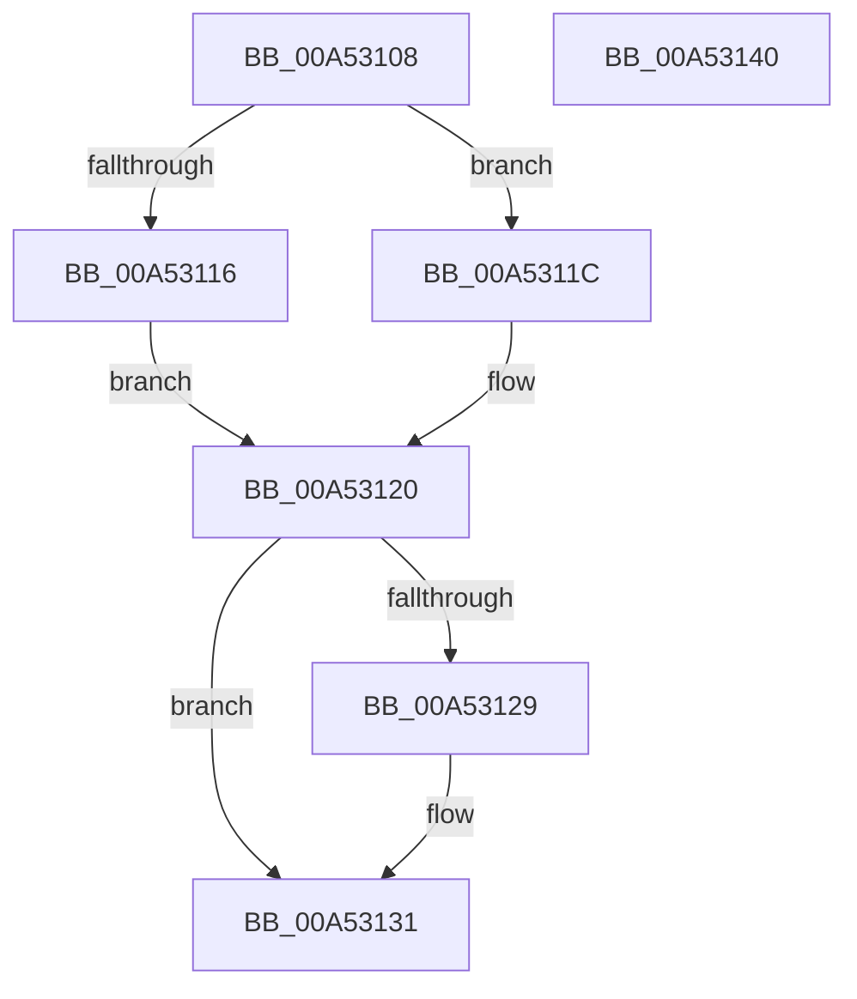

# PpmReinitializeHeteroEngine

- RVA: `0x00A53108`–`0x00A53141` (길이 `57` bytes)
- VA: `0x0000000140A53108`
- 실행 섹션: `PAGE`
- PDB 이름 있음: `예`; PDB Function 태그: `아니요`
- unwind 정보 RVA: `0x000AB2D8`
- 디코드: `18`개 명령, `57/57` bytes 표시
- 미해석 바이트: `0` (있으면 어셈블리에 `.byte`로 보존)

> 이 문서는 커널 이미지의 기계어와 PDB 기호를 분석해 생성했습니다. 4번과 5번은 함수 원형과 자료형을 바이너리 사용 방식에서 추정한 C 해석이며 원본 소스 복구 결과는 아닙니다.

## 1. Dependencies

- 직접 호출 지점: **1**; 고유 호출 대상: **1**
- 직접 호출자로 확인된 함수: **7**
- RIP 상대 이미지 참조: **0**

### Outgoing calls
- `0x00A53136` → [PpmReapplyPerfPolicy](PpmReapplyPerfPolicy_function_00A53148.md) (function, `0x00A53148`)

### Direct callers
- [PpmPerfClearBootOverrides](../../text/4F/PpmPerfClearBootOverrides_function_004FCF44.md) at `0x004FCF71`
- [PpmHeteroHgsUpdateWorker](../../text/5D/PpmHeteroHgsUpdateWorker_function_005D8F70.md) at `0x005D8F90`
- [PpmRegisterPerfStates](../75/PpmRegisterPerfStates_function_0075B084.md) at `0x0075BC70`
- [PpmUpdatePerfStates](../75/PpmUpdatePerfStates_function_0075BD90.md) at `0x0075BE65`
- [PpmDisableProfile](../77/PpmDisableProfile_function_00770858.md) at `0x007708E8`
- [PpmEnableProfile](../77/PpmEnableProfile_function_00770938.md) at `0x007709AC`
- [PpmHvEnableQosEnlightenment](../A8/PpmHvEnableQosEnlightenment_function_00A84D00.md) at `0x00A84DC3`

### Static image references
- 디코드된 RIP-relative 메모리 참조가 없습니다.

## 2. Other-region calls and transfers

- 다른 실행 섹션으로 향하는 call: **0**
- 별도 외부 분기/꼬리 이동을 확인하지 못했습니다.

## 3. Assembly (complete function range)

```asm
00A53108  88 54 24 10                     mov byte ptr [rsp + 0x10], dl
00A5310C  48 83 EC 28                     sub rsp, 0x28
00A53110  33 C0                           xor eax, eax
00A53112  84 C9                           test cl, cl
00A53114  74 06                           je 0x140a5311c
00A53116  0F BA E8 0B                     bts eax, 0xb
00A5311A  EB 04                           jmp 0x140a53120
00A5311C  0F BA E8 0C                     bts eax, 0xc
00A53120  89 44 24 38                     mov dword ptr [rsp + 0x38], eax
00A53124  45 84 C0                        test r8b, r8b
00A53127  74 08                           je 0x140a53131
00A53129  0F BA E8 0F                     bts eax, 0xf
00A5312D  89 44 24 38                     mov dword ptr [rsp + 0x38], eax
00A53131  48 8D 4C 24 38                  lea rcx, [rsp + 0x38]
00A53136  E8 0D 00 00 00                  call 0x140a53148
00A5313B  48 83 C4 28                     add rsp, 0x28
00A5313F  C3                              ret
00A53140  CC                              int3
```

## 4. C-style interpretation (structured pseudocode)

```c
__int64 __fastcall PpmReinitializeHeteroEngine(unsigned __int8 a1, unsigned __int8 a2, unsigned __int8 a3)
{
    __int64 result;
    __int64 v_rsp;
    unsigned __int8 v_stack_p10;

    v_stack_p10 = a2;
    v_rsp = (v_rsp) - (40);
    result = 0;
    if (a1 == 0) goto loc_00A5311C;
    goto loc_00A53120;
loc_00A5311C:
loc_00A53120:
    v_stack_p10 = 0;
    if (a3 != 0) {
        v_stack_p10 = 0;
    }
    result = PpmReapplyPerfPolicy(v_stack_p10, a2, a3, a4);
    v_rsp = (v_rsp) + (40);
    return result;
}
```

## 5. (Beta) C Style

```c
int64_t PpmReinitializeHeteroEngine(uint8_t Arg1, uint8_t Arg2, uint8_t Arg3)
{
    int64_t result;
    int64_t local_rsp;
    uint8_t v_stack_p10;

    v_stack_p10 = Arg2;
    local_rsp = (local_rsp) - (40);
    result = 0;
    if (Arg1 == 0) goto loc_00A5311C;
    goto loc_00A53120;
loc_00A5311C:
loc_00A53120:
    v_stack_p10 = 0;
    if (Arg3 != 0) {
        v_stack_p10 = 0;
    }
    result = PpmReapplyPerfPolicy(v_stack_p10, Arg2, Arg3, a4);
    local_rsp = (local_rsp) + (40);
    return result;
}
```

## 6. Execution-region graph

[열기: 2D/3D 그래프와 함수 탐색 컨트롤 패널](../../../control-panel.html?section=page&rva=0x00A53108&view=graph)

- 2D 그래프는 위에서 아래로 흐르고, 3D 그래프는 빈 공간을 드래그해 회전합니다. Shift+드래그는 이동, 휠은 확대·축소, 함수 노드 선택은 대상 보고서 이동입니다.

### Static fallback


