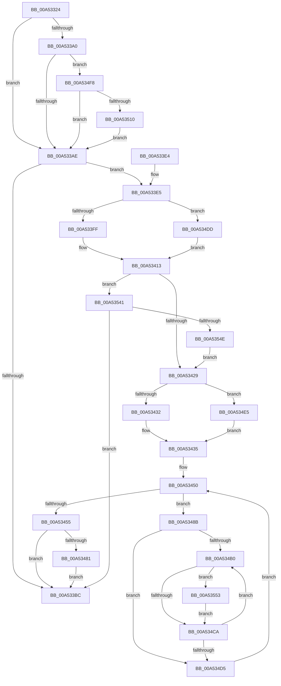

# PpmUpdateProcessorPolicy

- RVA: `0x00A53324`–`0x00A53569` (길이 `581` bytes)
- VA: `0x0000000140A53324`
- 실행 섹션: `PAGE`
- PDB 이름 있음: `예`; PDB Function 태그: `아니요`
- unwind 정보 RVA: `0x000B0DFC`
- 디코드: `130`개 명령, `581/581` bytes 표시
- 미해석 바이트: `0` (있으면 어셈블리에 `.byte`로 보존)

> 이 문서는 커널 이미지의 기계어와 PDB 기호를 분석해 생성했습니다. 4번과 5번은 함수 원형과 자료형을 바이너리 사용 방식에서 추정한 C 해석이며 원본 소스 복구 결과는 아닙니다.

## 1. Dependencies

- 직접 호출 지점: **8**; 고유 호출 대상: **6**
- 직접 호출자로 확인된 함수: **4**
- RIP 상대 이미지 참조: **11**

### Outgoing calls
- `0x00A5336B` → [memset](../../text/6C/memset_function_006C6C40.md) (function, `0x006C6C40`)
- `0x00A533C3` → [_security_check_cookie](../../text/6A/_security_check_cookie_function_006AC640.md) (function, `0x006AC640`)
- `0x00A5344B` → [memset](../../text/6C/memset_function_006C6C40.md) (function, `0x006C6C40`)
- `0x00A5346C` → [PopExecuteOnTargetProcessors](../../text/2D/PopExecuteOnTargetProcessors_function_002DD834.md) (function, `0x002DD834`)
- `0x00A53481` → [guard_dispatch_icall](../../text/6B/guard_dispatch_icall_function_006BAAD0.md) (function, `0x006BAAD0`)
- `0x00A5349F` → [KiOrAffinityEx](../../text/39/KiOrAffinityEx_function_0039A84C.md) (function, `0x0039A84C`)
- `0x00A53541` → [guard_dispatch_icall](../../text/6B/guard_dispatch_icall_function_006BAAD0.md) (function, `0x006BAAD0`)
- `0x00A5355F` → [PpmUpdateTargetProcessorPolicy](../../text/4B/PpmUpdateTargetProcessorPolicy_function_004B1BAC.md) (function, `0x004B1BAC`)

### Direct callers
- [PpmPerfReApplyStates](../75/PpmPerfReApplyStates_function_0075ADA4.md) at `0x0075ADC2`
- [PpmRegisterPerfStates](../75/PpmRegisterPerfStates_function_0075B084.md) at `0x0075BBEE`
- [PpmReapplyPerfPolicy](PpmReapplyPerfPolicy_function_00A53148.md) at `0x00A531DA`
- [PpmCheckInitProcessors](../A8/PpmCheckInitProcessors_function_00A84AE8.md) at `0x00A84C88`

### Static image references
- `0x00A53342` → RVA `0x00E0A740` (`.data`; read)
- `0x00A53370` → RVA `0x00E08380` (`.data`; read)
- `0x00A5337B` → RVA `0x00F0CE0C` (`.data`; read)
- `0x00A5338C` → RVA `0x00F0E180` (`.data`; read)
- `0x00A533F0` → RVA `0x00FC6AA0` (`ALMOSTRO`; read)
- `0x00A53413` → RVA `0x00F0E288` (`.data`; read)
- `0x00A5341A` → RVA `0x00F0E250` (`.data`; write)
- `0x00A5345E` → RVA `0x004B1B80` (`PpmUpdateProcessorPolicyCallback`; read)
- `0x00A53465` → RVA `0x00E0B430` (`.data`; read)
- `0x00A53471` → RVA `0x00F0E298` (`.data`; read)
- `0x00A534E5` → RVA `0x00FC6BA8` (`ALMOSTRO`; read)

## 2. Other-region calls and transfers

- 다른 실행 섹션으로 향하는 call: **8**
  - `0x00A5336B` → [memset](../../text/6C/memset_function_006C6C40.md) (`PAGE` → `.text`)
  - `0x00A533C3` → [_security_check_cookie](../../text/6A/_security_check_cookie_function_006AC640.md) (`PAGE` → `.text`)
  - `0x00A5344B` → [memset](../../text/6C/memset_function_006C6C40.md) (`PAGE` → `.text`)
  - `0x00A5346C` → [PopExecuteOnTargetProcessors](../../text/2D/PopExecuteOnTargetProcessors_function_002DD834.md) (`PAGE` → `.text`)
  - `0x00A53481` → [guard_dispatch_icall](../../text/6B/guard_dispatch_icall_function_006BAAD0.md) (`PAGE` → `.text`)
  - `0x00A5349F` → [KiOrAffinityEx](../../text/39/KiOrAffinityEx_function_0039A84C.md) (`PAGE` → `.text`)
  - `0x00A53541` → [guard_dispatch_icall](../../text/6B/guard_dispatch_icall_function_006BAAD0.md) (`PAGE` → `.text`)
  - `0x00A5355F` → [PpmUpdateTargetProcessorPolicy](../../text/4B/PpmUpdateTargetProcessorPolicy_function_004B1BAC.md) (`PAGE` → `.text`)
- 별도 외부 분기/꼬리 이동을 확인하지 못했습니다.

## 3. Assembly (complete function range)

```asm
00A53324  48 89 5C 24 18                  mov qword ptr [rsp + 0x18], rbx
00A53329  48 89 74 24 20                  mov qword ptr [rsp + 0x20], rsi
00A5332E  55                              push rbp
00A5332F  57                              push rdi
00A53330  41 54                           push r12
00A53332  41 56                           push r14
00A53334  41 57                           push r15
00A53336  48 8D 6C 24 B0                  lea rbp, [rsp - 0x50]
00A5333B  48 81 EC 50 01 00 00            sub rsp, 0x150
00A53342  48 8B 05 F7 73 3B 00            mov rax, qword ptr [rip + 0x3b73f7]
00A53349  48 33 C4                        xor rax, rsp
00A5334C  48 89 45 40                     mov qword ptr [rbp + 0x40], rax
00A53350  48 8B FA                        mov rdi, rdx
00A53353  48 8B D9                        mov rbx, rcx
00A53356  45 33 FF                        xor r15d, r15d
00A53359  48 8D 4C 24 38                  lea rcx, [rsp + 0x38]
00A5335E  33 D2                           xor edx, edx
00A53360  44 89 7C 24 20                  mov dword ptr [rsp + 0x20], r15d
00A53365  41 B8 00 01 00 00               mov r8d, 0x100
00A5336B  E8 D0 38 C7 FF                  call 0x1406c6c40
00A53370  48 8B 15 09 50 3B 00            mov rdx, qword ptr [rip + 0x3b5009]
00A53377  45 8D 67 01                     lea r12d, [r15 + 1]
00A5337B  48 63 05 8A 9A 4B 00            movsxd rax, dword ptr [rip + 0x4b9a8a]
00A53382  4C 69 F0 E8 01 00 00            imul r14, rax, 0x1e8
00A53389  0F B7 03                        movzx eax, word ptr [rbx]
00A5338C  66 23 05 ED AD 4B 00            and ax, word ptr [rip + 0x4baded]
00A53393  4C 03 F2                        add r14, rdx
00A53396  66 89 44 24 20                  mov word ptr [rsp + 0x20], ax
00A5339B  48 85 FF                        test rdi, rdi
00A5339E  75 0E                           jne 0x140a533ae
00A533A0  F7 44 24 20 00 04 00 00         test dword ptr [rsp + 0x20], 0x400
00A533A8  0F 85 4A 01 00 00               jne 0x140a534f8
00A533AE  0F BA 74 24 20 0A               btr dword ptr [rsp + 0x20], 0xa
00A533B4  66 44 39 7C 24 20               cmp word ptr [rsp + 0x20], r15w
00A533BA  75 29                           jne 0x140a533e5
00A533BC  48 8B 4D 40                     mov rcx, qword ptr [rbp + 0x40]
00A533C0  48 33 CC                        xor rcx, rsp
00A533C3  E8 78 92 C5 FF                  call 0x1406ac640
00A533C8  4C 8D 9C 24 50 01 00 00         lea r11, [rsp + 0x150]
00A533D0  49 8B 5B 40                     mov rbx, qword ptr [r11 + 0x40]
00A533D4  49 8B 73 48                     mov rsi, qword ptr [r11 + 0x48]
00A533D8  49 8B E3                        mov rsp, r11
00A533DB  41 5F                           pop r15
00A533DD  41 5E                           pop r14
00A533DF  41 5C                           pop r12
00A533E1  5F                              pop rdi
00A533E2  5D                              pop rbp
00A533E3  C3                              ret
00A533E4  CC                              int3
00A533E5  41 8B 46 4C                     mov eax, dword ptr [r14 + 0x4c]
00A533E9  48 69 C8 10 27 00 00            imul rcx, rax, 0x2710
00A533F0  8B 05 AA 36 57 00               mov eax, dword ptr [rip + 0x5736aa]
00A533F6  48 3B C8                        cmp rcx, rax
00A533F9  0F 86 DE 00 00 00               jbe 0x140a534dd
00A533FF  48 2B C8                        sub rcx, rax
00A53402  48 B8 4B 59 86 38 D6 C5 6D 34   movabs rax, 0x346dc5d63886594b
00A5340C  48 F7 E1                        mul rcx
00A5340F  48 C1 EA 0B                     shr rdx, 0xb
00A53413  48 8B 05 6E AE 4B 00            mov rax, qword ptr [rip + 0x4bae6e]
00A5341A  89 15 30 AE 4B 00               mov dword ptr [rip + 0x4bae30], edx
00A53420  48 85 C0                        test rax, rax
00A53423  0F 85 18 01 00 00               jne 0x140a53541
00A53429  48 85 FF                        test rdi, rdi
00A5342C  0F 84 B3 00 00 00               je 0x140a534e5
00A53432  48 8B 37                        mov rsi, qword ptr [rdi]
00A53435  33 D2                           xor edx, edx
00A53437  48 C7 44 24 30 01 00 20 00      mov qword ptr [rsp + 0x30], 0x200001
00A53440  41 B8 00 01 00 00               mov r8d, 0x100
00A53446  48 8D 4C 24 38                  lea rcx, [rsp + 0x38]
00A5344B  E8 F0 37 C7 FF                  call 0x1406c6c40
00A53450  48 3B FE                        cmp rdi, rsi
00A53453  75 36                           jne 0x140a5348b
00A53455  4D 8D 4E 28                     lea r9, [r14 + 0x28]
00A53459  4C 8D 44 24 20                  lea r8, [rsp + 0x20]
00A5345E  48 8D 15 1B E7 A5 FF            lea rdx, [rip - 0x5a18e5]
00A53465  48 8D 0D C4 7F 3B 00            lea rcx, [rip + 0x3b7fc4]
00A5346C  E8 C3 A3 88 FF                  call 0x1402dd834
00A53471  48 8B 05 20 AE 4B 00            mov rax, qword ptr [rip + 0x4bae20]
00A53478  48 85 C0                        test rax, rax
00A5347B  0F 84 3B FF FF FF               je 0x140a533bc
00A53481  E8 4A 76 C6 FF                  call 0x1406baad0
00A53486  E9 31 FF FF FF                  jmp 0x140a533bc
00A5348B  44 0F B7 4C 24 32               movzx r9d, word ptr [rsp + 0x32]
00A53491  48 8D 4F 18                     lea rcx, [rdi + 0x18]
00A53495  4C 8D 44 24 30                  lea r8, [rsp + 0x30]
00A5349A  48 8D 54 24 30                  lea rdx, [rsp + 0x30]
00A5349F  E8 A8 73 94 FF                  call 0x14039a84c
00A534A4  41 8B DF                        mov ebx, r15d
00A534A7  44 39 BF 28 01 00 00            cmp dword ptr [rdi + 0x128], r15d
00A534AE  76 25                           jbe 0x140a534d5
00A534B0  8B C3                           mov eax, ebx
00A534B2  48 69 D0 A8 04 00 00            imul rdx, rax, 0x4a8
00A534B9  48 03 97 38 01 00 00            add rdx, qword ptr [rdi + 0x138]
00A534C0  44 39 7A 10                     cmp dword ptr [rdx + 0x10], r15d
00A534C4  0F 85 89 00 00 00               jne 0x140a53553
00A534CA  41 03 DC                        add ebx, r12d
00A534CD  3B 9F 28 01 00 00               cmp ebx, dword ptr [rdi + 0x128]
00A534D3  72 DB                           jb 0x140a534b0
00A534D5  48 8B 3F                        mov rdi, qword ptr [rdi]
00A534D8  E9 73 FF FF FF                  jmp 0x140a53450
00A534DD  41 8B D7                        mov edx, r15d
00A534E0  E9 2E FF FF FF                  jmp 0x140a53413
00A534E5  48 8B 3D BC 36 57 00            mov rdi, qword ptr [rip + 0x5736bc]
00A534EC  48 8D 35 B5 36 57 00            lea rsi, [rip + 0x5736b5]
00A534F3  E9 3D FF FF FF                  jmp 0x140a53435
00A534F8  65 48 8B 04 25 20 00 00 00      mov rax, qword ptr gs:[0x20]
00A53501  48 0F BA A0 A0 8F 00 00 27      bt qword ptr [rax + 0x8fa0], 0x27
00A5350A  0F 83 9E FE FF FF               jae 0x140a533ae
00A53510  B9 B0 0D 00 00                  mov ecx, 0xdb0
00A53515  0F 32                           rdmsr
00A53517  48 C1 E2 20                     shl rdx, 0x20
00A5351B  48 0B C2                        or rax, rdx
00A5351E  4C 8B C0                        mov r8, rax
00A53521  48 83 E0 FE                     and rax, 0xfffffffffffffffe
00A53525  4D 0B C4                        or r8, r12
00A53528  45 38 BE B0 00 00 00            cmp byte ptr [r14 + 0xb0], r15b
00A5352F  49 0F 45 C0                     cmovne rax, r8
00A53533  48 8B D0                        mov rdx, rax
00A53536  48 C1 EA 20                     shr rdx, 0x20
00A5353A  0F 30                           wrmsr
00A5353C  E9 6D FE FF FF                  jmp 0x140a533ae
00A53541  E8 8A 75 C6 FF                  call 0x1406baad0
00A53546  85 C0                           test eax, eax
00A53548  0F 88 6E FE FF FF               js 0x140a533bc
00A5354E  E9 D6 FE FF FF                  jmp 0x140a53429
00A53553  4D 8D 4E 28                     lea r9, [r14 + 0x28]
00A53557  48 8B CF                        mov rcx, rdi
00A5355A  4C 8D 44 24 20                  lea r8, [rsp + 0x20]
00A5355F  E8 48 E6 A5 FF                  call 0x1404b1bac
00A53564  E9 61 FF FF FF                  jmp 0x140a534ca
```

## 4. C-style interpretation (structured pseudocode)

```c
__int64 __fastcall PpmUpdateProcessorPolicy(__int64 a1, __int64 a2)
{
    __int64 result;
    __int64 v_r14;
    __int64 v_r15;
    __int64 v_rbx;
    __int64 v_rsp;
    unsigned __int64 v_stack_m118;
    unsigned __int16 v_stack_m11E;
    unsigned __int64 v_stack_m120;
    unsigned __int64 v_stack_m130;
    unsigned __int64 v_stack_m140;
    unsigned int v_stack_m158;
    unsigned __int64 v_stack_m28;
    unsigned __int64 v_stack_m38;
    unsigned __int64 v_stack_m78;
    unsigned __int64 v_stack_p18;
    unsigned __int64 v_stack_p20;

    v_stack_p18 = v_rbx;
    v_stack_p20 = v_rsi;
    v_rsp = (v_rsp) - (336);
    result = (*(unsigned __int64 *)(v_rip + 3896311)) ^ (v_rsp);
    v_stack_m38 = result;
    v_r15 = 0;
    a2 = 0;
    v_stack_m158 = 0;
    result = memset(v_stack_m140, a2, 256, a4);
    v_r14 = (v_r14) * ((int)(*(unsigned int *)(v_rip + 4954762)));
    result = (unsigned __int16)((*(unsigned __int16 *)(a1)) & (*(unsigned __int16 *)(v_rip + 4959725)));
    v_r14 = (v_r14) + (*(unsigned __int64 *)(v_rip + 3887113));
    v_stack_m158 = (unsigned __int16)(result);
    if (0 != 0) goto loc_00A533AE;
    if (((v_stack_m158) & (0x400ULL)) != 0) goto loc_00A534F8;
loc_00A533AE:
    if (v_stack_m158 != 0) goto loc_00A533E5;
loc_00A533BC:
    a1 = (v_stack_m38) ^ (v_rsp);
    result = _security_check_cookie(a1, *(unsigned __int64 *)(v_rip + 3887113), 256, a4);
    return result;
loc_00A533E5:
    a1 = (a1) * ((unsigned int)(*(unsigned int *)(v_r14 + 76)));
    if (a1 <= ((unsigned int)(*(unsigned int *)(v_rip + 5715626)))) goto loc_00A534DD;
    a1 = (a1) - ((unsigned int)(*(unsigned int *)(v_rip + 5715626)));
    a2 = (*(unsigned __int64 *)(v_rip + 3887113)) >> (11);
loc_00A53413:
    *(unsigned int *)(v_rip + 4959792) = (unsigned int)(a2);
    if (*(unsigned __int64 *)(v_rip + 4959854) != 0) goto loc_00A53541;
loc_00A53429:
    if (a2 == 0) goto loc_00A534E5;
loc_00A53435:
    a2 = 0;
    v_stack_m120 = 0x200001ULL;
    result = memset(v_stack_m118, a2, 256, a4);
loc_00A53450:
    if (0 != (*(unsigned __int64 *)(a2))) goto loc_00A5348B;
    result = PopExecuteOnTargetProcessors(v_rip + 3899332, v_rip - 5904613, v_stack_m130, v_r14 + 40);
    if (*(unsigned __int64 *)(v_rip + 4959776) == 0) goto loc_00A533BC;
    result = guard_dispatch_icall(v_rip + 3899332, v_rip - 5904613, v_stack_m130, v_r14 + 40);
    goto loc_00A533BC;
loc_00A5348B:
    result = KiOrAffinityEx(a2 + 24, v_stack_m120, v_stack_m120, v_stack_m11E);
    if ((*(unsigned int *)(a2 + 296)) <= 0) goto loc_00A534D5;
loc_00A534B0:
    a2 = (v_stack_m120) * (0);
    a2 = (a2) + (*(unsigned __int64 *)(a2 + 312));
    if ((*(unsigned int *)(a2 + 16)) != 0) goto loc_00A53553;
loc_00A534CA:
    v_rbx = (unsigned int)((0) + ((unsigned int)(v_r15 + 1)));
    if (((unsigned int)(v_rbx)) < (*(unsigned int *)(a2 + 296))) goto loc_00A534B0;
loc_00A534D5:
    goto loc_00A53450;
loc_00A534DD:
    goto loc_00A53413;
loc_00A534E5:
    goto loc_00A53435;
loc_00A534F8:
    if (((unsigned int)(v_rbx)) >= (*(unsigned int *)(a2 + 296))) goto loc_00A533AE;
    a2 = (0) << (32);
    result = (*(unsigned __int64 *)(gs_base + (0 + 32))) | (a2);
    result = (result) & (-2);
    a3 = (result) | (v_r15 + 1);
    if ((*(unsigned __int8 *)(v_r14 + 176)) != 0) { result = a3; }
    a2 = (result) >> (32);
    goto loc_00A533AE;
loc_00A53541:
    result = guard_dispatch_icall((unsigned int)(0xDB0ULL), a2, a3, v_stack_m11E);
    if (sign_flag) goto loc_00A533BC;
    goto loc_00A53429;
loc_00A53553:
    result = PpmUpdateTargetProcessorPolicy(*(unsigned __int64 *)(v_rip + 5715644), a2, v_stack_m130, v_r14 + 40);
    goto loc_00A534CA;
}
```

## 5. (Beta) C Style

```c
int64_t PpmUpdateProcessorPolicy(void *Arg1, int64_t Arg2)
{
    uint8_t *arg1 = (uint8_t *)Arg1;

    int64_t result;
    int64_t local_r14;
    int64_t local_r15;
    int64_t local_rbx;
    int64_t local_rsp;
    uint64_t v_stack_m118;
    uint16_t v_stack_m11E;
    uint64_t v_stack_m120;
    uint64_t v_stack_m130;
    uint64_t v_stack_m140;
    uint32_t v_stack_m158;
    uint64_t v_stack_m28;
    uint64_t v_stack_m38;
    uint64_t v_stack_m78;
    uint64_t v_stack_p18;
    uint64_t v_stack_p20;

    v_stack_p18 = local_rbx;
    v_stack_p20 = local_rsi;
    local_rsp = (local_rsp) - (336);
    result = (*(uint64_t *)(v_rip + 0x3B73F7)) ^ (local_rsp);
    v_stack_m38 = result;
    local_r15 = 0;
    Arg2 = 0;
    v_stack_m158 = 0;
    result = memset(v_stack_m140, Arg2, 256, a4);
    local_r14 = (local_r14) * ((int32_t)(*(uint32_t *)(v_rip + 0x4B9A8A)));
    result = (uint16_t)((*(uint16_t *)(arg1)) & (*(uint16_t *)(v_rip + 0x4BADED)));
    local_r14 = (local_r14) + (*(uint64_t *)(v_rip + 0x3B5009));
    v_stack_m158 = (uint16_t)(result);
    if (0 != 0) goto loc_00A533AE;
    if (((v_stack_m158) & (0x400ULL)) != 0) goto loc_00A534F8;
loc_00A533AE:
    if (v_stack_m158 != 0) goto loc_00A533E5;
loc_00A533BC:
    Arg1 = (v_stack_m38) ^ (local_rsp);
    result = _security_check_cookie(Arg1, *(uint64_t *)(v_rip + 0x3B5009), 256, a4);
    return result;
loc_00A533E5:
    Arg1 = (Arg1) * ((uint32_t)(*(uint32_t *)(local_r14 + 0x4C)));
    if (Arg1 <= ((uint32_t)(*(uint32_t *)(v_rip + 0x5736AA)))) goto loc_00A534DD;
    Arg1 = (Arg1) - ((uint32_t)(*(uint32_t *)(v_rip + 0x5736AA)));
    Arg2 = (*(uint64_t *)(v_rip + 0x3B5009)) >> (11);
loc_00A53413:
    *(uint32_t *)(v_rip + 0x4BAE30) = (uint32_t)(Arg2);
    if (*(uint64_t *)(v_rip + 0x4BAE6E) != 0) goto loc_00A53541;
loc_00A53429:
    if (Arg2 == 0) goto loc_00A534E5;
loc_00A53435:
    Arg2 = 0;
    v_stack_m120 = 0x200001ULL;
    result = memset(v_stack_m118, Arg2, 256, a4);
loc_00A53450:
    if (0 != (*(uint64_t *)(Arg2))) goto loc_00A5348B;
    result = PopExecuteOnTargetProcessors(v_rip + 3899332, v_rip - 5904613, v_stack_m130, local_r14 + 40);
    if (*(uint64_t *)(v_rip + 0x4BAE20) == 0) goto loc_00A533BC;
    result = guard_dispatch_icall(v_rip + 3899332, v_rip - 5904613, v_stack_m130, local_r14 + 40);
    goto loc_00A533BC;
loc_00A5348B:
    result = KiOrAffinityEx(Arg2 + 24, v_stack_m120, v_stack_m120, v_stack_m11E);
    if ((*(uint32_t *)(Arg2 + 0x128)) <= 0) goto loc_00A534D5;
loc_00A534B0:
    Arg2 = (v_stack_m120) * (0);
    Arg2 = (Arg2) + (*(uint64_t *)(Arg2 + 0x138));
    if ((*(uint32_t *)(Arg2 + 0x10)) != 0) goto loc_00A53553;
loc_00A534CA:
    local_rbx = (uint32_t)((0) + ((uint32_t)(local_r15 + 1)));
    if (((uint32_t)(local_rbx)) < (*(uint32_t *)(Arg2 + 0x128))) goto loc_00A534B0;
loc_00A534D5:
    goto loc_00A53450;
loc_00A534DD:
    goto loc_00A53413;
loc_00A534E5:
    goto loc_00A53435;
loc_00A534F8:
    if (((uint32_t)(local_rbx)) >= (*(uint32_t *)(Arg2 + 0x128))) goto loc_00A533AE;
    Arg2 = (0) << (32);
    result = (*(uint64_t *)(gs_base + (0 + 0x20))) | (Arg2);
    result = (result) & (-2);
    a3 = (result) | (local_r15 + 1);
    if ((*(uint8_t *)(local_r14 + 0xB0)) != 0) { result = a3; }
    Arg2 = (result) >> (32);
    goto loc_00A533AE;
loc_00A53541:
    result = guard_dispatch_icall((uint32_t)(0xDB0ULL), Arg2, a3, v_stack_m11E);
    if (sign_flag) goto loc_00A533BC;
    goto loc_00A53429;
loc_00A53553:
    result = PpmUpdateTargetProcessorPolicy(*(uint64_t *)(v_rip + 0x5736BC), Arg2, v_stack_m130, local_r14 + 40);
    goto loc_00A534CA;
}
```

### 관측된 메모리 오프셋

구조체 형식이 확인되지 않은 접근은 인자 기준의 오프셋으로만 기록했습니다.

| 기준 인자 | 오프셋 표현 | 폭 (bit) | 접근 |
|---|---:|---:|---|
| `Arg1` | `+ 0x0` | `16` | `R` |

## 6. Execution-region graph

[열기: 2D/3D 그래프와 함수 탐색 컨트롤 패널](../../../control-panel.html?section=page&rva=0x00A53324&view=graph)

- 2D 그래프는 위에서 아래로 흐르고, 3D 그래프는 빈 공간을 드래그해 회전합니다. Shift+드래그는 이동, 휠은 확대·축소, 함수 노드 선택은 대상 보고서 이동입니다.

### Static fallback


