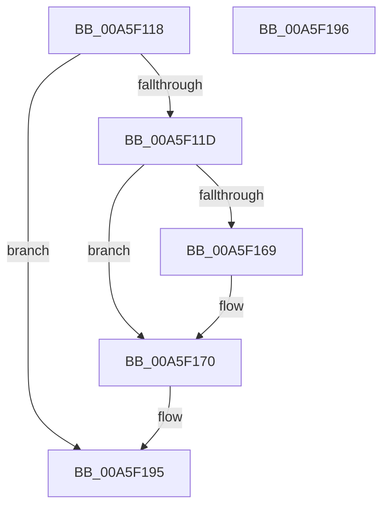

# PsJoinSession

- RVA: `0x00A5F118`–`0x00A5F197` (길이 `127` bytes)
- VA: `0x0000000140A5F118`
- 실행 섹션: `PAGE`
- PDB 이름 있음: `예`; PDB Function 태그: `아니요`
- unwind 정보 RVA: `0x000ADC24`
- 디코드: `32`개 명령, `127/127` bytes 표시
- 미해석 바이트: `0` (있으면 어셈블리에 `.byte`로 보존)

> 이 문서는 커널 이미지의 기계어와 PDB 기호를 분석해 생성했습니다. 4번과 5번은 함수 원형과 자료형을 바이너리 사용 방식에서 추정한 C 해석이며 원본 소스 복구 결과는 아닙니다.

## 1. Dependencies

- 직접 호출 지점: **2**; 고유 호출 대상: **2**
- 직접 호출자로 확인된 함수: **1**
- RIP 상대 이미지 참조: **0**

### Outgoing calls
- `0x00A5F150` → [PspLockProcessListExclusive](../../text/22/PspLockProcessListExclusive_function_0022578C.md) (function, `0x0022578C`)
- `0x00A5F181` → [PspUnlockProcessListExclusive](../../text/2D/PspUnlockProcessListExclusive_function_002DFD18.md) (function, `0x002DFD18`)

### Direct callers
- [MmCreateProcessAddressSpace](MmCreateProcessAddressSpace_function_00A5EE5C.md) at `0x00A5F076`

### Static image references
- 디코드된 RIP-relative 메모리 참조가 없습니다.

## 2. Other-region calls and transfers

- 다른 실행 섹션으로 향하는 call: **2**
  - `0x00A5F150` → [PspLockProcessListExclusive](../../text/22/PspLockProcessListExclusive_function_0022578C.md) (`PAGE` → `.text`)
  - `0x00A5F181` → [PspUnlockProcessListExclusive](../../text/2D/PspUnlockProcessListExclusive_function_002DFD18.md) (`PAGE` → `.text`)
- 별도 외부 분기/꼬리 이동을 확인하지 못했습니다.

## 3. Assembly (complete function range)

```asm
00A5F118  48 85 D2                        test rdx, rdx
00A5F11B  74 78                           je 0x140a5f195
00A5F11D  48 89 5C 24 08                  mov qword ptr [rsp + 8], rbx
00A5F122  48 89 74 24 10                  mov qword ptr [rsp + 0x10], rsi
00A5F127  57                              push rdi
00A5F128  48 83 EC 20                     sub rsp, 0x20
00A5F12C  48 8B DA                        mov rbx, rdx
00A5F12F  48 89 91 E8 02 00 00            mov qword ptr [rcx + 0x2e8], rdx
00A5F136  48 8B F9                        mov rdi, rcx
00A5F139  F0 81 89 F4 01 00 00 00 00 01 00  lock or dword ptr [rcx + 0x1f4], 0x10000
00A5F144  65 48 8B 34 25 88 01 00 00      mov rsi, qword ptr gs:[0x188]
00A5F14D  48 8B CE                        mov rcx, rsi
00A5F150  E8 37 66 7C FF                  call 0x14022578c
00A5F155  48 8B 4B 18                     mov rcx, qword ptr [rbx + 0x18]
00A5F159  48 8D 87 30 02 00 00            lea rax, [rdi + 0x230]
00A5F160  48 83 C3 10                     add rbx, 0x10
00A5F164  48 39 19                        cmp qword ptr [rcx], rbx
00A5F167  74 07                           je 0x140a5f170
00A5F169  B9 03 00 00 00                  mov ecx, 3
00A5F16E  CD 29                           int 0x29
00A5F170  48 89 48 08                     mov qword ptr [rax + 8], rcx
00A5F174  48 89 18                        mov qword ptr [rax], rbx
00A5F177  48 89 01                        mov qword ptr [rcx], rax
00A5F17A  48 8B CE                        mov rcx, rsi
00A5F17D  48 89 43 08                     mov qword ptr [rbx + 8], rax
00A5F181  E8 92 0B 88 FF                  call 0x1402dfd18
00A5F186  48 8B 5C 24 30                  mov rbx, qword ptr [rsp + 0x30]
00A5F18B  48 8B 74 24 38                  mov rsi, qword ptr [rsp + 0x38]
00A5F190  48 83 C4 20                     add rsp, 0x20
00A5F194  5F                              pop rdi
00A5F195  C3                              ret
00A5F196  CC                              int3
```

## 4. C-style interpretation (structured pseudocode)

```c
__int64 __fastcall PsJoinSession(__int64 a1, __int64 a2)
{
    __int64 result;
    __int64 v_rbx;
    __int64 v_rsp;
    unsigned __int64 v_stack_p10;
    unsigned __int64 v_stack_p8;

    if (a2 == 0) goto loc_00A5F195;
    v_stack_p8 = v_rbx;
    v_stack_p10 = v_rsi;
    v_rsp = (v_rsp) - (32);
    *(unsigned __int64 *)(a1 + 744) = a2;
    result = PspLockProcessListExclusive(*(unsigned __int64 *)(gs_base + (0 + 392)), a2, a3, a4);
    v_rbx = (a2) + (16);
    if ((*(unsigned __int64 *)(*(unsigned __int64 *)(a2 + 24))) != v_rbx) {
        a1 = 3;
    }
    *(unsigned __int64 *)(a1 + 560 + 8) = a1;
    *(unsigned __int64 *)(a1 + 560) = v_rbx;
    *(unsigned __int64 *)(a1) = a1 + 560;
    *(unsigned __int64 *)(v_rbx + 8) = a1 + 560;
    result = PspUnlockProcessListExclusive(*(unsigned __int64 *)(gs_base + (0 + 392)), a2, a3, a4);
    v_rsp = (v_rsp) + (32);
loc_00A5F195:
    return result;
}
```

## 5. (Beta) C Style

```c
int64_t PsJoinSession(void *Arg1, int64_t Arg2)
{
    uint8_t *arg1 = (uint8_t *)Arg1;

    int64_t result;
    int64_t local_rbx;
    int64_t local_rsp;
    uint64_t v_stack_p10;
    uint64_t v_stack_p8;

    if (Arg2 == 0) goto loc_00A5F195;
    v_stack_p8 = local_rbx;
    v_stack_p10 = local_rsi;
    local_rsp = (local_rsp) - (32);
    *(uint64_t *)(arg1 + 0x2E8) = Arg2;
    result = PspLockProcessListExclusive(*(uint64_t *)(gs_base + (0 + 0x188)), Arg2, a3, a4);
    local_rbx = (Arg2) + (16);
    if ((*(uint64_t *)(*(uint64_t *)(Arg2 + 0x18))) != local_rbx) {
        Arg1 = 3;
    }
    *(void **)(arg1 + 0x230 + 0x8) = Arg1;
    *(uint64_t *)(arg1 + 0x230) = local_rbx;
    *(void **)(arg1) = Arg1 + 560;
    *(void **)(local_rbx + 0x8) = Arg1 + 560;
    result = PspUnlockProcessListExclusive(*(uint64_t *)(gs_base + (0 + 0x188)), Arg2, a3, a4);
    local_rsp = (local_rsp) + (32);
loc_00A5F195:
    return result;
}
```

### 관측된 메모리 오프셋

구조체 형식이 확인되지 않은 접근은 인자 기준의 오프셋으로만 기록했습니다.

| 기준 인자 | 오프셋 표현 | 폭 (bit) | 접근 |
|---|---:|---:|---|
| `Arg1` | `+ 0x0` | `64` | `W` |
| `Arg1` | `+ 0x8` | `64` | `W` |
| `Arg1` | `+ 0x1F4` | `32` | `R/W` |
| `Arg1` | `+ 0x230` | `64` | `R` |
| `Arg1` | `+ 0x2E8` | `64` | `W` |

## 6. Execution-region graph

[열기: 2D/3D 그래프와 함수 탐색 컨트롤 패널](../../../control-panel.html?section=page&rva=0x00A5F118&view=graph)

- 2D 그래프는 위에서 아래로 흐르고, 3D 그래프는 빈 공간을 드래그해 회전합니다. Shift+드래그는 이동, 휠은 확대·축소, 함수 노드 선택은 대상 보고서 이동입니다.

### Static fallback


