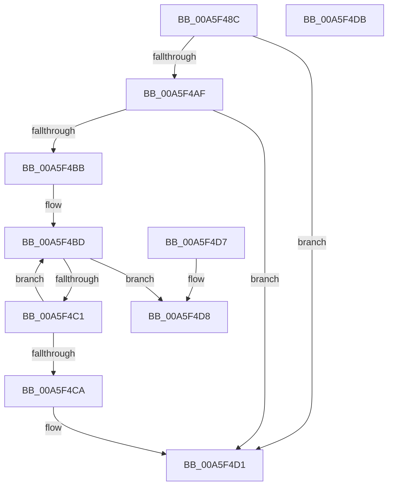

# PsReserveSessionMembership

- RVA: `0x00A5F48C`–`0x00A5F4DC` (길이 `80` bytes)
- VA: `0x0000000140A5F48C`
- 실행 섹션: `PAGE`
- PDB 이름 있음: `예`; PDB Function 태그: `아니요`
- unwind 정보 RVA: `0x000DB714`
- 디코드: `23`개 명령, `80/80` bytes 표시
- 미해석 바이트: `0` (있으면 어셈블리에 `.byte`로 보존)

> 이 문서는 커널 이미지의 기계어와 PDB 기호를 분석해 생성했습니다. 4번과 5번은 함수 원형과 자료형을 바이너리 사용 방식에서 추정한 C 해석이며 원본 소스 복구 결과는 아닙니다.

## 1. Dependencies

- 직접 호출 지점: **0**; 고유 호출 대상: **0**
- 직접 호출자로 확인된 함수: **1**
- RIP 상대 이미지 참조: **0**

### Outgoing calls
- 직접 디코드된 call 명령이 없습니다.

### Direct callers
- [MmCreateProcessAddressSpace](MmCreateProcessAddressSpace_function_00A5EE5C.md) at `0x00A5F036`

### Static image references
- 디코드된 RIP-relative 메모리 참조가 없습니다.

## 2. Other-region calls and transfers

- 다른 실행 섹션으로 향하는 call: **0**
- 별도 외부 분기/꼬리 이동을 확인하지 못했습니다.

## 3. Assembly (complete function range)

```asm
00A5F48C  65 48 8B 04 25 88 01 00 00      mov rax, qword ptr gs:[0x188]
00A5F495  4C 8B C1                        mov r8, rcx
00A5F498  48 83 21 00                     and qword ptr [rcx], 0
00A5F49C  48 8B 90 B8 00 00 00            mov rdx, qword ptr [rax + 0xb8]
00A5F4A3  F7 82 FC 05 00 00 00 10 00 00   test dword ptr [rdx + 0x5fc], 0x1000
00A5F4AD  75 22                           jne 0x140a5f4d1
00A5F4AF  48 8B 92 E8 02 00 00            mov rdx, qword ptr [rdx + 0x2e8]
00A5F4B6  48 85 D2                        test rdx, rdx
00A5F4B9  74 16                           je 0x140a5f4d1
00A5F4BB  8B 02                           mov eax, dword ptr [rdx]
00A5F4BD  85 C0                           test eax, eax
00A5F4BF  74 17                           je 0x140a5f4d8
00A5F4C1  8D 48 01                        lea ecx, [rax + 1]
00A5F4C4  F0 0F B1 0A                     lock cmpxchg dword ptr [rdx], ecx
00A5F4C8  75 F3                           jne 0x140a5f4bd
00A5F4CA  F0 FF 42 0C                     lock inc dword ptr [rdx + 0xc]
00A5F4CE  49 89 10                        mov qword ptr [r8], rdx
00A5F4D1  B8 01 00 00 00                  mov eax, 1
00A5F4D6  C3                              ret
00A5F4D7  CC                              int3
00A5F4D8  33 C0                           xor eax, eax
00A5F4DA  C3                              ret
00A5F4DB  CC                              int3
```

## 4. C-style interpretation (structured pseudocode)

```c
__int64 __fastcall PsReserveSessionMembership(__int64 a1)
{
    __int64 result;

    if (((*(unsigned int *)(*(unsigned __int64 *)(*(unsigned __int64 *)(gs_base + (0 + 392)) + 184) + 1532)) & (0x1000ULL)) != 0) goto loc_00A5F4D1;
    if (*(unsigned __int64 *)(*(unsigned __int64 *)(*(unsigned __int64 *)(gs_base + (0 + 392)) + 184) + 744) == 0) goto loc_00A5F4D1;
loc_00A5F4BD:
    if ((unsigned int)((unsigned int)(*(unsigned int *)(*(unsigned __int64 *)(*(unsigned __int64 *)(*(unsigned __int64 *)(gs_base + (0 + 392)) + 184) + 744)))) == 0) goto loc_00A5F4D8;
    if ((unsigned int)((unsigned int)(*(unsigned int *)(*(unsigned __int64 *)(*(unsigned __int64 *)(*(unsigned __int64 *)(gs_base + (0 + 392)) + 184) + 744)))) != 0) goto loc_00A5F4BD;
    *(unsigned __int64 *)(a1) = *(unsigned __int64 *)(*(unsigned __int64 *)(*(unsigned __int64 *)(gs_base + (0 + 392)) + 184) + 744);
loc_00A5F4D1:
    return 1;
loc_00A5F4D8:
    result = 0;
    return result;
}
```

## 5. (Beta) C Style

```c
int64_t PsReserveSessionMembership(void *Arg1)
{
    uint8_t *arg1 = (uint8_t *)Arg1;

    int64_t result;

    if (((*(uint32_t *)(*(uint64_t *)(*(uint64_t *)(gs_base + (0 + 0x188)) + 0xB8) + 0x5FC)) & (0x1000ULL)) != 0) goto loc_00A5F4D1;
    if (*(uint64_t *)(*(uint64_t *)(*(uint64_t *)(gs_base + (0 + 0x188)) + 0xB8) + 0x2E8) == 0) goto loc_00A5F4D1;
loc_00A5F4BD:
    if ((uint32_t)((uint32_t)(*(uint32_t *)(*(uint64_t *)(*(uint64_t *)(*(uint64_t *)(gs_base + (0 + 0x188)) + 0xB8) + 0x2E8)))) == 0) goto loc_00A5F4D8;
    if ((uint32_t)((uint32_t)(*(uint32_t *)(*(uint64_t *)(*(uint64_t *)(*(uint64_t *)(gs_base + (0 + 0x188)) + 0xB8) + 0x2E8)))) != 0) goto loc_00A5F4BD;
    *(uint64_t *)(arg1) = *(uint64_t *)(*(uint64_t *)(*(uint64_t *)(gs_base + (0 + 0x188)) + 0xB8) + 0x2E8);
loc_00A5F4D1:
    return 1;
loc_00A5F4D8:
    result = 0;
    return result;
}
```

### 관측된 메모리 오프셋

구조체 형식이 확인되지 않은 접근은 인자 기준의 오프셋으로만 기록했습니다.

| 기준 인자 | 오프셋 표현 | 폭 (bit) | 접근 |
|---|---:|---:|---|
| `Arg1` | `+ 0x0` | `64` | `R/W` |
| `Arg1` | `+ 0x0` | `64` | `W` |

## 6. Execution-region graph

[열기: 2D/3D 그래프와 함수 탐색 컨트롤 패널](../../../control-panel.html?section=page&rva=0x00A5F48C&view=graph)

- 2D 그래프는 위에서 아래로 흐르고, 3D 그래프는 빈 공간을 드래그해 회전합니다. Shift+드래그는 이동, 휠은 확대·축소, 함수 노드 선택은 대상 보고서 이동입니다.

### Static fallback


