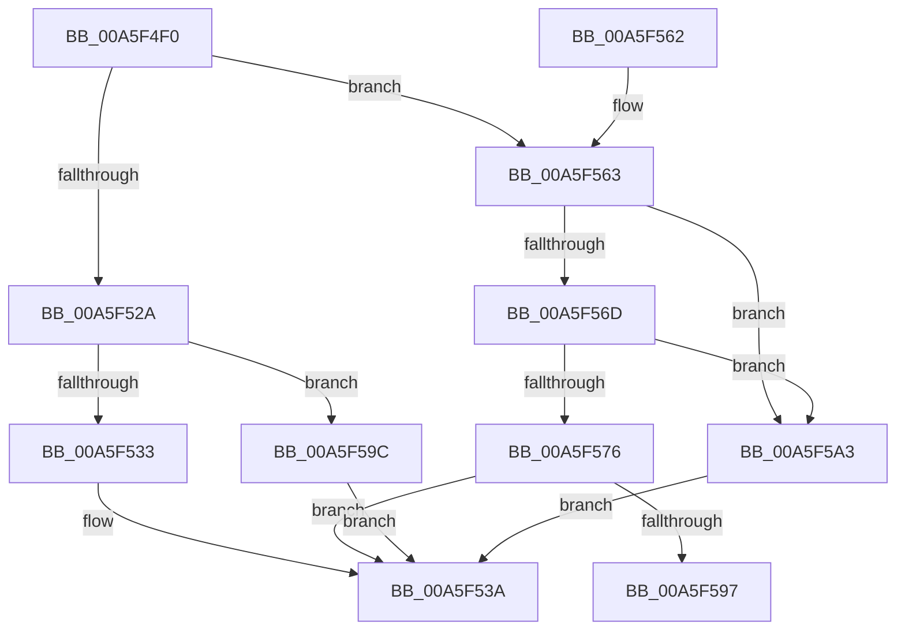

# PsSetProcessWin32Process

- RVA: `0x00A5F4F0`–`0x00A5F5AA` (길이 `186` bytes)
- VA: `0x0000000140A5F4F0`
- 실행 섹션: `PAGE`
- PDB 이름 있음: `예`; PDB Function 태그: `예`
- unwind 정보 RVA: `0x000928D4`
- 디코드: `48`개 명령, `186/186` bytes 표시
- 미해석 바이트: `0` (있으면 어셈블리에 `.byte`로 보존)

> 이 문서는 커널 이미지의 기계어와 PDB 기호를 분석해 생성했습니다. 4번과 5번은 함수 원형과 자료형을 바이너리 사용 방식에서 추정한 C 해석이며 원본 소스 복구 결과는 아닙니다.

## 1. Dependencies

- 직접 호출 지점: **2**; 고유 호출 대상: **2**
- 직접 호출자로 확인된 함수: **0**
- RIP 상대 이미지 참조: **0**

### Outgoing calls
- `0x00A5F520` → [PspLockProcessExclusive](../../text/46/PspLockProcessExclusive_function_00460164.md) (function, `0x00460164`)
- `0x00A5F540` → [PspUnlockProcessExclusive](../../text/46/PspUnlockProcessExclusive_function_004601C0.md) (function, `0x004601C0`)

### Direct callers
- 이 함수 시작 RVA로 연결되는 직접 call은 확인되지 않았습니다. 간접 호출은 완전히 역산할 수 없습니다.

### Static image references
- 디코드된 RIP-relative 메모리 참조가 없습니다.

## 2. Other-region calls and transfers

- 다른 실행 섹션으로 향하는 call: **2**
  - `0x00A5F520` → [PspLockProcessExclusive](../../text/46/PspLockProcessExclusive_function_00460164.md) (`PAGE` → `.text`)
  - `0x00A5F540` → [PspUnlockProcessExclusive](../../text/46/PspUnlockProcessExclusive_function_004601C0.md) (`PAGE` → `.text`)
- call이 아닌 외부 분기/꼬리 이동: **1**
  - `0x00A5F597` → [sub_00B3E114](../B3/Unknown_function_00B3E114.md) (`tail-transfer`)

## 3. Assembly (complete function range)

```asm
00A5F4F0  48 8B C4                        mov rax, rsp
00A5F4F3  48 89 58 08                     mov qword ptr [rax + 8], rbx
00A5F4F7  48 89 68 10                     mov qword ptr [rax + 0x10], rbp
00A5F4FB  48 89 70 18                     mov qword ptr [rax + 0x18], rsi
00A5F4FF  48 89 78 20                     mov qword ptr [rax + 0x20], rdi
00A5F503  41 56                           push r14
00A5F505  48 83 EC 20                     sub rsp, 0x20
00A5F509  65 4C 8B 34 25 88 01 00 00      mov r14, qword ptr gs:[0x188]
00A5F512  48 8B EA                        mov rbp, rdx
00A5F515  49 8B D6                        mov rdx, r14
00A5F518  49 8B F0                        mov rsi, r8
00A5F51B  48 8B D9                        mov rbx, rcx
00A5F51E  33 FF                           xor edi, edi
00A5F520  E8 3F 0C A0 FF                  call 0x140460164
00A5F525  48 85 ED                        test rbp, rbp
00A5F528  75 39                           jne 0x140a5f563
00A5F52A  48 39 B3 98 02 00 00            cmp qword ptr [rbx + 0x298], rsi
00A5F531  75 69                           jne 0x140a5f59c
00A5F533  48 89 BB 98 02 00 00            mov qword ptr [rbx + 0x298], rdi
00A5F53A  49 8B D6                        mov rdx, r14
00A5F53D  48 8B CB                        mov rcx, rbx
00A5F540  E8 7B 0C A0 FF                  call 0x1404601c0
00A5F545  48 8B 5C 24 30                  mov rbx, qword ptr [rsp + 0x30]
00A5F54A  8B C7                           mov eax, edi
00A5F54C  48 8B 7C 24 48                  mov rdi, qword ptr [rsp + 0x48]
00A5F551  48 8B 6C 24 38                  mov rbp, qword ptr [rsp + 0x38]
00A5F556  48 8B 74 24 40                  mov rsi, qword ptr [rsp + 0x40]
00A5F55B  48 83 C4 20                     add rsp, 0x20
00A5F55F  41 5E                           pop r14
00A5F561  C3                              ret
00A5F562  CC                              int3
00A5F563  8B 83 F4 01 00 00               mov eax, dword ptr [rbx + 0x1f4]
00A5F569  A8 08                           test al, 8
00A5F56B  75 36                           jne 0x140a5f5a3
00A5F56D  48 39 BB 98 02 00 00            cmp qword ptr [rbx + 0x298], rdi
00A5F574  75 2D                           jne 0x140a5f5a3
00A5F576  48 89 AB 98 02 00 00            mov qword ptr [rbx + 0x298], rbp
00A5F57D  48 8B 83 F0 06 00 00            mov rax, qword ptr [rbx + 0x6f0]
00A5F584  48 8B C8                        mov rcx, rax
00A5F587  48 C1 E9 1E                     shr rcx, 0x1e
00A5F58B  48 0B C8                        or rcx, rax
00A5F58E  48 F7 C1 FF FF FF 3F            test rcx, 0x3fffffff
00A5F595  74 A3                           je 0x140a5f53a
00A5F597  E9 78 EB 0D 00                  jmp 0x140b3e114
00A5F59C  BF 01 00 00 C0                  mov edi, 0xc0000001
00A5F5A1  EB 97                           jmp 0x140a5f53a
00A5F5A3  BF 0A 01 00 C0                  mov edi, 0xc000010a
00A5F5A8  EB 90                           jmp 0x140a5f53a
```

## 4. C-style interpretation (structured pseudocode)

```c
__int64 __fastcall PsSetProcessWin32Process(__int64 a1, __int64 a2, __int64 a3)
{
    __int64 result;
    __int64 v_rdi;
    __int64 v_rsp;
    unsigned __int64 v_stack_p10;
    unsigned __int64 v_stack_p18;
    unsigned __int64 v_stack_p20;
    unsigned __int64 v_stack_p8;

    *(unsigned __int64 *)(v_rsp + 8) = v_rbx;
    *(unsigned __int64 *)(v_rsp + 16) = v_rbp;
    *(unsigned __int64 *)(v_rsp + 24) = v_rsi;
    *(unsigned __int64 *)(v_rsp + 32) = v_rdi;
    v_rsp = (v_rsp) - (32);
    v_rdi = 0;
    result = PspLockProcessExclusive(a1, *(unsigned __int64 *)(gs_base + (0 + 392)), a3, a4);
    if (a2 != 0) goto loc_00A5F563;
    if ((*(unsigned __int64 *)(a1 + 664)) != a3) goto loc_00A5F59C;
    *(unsigned __int64 *)(a1 + 664) = 0;
loc_00A5F53A:
    result = PspUnlockProcessExclusive(a1, *(unsigned __int64 *)(gs_base + (0 + 392)), a3, a4);
    v_rsp = (v_rsp) + (32);
    return 0;
loc_00A5F563:
    if ((((unsigned __int8)((unsigned int)(*(unsigned int *)(v_stack_p8 + 500)))) & (8)) != 0) goto loc_00A5F5A3;
    if ((*(unsigned __int64 *)(v_stack_p8 + 664)) != v_stack_p20) goto loc_00A5F5A3;
    *(unsigned __int64 *)(v_stack_p8 + 664) = v_stack_p10;
    a1 = (*(unsigned __int64 *)(v_stack_p8 + 1776)) >> (30);
    a1 = (a1) | (*(unsigned __int64 *)(v_stack_p8 + 1776));
    if (((a1) & (0x3FFFFFFFULL)) == 0) goto loc_00A5F53A;
loc_00A5F59C:
    goto loc_00A5F53A;
loc_00A5F5A3:
    goto loc_00A5F53A;
}
```

## 5. (Beta) C Style

```c
int64_t PsSetProcessWin32Process(void *Arg1, int64_t Arg2, int64_t Arg3)
{
    uint8_t *arg1 = (uint8_t *)Arg1;

    int64_t result;
    int64_t local_rdi;
    int64_t local_rsp;
    uint64_t v_stack_p10;
    uint64_t v_stack_p18;
    uint64_t v_stack_p20;
    uint64_t v_stack_p8;

    *(uint64_t *)(local_rsp + 0x8) = local_rbx;
    *(uint64_t *)(local_rsp + 0x10) = local_rbp;
    *(uint64_t *)(local_rsp + 0x18) = local_rsi;
    *(uint64_t *)(local_rsp + 0x20) = local_rdi;
    local_rsp = (local_rsp) - (32);
    local_rdi = 0;
    result = PspLockProcessExclusive(Arg1, *(uint64_t *)(gs_base + (0 + 0x188)), Arg3, a4);
    if (Arg2 != 0) goto loc_00A5F563;
    if ((*(uint64_t *)(arg1 + 0x298)) != Arg3) goto loc_00A5F59C;
    *(uint64_t *)(arg1 + 0x298) = 0;
loc_00A5F53A:
    result = PspUnlockProcessExclusive(Arg1, *(uint64_t *)(gs_base + (0 + 0x188)), Arg3, a4);
    local_rsp = (local_rsp) + (32);
    return 0;
loc_00A5F563:
    if ((((uint8_t)((uint32_t)(*(uint32_t *)(v_stack_p8 + 0x1F4)))) & (8)) != 0) goto loc_00A5F5A3;
    if ((*(uint64_t *)(v_stack_p8 + 0x298)) != v_stack_p20) goto loc_00A5F5A3;
    *(uint64_t *)(v_stack_p8 + 0x298) = v_stack_p10;
    Arg1 = (*(uint64_t *)(v_stack_p8 + 0x6F0)) >> (30);
    Arg1 = (Arg1) | (*(uint64_t *)(v_stack_p8 + 0x6F0));
    if (((Arg1) & (0x3FFFFFFFULL)) == 0) goto loc_00A5F53A;
loc_00A5F59C:
    goto loc_00A5F53A;
loc_00A5F5A3:
    goto loc_00A5F53A;
}
```

### 관측된 메모리 오프셋

구조체 형식이 확인되지 않은 접근은 인자 기준의 오프셋으로만 기록했습니다.

| 기준 인자 | 오프셋 표현 | 폭 (bit) | 접근 |
|---|---:|---:|---|
| `Arg1` | `+ 0x1F4` | `32` | `R` |
| `Arg1` | `+ 0x298` | `64` | `R` |
| `Arg1` | `+ 0x298` | `64` | `W` |
| `Arg1` | `+ 0x6F0` | `64` | `R` |

## 6. Execution-region graph

[열기: 2D/3D 그래프와 함수 탐색 컨트롤 패널](../../../control-panel.html?section=page&rva=0x00A5F4F0&view=graph)

- 2D 그래프는 위에서 아래로 흐르고, 3D 그래프는 빈 공간을 드래그해 회전합니다. Shift+드래그는 이동, 휠은 확대·축소, 함수 노드 선택은 대상 보고서 이동입니다.

### Static fallback


