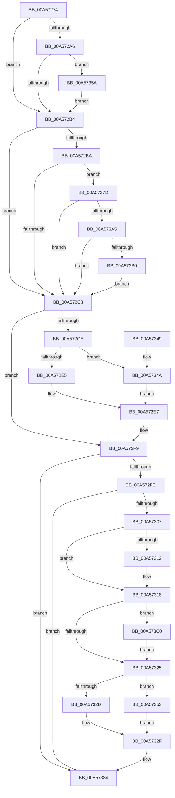

# PspApplyJobLimitsToProcess

- RVA: `0x00A57274`–`0x00A573D9` (길이 `357` bytes)
- VA: `0x0000000140A57274`
- 실행 섹션: `PAGE`
- PDB 이름 있음: `예`; PDB Function 태그: `아니요`
- unwind 정보 RVA: `0x000B1644`
- 디코드: `88`개 명령, `357/357` bytes 표시
- 미해석 바이트: `0` (있으면 어셈블리에 `.byte`로 보존)

> 이 문서는 커널 이미지의 기계어와 PDB 기호를 분석해 생성했습니다. 4번과 5번은 함수 원형과 자료형을 바이너리 사용 방식에서 추정한 C 해석이며 원본 소스 복구 결과는 아닙니다.

## 1. Dependencies

- 직접 호출 지점: **7**; 고유 호출 대상: **7**
- 직접 호출자로 확인된 함수: **2**
- RIP 상대 이미지 참조: **2**

### Outgoing calls
- `0x00A572D4` → [PspLockJobMemoryLimitsShared](../91/PspLockJobMemoryLimitsShared_function_0091A394.md) (function, `0x0091A394`)
- `0x00A572F4` → [PspUnlockJobMemoryLimitsShared](../91/PspUnlockJobMemoryLimitsShared_function_0091A420.md) (function, `0x0091A420`)
- `0x00A5732F` → [KeSetDisableQuantumProcess](../../text/3C/KeSetDisableQuantumProcess_function_003C2128.md) (function, `0x003C2128`)
- `0x00A57373` → [PspSetProcessPriorityByClass](../../text/4E/PspSetProcessPriorityByClass_function_004E9754.md) (function, `0x004E9754`)
- `0x00A57398` → [PspSetProcessAffinitySafe](../A6/PspSetProcessAffinitySafe_function_00A60904.md) (function, `0x00A60904`)
- `0x00A573B6` → [PspUpdatePebForAffinityChange](PspUpdatePebForAffinityChange_function_00A50790.md) (function, `0x00A50790`)
- `0x00A573CF` → [KeSetQuantumProcess](../../text/3C/KeSetQuantumProcess_function_003C1EF0.md) (function, `0x003C1EF0`)

### Direct callers
- [PspApplyJobChainLimitsToProcess](../87/PspApplyJobChainLimitsToProcess_function_0087EB5C.md) at `0x0087EB79`
- [PspSetJobLimitsProcessCallback](PspSetJobLimitsProcessCallback_function_00A57220.md) at `0x00A5723D`

### Static image references
- `0x00A57318` → RVA `0x00FD9A66` (`PAGEDATA`; read)
- `0x00A573C2` → RVA `0x00B4B050` (`PspJobSchedulingClasses`; read)

## 2. Other-region calls and transfers

- 다른 실행 섹션으로 향하는 call: **3**
  - `0x00A5732F` → [KeSetDisableQuantumProcess](../../text/3C/KeSetDisableQuantumProcess_function_003C2128.md) (`PAGE` → `.text`)
  - `0x00A57373` → [PspSetProcessPriorityByClass](../../text/4E/PspSetProcessPriorityByClass_function_004E9754.md) (`PAGE` → `.text`)
  - `0x00A573CF` → [KeSetQuantumProcess](../../text/3C/KeSetQuantumProcess_function_003C1EF0.md) (`PAGE` → `.text`)
- 별도 외부 분기/꼬리 이동을 확인하지 못했습니다.

## 3. Assembly (complete function range)

```asm
00A57274  48 8B C4                        mov rax, rsp
00A57277  48 89 58 08                     mov qword ptr [rax + 8], rbx
00A5727B  48 89 68 18                     mov qword ptr [rax + 0x18], rbp
00A5727F  48 89 70 20                     mov qword ptr [rax + 0x20], rsi
00A57283  57                              push rdi
00A57284  48 83 EC 30                     sub rsp, 0x30
00A57288  83 60 10 00                     and dword ptr [rax + 0x10], 0
00A5728C  8B F2                           mov esi, edx
00A5728E  65 48 8B 2C 25 88 01 00 00      mov rbp, qword ptr gs:[0x188]
00A57297  48 8B D9                        mov rbx, rcx
00A5729A  48 8B B9 A0 02 00 00            mov rdi, qword ptr [rcx + 0x2a0]
00A572A1  F6 C2 20                        test dl, 0x20
00A572A4  75 0E                           jne 0x140a572b4
00A572A6  8B 87 20 04 00 00               mov eax, dword ptr [rdi + 0x420]
00A572AC  A8 20                           test al, 0x20
00A572AE  0F 85 A6 00 00 00               jne 0x140a5735a
00A572B4  40 F6 C6 10                     test sil, 0x10
00A572B8  75 0E                           jne 0x140a572c8
00A572BA  8B 87 20 04 00 00               mov eax, dword ptr [rdi + 0x420]
00A572C0  A8 10                           test al, 0x10
00A572C2  0F 85 B5 00 00 00               jne 0x140a5737d
00A572C8  0F BA E6 08                     bt esi, 8
00A572CC  72 2B                           jb 0x140a572f9
00A572CE  48 8B D5                        mov rdx, rbp
00A572D1  48 8B CF                        mov rcx, rdi
00A572D4  E8 BB 30 EC FF                  call 0x14091a394
00A572D9  F7 87 20 04 00 00 00 01 00 00   test dword ptr [rdi + 0x420], 0x100
00A572E3  75 65                           jne 0x140a5734a
00A572E5  33 C0                           xor eax, eax
00A572E7  48 8B D5                        mov rdx, rbp
00A572EA  48 89 83 D0 03 00 00            mov qword ptr [rbx + 0x3d0], rax
00A572F1  48 8B CF                        mov rcx, rdi
00A572F4  E8 27 31 EC FF                  call 0x14091a420
00A572F9  40 84 F6                        test sil, sil
00A572FC  78 36                           js 0x140a57334
00A572FE  80 BB 47 03 00 00 01            cmp byte ptr [rbx + 0x347], 1
00A57305  74 2D                           je 0x140a57334
00A57307  8B B7 24 04 00 00               mov esi, dword ptr [rdi + 0x424]
00A5730D  83 FE 0A                        cmp esi, 0xa
00A57310  72 06                           jb 0x140a57318
00A57312  8B B7 44 02 00 00               mov esi, dword ptr [rdi + 0x244]
00A57318  80 3D 47 27 58 00 00            cmp byte ptr [rip + 0x582747], 0
00A5731F  0F 85 9B 00 00 00               jne 0x140a573c0
00A57325  48 8B CB                        mov rcx, rbx
00A57328  83 FE 09                        cmp esi, 9
00A5732B  74 26                           je 0x140a57353
00A5732D  33 D2                           xor edx, edx
00A5732F  E8 F4 AD 96 FF                  call 0x1403c2128
00A57334  48 8B 5C 24 40                  mov rbx, qword ptr [rsp + 0x40]
00A57339  48 8B 6C 24 50                  mov rbp, qword ptr [rsp + 0x50]
00A5733E  48 8B 74 24 58                  mov rsi, qword ptr [rsp + 0x58]
00A57343  48 83 C4 30                     add rsp, 0x30
00A57347  5F                              pop rdi
00A57348  C3                              ret
00A57349  CC                              int3
00A5734A  48 8B 87 F8 03 00 00            mov rax, qword ptr [rdi + 0x3f8]
00A57351  EB 94                           jmp 0x140a572e7
00A57353  BA 01 00 00 00                  mov edx, 1
00A57358  EB D5                           jmp 0x140a5732f
00A5735A  8A 87 4C 04 00 00               mov al, byte ptr [rdi + 0x44c]
00A57360  33 D2                           xor edx, edx
00A57362  88 81 47 03 00 00               mov byte ptr [rcx + 0x347], al
00A57368  8A 81 BA 04 00 00               mov al, byte ptr [rcx + 0x4ba]
00A5736E  3C 02                           cmp al, 2
00A57370  0F 94 C2                        sete dl
00A57373  E8 DC 23 A9 FF                  call 0x1404e9754
00A57378  E9 37 FF FF FF                  jmp 0x140a572b4
00A5737D  45 33 C9                        xor r9d, r9d
00A57380  48 8D 44 24 48                  lea rax, [rsp + 0x48]
00A57385  4C 8D 87 D8 02 00 00            lea r8, [rdi + 0x2d8]
00A5738C  48 89 44 24 20                  mov qword ptr [rsp + 0x20], rax
00A57391  48 8B CB                        mov rcx, rbx
00A57394  41 8D 51 01                     lea edx, [r9 + 1]
00A57398  E8 67 95 00 00                  call 0x140a60904
00A5739D  85 C0                           test eax, eax
00A5739F  0F 88 23 FF FF FF               js 0x140a572c8
00A573A5  83 7C 24 48 00                  cmp dword ptr [rsp + 0x48], 0
00A573AA  0F 84 18 FF FF FF               je 0x140a572c8
00A573B0  48 8B D3                        mov rdx, rbx
00A573B3  48 8B CD                        mov rcx, rbp
00A573B6  E8 D5 93 FF FF                  call 0x140a50790
00A573BB  E9 08 FF FF FF                  jmp 0x140a572c8
00A573C0  8B D6                           mov edx, esi
00A573C2  48 8D 05 87 3C 0F 00            lea rax, [rip + 0xf3c87]
00A573C9  48 8B CB                        mov rcx, rbx
00A573CC  8A 14 02                        mov dl, byte ptr [rdx + rax]
00A573CF  E8 1C AB 96 FF                  call 0x1403c1ef0
00A573D4  E9 4C FF FF FF                  jmp 0x140a57325
```

## 4. C-style interpretation (structured pseudocode)

```c
__int64 __fastcall PspApplyJobLimitsToProcess(__int64 a1, int a2, __int64 a3, int a4)
{
    __int64 result;
    __int64 v_rsi;
    __int64 v_rsp;
    unsigned __int64 v_stack_p18;
    unsigned __int64 v_stack_p20;
    unsigned __int64 v_stack_p48;
    unsigned __int64 v_stack_p8;

    *(unsigned __int64 *)(v_rsp + 8) = v_rbx;
    *(unsigned __int64 *)(v_rsp + 24) = v_rbp;
    *(unsigned __int64 *)(v_rsp + 32) = v_rsi;
    v_rsp = (v_rsp) - (48);
    if ((((unsigned __int8)(a2)) & (32)) != 0) goto loc_00A572B4;
    if ((((unsigned __int8)((unsigned int)(*(unsigned int *)(*(unsigned __int64 *)(a1 + 672) + 1056)))) & (32)) != 0) goto loc_00A5735A;
loc_00A572B4:
    if ((((unsigned __int8)((unsigned int)(a2))) & (16)) != 0) goto loc_00A572C8;
    if ((((unsigned __int8)((unsigned int)(*(unsigned int *)(*(unsigned __int64 *)(a1 + 672) + 1056)))) & (16)) != 0) goto loc_00A5737D;
loc_00A572C8:
    if (condition_is_below) goto loc_00A572F9;
    result = PspLockJobMemoryLimitsShared(*(unsigned __int64 *)(a1 + 672), *(unsigned __int64 *)(gs_base + (0 + 392)), a3, a4);
    if (((*(unsigned int *)(*(unsigned __int64 *)(a1 + 672) + 1056)) & (256)) != 0) goto loc_00A5734A;
    result = 0;
loc_00A572E7:
    *(unsigned __int64 *)(a1 + 976) = 0;
    result = PspUnlockJobMemoryLimitsShared(*(unsigned __int64 *)(a1 + 672), *(unsigned __int64 *)(gs_base + (0 + 392)), a3, a4);
loc_00A572F9:
    if (sign_flag) goto loc_00A57334;
    if ((*(unsigned __int8 *)(a1 + 839)) == 1) goto loc_00A57334;
    v_rsi = (unsigned int)(*(unsigned int *)(*(unsigned __int64 *)(a1 + 672) + 1060));
    if (((unsigned int)((unsigned int)(*(unsigned int *)(*(unsigned __int64 *)(a1 + 672) + 1060)))) >= 10) {
        v_rsi = *(unsigned int *)(*(unsigned __int64 *)(a1 + 672) + 580);
    }
    if ((*(unsigned __int8 *)(v_rip + 5777223)) != 0) goto loc_00A573C0;
loc_00A57325:
    if (((unsigned int)(v_rsi)) == 9) goto loc_00A57353;
    a2 = 0;
loc_00A5732F:
    result = KeSetDisableQuantumProcess(a1, a2, a3, a4);
loc_00A57334:
    v_rsp = (v_rsp) + (48);
    return result;
loc_00A5734A:
    goto loc_00A572E7;
loc_00A57353:
    goto loc_00A5732F;
loc_00A5735A:
    a2 = 0;
    *(unsigned __int8 *)(a1 + 839) = (unsigned __int8)(*(unsigned __int8 *)(*(unsigned __int64 *)(a1 + 672) + 1100));
    a2 = (((unsigned __int8)(*(unsigned __int8 *)(a1 + 1210))) == 2) ? 1 : 0;
    result = PspSetProcessPriorityByClass(a1, a2, a3, a4);
    goto loc_00A572B4;
loc_00A5737D:
    a4 = 0;
    v_stack_p20 = v_stack_p48;
    result = PspSetProcessAffinitySafe(v_stack_p8, a4 + 1, *(unsigned __int64 *)(a1 + 672) + 728, a4);
    if (sign_flag) goto loc_00A572C8;
    if (v_stack_p48 == 0) goto loc_00A572C8;
    result = PspUpdatePebForAffinityChange(v_stack_p18, v_stack_p8, *(unsigned __int64 *)(a1 + 672) + 728, a4);
    goto loc_00A572C8;
loc_00A573C0:
    result = KeSetQuantumProcess(v_stack_p8, *(unsigned __int8 *)((unsigned int)((unsigned int)(v_stack_p20)) + v_rip + 998535 * 1), *(unsigned __int64 *)(a1 + 672) + 728, a4);
    goto loc_00A57325;
}
```

## 5. (Beta) C Style

```c
int64_t PspApplyJobLimitsToProcess(void *Arg1, int32_t Arg2, int64_t Arg3, int32_t Arg4)
{
    uint8_t *arg1 = (uint8_t *)Arg1;

    int64_t result;
    int64_t local_rsi;
    int64_t local_rsp;
    uint64_t v_stack_p18;
    uint64_t v_stack_p20;
    uint64_t v_stack_p48;
    uint64_t v_stack_p8;

    *(uint64_t *)(local_rsp + 0x8) = local_rbx;
    *(uint64_t *)(local_rsp + 0x18) = local_rbp;
    *(uint64_t *)(local_rsp + 0x20) = local_rsi;
    local_rsp = (local_rsp) - (48);
    if ((((uint8_t)(Arg2)) & (32)) != 0) goto loc_00A572B4;
    if ((((uint8_t)((uint32_t)(*(uint32_t *)(*(uint64_t *)(arg1 + 0x2A0) + 0x420)))) & (32)) != 0) goto loc_00A5735A;
loc_00A572B4:
    if ((((uint8_t)((uint32_t)(Arg2))) & (16)) != 0) goto loc_00A572C8;
    if ((((uint8_t)((uint32_t)(*(uint32_t *)(*(uint64_t *)(arg1 + 0x2A0) + 0x420)))) & (16)) != 0) goto loc_00A5737D;
loc_00A572C8:
    if (condition_is_below) goto loc_00A572F9;
    result = PspLockJobMemoryLimitsShared(*(uint64_t *)(arg1 + 0x2A0), *(uint64_t *)(gs_base + (0 + 0x188)), Arg3, Arg4);
    if (((*(uint32_t *)(*(uint64_t *)(arg1 + 0x2A0) + 0x420)) & (256)) != 0) goto loc_00A5734A;
    result = 0;
loc_00A572E7:
    *(uint64_t *)(arg1 + 0x3D0) = 0;
    result = PspUnlockJobMemoryLimitsShared(*(uint64_t *)(arg1 + 0x2A0), *(uint64_t *)(gs_base + (0 + 0x188)), Arg3, Arg4);
loc_00A572F9:
    if (sign_flag) goto loc_00A57334;
    if ((*(uint8_t *)(arg1 + 0x347)) == 1) goto loc_00A57334;
    local_rsi = (uint32_t)(*(uint32_t *)(*(uint64_t *)(arg1 + 0x2A0) + 0x424));
    if (((uint32_t)((uint32_t)(*(uint32_t *)(*(uint64_t *)(arg1 + 0x2A0) + 0x424)))) >= 10) {
        local_rsi = *(uint32_t *)(*(uint64_t *)(arg1 + 0x2A0) + 0x244);
    }
    if ((*(uint8_t *)(v_rip + 0x582747)) != 0) goto loc_00A573C0;
loc_00A57325:
    if (((uint32_t)(local_rsi)) == 9) goto loc_00A57353;
    Arg2 = 0;
loc_00A5732F:
    result = KeSetDisableQuantumProcess(Arg1, Arg2, Arg3, Arg4);
loc_00A57334:
    local_rsp = (local_rsp) + (48);
    return result;
loc_00A5734A:
    goto loc_00A572E7;
loc_00A57353:
    goto loc_00A5732F;
loc_00A5735A:
    Arg2 = 0;
    *(uint8_t *)(arg1 + 0x347) = (uint8_t)(*(uint8_t *)(*(uint64_t *)(arg1 + 0x2A0) + 0x44C));
    Arg2 = (((uint8_t)(*(uint8_t *)(arg1 + 0x4BA))) == 2) ? 1 : 0;
    result = PspSetProcessPriorityByClass(Arg1, Arg2, Arg3, Arg4);
    goto loc_00A572B4;
loc_00A5737D:
    Arg4 = 0;
    v_stack_p20 = v_stack_p48;
    result = PspSetProcessAffinitySafe(v_stack_p8, Arg4 + 1, *(uint64_t *)(arg1 + 0x2A0) + 728, Arg4);
    if (sign_flag) goto loc_00A572C8;
    if (v_stack_p48 == 0) goto loc_00A572C8;
    result = PspUpdatePebForAffinityChange(v_stack_p18, v_stack_p8, *(uint64_t *)(arg1 + 0x2A0) + 728, Arg4);
    goto loc_00A572C8;
loc_00A573C0:
    result = KeSetQuantumProcess(v_stack_p8, *(uint8_t *)((uint32_t)((uint32_t)(v_stack_p20)) + v_rip + 0xF3C87 * 1), *(uint64_t *)(arg1 + 0x2A0) + 728, Arg4);
    goto loc_00A57325;
}
```

### 관측된 메모리 오프셋

구조체 형식이 확인되지 않은 접근은 인자 기준의 오프셋으로만 기록했습니다.

| 기준 인자 | 오프셋 표현 | 폭 (bit) | 접근 |
|---|---:|---:|---|
| `Arg1` | `+ 0x2A0` | `64` | `R` |
| `Arg1` | `+ 0x347` | `8` | `R` |
| `Arg1` | `+ 0x347` | `8` | `W` |
| `Arg1` | `+ 0x3D0` | `64` | `W` |
| `Arg1` | `+ 0x4BA` | `8` | `R` |

## 6. Execution-region graph

[열기: 2D/3D 그래프와 함수 탐색 컨트롤 패널](../../../control-panel.html?section=page&rva=0x00A57274&view=graph)

- 2D 그래프는 위에서 아래로 흐르고, 3D 그래프는 빈 공간을 드래그해 회전합니다. Shift+드래그는 이동, 휠은 확대·축소, 함수 노드 선택은 대상 보고서 이동입니다.

### Static fallback


