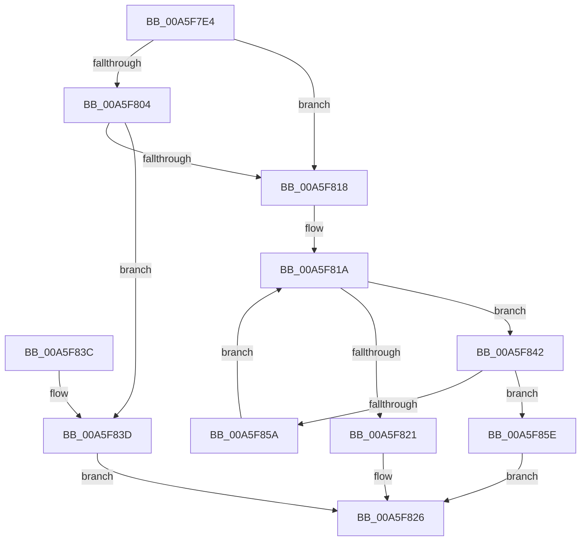

# PspEstimateNewProcessServerSilo

- RVA: `0x00A5F7E4`–`0x00A5F863` (길이 `127` bytes)
- VA: `0x0000000140A5F7E4`
- 실행 섹션: `PAGE`
- PDB 이름 있음: `예`; PDB Function 태그: `아니요`
- unwind 정보 RVA: `0x000B2D54`
- 디코드: `40`개 명령, `127/127` bytes 표시
- 미해석 바이트: `0` (있으면 어셈블리에 `.byte`로 보존)

> 이 문서는 커널 이미지의 기계어와 PDB 기호를 분석해 생성했습니다. 4번과 5번은 함수 원형과 자료형을 바이너리 사용 방식에서 추정한 C 해석이며 원본 소스 복구 결과는 아닙니다.

## 1. Dependencies

- 직접 호출 지점: **5**; 고유 호출 대상: **4**
- 직접 호출자로 확인된 함수: **1**
- RIP 상대 이미지 참조: **0**

### Outgoing calls
- `0x00A5F804` → [PsGetProcessServerSilo](../../text/44/PsGetProcessServerSilo_function_0044BEE0.md) (function, `0x0044BEE0`)
- `0x00A5F80F` → [PsIsHostSilo](../../text/44/PsIsHostSilo_function_00443B30.md) (function, `0x00443B30`)
- `0x00A5F821` → [HalAdjustResourceList](../../text/48/HalAdjustResourceList_function_0048FDC0.md) (function, `0x0048FDC0`)
- `0x00A5F846` → [PsGetEffectiveServerSilo](../../text/22/PsGetEffectiveServerSilo_function_002257F0.md) (function, `0x002257F0`)
- `0x00A5F851` → [PsIsHostSilo](../../text/44/PsIsHostSilo_function_00443B30.md) (function, `0x00443B30`)

### Direct callers
- [NtCreateUserProcess](../AE/NtCreateUserProcess_function_00AEA680.md) at `0x00AEAA09`

### Static image references
- 디코드된 RIP-relative 메모리 참조가 없습니다.

## 2. Other-region calls and transfers

- 다른 실행 섹션으로 향하는 call: **5**
  - `0x00A5F804` → [PsGetProcessServerSilo](../../text/44/PsGetProcessServerSilo_function_0044BEE0.md) (`PAGE` → `.text`)
  - `0x00A5F80F` → [PsIsHostSilo](../../text/44/PsIsHostSilo_function_00443B30.md) (`PAGE` → `.text`)
  - `0x00A5F821` → [HalAdjustResourceList](../../text/48/HalAdjustResourceList_function_0048FDC0.md) (`PAGE` → `.text`)
  - `0x00A5F846` → [PsGetEffectiveServerSilo](../../text/22/PsGetEffectiveServerSilo_function_002257F0.md) (`PAGE` → `.text`)
  - `0x00A5F851` → [PsIsHostSilo](../../text/44/PsIsHostSilo_function_00443B30.md) (`PAGE` → `.text`)
- 별도 외부 분기/꼬리 이동을 확인하지 못했습니다.

## 3. Assembly (complete function range)

```asm
00A5F7E4  48 89 5C 24 08                  mov qword ptr [rsp + 8], rbx
00A5F7E9  48 89 74 24 10                  mov qword ptr [rsp + 0x10], rsi
00A5F7EE  48 89 7C 24 18                  mov qword ptr [rsp + 0x18], rdi
00A5F7F3  41 56                           push r14
00A5F7F5  48 83 EC 20                     sub rsp, 0x20
00A5F7F9  49 8B F0                        mov rsi, r8
00A5F7FC  4C 8B F2                        mov r14, rdx
00A5F7FF  48 85 C9                        test rcx, rcx
00A5F802  74 14                           je 0x140a5f818
00A5F804  E8 D7 C6 9E FF                  call 0x14044bee0
00A5F809  48 8B C8                        mov rcx, rax
00A5F80C  48 8B D8                        mov rbx, rax
00A5F80F  E8 1C 43 9E FF                  call 0x140443b30
00A5F814  84 C0                           test al, al
00A5F816  74 25                           je 0x140a5f83d
00A5F818  33 DB                           xor ebx, ebx
00A5F81A  8B CB                           mov ecx, ebx
00A5F81C  48 3B CE                        cmp rcx, rsi
00A5F81F  72 21                           jb 0x140a5f842
00A5F821  E8 9A 05 A3 FF                  call 0x14048fdc0
00A5F826  48 8B 5C 24 30                  mov rbx, qword ptr [rsp + 0x30]
00A5F82B  48 8B 74 24 38                  mov rsi, qword ptr [rsp + 0x38]
00A5F830  48 8B 7C 24 40                  mov rdi, qword ptr [rsp + 0x40]
00A5F835  48 83 C4 20                     add rsp, 0x20
00A5F839  41 5E                           pop r14
00A5F83B  C3                              ret
00A5F83C  CC                              int3
00A5F83D  48 8B C3                        mov rax, rbx
00A5F840  EB E4                           jmp 0x140a5f826
00A5F842  49 8B 0C DE                     mov rcx, qword ptr [r14 + rbx*8]
00A5F846  E8 A5 5F 7C FF                  call 0x1402257f0
00A5F84B  48 8B C8                        mov rcx, rax
00A5F84E  48 8B F8                        mov rdi, rax
00A5F851  E8 DA 42 9E FF                  call 0x140443b30
00A5F856  84 C0                           test al, al
00A5F858  74 04                           je 0x140a5f85e
00A5F85A  FF C3                           inc ebx
00A5F85C  EB BC                           jmp 0x140a5f81a
00A5F85E  48 8B C7                        mov rax, rdi
00A5F861  EB C3                           jmp 0x140a5f826
```

## 4. C-style interpretation (structured pseudocode)

```c
__int64 __fastcall PspEstimateNewProcessServerSilo(__int64 a1, __int64 a2, __int64 a3)
{
    __int64 result;
    __int64 v_rbx;
    __int64 v_rsp;
    unsigned __int64 v_stack_p10;
    unsigned __int64 v_stack_p18;
    unsigned __int64 v_stack_p8;

    v_stack_p8 = v_rbx;
    v_stack_p10 = v_rsi;
    v_stack_p18 = v_rdi;
    v_rsp = (v_rsp) - (32);
    if (a1 == 0) goto loc_00A5F818;
    result = PsGetProcessServerSilo(a1, a2, a3, a4);
    result = PsIsHostSilo(result, a2, a3, a4);
    if ((unsigned __int8)(result) == 0) goto loc_00A5F83D;
loc_00A5F818:
    v_rbx = 0;
loc_00A5F81A:
    if (0 < a3) goto loc_00A5F842;
    result = HalAdjustResourceList(0, a2, a3, a4);
loc_00A5F826:
    v_rsp = (v_rsp) + (32);
    return result;
loc_00A5F83D:
    goto loc_00A5F826;
loc_00A5F842:
    result = PsGetEffectiveServerSilo(*(unsigned __int64 *)(a2 + v_stack_p8 * 8), a2, a3, a4);
    result = PsIsHostSilo(result, a2, a3, a4);
    if ((unsigned __int8)(result) == 0) goto loc_00A5F85E;
    v_rbx = (unsigned int)((v_stack_p8) + 1);
    goto loc_00A5F81A;
loc_00A5F85E:
    goto loc_00A5F826;
}
```

## 5. (Beta) C Style

```c
int64_t PspEstimateNewProcessServerSilo(int64_t Arg1, void *Arg2, int64_t Arg3)
{
    uint8_t *arg2 = (uint8_t *)Arg2;

    int64_t result;
    int64_t local_rbx;
    int64_t local_rsp;
    uint64_t v_stack_p10;
    uint64_t v_stack_p18;
    uint64_t v_stack_p8;

    v_stack_p8 = local_rbx;
    v_stack_p10 = local_rsi;
    v_stack_p18 = local_rdi;
    local_rsp = (local_rsp) - (32);
    if (Arg1 == 0) goto loc_00A5F818;
    result = PsGetProcessServerSilo(Arg1, Arg2, Arg3, a4);
    result = PsIsHostSilo(result, Arg2, Arg3, a4);
    if ((uint8_t)(result) == 0) goto loc_00A5F83D;
loc_00A5F818:
    local_rbx = 0;
loc_00A5F81A:
    if (0 < Arg3) goto loc_00A5F842;
    result = HalAdjustResourceList(0, Arg2, Arg3, a4);
loc_00A5F826:
    local_rsp = (local_rsp) + (32);
    return result;
loc_00A5F83D:
    goto loc_00A5F826;
loc_00A5F842:
    result = PsGetEffectiveServerSilo(*(uint64_t *)(arg2 + v_stack_p8 * 8), Arg2, Arg3, a4);
    result = PsIsHostSilo(result, Arg2, Arg3, a4);
    if ((uint8_t)(result) == 0) goto loc_00A5F85E;
    local_rbx = (uint32_t)((v_stack_p8) + 1);
    goto loc_00A5F81A;
loc_00A5F85E:
    goto loc_00A5F826;
}
```

### 관측된 메모리 오프셋

구조체 형식이 확인되지 않은 접근은 인자 기준의 오프셋으로만 기록했습니다.

| 기준 인자 | 오프셋 표현 | 폭 (bit) | 접근 |
|---|---:|---:|---|
| `Arg2` | `+ 0x0 + rbx*8` | `64` | `R` |

## 6. Execution-region graph

[열기: 2D/3D 그래프와 함수 탐색 컨트롤 패널](../../../control-panel.html?section=page&rva=0x00A5F7E4&view=graph)

- 2D 그래프는 위에서 아래로 흐르고, 3D 그래프는 빈 공간을 드래그해 회전합니다. Shift+드래그는 이동, 휠은 확대·축소, 함수 노드 선택은 대상 보고서 이동입니다.

### Static fallback


