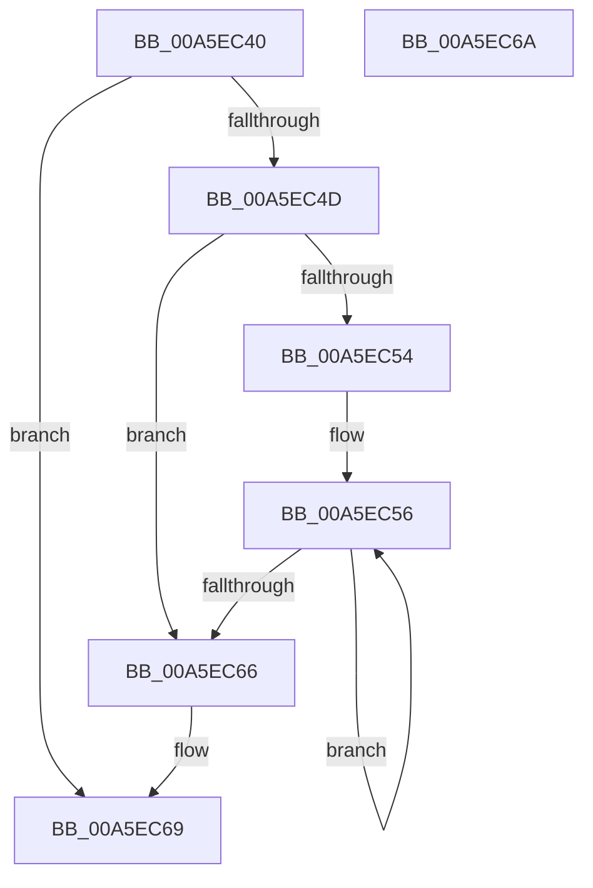

# PspHashKeyValue

- RVA: `0x00A5EC40`–`0x00A5EC6B` (길이 `43` bytes)
- VA: `0x0000000140A5EC40`
- 실행 섹션: `PAGE`
- PDB 이름 있음: `예`; PDB Function 태그: `아니요`
- unwind 정보 RVA: `0x000DB714`
- 디코드: `18`개 명령, `43/43` bytes 표시
- 미해석 바이트: `0` (있으면 어셈블리에 `.byte`로 보존)

> 이 문서는 커널 이미지의 기계어와 PDB 기호를 분석해 생성했습니다. 4번과 5번은 함수 원형과 자료형을 바이너리 사용 방식에서 추정한 C 해석이며 원본 소스 복구 결과는 아닙니다.

## 1. Dependencies

- 직접 호출 지점: **0**; 고유 호출 대상: **0**
- 직접 호출자로 확인된 함수: **2**
- RIP 상대 이미지 참조: **0**

### Outgoing calls
- 직접 디코드된 call 명령이 없습니다.

### Direct callers
- [PspRemoveQuotaBlock](../9D/PspRemoveQuotaBlock_function_009DAA00.md) at `0x009DAA68`
- [PspLookupProcessQuotaBlock](../AE/PspLookupProcessQuotaBlock_function_00AE336C.md) at `0x00AE339E`

### Static image references
- 디코드된 RIP-relative 메모리 참조가 없습니다.

## 2. Other-region calls and transfers

- 다른 실행 섹션으로 향하는 call: **0**
- 별도 외부 분기/꼬리 이동을 확인하지 못했습니다.

## 3. Assembly (complete function range)

```asm
00A5EC40  33 C0                           xor eax, eax
00A5EC42  4C 8B C2                        mov r8, rdx
00A5EC45  4C 8B C9                        mov r9, rcx
00A5EC48  48 85 C9                        test rcx, rcx
00A5EC4B  74 1C                           je 0x140a5ec69
00A5EC4D  8B D0                           mov edx, eax
00A5EC4F  4D 85 C0                        test r8, r8
00A5EC52  74 12                           je 0x140a5ec66
00A5EC54  8B C8                           mov ecx, eax
00A5EC56  42 0F B6 0C 09                  movzx ecx, byte ptr [rcx + r9]
00A5EC5B  FF C2                           inc edx
00A5EC5D  03 C1                           add eax, ecx
00A5EC5F  8B CA                           mov ecx, edx
00A5EC61  49 3B C8                        cmp rcx, r8
00A5EC64  72 F0                           jb 0x140a5ec56
00A5EC66  83 E0 1F                        and eax, 0x1f
00A5EC69  C3                              ret
00A5EC6A  CC                              int3
```

## 4. C-style interpretation (structured pseudocode)

```c
__int64 __fastcall PspHashKeyValue(__int64 a1, __int64 a2)
{
    __int64 result;

    result = 0;
    if (a1 == 0) goto loc_00A5EC69;
    if (a2 == 0) goto loc_00A5EC66;
loc_00A5EC56:
    a2 = (unsigned int)((0) + 1);
    result = (unsigned int)((result) + ((unsigned int)(*(unsigned __int8 *)(0 + a1 * 1))));
    if (((unsigned int)((unsigned int)(a2))) < a2) goto loc_00A5EC56;
loc_00A5EC66:
    result = (unsigned int)((result) & (31));
loc_00A5EC69:
    return result;
}
```

## 5. (Beta) C Style

```c
int64_t PspHashKeyValue(int64_t Arg1, int64_t Arg2)
{
    int64_t result;

    result = 0;
    if (Arg1 == 0) goto loc_00A5EC69;
    if (Arg2 == 0) goto loc_00A5EC66;
loc_00A5EC56:
    Arg2 = (uint32_t)((0) + 1);
    result = (uint32_t)((result) + ((uint32_t)(*(uint8_t *)(0 + Arg1 * 1))));
    if (((uint32_t)((uint32_t)(Arg2))) < Arg2) goto loc_00A5EC56;
loc_00A5EC66:
    result = (uint32_t)((result) & (31));
loc_00A5EC69:
    return result;
}
```

## 6. Execution-region graph

[열기: 2D/3D 그래프와 함수 탐색 컨트롤 패널](../../../control-panel.html?section=page&rva=0x00A5EC40&view=graph)

- 2D 그래프는 위에서 아래로 흐르고, 3D 그래프는 빈 공간을 드래그해 회전합니다. Shift+드래그는 이동, 휠은 확대·축소, 함수 노드 선택은 대상 보고서 이동입니다.

### Static fallback


