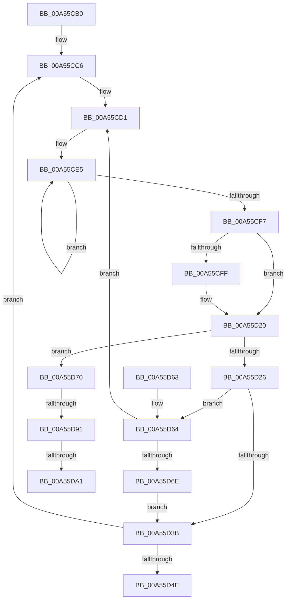

# PspJobNotificationWorker

- RVA: `0x00A55CB0`–`0x00A55DB4` (길이 `260` bytes)
- VA: `0x0000000140A55CB0`
- 실행 섹션: `PAGE`
- PDB 이름 있음: `예`; PDB Function 태그: `예`
- unwind 정보 RVA: `0x000B12D0`
- 디코드: `60`개 명령, `260/260` bytes 표시
- 미해석 바이트: `0` (있으면 어셈블리에 `.byte`로 보존)

> 이 문서는 커널 이미지의 기계어와 PDB 기호를 분석해 생성했습니다. 4번과 5번은 함수 원형과 자료형을 바이너리 사용 방식에서 추정한 C 해석이며 원본 소스 복구 결과는 아닙니다.

## 1. Dependencies

- 직접 호출 지점: **4**; 고유 호출 대상: **4**
- 직접 호출자로 확인된 함수: **0**
- RIP 상대 이미지 참조: **2**

### Outgoing calls
- `0x00A55D1B` → [ZwUpdateWnfStateData](../../text/6B/ZwUpdateWnfStateData_function_006B0D10.md) (function, `0x006B0D10`)
- `0x00A55D2E` → [ObfDereferenceObjectWithTag](../../text/2F/ObfDereferenceObjectWithTag_function_002F78E0.md) (function, `0x002F78E0`)
- `0x00A55D7F` → [PspLockJobExclusive](../91/PspLockJobExclusive_function_0091A4B8.md) (function, `0x0091A4B8`)
- `0x00A55DA9` → [PspSendReliableJobNotification](../91/PspSendReliableJobNotification_function_009171D4.md) (function, `0x009171D4`)

### Direct callers
- 이 함수 시작 RVA로 연결되는 직접 call은 확인되지 않았습니다. 간접 호출은 완전히 역산할 수 없습니다.

### Static image references
- `0x00A55CCA` → RVA `0x00F06598` (`.data`; read/write)
- `0x00A55D3F` → RVA `0x00F06598` (`.data`; read)

## 2. Other-region calls and transfers

- 다른 실행 섹션으로 향하는 call: **2**
  - `0x00A55D1B` → [ZwUpdateWnfStateData](../../text/6B/ZwUpdateWnfStateData_function_006B0D10.md) (`PAGE` → `.text`)
  - `0x00A55D2E` → [ObfDereferenceObjectWithTag](../../text/2F/ObfDereferenceObjectWithTag_function_002F78E0.md) (`PAGE` → `.text`)
- call이 아닌 외부 분기/꼬리 이동: **3**
  - `0x00A55D8B` → [sub_00B3D6D2](../B3/Unknown_function_00B3D6D2.md) (`tail-transfer`)
  - `0x00A55D9B` → [sub_00B3D6D2](../B3/Unknown_function_00B3D6D2.md) (`tail-transfer`)
  - `0x00A55DAF` → [sub_00B3D6D2](../B3/Unknown_function_00B3D6D2.md) (`tail-transfer`)

## 3. Assembly (complete function range)

```asm
00A55CB0  48 89 5C 24 08                  mov qword ptr [rsp + 8], rbx
00A55CB5  48 89 6C 24 10                  mov qword ptr [rsp + 0x10], rbp
00A55CBA  48 89 74 24 18                  mov qword ptr [rsp + 0x18], rsi
00A55CBF  57                              push rdi
00A55CC0  48 83 EC 40                     sub rsp, 0x40
00A55CC4  33 ED                           xor ebp, ebp
00A55CC6  48 83 CB FF                     or rbx, 0xffffffffffffffff
00A55CCA  48 87 1D C7 08 4B 00            xchg qword ptr [rip + 0x4b08c7], rbx
00A55CD1  48 8B BB B0 04 00 00            mov rdi, qword ptr [rbx + 0x4b0]
00A55CD8  0F 0D 8B 10 06 00 00            prefetchw byte ptr [rbx + 0x610]
00A55CDF  8B 83 10 06 00 00               mov eax, dword ptr [rbx + 0x610]
00A55CE5  8B C8                           mov ecx, eax
00A55CE7  81 E1 FF DF FD FF               and ecx, 0xfffddfff
00A55CED  F0 0F B1 8B 10 06 00 00         lock cmpxchg dword ptr [rbx + 0x610], ecx
00A55CF5  75 EE                           jne 0x140a55ce5
00A55CF7  8B F0                           mov esi, eax
00A55CF9  0F BA E0 0D                     bt eax, 0xd
00A55CFD  73 21                           jae 0x140a55d20
00A55CFF  89 6C 24 30                     mov dword ptr [rsp + 0x30], ebp
00A55D03  48 8D 8B 58 04 00 00            lea rcx, [rbx + 0x458]
00A55D0A  89 6C 24 28                     mov dword ptr [rsp + 0x28], ebp
00A55D0E  45 33 C9                        xor r9d, r9d
00A55D11  45 33 C0                        xor r8d, r8d
00A55D14  48 89 6C 24 20                  mov qword ptr [rsp + 0x20], rbp
00A55D19  33 D2                           xor edx, edx
00A55D1B  E8 F0 AF C5 FF                  call 0x1406b0d10
00A55D20  0F BA E6 11                     bt esi, 0x11
00A55D24  72 4A                           jb 0x140a55d70
00A55D26  BA 50 73 4E 6F                  mov edx, 0x6f4e7350
00A55D2B  48 8B CB                        mov rcx, rbx
00A55D2E  E8 AD 1B 8A FF                  call 0x1402f78e0
00A55D33  48 8B DF                        mov rbx, rdi
00A55D36  48 85 FF                        test rdi, rdi
00A55D39  75 29                           jne 0x140a55d64
00A55D3B  48 83 C8 FF                     or rax, 0xffffffffffffffff
00A55D3F  F0 48 0F B1 2D 50 08 4B 00      lock cmpxchg qword ptr [rip + 0x4b0850], rbp
00A55D48  0F 85 78 FF FF FF               jne 0x140a55cc6
00A55D4E  48 8B 5C 24 50                  mov rbx, qword ptr [rsp + 0x50]
00A55D53  48 8B 6C 24 58                  mov rbp, qword ptr [rsp + 0x58]
00A55D58  48 8B 74 24 60                  mov rsi, qword ptr [rsp + 0x60]
00A55D5D  48 83 C4 40                     add rsp, 0x40
00A55D61  5F                              pop rdi
00A55D62  C3                              ret
00A55D63  CC                              int3
00A55D64  48 83 FF FF                     cmp rdi, -1
00A55D68  0F 85 63 FF FF FF               jne 0x140a55cd1
00A55D6E  EB CB                           jmp 0x140a55d3b
00A55D70  65 48 8B 34 25 88 01 00 00      mov rsi, qword ptr gs:[0x188]
00A55D79  48 8B CB                        mov rcx, rbx
00A55D7C  48 8B D6                        mov rdx, rsi
00A55D7F  E8 34 47 EC FF                  call 0x14091a4b8
00A55D84  48 39 AB 28 02 00 00            cmp qword ptr [rbx + 0x228], rbp
00A55D8B  0F 84 41 79 0E 00               je 0x140b3d6d2
00A55D91  F7 83 50 04 00 00 00 10 00 00   test dword ptr [rbx + 0x450], 0x1000
00A55D9B  0F 84 31 79 0E 00               je 0x140b3d6d2
00A55DA1  BA 0C 00 00 00                  mov edx, 0xc
00A55DA6  48 8B CB                        mov rcx, rbx
00A55DA9  E8 26 14 EC FF                  call 0x1409171d4
00A55DAE  90                              nop
00A55DAF  E9 1E 79 0E 00                  jmp 0x140b3d6d2
```

## 4. C-style interpretation (structured pseudocode)

```c
__int64 __fastcall PspJobNotificationWorker(__int64 a1, int a2, int a3, int a4)
{
    __int64 result;
    __int64 v_rbp;
    __int64 v_rbx;
    __int64 v_rsp;
    unsigned int v_stack_m18;
    unsigned int v_stack_m20;
    unsigned __int64 v_stack_m28;
    unsigned __int64 v_stack_p10;
    unsigned __int64 v_stack_p18;
    unsigned __int64 v_stack_p8;

    v_stack_p8 = v_rbx;
    v_stack_p10 = v_rbp;
    v_stack_p18 = v_rsi;
    v_rsp = (v_rsp) - (64);
    v_rbp = 0;
loc_00A55CC6:
    v_rbx = (v_rbx) | (-1);
loc_00A55CD1:
loc_00A55CE5:
    a1 = (unsigned int)(((unsigned int)((unsigned int)((unsigned int)(*(unsigned int *)(v_rbx + 1552))))) & (0xFFFDDFFFULL));
    if (condition_is_not_equal) goto loc_00A55CE5;
    result = (unsigned int)(*(unsigned int *)(v_rbx + 1552));
    if (!(condition_is_above_or_equal)) {
        v_stack_m18 = 0;
        a1 = v_rbx + 1112;
        v_stack_m20 = 0;
        a4 = 0;
        a3 = 0;
        v_stack_m28 = 0;
        a2 = 0;
        result = ZwUpdateWnfStateData(a1, a2, a3, a4);
    }
    if (condition_is_below) goto loc_00A55D70;
    result = ObfDereferenceObjectWithTag(v_rbx, (unsigned int)(0x6F4E7350ULL), a3, a4);
    if (*(unsigned __int64 *)(v_rbx + 1200) != 0) goto loc_00A55D64;
loc_00A55D3B:
    result = (result) | (-1);
    if (condition_is_not_equal) goto loc_00A55CC6;
    v_rsp = (v_rsp) + (64);
    return result;
loc_00A55D64:
    if ((*(unsigned __int64 *)(v_rbx + 1200)) != -1) goto loc_00A55CD1;
    goto loc_00A55D3B;
loc_00A55D70:
    result = PspLockJobExclusive(v_stack_p8, *(unsigned __int64 *)(gs_base + (0 + 392)), a3, a4);
    result = PspSendReliableJobNotification(v_stack_p8, 12, a3, a4);
}
```

## 5. (Beta) C Style

```c
int64_t PspJobNotificationWorker(int64_t Arg1, int32_t Arg2, int32_t Arg3, int32_t Arg4)
{
    int64_t result;
    int64_t local_rbp;
    int64_t local_rbx;
    int64_t local_rsp;
    uint32_t v_stack_m18;
    uint32_t v_stack_m20;
    uint64_t v_stack_m28;
    uint64_t v_stack_p10;
    uint64_t v_stack_p18;
    uint64_t v_stack_p8;

    v_stack_p8 = local_rbx;
    v_stack_p10 = local_rbp;
    v_stack_p18 = local_rsi;
    local_rsp = (local_rsp) - (64);
    local_rbp = 0;
loc_00A55CC6:
    local_rbx = (local_rbx) | (-1);
loc_00A55CD1:
loc_00A55CE5:
    Arg1 = (uint32_t)(((uint32_t)((uint32_t)((uint32_t)(*(uint32_t *)(local_rbx + 0x610))))) & (0xFFFDDFFFULL));
    if (condition_is_not_equal) goto loc_00A55CE5;
    result = (uint32_t)(*(uint32_t *)(local_rbx + 0x610));
    if (!(condition_is_above_or_equal)) {
        v_stack_m18 = 0;
        Arg1 = local_rbx + 1112;
        v_stack_m20 = 0;
        Arg4 = 0;
        Arg3 = 0;
        v_stack_m28 = 0;
        Arg2 = 0;
        result = ZwUpdateWnfStateData(Arg1, Arg2, Arg3, Arg4);
    }
    if (condition_is_below) goto loc_00A55D70;
    result = ObfDereferenceObjectWithTag(local_rbx, (uint32_t)(0x6F4E7350ULL), Arg3, Arg4);
    if (*(uint64_t *)(local_rbx + 0x4B0) != 0) goto loc_00A55D64;
loc_00A55D3B:
    result = (result) | (-1);
    if (condition_is_not_equal) goto loc_00A55CC6;
    local_rsp = (local_rsp) + (64);
    return result;
loc_00A55D64:
    if ((*(uint64_t *)(local_rbx + 0x4B0)) != -1) goto loc_00A55CD1;
    goto loc_00A55D3B;
loc_00A55D70:
    result = PspLockJobExclusive(v_stack_p8, *(uint64_t *)(gs_base + (0 + 0x188)), Arg3, Arg4);
    result = PspSendReliableJobNotification(v_stack_p8, 12, Arg3, Arg4);
}
```

## 6. Execution-region graph

[열기: 2D/3D 그래프와 함수 탐색 컨트롤 패널](../../../control-panel.html?section=page&rva=0x00A55CB0&view=graph)

- 2D 그래프는 위에서 아래로 흐르고, 3D 그래프는 빈 공간을 드래그해 회전합니다. Shift+드래그는 이동, 휠은 확대·축소, 함수 노드 선택은 대상 보고서 이동입니다.

### Static fallback


