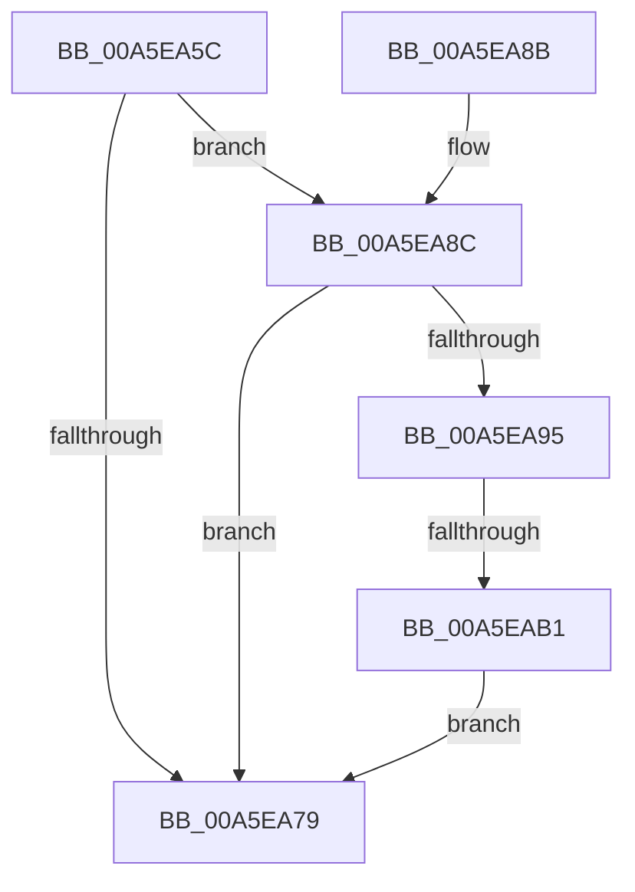

# PspRecheckThreadPasidMsrState

- RVA: `0x00A5EA5C`–`0x00A5EAB8` (길이 `92` bytes)
- VA: `0x0000000140A5EA5C`
- 실행 섹션: `PAGE`
- PDB 이름 있음: `예`; PDB Function 태그: `예`
- unwind 정보 RVA: `0x000B2A30`
- 디코드: `26`개 명령, `92/92` bytes 표시
- 미해석 바이트: `0` (있으면 어셈블리에 `.byte`로 보존)

> 이 문서는 커널 이미지의 기계어와 PDB 기호를 분석해 생성했습니다. 4번과 5번은 함수 원형과 자료형을 바이너리 사용 방식에서 추정한 C 해석이며 원본 소스 복구 결과는 아닙니다.

## 1. Dependencies

- 직접 호출 지점: **2**; 고유 호출 대상: **2**
- 직접 호출자로 확인된 함수: **1**
- RIP 상대 이미지 참조: **0**

### Outgoing calls
- `0x00A5EA70` → [ExIsSvmPasidMsrUpdateRequiredForProcess](ExIsSvmPasidMsrUpdateRequiredForProcess_function_00A5EAC0.md) (function, `0x00A5EAC0`)
- `0x00A5EAA3` → [ExAllocatePool2](../../poolcode/B8/ExAllocatePool2_function_00B820F0.md) (function, `0x00B820F0`)

### Direct callers
- [PspInsertThread](../9F/PspInsertThread_function_009F0314.md) at `0x009F0914`

### Static image references
- 디코드된 RIP-relative 메모리 참조가 없습니다.

## 2. Other-region calls and transfers

- 다른 실행 섹션으로 향하는 call: **1**
  - `0x00A5EAA3` → [ExAllocatePool2](../../poolcode/B8/ExAllocatePool2_function_00B820F0.md) (`PAGE` → `POOLCODE`)
- call이 아닌 외부 분기/꼬리 이동: **1**
  - `0x00A5EAAB` → [sub_00B3E0C2](../B3/Unknown_function_00B3E0C2.md) (`tail-transfer`)

## 3. Assembly (complete function range)

```asm
00A5EA5C  48 89 5C 24 08                  mov qword ptr [rsp + 8], rbx
00A5EA61  48 89 74 24 10                  mov qword ptr [rsp + 0x10], rsi
00A5EA66  57                              push rdi
00A5EA67  48 83 EC 40                     sub rsp, 0x40
00A5EA6B  48 8B F2                        mov rsi, rdx
00A5EA6E  33 FF                           xor edi, edi
00A5EA70  E8 4B 00 00 00                  call 0x140a5eac0
00A5EA75  84 C0                           test al, al
00A5EA77  75 13                           jne 0x140a5ea8c
00A5EA79  48 8B 5C 24 50                  mov rbx, qword ptr [rsp + 0x50]
00A5EA7E  8B C7                           mov eax, edi
00A5EA80  48 8B 74 24 58                  mov rsi, qword ptr [rsp + 0x58]
00A5EA85  48 83 C4 40                     add rsp, 0x40
00A5EA89  5F                              pop rdi
00A5EA8A  C3                              ret
00A5EA8B  CC                              int3
00A5EA8C  40 38 BE A9 05 00 00            cmp byte ptr [rsi + 0x5a9], dil
00A5EA93  7C E4                           jl 0x140a5ea79
00A5EA95  BA 70 00 00 00                  mov edx, 0x70
00A5EA9A  41 B8 50 73 53 76               mov r8d, 0x76537350
00A5EAA0  8D 4A D0                        lea ecx, [rdx - 0x30]
00A5EAA3  E8 48 36 12 00                  call 0x140b820f0
00A5EAA8  48 85 C0                        test rax, rax
00A5EAAB  0F 85 11 F6 0D 00               jne 0x140b3e0c2
00A5EAB1  BF 17 00 00 C0                  mov edi, 0xc0000017
00A5EAB6  EB C1                           jmp 0x140a5ea79
```

## 4. C-style interpretation (structured pseudocode)

```c
__int64 __fastcall PspRecheckThreadPasidMsrState(__int64 a1, __int64 a2)
{
    __int64 result;
    __int64 v_rdi;
    __int64 v_rsp;
    unsigned __int64 v_stack_p10;
    unsigned __int64 v_stack_p8;

    v_stack_p8 = v_rbx;
    v_stack_p10 = v_rsi;
    v_rsp = (v_rsp) - (64);
    v_rdi = 0;
    result = ExIsSvmPasidMsrUpdateRequiredForProcess(a1, a2, a3, a4);
    if ((unsigned __int8)(result) != 0) goto loc_00A5EA8C;
loc_00A5EA79:
    v_rsp = (v_rsp) + (64);
    return 0;
loc_00A5EA8C:
    if ((*(unsigned __int8 *)(v_stack_p10 + 1449)) < 0) goto loc_00A5EA79;
    result = ExAllocatePool2(112 - 48, 112, (unsigned int)(0x76537350ULL), a4);
    goto loc_00A5EA79;
}
```

## 5. (Beta) C Style

```c
int64_t PspRecheckThreadPasidMsrState(int64_t Arg1, void *Arg2)
{
    uint8_t *arg2 = (uint8_t *)Arg2;

    int64_t result;
    int64_t local_rdi;
    int64_t local_rsp;
    uint64_t v_stack_p10;
    uint64_t v_stack_p8;

    v_stack_p8 = local_rbx;
    v_stack_p10 = local_rsi;
    local_rsp = (local_rsp) - (64);
    local_rdi = 0;
    result = ExIsSvmPasidMsrUpdateRequiredForProcess(Arg1, Arg2, a3, a4);
    if ((uint8_t)(result) != 0) goto loc_00A5EA8C;
loc_00A5EA79:
    local_rsp = (local_rsp) + (64);
    return 0;
loc_00A5EA8C:
    if ((*(uint8_t *)(v_stack_p10 + 0x5A9)) < 0) goto loc_00A5EA79;
    result = ExAllocatePool2(112 - 48, 112, (uint32_t)(0x76537350ULL), a4);
    goto loc_00A5EA79;
}
```

### 관측된 메모리 오프셋

구조체 형식이 확인되지 않은 접근은 인자 기준의 오프셋으로만 기록했습니다.

| 기준 인자 | 오프셋 표현 | 폭 (bit) | 접근 |
|---|---:|---:|---|
| `Arg2` | `+ 0x5A9` | `8` | `R` |

## 6. Execution-region graph

[열기: 2D/3D 그래프와 함수 탐색 컨트롤 패널](../../../control-panel.html?section=page&rva=0x00A5EA5C&view=graph)

- 2D 그래프는 위에서 아래로 흐르고, 3D 그래프는 빈 공간을 드래그해 회전합니다. Shift+드래그는 이동, 휠은 확대·축소, 함수 노드 선택은 대상 보고서 이동입니다.

### Static fallback


