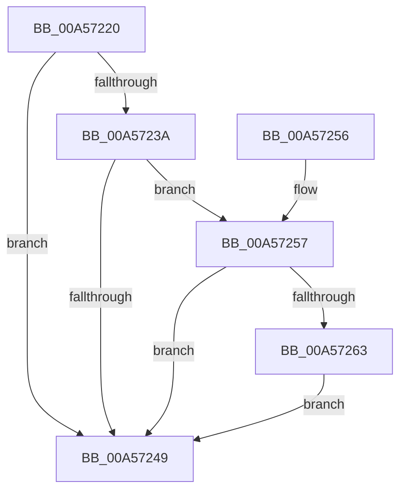

# PspSetJobLimitsProcessCallback

- RVA: `0x00A57220`–`0x00A5726D` (길이 `77` bytes)
- VA: `0x0000000140A57220`
- 실행 섹션: `PAGE`
- PDB 이름 있음: `예`; PDB Function 태그: `아니요`
- unwind 정보 RVA: `0x0006BDE4`
- 디코드: `25`개 명령, `77/77` bytes 표시
- 미해석 바이트: `0` (있으면 어셈블리에 `.byte`로 보존)

> 이 문서는 커널 이미지의 기계어와 PDB 기호를 분석해 생성했습니다. 4번과 5번은 함수 원형과 자료형을 바이너리 사용 방식에서 추정한 C 해석이며 원본 소스 복구 결과는 아닙니다.

## 1. Dependencies

- 직접 호출 지점: **2**; 고유 호출 대상: **2**
- 직접 호출자로 확인된 함수: **0**
- RIP 상대 이미지 참조: **0**

### Outgoing calls
- `0x00A5723D` → [PspApplyJobLimitsToProcess](PspApplyJobLimitsToProcess_function_00A57274.md) (function, `0x00A57274`)
- `0x00A57266` → [PspAddProcessToWorkingSetChangeList](../78/PspAddProcessToWorkingSetChangeList_function_00784B38.md) (function, `0x00784B38`)

### Direct callers
- 이 함수 시작 RVA로 연결되는 직접 call은 확인되지 않았습니다. 간접 호출은 완전히 역산할 수 없습니다.

### Static image references
- 디코드된 RIP-relative 메모리 참조가 없습니다.

## 2. Other-region calls and transfers

- 다른 실행 섹션으로 향하는 call: **0**
- 별도 외부 분기/꼬리 이동을 확인하지 못했습니다.

## 3. Assembly (complete function range)

```asm
00A57220  48 89 5C 24 08                  mov qword ptr [rsp + 8], rbx
00A57225  57                              push rdi
00A57226  48 83 EC 20                     sub rsp, 0x20
00A5722A  8B 81 F0 01 00 00               mov eax, dword ptr [rcx + 0x1f0]
00A57230  48 8B FA                        mov rdi, rdx
00A57233  48 8B D9                        mov rbx, rcx
00A57236  A8 01                           test al, 1
00A57238  75 0F                           jne 0x140a57249
00A5723A  8B 52 08                        mov edx, dword ptr [rdx + 8]
00A5723D  E8 32 00 00 00                  call 0x140a57274
00A57242  8B 47 08                        mov eax, dword ptr [rdi + 8]
00A57245  A8 01                           test al, 1
00A57247  74 0E                           je 0x140a57257
00A57249  48 8B 5C 24 30                  mov rbx, qword ptr [rsp + 0x30]
00A5724E  33 C0                           xor eax, eax
00A57250  48 83 C4 20                     add rsp, 0x20
00A57254  5F                              pop rdi
00A57255  C3                              ret
00A57256  CC                              int3
00A57257  48 8B 83 A0 02 00 00            mov rax, qword ptr [rbx + 0x2a0]
00A5725E  48 39 07                        cmp qword ptr [rdi], rax
00A57261  74 E6                           je 0x140a57249
00A57263  48 8B CB                        mov rcx, rbx
00A57266  E8 CD D8 D2 FF                  call 0x140784b38
00A5726B  EB DC                           jmp 0x140a57249
```

## 4. C-style interpretation (structured pseudocode)

```c
__int64 __fastcall PspSetJobLimitsProcessCallback(__int64 a1, __int64 a2)
{
    __int64 result;
    __int64 v_rsp;
    unsigned __int64 v_stack_p8;

    v_stack_p8 = v_rbx;
    v_rsp = (v_rsp) - (32);
    if ((((unsigned __int8)((unsigned int)(*(unsigned int *)(a1 + 496)))) & (1)) != 0) goto loc_00A57249;
    result = PspApplyJobLimitsToProcess(a1, (unsigned int)(*(unsigned int *)(a2 + 8)), a3, a4);
    if ((((unsigned __int8)((unsigned int)(*(unsigned int *)(a2 + 8)))) & (1)) == 0) goto loc_00A57257;
loc_00A57249:
    result = 0;
    v_rsp = (v_rsp) + (32);
    return result;
loc_00A57257:
    if ((*(unsigned __int64 *)(a2)) == (*(unsigned __int64 *)(v_stack_p8 + 672))) goto loc_00A57249;
    result = PspAddProcessToWorkingSetChangeList(v_stack_p8, (unsigned int)(*(unsigned int *)(a2 + 8)), a3, a4);
    goto loc_00A57249;
}
```

## 5. (Beta) C Style

```c
int64_t PspSetJobLimitsProcessCallback(void *Arg1, void *Arg2)
{
    uint8_t *arg1 = (uint8_t *)Arg1;
    uint8_t *arg2 = (uint8_t *)Arg2;

    int64_t result;
    int64_t local_rsp;
    uint64_t v_stack_p8;

    v_stack_p8 = local_rbx;
    local_rsp = (local_rsp) - (32);
    if ((((uint8_t)((uint32_t)(*(uint32_t *)(arg1 + 0x1F0)))) & (1)) != 0) goto loc_00A57249;
    result = PspApplyJobLimitsToProcess(Arg1, (uint32_t)(*(uint32_t *)(arg2 + 0x8)), a3, a4);
    if ((((uint8_t)((uint32_t)(*(uint32_t *)(arg2 + 0x8)))) & (1)) == 0) goto loc_00A57257;
loc_00A57249:
    result = 0;
    local_rsp = (local_rsp) + (32);
    return result;
loc_00A57257:
    if ((*(uint64_t *)(arg2)) == (*(uint64_t *)(v_stack_p8 + 0x2A0))) goto loc_00A57249;
    result = PspAddProcessToWorkingSetChangeList(v_stack_p8, (uint32_t)(*(uint32_t *)(arg2 + 0x8)), a3, a4);
    goto loc_00A57249;
}
```

### 관측된 메모리 오프셋

구조체 형식이 확인되지 않은 접근은 인자 기준의 오프셋으로만 기록했습니다.

| 기준 인자 | 오프셋 표현 | 폭 (bit) | 접근 |
|---|---:|---:|---|
| `Arg1` | `+ 0x1F0` | `32` | `R` |
| `Arg1` | `+ 0x2A0` | `64` | `R` |
| `Arg2` | `+ 0x0` | `64` | `R` |
| `Arg2` | `+ 0x8` | `32` | `R` |

## 6. Execution-region graph

[열기: 2D/3D 그래프와 함수 탐색 컨트롤 패널](../../../control-panel.html?section=page&rva=0x00A57220&view=graph)

- 2D 그래프는 위에서 아래로 흐르고, 3D 그래프는 빈 공간을 드래그해 회전합니다. Shift+드래그는 이동, 휠은 확대·축소, 함수 노드 선택은 대상 보고서 이동입니다.

### Static fallback


