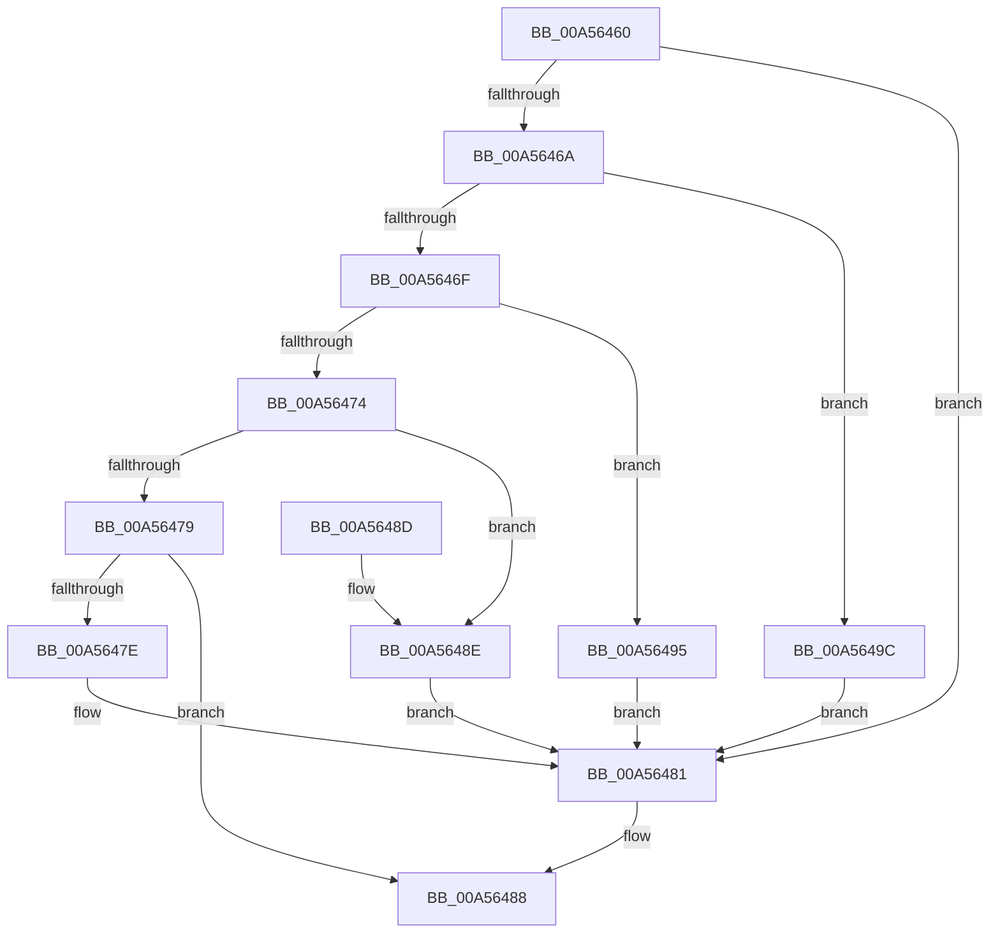

# PspSetThreadPpmPolicy

- RVA: `0x00A56460`–`0x00A564A3` (길이 `67` bytes)
- VA: `0x0000000140A56460`
- 실행 섹션: `PAGE`
- PDB 이름 있음: `예`; PDB Function 태그: `아니요`
- unwind 정보 RVA: `0x00068E00`
- 디코드: `24`개 명령, `67/67` bytes 표시
- 미해석 바이트: `0` (있으면 어셈블리에 `.byte`로 보존)

> 이 문서는 커널 이미지의 기계어와 PDB 기호를 분석해 생성했습니다. 4번과 5번은 함수 원형과 자료형을 바이너리 사용 방식에서 추정한 C 해석이며 원본 소스 복구 결과는 아닙니다.

## 1. Dependencies

- 직접 호출 지점: **1**; 고유 호출 대상: **1**
- 직접 호출자로 확인된 함수: **1**
- RIP 상대 이미지 참조: **0**

### Outgoing calls
- `0x00A56483` → [KeSetThreadPpmPolicy](../../text/3C/KeSetThreadPpmPolicy_function_003C6C30.md) (function, `0x003C6C30`)

### Direct callers
- [NtSetInformationThread](../8C/NtSetInformationThread_function_008C9F60.md) at `0x008CAD73`

### Static image references
- 디코드된 RIP-relative 메모리 참조가 없습니다.

## 2. Other-region calls and transfers

- 다른 실행 섹션으로 향하는 call: **1**
  - `0x00A56483` → [KeSetThreadPpmPolicy](../../text/3C/KeSetThreadPpmPolicy_function_003C6C30.md) (`PAGE` → `.text`)
- 별도 외부 분기/꼬리 이동을 확인하지 못했습니다.

## 3. Assembly (complete function range)

```asm
00A56460  48 83 EC 28                     sub rsp, 0x28
00A56464  33 C0                           xor eax, eax
00A56466  85 D2                           test edx, edx
00A56468  74 17                           je 0x140a56481
00A5646A  83 EA 01                        sub edx, 1
00A5646D  74 2D                           je 0x140a5649c
00A5646F  83 EA 01                        sub edx, 1
00A56472  74 21                           je 0x140a56495
00A56474  83 EA 01                        sub edx, 1
00A56477  74 15                           je 0x140a5648e
00A56479  83 FA 05                        cmp edx, 5
00A5647C  75 0A                           jne 0x140a56488
00A5647E  8D 42 FF                        lea eax, [rdx - 1]
00A56481  8B D0                           mov edx, eax
00A56483  E8 A8 07 97 FF                  call 0x1403c6c30
00A56488  48 83 C4 28                     add rsp, 0x28
00A5648C  C3                              ret
00A5648D  CC                              int3
00A5648E  B8 03 00 00 00                  mov eax, 3
00A56493  EB EC                           jmp 0x140a56481
00A56495  B8 02 00 00 00                  mov eax, 2
00A5649A  EB E5                           jmp 0x140a56481
00A5649C  B8 01 00 00 00                  mov eax, 1
00A564A1  EB DE                           jmp 0x140a56481
```

## 4. C-style interpretation (structured pseudocode)

```c
__int64 __fastcall PspSetThreadPpmPolicy(__int64 a1, int a2)
{
    __int64 result;
    __int64 v_rsp;

    v_rsp = (v_rsp) - (40);
    result = 0;
    if (a2 == 0) goto loc_00A56481;
    a2 = (unsigned int)((a2) - (1));
    if (condition_is_equal) goto loc_00A5649C;
    a2 = (unsigned int)((a2) - (1));
    if (condition_is_equal) goto loc_00A56495;
    a2 = (unsigned int)((a2) - (1));
    if (condition_is_equal) goto loc_00A5648E;
    if (a2 != 5) goto loc_00A56488;
loc_00A56481:
    result = KeSetThreadPpmPolicy(a1, (unsigned int)((unsigned int)(a2 - 1)), a3, a4);
loc_00A56488:
    v_rsp = (v_rsp) + (40);
    return result;
loc_00A5648E:
    goto loc_00A56481;
loc_00A56495:
    goto loc_00A56481;
loc_00A5649C:
    goto loc_00A56481;
}
```

## 5. (Beta) C Style

```c
int64_t PspSetThreadPpmPolicy(int64_t Arg1, int32_t Arg2)
{
    int64_t result;
    int64_t local_rsp;

    local_rsp = (local_rsp) - (40);
    result = 0;
    if (Arg2 == 0) goto loc_00A56481;
    Arg2 = (uint32_t)((Arg2) - (1));
    if (condition_is_equal) goto loc_00A5649C;
    Arg2 = (uint32_t)((Arg2) - (1));
    if (condition_is_equal) goto loc_00A56495;
    Arg2 = (uint32_t)((Arg2) - (1));
    if (condition_is_equal) goto loc_00A5648E;
    if (Arg2 != 5) goto loc_00A56488;
loc_00A56481:
    result = KeSetThreadPpmPolicy(Arg1, (uint32_t)((uint32_t)(Arg2 - 1)), a3, a4);
loc_00A56488:
    local_rsp = (local_rsp) + (40);
    return result;
loc_00A5648E:
    goto loc_00A56481;
loc_00A56495:
    goto loc_00A56481;
loc_00A5649C:
    goto loc_00A56481;
}
```

## 6. Execution-region graph

[열기: 2D/3D 그래프와 함수 탐색 컨트롤 패널](../../../control-panel.html?section=page&rva=0x00A56460&view=graph)

- 2D 그래프는 위에서 아래로 흐르고, 3D 그래프는 빈 공간을 드래그해 회전합니다. Shift+드래그는 이동, 휠은 확대·축소, 함수 노드 선택은 대상 보고서 이동입니다.

### Static fallback


