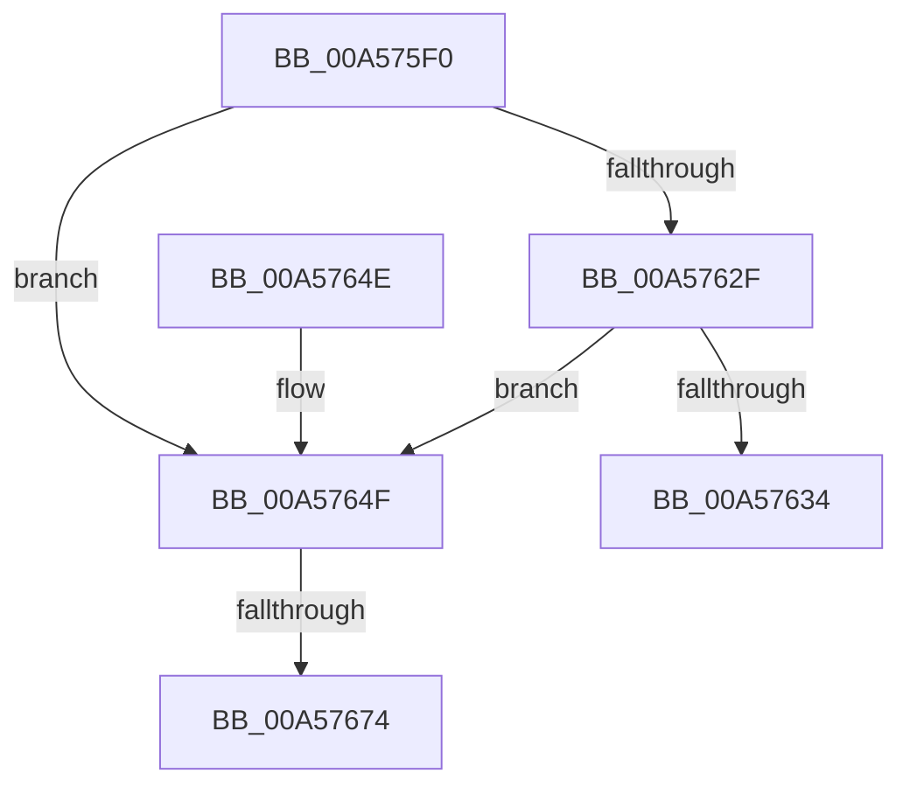

# PspSetupReservedUserMappings

- RVA: `0x00A575F0`–`0x00A57685` (길이 `149` bytes)
- VA: `0x0000000140A575F0`
- 실행 섹션: `PAGE`
- PDB 이름 있음: `예`; PDB Function 태그: `예`
- unwind 정보 RVA: `0x000B16D4`
- 디코드: `45`개 명령, `149/149` bytes 표시
- 미해석 바이트: `0` (있으면 어셈블리에 `.byte`로 보존)

> 이 문서는 커널 이미지의 기계어와 PDB 기호를 분석해 생성했습니다. 4번과 5번은 함수 원형과 자료형을 바이너리 사용 방식에서 추정한 C 해석이며 원본 소스 복구 결과는 아닙니다.

## 1. Dependencies

- 직접 호출 지점: **1**; 고유 호출 대상: **1**
- 직접 호출자로 확인된 함수: **1**
- RIP 상대 이미지 참조: **0**

### Outgoing calls
- `0x00A57660` → [KiStackAttachProcess](../../text/21/KiStackAttachProcess_function_00216820.md) (function, `0x00216820`)

### Direct callers
- [PspAllocateProcess](../A1/PspAllocateProcess_function_00A13B3C.md) at `0x00A15D80`

### Static image references
- 디코드된 RIP-relative 메모리 참조가 없습니다.

## 2. Other-region calls and transfers

- 다른 실행 섹션으로 향하는 call: **1**
  - `0x00A57660` → [KiStackAttachProcess](../../text/21/KiStackAttachProcess_function_00216820.md) (`PAGE` → `.text`)
- call이 아닌 외부 분기/꼬리 이동: **2**
  - `0x00A5766E` → [sub_00B3D958](../B3/Unknown_function_00B3D958.md) (`tail-transfer`)
  - `0x00A57680` → [sub_00B3D958 + 0x63](../B3/Unknown_function_00B3D958.md) (`tail-transfer`)

## 3. Assembly (complete function range)

```asm
00A575F0  48 8B C4                        mov rax, rsp
00A575F3  48 89 58 08                     mov qword ptr [rax + 8], rbx
00A575F7  55                              push rbp
00A575F8  56                              push rsi
00A575F9  57                              push rdi
00A575FA  41 54                           push r12
00A575FC  41 55                           push r13
00A575FE  41 56                           push r14
00A57600  41 57                           push r15
00A57602  48 83 EC 40                     sub rsp, 0x40
00A57606  4C 8B E2                        mov r12, rdx
00A57609  49 8D 98 00 01 00 00            lea rbx, [r8 + 0x100]
00A57610  33 D2                           xor edx, edx
00A57612  4D 8B F0                        mov r14, r8
00A57615  48 89 50 20                     mov qword ptr [rax + 0x20], rdx
00A57619  48 89 50 18                     mov qword ptr [rax + 0x18], rdx
00A5761D  49 8B 80 D8 00 00 00            mov rax, qword ptr [r8 + 0xd8]
00A57624  8B 78 08                        mov edi, dword ptr [rax + 8]
00A57627  81 E7 60 00 00 01               and edi, 0x1000060
00A5762D  75 20                           jne 0x140a5764f
00A5762F  48 39 13                        cmp qword ptr [rbx], rdx
00A57632  75 1B                           jne 0x140a5764f
00A57634  33 C0                           xor eax, eax
00A57636  48 8B 9C 24 80 00 00 00         mov rbx, qword ptr [rsp + 0x80]
00A5763E  48 83 C4 40                     add rsp, 0x40
00A57642  41 5F                           pop r15
00A57644  41 5E                           pop r14
00A57646  41 5D                           pop r13
00A57648  41 5C                           pop r12
00A5764A  5F                              pop rdi
00A5764B  5E                              pop rsi
00A5764C  5D                              pop rbp
00A5764D  C3                              ret
00A5764E  CC                              int3
00A5764F  4D 8B C4                        mov r8, r12
00A57652  41 BD 00 20 00 00               mov r13d, 0x2000
00A57658  41 BF 04 00 00 00               mov r15d, 4
00A5765E  8B EA                           mov ebp, edx
00A57660  E8 BB F1 7B FF                  call 0x140216820
00A57665  48 8B F3                        mov rsi, rbx
00A57668  81 FF 00 00 00 01               cmp edi, 0x1000000
00A5766E  0F 85 E4 62 0E 00               jne 0x140b3d958
00A57674  41 BD 00 20 04 00               mov r13d, 0x42000
00A5767A  41 BF 01 00 00 00               mov r15d, 1
00A57680  E9 36 63 0E 00                  jmp 0x140b3d9bb
```

## 4. C-style interpretation (structured pseudocode)

```c
__int64 __fastcall PspSetupReservedUserMappings(__int64 a1, __int64 a2, __int64 a3)
{
    __int64 result;
    __int64 v_rdi;
    __int64 v_rsp;
    unsigned __int64 v_stack_p8;

    *(unsigned __int64 *)(v_rsp + 8) = v_rbx;
    v_rsp = (v_rsp) - (64);
    a2 = 0;
    *(unsigned __int64 *)(v_rsp + 32) = 0;
    *(unsigned __int64 *)(v_rsp + 24) = 0;
    v_rdi = (unsigned int)(((unsigned int)(*(unsigned int *)(*(unsigned __int64 *)(a3 + 216) + 8))) & (0x1000060ULL));
    if (condition_is_not_equal) goto loc_00A5764F;
    if ((*(unsigned __int64 *)(a3 + 256)) != 0) goto loc_00A5764F;
    result = 0;
    v_rsp = (v_rsp) + (64);
    return result;
loc_00A5764F:
    result = KiStackAttachProcess(a1, a2, 0, a4);
}
```

## 5. (Beta) C Style

```c
int64_t PspSetupReservedUserMappings(int64_t Arg1, int64_t Arg2, void *Arg3)
{
    uint8_t *arg3 = (uint8_t *)Arg3;

    int64_t result;
    int64_t local_rdi;
    int64_t local_rsp;
    uint64_t v_stack_p8;

    *(uint64_t *)(local_rsp + 0x8) = local_rbx;
    local_rsp = (local_rsp) - (64);
    Arg2 = 0;
    *(uint64_t *)(local_rsp + 0x20) = 0;
    *(uint64_t *)(local_rsp + 0x18) = 0;
    local_rdi = (uint32_t)(((uint32_t)(*(uint32_t *)(*(uint64_t *)(arg3 + 0xD8) + 0x8))) & (0x1000060ULL));
    if (condition_is_not_equal) goto loc_00A5764F;
    if ((*(uint64_t *)(arg3 + 0x100)) != 0) goto loc_00A5764F;
    result = 0;
    local_rsp = (local_rsp) + (64);
    return result;
loc_00A5764F:
    result = KiStackAttachProcess(Arg1, Arg2, 0, a4);
}
```

### 관측된 메모리 오프셋

구조체 형식이 확인되지 않은 접근은 인자 기준의 오프셋으로만 기록했습니다.

| 기준 인자 | 오프셋 표현 | 폭 (bit) | 접근 |
|---|---:|---:|---|
| `Arg3` | `+ 0x0` | `64` | `R` |
| `Arg3` | `+ 0xD8` | `64` | `R` |
| `Arg3` | `+ 0x100` | `64` | `R` |

## 6. Execution-region graph

[열기: 2D/3D 그래프와 함수 탐색 컨트롤 패널](../../../control-panel.html?section=page&rva=0x00A575F0&view=graph)

- 2D 그래프는 위에서 아래로 흐르고, 3D 그래프는 빈 공간을 드래그해 회전합니다. Shift+드래그는 이동, 휠은 확대·축소, 함수 노드 선택은 대상 보고서 이동입니다.

### Static fallback


