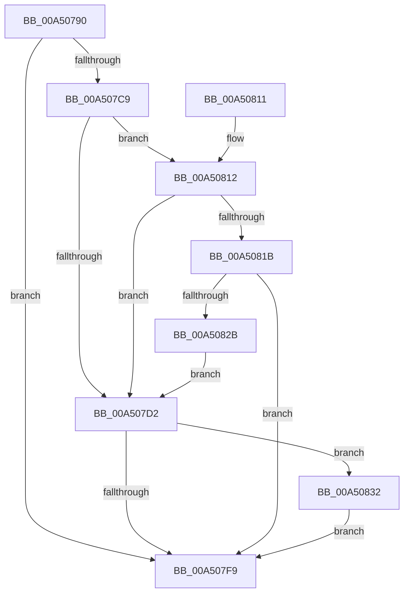

# PspUpdatePebForAffinityChange

- RVA: `0x00A50790`–`0x00A50840` (길이 `176` bytes)
- VA: `0x0000000140A50790`
- 실행 섹션: `PAGE`
- PDB 이름 있음: `예`; PDB Function 태그: `아니요`
- unwind 정보 RVA: `0x000B0A6C`
- 디코드: `46`개 명령, `176/176` bytes 표시
- 미해석 바이트: `0` (있으면 어셈블리에 `.byte`로 보존)

> 이 문서는 커널 이미지의 기계어와 PDB 기호를 분석해 생성했습니다. 4번과 5번은 함수 원형과 자료형을 바이너리 사용 방식에서 추정한 C 해석이며 원본 소스 복구 결과는 아닙니다.

## 1. Dependencies

- 직접 호출 지점: **6**; 고유 호출 대상: **6**
- 직접 호출자로 확인된 함수: **5**
- RIP 상대 이미지 참조: **1**

### Outgoing calls
- `0x00A507DC` → [KiStackAttachProcess](../../text/21/KiStackAttachProcess_function_00216820.md) (function, `0x00216820`)
- `0x00A507E4` → [PspWritePebAffinityInfoAttached](PspWritePebAffinityInfoAttached_function_00A50848.md) (function, `0x00A50848`)
- `0x00A507F0` → [KiUnstackDetachProcess](../../text/21/KiUnstackDetachProcess_function_00217D30.md) (function, `0x00217D30`)
- `0x00A50801` → [_security_check_cookie](../../text/6A/_security_check_cookie_function_006AC640.md) (function, `0x006AC640`)
- `0x00A50822` → [ExAcquireRundownProtection](../../text/21/ExAcquireRundownProtection_function_00216620.md) (function, `0x00216620`)
- `0x00A50839` → [ExReleaseRundownProtection](../../text/34/ExReleaseRundownProtection_function_00349E80.md) (function, `0x00349E80`)

### Direct callers
- [PspUpdateSingleProcessAffinity](../78/PspUpdateSingleProcessAffinity_function_00782B00.md) at `0x00782BCF`
- [PspAllocateProcess](../A1/PspAllocateProcess_function_00A13B3C.md) at `0x00A160F5`
- [PspApplyJobLimitsToProcess](PspApplyJobLimitsToProcess_function_00A57274.md) at `0x00A573B6`
- [NtSetInformationProcess](../AE/NtSetInformationProcess_function_00AE5370.md) at `0x00AE65E8`
- [PspSetupUserProcessAddressSpace](../AE/PspSetupUserProcessAddressSpace_function_00AEBDC8.md) at `0x00AEBFF7`

### Static image references
- `0x00A5079A` → RVA `0x00E0A740` (`.data`; read)

## 2. Other-region calls and transfers

- 다른 실행 섹션으로 향하는 call: **5**
  - `0x00A507DC` → [KiStackAttachProcess](../../text/21/KiStackAttachProcess_function_00216820.md) (`PAGE` → `.text`)
  - `0x00A507F0` → [KiUnstackDetachProcess](../../text/21/KiUnstackDetachProcess_function_00217D30.md) (`PAGE` → `.text`)
  - `0x00A50801` → [_security_check_cookie](../../text/6A/_security_check_cookie_function_006AC640.md) (`PAGE` → `.text`)
  - `0x00A50822` → [ExAcquireRundownProtection](../../text/21/ExAcquireRundownProtection_function_00216620.md) (`PAGE` → `.text`)
  - `0x00A50839` → [ExReleaseRundownProtection](../../text/34/ExReleaseRundownProtection_function_00349E80.md) (`PAGE` → `.text`)
- 별도 외부 분기/꼬리 이동을 확인하지 못했습니다.

## 3. Assembly (complete function range)

```asm
00A50790  48 89 5C 24 08                  mov qword ptr [rsp + 8], rbx
00A50795  57                              push rdi
00A50796  48 83 EC 60                     sub rsp, 0x60
00A5079A  48 8B 05 9F 9F 3B 00            mov rax, qword ptr [rip + 0x3b9f9f]
00A507A1  48 33 C4                        xor rax, rsp
00A507A4  48 89 44 24 50                  mov qword ptr [rsp + 0x50], rax
00A507A9  0F 57 C0                        xorps xmm0, xmm0
00A507AC  33 DB                           xor ebx, ebx
00A507AE  48 8B FA                        mov rdi, rdx
00A507B1  0F 11 44 24 20                  movups xmmword ptr [rsp + 0x20], xmm0
00A507B6  0F 11 44 24 30                  movups xmmword ptr [rsp + 0x30], xmm0
00A507BB  0F 11 44 24 40                  movups xmmword ptr [rsp + 0x40], xmm0
00A507C0  48 39 9A E0 02 00 00            cmp qword ptr [rdx + 0x2e0], rbx
00A507C7  74 30                           je 0x140a507f9
00A507C9  48 39 9A D0 01 00 00            cmp qword ptr [rdx + 0x1d0], rbx
00A507D0  75 40                           jne 0x140a50812
00A507D2  4C 8D 44 24 20                  lea r8, [rsp + 0x20]
00A507D7  33 D2                           xor edx, edx
00A507D9  48 8B CF                        mov rcx, rdi
00A507DC  E8 3F 60 7C FF                  call 0x140216820
00A507E1  48 8B CF                        mov rcx, rdi
00A507E4  E8 5F 00 00 00                  call 0x140a50848
00A507E9  33 D2                           xor edx, edx
00A507EB  48 8D 4C 24 20                  lea rcx, [rsp + 0x20]
00A507F0  E8 3B 75 7C FF                  call 0x140217d30
00A507F5  85 DB                           test ebx, ebx
00A507F7  75 39                           jne 0x140a50832
00A507F9  48 8B 4C 24 50                  mov rcx, qword ptr [rsp + 0x50]
00A507FE  48 33 CC                        xor rcx, rsp
00A50801  E8 3A BE C5 FF                  call 0x1406ac640
00A50806  48 8B 5C 24 70                  mov rbx, qword ptr [rsp + 0x70]
00A5080B  48 83 C4 60                     add rsp, 0x60
00A5080F  5F                              pop rdi
00A50810  C3                              ret
00A50811  CC                              int3
00A50812  48 3B B9 20 02 00 00            cmp rdi, qword ptr [rcx + 0x220]
00A50819  74 B7                           je 0x140a507d2
00A5081B  48 8D 8A E8 01 00 00            lea rcx, [rdx + 0x1e8]
00A50822  E8 F9 5D 7C FF                  call 0x140216620
00A50827  84 C0                           test al, al
00A50829  74 CE                           je 0x140a507f9
00A5082B  BB 01 00 00 00                  mov ebx, 1
00A50830  EB A0                           jmp 0x140a507d2
00A50832  48 8D 8F E8 01 00 00            lea rcx, [rdi + 0x1e8]
00A50839  E8 42 96 8F FF                  call 0x140349e80
00A5083E  EB B9                           jmp 0x140a507f9
```

## 4. C-style interpretation (structured pseudocode)

```c
__int64 __fastcall PspUpdatePebForAffinityChange(__int64 a1, __int64 a2)
{
    __int64 result;
    __int64 v_rbx;
    __int64 v_rsp;
    unsigned __int64 v_stack_m18;
    unsigned __int64 v_stack_m28;
    unsigned __int64 v_stack_m38;
    unsigned __int64 v_stack_m48;
    unsigned __int64 v_stack_p8;

    v_stack_p8 = v_rbx;
    v_rsp = (v_rsp) - (96);
    result = (*(unsigned __int64 *)(v_rip + 3907487)) ^ (v_rsp);
    v_stack_m18 = result;
    v_rbx = 0;
    v_stack_m48 = v_xmm0;
    v_stack_m38 = v_xmm0;
    v_stack_m28 = v_xmm0;
    if ((*(unsigned __int64 *)(a2 + 736)) == 0) goto loc_00A507F9;
    if ((*(unsigned __int64 *)(a2 + 464)) != 0) goto loc_00A50812;
loc_00A507D2:
    a2 = 0;
    result = KiStackAttachProcess(0, a2, v_stack_m48, a4);
    result = PspWritePebAffinityInfoAttached(0, a2, v_stack_m48, a4);
    a2 = 0;
    result = KiUnstackDetachProcess(v_stack_m48, a2, v_stack_m48, a4);
    if (0 != 0) goto loc_00A50832;
loc_00A507F9:
    a1 = (v_stack_m18) ^ (v_rsp);
    result = _security_check_cookie(a1, a2, v_stack_m48, a4);
    v_rsp = (v_rsp) + (96);
    return result;
loc_00A50812:
    if (0 == (*(unsigned __int64 *)(a1 + 544))) goto loc_00A507D2;
    result = ExAcquireRundownProtection(a2 + 488, a2, v_stack_m48, a4);
    if ((unsigned __int8)(result) == 0) goto loc_00A507F9;
    goto loc_00A507D2;
loc_00A50832:
    result = ExReleaseRundownProtection(a2 + 488, a2, v_stack_m48, a4);
    goto loc_00A507F9;
}
```

## 5. (Beta) C Style

```c
int64_t PspUpdatePebForAffinityChange(void *Arg1, void *Arg2)
{
    uint8_t *arg1 = (uint8_t *)Arg1;
    uint8_t *arg2 = (uint8_t *)Arg2;

    int64_t result;
    int64_t local_rbx;
    int64_t local_rsp;
    uint64_t v_stack_m18;
    uint64_t v_stack_m28;
    uint64_t v_stack_m38;
    uint64_t v_stack_m48;
    uint64_t v_stack_p8;

    v_stack_p8 = local_rbx;
    local_rsp = (local_rsp) - (96);
    result = (*(uint64_t *)(v_rip + 0x3B9F9F)) ^ (local_rsp);
    v_stack_m18 = result;
    local_rbx = 0;
    v_stack_m48 = v_xmm0;
    v_stack_m38 = v_xmm0;
    v_stack_m28 = v_xmm0;
    if ((*(uint64_t *)(arg2 + 0x2E0)) == 0) goto loc_00A507F9;
    if ((*(uint64_t *)(arg2 + 0x1D0)) != 0) goto loc_00A50812;
loc_00A507D2:
    Arg2 = 0;
    result = KiStackAttachProcess(0, Arg2, v_stack_m48, a4);
    result = PspWritePebAffinityInfoAttached(0, Arg2, v_stack_m48, a4);
    Arg2 = 0;
    result = KiUnstackDetachProcess(v_stack_m48, Arg2, v_stack_m48, a4);
    if (0 != 0) goto loc_00A50832;
loc_00A507F9:
    Arg1 = (v_stack_m18) ^ (local_rsp);
    result = _security_check_cookie(Arg1, Arg2, v_stack_m48, a4);
    local_rsp = (local_rsp) + (96);
    return result;
loc_00A50812:
    if (0 == (*(uint64_t *)(arg1 + 0x220))) goto loc_00A507D2;
    result = ExAcquireRundownProtection(Arg2 + 488, Arg2, v_stack_m48, a4);
    if ((uint8_t)(result) == 0) goto loc_00A507F9;
    goto loc_00A507D2;
loc_00A50832:
    result = ExReleaseRundownProtection(Arg2 + 488, Arg2, v_stack_m48, a4);
    goto loc_00A507F9;
}
```

### 관측된 메모리 오프셋

구조체 형식이 확인되지 않은 접근은 인자 기준의 오프셋으로만 기록했습니다.

| 기준 인자 | 오프셋 표현 | 폭 (bit) | 접근 |
|---|---:|---:|---|
| `Arg1` | `+ 0x220` | `64` | `R` |
| `Arg2` | `+ 0x1D0` | `64` | `R` |
| `Arg2` | `+ 0x1E8` | `64` | `R` |
| `Arg2` | `+ 0x2E0` | `64` | `R` |

## 6. Execution-region graph

[열기: 2D/3D 그래프와 함수 탐색 컨트롤 패널](../../../control-panel.html?section=page&rva=0x00A50790&view=graph)

- 2D 그래프는 위에서 아래로 흐르고, 3D 그래프는 빈 공간을 드래그해 회전합니다. Shift+드래그는 이동, 휠은 확대·축소, 함수 노드 선택은 대상 보고서 이동입니다.

### Static fallback


