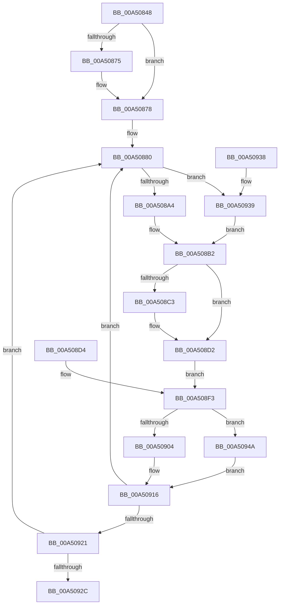

# PspWritePebAffinityInfoAttached

- RVA: `0x00A50848`–`0x00A50953` (길이 `267` bytes)
- VA: `0x0000000140A50848`
- 실행 섹션: `PAGE`
- PDB 이름 있음: `예`; PDB Function 태그: `아니요`
- unwind 정보 RVA: `0x000B0A84`
- 디코드: `65`개 명령, `267/267` bytes 표시
- 미해석 바이트: `0` (있으면 어셈블리에 `.byte`로 보존)

> 이 문서는 커널 이미지의 기계어와 PDB 기호를 분석해 생성했습니다. 4번과 5번은 함수 원형과 자료형을 바이너리 사용 방식에서 추정한 C 해석이며 원본 소스 복구 결과는 아닙니다.

## 1. Dependencies

- 직접 호출 지점: **2**; 고유 호출 대상: **1**
- 직접 호출자로 확인된 함수: **1**
- RIP 상대 이미지 참조: **0**

### Outgoing calls
- `0x00A508AC` → [KeQueryPrimaryGroupAffinityProcess](../../text/49/KeQueryPrimaryGroupAffinityProcess_function_00490BA4.md) (function, `0x00490BA4`)
- `0x00A5090C` → [KeQueryPrimaryGroupAffinityProcess](../../text/49/KeQueryPrimaryGroupAffinityProcess_function_00490BA4.md) (function, `0x00490BA4`)

### Direct callers
- [PspUpdatePebForAffinityChange](PspUpdatePebForAffinityChange_function_00A50790.md) at `0x00A507E4`

### Static image references
- 디코드된 RIP-relative 메모리 참조가 없습니다.

## 2. Other-region calls and transfers

- 다른 실행 섹션으로 향하는 call: **2**
  - `0x00A508AC` → [KeQueryPrimaryGroupAffinityProcess](../../text/49/KeQueryPrimaryGroupAffinityProcess_function_00490BA4.md) (`PAGE` → `.text`)
  - `0x00A5090C` → [KeQueryPrimaryGroupAffinityProcess](../../text/49/KeQueryPrimaryGroupAffinityProcess_function_00490BA4.md) (`PAGE` → `.text`)
- 별도 외부 분기/꼬리 이동을 확인하지 못했습니다.

## 3. Assembly (complete function range)

```asm
00A50848  48 89 4C 24 08                  mov qword ptr [rsp + 8], rcx
00A5084D  53                              push rbx
00A5084E  56                              push rsi
00A5084F  57                              push rdi
00A50850  41 56                           push r14
00A50852  41 57                           push r15
00A50854  48 83 EC 40                     sub rsp, 0x40
00A50858  48 8B D9                        mov rbx, rcx
00A5085B  4C 8B B9 E0 02 00 00            mov r15, qword ptr [rcx + 0x2e0]
00A50862  4C 89 7C 24 78                  mov qword ptr [rsp + 0x78], r15
00A50867  33 FF                           xor edi, edi
00A50869  48 8B 81 10 03 00 00            mov rax, qword ptr [rcx + 0x310]
00A50870  48 85 C0                        test rax, rax
00A50873  74 03                           je 0x140a50878
00A50875  48 8B 38                        mov rdi, qword ptr [rax]
00A50878  48 89 BC 24 80 00 00 00         mov qword ptr [rsp + 0x80], rdi
00A50880  0F 57 C0                        xorps xmm0, xmm0
00A50883  0F 11 44 24 20                  movups xmmword ptr [rsp + 0x20], xmm0
00A50888  4C 8D B3 88 00 00 00            lea r14, [rbx + 0x88]
00A5088F  4C 89 B4 24 88 00 00 00         mov qword ptr [rsp + 0x88], r14
00A50897  41 F7 06 00 10 00 00            test dword ptr [r14], 0x1000
00A5089E  0F 85 95 00 00 00               jne 0x140a50939
00A508A4  48 8D 54 24 20                  lea rdx, [rsp + 0x20]
00A508A9  48 8B CB                        mov rcx, rbx
00A508AC  E8 F3 02 A4 FF                  call 0x140490ba4
00A508B1  90                              nop
00A508B2  48 8B 74 24 20                  mov rsi, qword ptr [rsp + 0x20]
00A508B7  49 89 B7 38 01 00 00            mov qword ptr [r15 + 0x138], rsi
00A508BE  48 85 FF                        test rdi, rdi
00A508C1  74 0F                           je 0x140a508d2
00A508C3  48 8B C6                        mov rax, rsi
00A508C6  48 C1 E8 20                     shr rax, 0x20
00A508CA  0B C6                           or eax, esi
00A508CC  89 87 C0 00 00 00               mov dword ptr [rdi + 0xc0], eax
00A508D2  EB 1F                           jmp 0x140a508f3
00A508D4  48 8B 5C 24 70                  mov rbx, qword ptr [rsp + 0x70]
00A508D9  48 8B 74 24 20                  mov rsi, qword ptr [rsp + 0x20]
00A508DE  4C 8B 7C 24 78                  mov r15, qword ptr [rsp + 0x78]
00A508E3  48 8B BC 24 80 00 00 00         mov rdi, qword ptr [rsp + 0x80]
00A508EB  4C 8B B4 24 88 00 00 00         mov r14, qword ptr [rsp + 0x88]
00A508F3  0F 57 C0                        xorps xmm0, xmm0
00A508F6  0F 11 44 24 30                  movups xmmword ptr [rsp + 0x30], xmm0
00A508FB  41 F7 06 00 10 00 00            test dword ptr [r14], 0x1000
00A50902  75 46                           jne 0x140a5094a
00A50904  48 8D 54 24 30                  lea rdx, [rsp + 0x30]
00A50909  48 8B CB                        mov rcx, rbx
00A5090C  E8 93 02 A4 FF                  call 0x140490ba4
00A50911  0F B7 44 24 38                  movzx eax, word ptr [rsp + 0x38]
00A50916  66 39 44 24 28                  cmp word ptr [rsp + 0x28], ax
00A5091B  0F 85 5F FF FF FF               jne 0x140a50880
00A50921  48 3B 74 24 30                  cmp rsi, qword ptr [rsp + 0x30]
00A50926  0F 85 54 FF FF FF               jne 0x140a50880
00A5092C  48 83 C4 40                     add rsp, 0x40
00A50930  41 5F                           pop r15
00A50932  41 5E                           pop r14
00A50934  5F                              pop rdi
00A50935  5E                              pop rsi
00A50936  5B                              pop rbx
00A50937  C3                              ret
00A50938  CC                              int3
00A50939  0F B7 83 A0 01 00 00            movzx eax, word ptr [rbx + 0x1a0]
00A50940  66 89 44 24 28                  mov word ptr [rsp + 0x28], ax
00A50945  E9 68 FF FF FF                  jmp 0x140a508b2
00A5094A  0F B7 83 A0 01 00 00            movzx eax, word ptr [rbx + 0x1a0]
00A50951  EB C3                           jmp 0x140a50916
```

## 4. C-style interpretation (structured pseudocode)

```c
__int64 __fastcall PspWritePebAffinityInfoAttached(__int64 a1)
{
    __int64 result;
    __int64 v_rdi;
    __int64 v_rsp;
    unsigned __int16 v_stack_m30;
    unsigned __int64 v_stack_m38;
    unsigned __int16 v_stack_m40;
    unsigned __int64 v_stack_m48;
    unsigned __int64 v_stack_p10;
    unsigned __int64 v_stack_p18;
    unsigned __int64 v_stack_p20;
    unsigned __int16 v_stack_p28;
    unsigned __int64 v_stack_p8;

    v_stack_p8 = a1;
    v_rsp = (v_rsp) - (64);
    v_stack_p10 = *(unsigned __int64 *)(a1 + 736);
    v_rdi = 0;
    if (*(unsigned __int64 *)(a1 + 784) != 0) {
        v_rdi = *(unsigned __int64 *)(*(unsigned __int64 *)(a1 + 784));
    }
    v_stack_p18 = v_rdi;
loc_00A50880:
    v_stack_m48 = v_xmm0;
    v_stack_p20 = a1 + 136;
    if (((*(unsigned int *)(a1 + 136)) & (0x1000ULL)) != 0) goto loc_00A50939;
    result = KeQueryPrimaryGroupAffinityProcess(a1, v_stack_m48, a3, a4);
loc_00A508B2:
    *(unsigned __int64 *)(*(unsigned __int64 *)(a1 + 736) + 312) = v_stack_m48;
    if (v_rdi != 0) {
        result = v_stack_m48;
        result = (result) >> (32);
        result = (unsigned int)((result) | ((unsigned int)(v_stack_m48)));
        *(unsigned int *)(v_rdi + 192) = (unsigned int)(result);
    }
    goto loc_00A508F3;
loc_00A508F3:
    v_stack_m38 = v_xmm0;
    if (((*(unsigned int *)(a1 + 136)) & (0x1000ULL)) != 0) goto loc_00A5094A;
    result = KeQueryPrimaryGroupAffinityProcess(a1, v_stack_m38, a3, a4);
loc_00A50916:
    if (v_stack_m40 != ((unsigned __int16)(v_stack_m30))) goto loc_00A50880;
    if (v_stack_m48 != v_stack_m38) goto loc_00A50880;
    v_rsp = (v_rsp) + (64);
    return v_stack_m30;
loc_00A50939:
    v_stack_p28 = (unsigned __int16)(*(unsigned __int16 *)(a1 + 416));
    goto loc_00A508B2;
loc_00A5094A:
    goto loc_00A50916;
}
```

## 5. (Beta) C Style

```c
int64_t PspWritePebAffinityInfoAttached(void *Arg1)
{
    uint8_t *arg1 = (uint8_t *)Arg1;

    int64_t result;
    int64_t local_rdi;
    int64_t local_rsp;
    uint16_t v_stack_m30;
    uint64_t v_stack_m38;
    uint16_t v_stack_m40;
    uint64_t v_stack_m48;
    uint64_t v_stack_p10;
    uint64_t v_stack_p18;
    uint64_t v_stack_p20;
    uint16_t v_stack_p28;
    uint64_t v_stack_p8;

    v_stack_p8 = Arg1;
    local_rsp = (local_rsp) - (64);
    v_stack_p10 = *(uint64_t *)(arg1 + 0x2E0);
    local_rdi = 0;
    if (*(uint64_t *)(arg1 + 0x310) != 0) {
        local_rdi = *(uint64_t *)(*(uint64_t *)(arg1 + 0x310));
    }
    v_stack_p18 = local_rdi;
loc_00A50880:
    v_stack_m48 = v_xmm0;
    v_stack_p20 = Arg1 + 136;
    if (((*(uint32_t *)(arg1 + 0x88)) & (0x1000ULL)) != 0) goto loc_00A50939;
    result = KeQueryPrimaryGroupAffinityProcess(Arg1, v_stack_m48, a3, a4);
loc_00A508B2:
    *(uint64_t *)(*(uint64_t *)(arg1 + 0x2E0) + 0x138) = v_stack_m48;
    if (local_rdi != 0) {
        result = v_stack_m48;
        result = (result) >> (32);
        result = (uint32_t)((result) | ((uint32_t)(v_stack_m48)));
        *(uint32_t *)(local_rdi + 0xC0) = (uint32_t)(result);
    }
    goto loc_00A508F3;
loc_00A508F3:
    v_stack_m38 = v_xmm0;
    if (((*(uint32_t *)(arg1 + 0x88)) & (0x1000ULL)) != 0) goto loc_00A5094A;
    result = KeQueryPrimaryGroupAffinityProcess(Arg1, v_stack_m38, a3, a4);
loc_00A50916:
    if (v_stack_m40 != ((uint16_t)(v_stack_m30))) goto loc_00A50880;
    if (v_stack_m48 != v_stack_m38) goto loc_00A50880;
    local_rsp = (local_rsp) + (64);
    return v_stack_m30;
loc_00A50939:
    v_stack_p28 = (uint16_t)(*(uint16_t *)(arg1 + 0x1A0));
    goto loc_00A508B2;
loc_00A5094A:
    goto loc_00A50916;
}
```

### 관측된 메모리 오프셋

구조체 형식이 확인되지 않은 접근은 인자 기준의 오프셋으로만 기록했습니다.

| 기준 인자 | 오프셋 표현 | 폭 (bit) | 접근 |
|---|---:|---:|---|
| `Arg1` | `+ 0x0` | `32` | `R` |
| `Arg1` | `+ 0x88` | `64` | `R` |
| `Arg1` | `+ 0x1A0` | `16` | `R` |
| `Arg1` | `+ 0x2E0` | `64` | `R` |
| `Arg1` | `+ 0x310` | `64` | `R` |

## 6. Execution-region graph

[열기: 2D/3D 그래프와 함수 탐색 컨트롤 패널](../../../control-panel.html?section=page&rva=0x00A50848&view=graph)

- 2D 그래프는 위에서 아래로 흐르고, 3D 그래프는 빈 공간을 드래그해 회전합니다. Shift+드래그는 이동, 휠은 확대·축소, 함수 노드 선택은 대상 보고서 이동입니다.

### Static fallback


