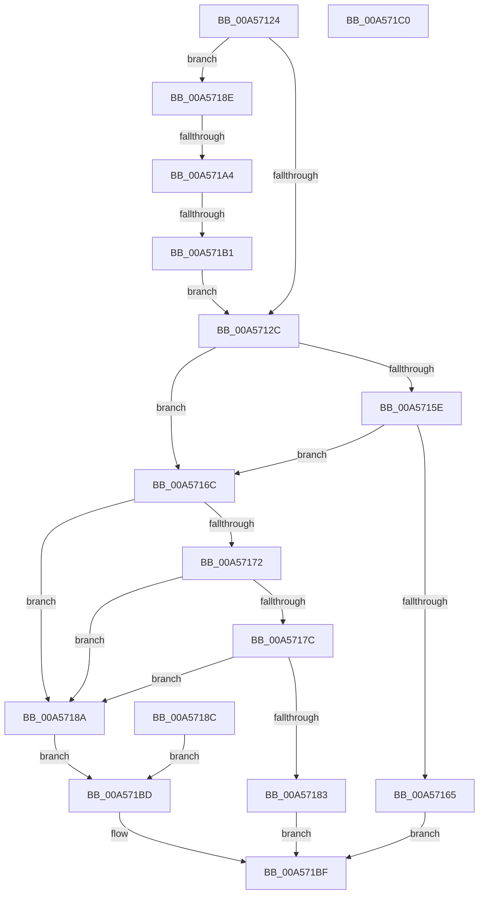

# RtlGuardIsValidWow64StackPointer

- RVA: `0x00A57124`–`0x00A571C1` (길이 `157` bytes)
- VA: `0x0000000140A57124`
- 실행 섹션: `PAGE`
- PDB 이름 있음: `예`; PDB Function 태그: `예`
- unwind 정보 RVA: `0x000B15F4`
- 디코드: `41`개 명령, `157/157` bytes 표시
- 미해석 바이트: `0` (있으면 어셈블리에 `.byte`로 보존)

> 이 문서는 커널 이미지의 기계어와 PDB 기호를 분석해 생성했습니다. 4번과 5번은 함수 원형과 자료형을 바이너리 사용 방식에서 추정한 C 해석이며 원본 소스 복구 결과는 아닙니다.

## 1. Dependencies

- 직접 호출 지점: **0**; 고유 호출 대상: **0**
- 직접 호출자로 확인된 함수: **3**
- RIP 상대 이미지 참조: **0**

### Outgoing calls
- 직접 디코드된 call 명령이 없습니다.

### Direct callers
- [sub_006DF3D6](../../text/6D/Unknown_function_006DF3D6.md) at `0x006DF3EB`
- [sub_006EC920](../../text/6E/Unknown_function_006EC920.md) at `0x006EC92F`
- [PspWow64SetContextThread](../8C/PspWow64SetContextThread_function_008CCC88.md) at `0x008CD045`

### Static image references
- 디코드된 RIP-relative 메모리 참조가 없습니다.

## 2. Other-region calls and transfers

- 다른 실행 섹션으로 향하는 call: **0**
- call이 아닌 외부 분기/꼬리 이동: **2**
  - `0x00A5719E` → [sub_00B3D950](../B3/Unknown_function_00B3D950.md) (`tail-transfer`)
  - `0x00A571AB` → [sub_00B3D950](../B3/Unknown_function_00B3D950.md) (`tail-transfer`)

## 3. Assembly (complete function range)

```asm
00A57124  44 8B C1                        mov r8d, ecx
00A57127  48 85 D2                        test rdx, rdx
00A5712A  74 62                           je 0x140a5718e
00A5712C  48 8D 82 00 20 00 00            lea rax, [rdx + 0x2000]
00A57133  48 F7 DA                        neg rdx
00A57136  4D 1B C9                        sbb r9, r9
00A57139  4C 23 C8                        and r9, rax
00A5713C  41 8B 89 0C 0E 00 00            mov ecx, dword ptr [r9 + 0xe0c]
00A57143  89 4C 24 20                     mov dword ptr [rsp + 0x20], ecx
00A57147  41 8B 49 04                     mov ecx, dword ptr [r9 + 4]
00A5714B  89 4C 24 10                     mov dword ptr [rsp + 0x10], ecx
00A5714F  41 8B 49 08                     mov ecx, dword ptr [r9 + 8]
00A57153  89 4C 24 18                     mov dword ptr [rsp + 0x18], ecx
00A57157  8B C1                           mov eax, ecx
00A57159  44 3B C0                        cmp r8d, eax
00A5715C  72 0E                           jb 0x140a5716c
00A5715E  44 3B 44 24 10                  cmp r8d, dword ptr [rsp + 0x10]
00A57163  77 07                           ja 0x140a5716c
00A57165  B8 01 00 00 00                  mov eax, 1
00A5716A  EB 53                           jmp 0x140a571bf
00A5716C  3B 44 24 20                     cmp eax, dword ptr [rsp + 0x20]
00A57170  74 18                           je 0x140a5718a
00A57172  05 00 F0 FF FF                  add eax, 0xfffff000
00A57177  44 3B C0                        cmp r8d, eax
00A5717A  72 0E                           jb 0x140a5718a
00A5717C  44 3B 44 24 10                  cmp r8d, dword ptr [rsp + 0x10]
00A57181  77 07                           ja 0x140a5718a
00A57183  B8 01 00 00 00                  mov eax, 1
00A57188  EB 35                           jmp 0x140a571bf
00A5718A  EB 31                           jmp 0x140a571bd
00A5718C  EB 2F                           jmp 0x140a571bd
00A5718E  65 48 8B 14 25 88 01 00 00      mov rdx, qword ptr gs:[0x188]
00A57197  F7 42 74 00 04 00 00            test dword ptr [rdx + 0x74], 0x400
00A5719E  0F 85 AC 67 0E 00               jne 0x140b3d950
00A571A4  80 BA 4A 02 00 00 01            cmp byte ptr [rdx + 0x24a], 1
00A571AB  0F 84 9F 67 0E 00               je 0x140b3d950
00A571B1  48 8B 92 F0 00 00 00            mov rdx, qword ptr [rdx + 0xf0]
00A571B8  E9 6F FF FF FF                  jmp 0x140a5712c
00A571BD  33 C0                           xor eax, eax
00A571BF  C3                              ret
00A571C0  CC                              int3
```

## 4. C-style interpretation (structured pseudocode)

```c
__int64 __fastcall RtlGuardIsValidWow64StackPointer(int a1, __int64 a2, __int64 a3, __int64 a4)
{
    __int64 result;
    unsigned int v_stack_p10;
    unsigned int v_stack_p18;
    unsigned int v_stack_p20;

    if (a2 == 0) goto loc_00A5718E;
loc_00A5712C:
    a2 = -(a2);
    a4 = (a4) & (a2 + 8192);
    v_stack_p20 = (unsigned int)((unsigned int)(*(unsigned int *)(a4 + 3596)));
    v_stack_p10 = (unsigned int)((unsigned int)(*(unsigned int *)(a4 + 4)));
    v_stack_p18 = (unsigned int)((unsigned int)(*(unsigned int *)(a4 + 8)));
    if (((unsigned int)((unsigned int)(a1))) < ((unsigned int)((unsigned int)((unsigned int)((unsigned int)(*(unsigned int *)(a4 + 8))))))) goto loc_00A5716C;
    if (((unsigned int)((unsigned int)(a1))) > v_stack_p10) goto loc_00A5716C;
    goto loc_00A571BF;
loc_00A5716C:
    if (1 == v_stack_p20) goto loc_00A5718A;
    result = (unsigned int)((1) + (0xFFFFF000ULL));
    if (((unsigned int)((unsigned int)(a1))) < ((unsigned int)(result))) goto loc_00A5718A;
    if (((unsigned int)((unsigned int)(a1))) > v_stack_p10) goto loc_00A5718A;
    goto loc_00A571BF;
loc_00A5718A:
    goto loc_00A571BD;
loc_00A5718E:
    goto loc_00A5712C;
loc_00A571BD:
    result = 0;
loc_00A571BF:
    return result;
}
```

## 5. (Beta) C Style

```c
int64_t RtlGuardIsValidWow64StackPointer(int32_t Arg1, int64_t Arg2, int64_t Arg3, int64_t Arg4)
{
    int64_t result;
    uint32_t v_stack_p10;
    uint32_t v_stack_p18;
    uint32_t v_stack_p20;

    if (Arg2 == 0) goto loc_00A5718E;
loc_00A5712C:
    Arg2 = -(Arg2);
    Arg4 = (Arg4) & (Arg2 + 8192);
    v_stack_p20 = (uint32_t)((uint32_t)(*(uint32_t *)(Arg4 + 0xE0C)));
    v_stack_p10 = (uint32_t)((uint32_t)(*(uint32_t *)(Arg4 + 0x4)));
    v_stack_p18 = (uint32_t)((uint32_t)(*(uint32_t *)(Arg4 + 0x8)));
    if (((uint32_t)((uint32_t)(Arg1))) < ((uint32_t)((uint32_t)((uint32_t)((uint32_t)(*(uint32_t *)(Arg4 + 0x8))))))) goto loc_00A5716C;
    if (((uint32_t)((uint32_t)(Arg1))) > v_stack_p10) goto loc_00A5716C;
    goto loc_00A571BF;
loc_00A5716C:
    if (1 == v_stack_p20) goto loc_00A5718A;
    result = (uint32_t)((1) + (0xFFFFF000ULL));
    if (((uint32_t)((uint32_t)(Arg1))) < ((uint32_t)(result))) goto loc_00A5718A;
    if (((uint32_t)((uint32_t)(Arg1))) > v_stack_p10) goto loc_00A5718A;
    goto loc_00A571BF;
loc_00A5718A:
    goto loc_00A571BD;
loc_00A5718E:
    goto loc_00A5712C;
loc_00A571BD:
    result = 0;
loc_00A571BF:
    return result;
}
```

## 6. Execution-region graph

[열기: 2D/3D 그래프와 함수 탐색 컨트롤 패널](../../../control-panel.html?section=page&rva=0x00A57124&view=graph)

- 2D 그래프는 위에서 아래로 흐르고, 3D 그래프는 빈 공간을 드래그해 회전합니다. Shift+드래그는 이동, 휠은 확대·축소, 함수 노드 선택은 대상 보고서 이동입니다.

### Static fallback


