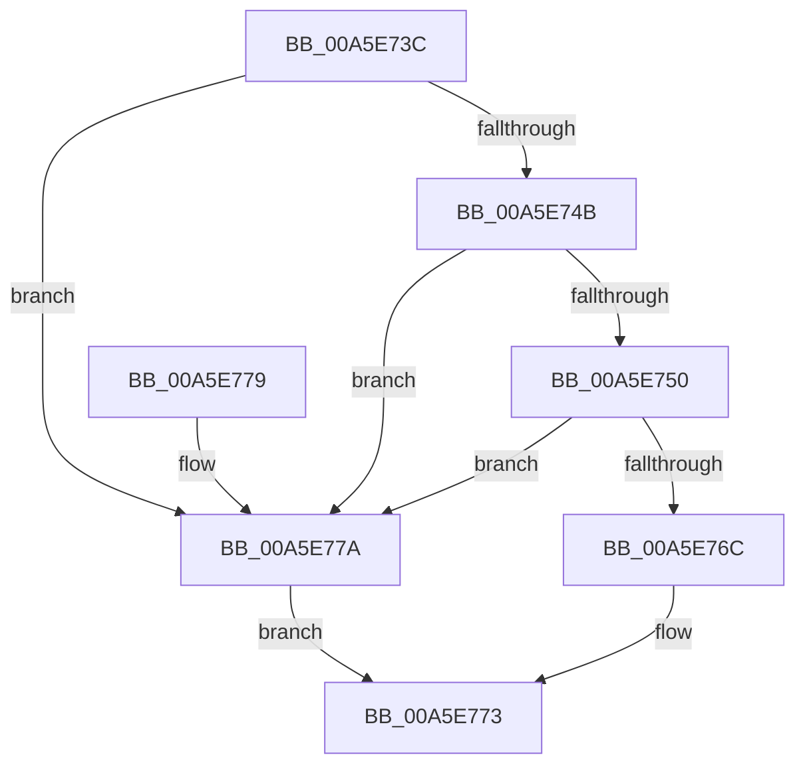

# RtlIsPackageSid

- RVA: `0x00A5E73C`–`0x00A5E77E` (길이 `66` bytes)
- VA: `0x0000000140A5E73C`
- 실행 섹션: `PAGE`
- PDB 이름 있음: `예`; PDB Function 태그: `아니요`
- unwind 정보 RVA: `0x00065BAC`
- 디코드: `21`개 명령, `66/66` bytes 표시
- 미해석 바이트: `0` (있으면 어셈블리에 `.byte`로 보존)

> 이 문서는 커널 이미지의 기계어와 PDB 기호를 분석해 생성했습니다. 4번과 5번은 함수 원형과 자료형을 바이너리 사용 방식에서 추정한 C 해석이며 원본 소스 복구 결과는 아닙니다.

## 1. Dependencies

- 직접 호출 지점: **1**; 고유 호출 대상: **1**
- 직접 호출자로 확인된 함수: **4**
- RIP 상대 이미지 참조: **1**

### Outgoing calls
- `0x00A5E761` → [RtlCompareMemory](../../text/6B/RtlCompareMemory_function_006BA670.md) (function, `0x006BA670`)

### Direct callers
- [SepCreateAppContainerToken](../../text/4F/SepCreateAppContainerToken_function_004F43AC.md) at `0x004F452A`
- [SepFilterToken](../9C/SepFilterToken_function_009C6B80.md) at `0x009C6C1E`
- [ObpVerifyAccessToBoundaryEntry](ObpVerifyAccessToBoundaryEntry_function_00A5E500.md) at `0x00A5E57B`
- [NtCreateLowBoxToken](../AB/NtCreateLowBoxToken_function_00AB9880.md) at `0x00AB9DDA`

### Static image references
- `0x00A5E754` → RVA `0x0001A798` (`.rdata`; read)

## 2. Other-region calls and transfers

- 다른 실행 섹션으로 향하는 call: **1**
  - `0x00A5E761` → [RtlCompareMemory](../../text/6B/RtlCompareMemory_function_006BA670.md) (`PAGE` → `.text`)
- 별도 외부 분기/꼬리 이동을 확인하지 못했습니다.

## 3. Assembly (complete function range)

```asm
00A5E73C  40 53                           push rbx
00A5E73E  48 83 EC 20                     sub rsp, 0x20
00A5E742  80 79 01 02                     cmp byte ptr [rcx + 1], 2
00A5E746  48 8B D9                        mov rbx, rcx
00A5E749  72 2F                           jb 0x140a5e77a
00A5E74B  80 39 01                        cmp byte ptr [rcx], 1
00A5E74E  75 2A                           jne 0x140a5e77a
00A5E750  48 83 C1 02                     add rcx, 2
00A5E754  48 8D 15 3D C0 5B FF            lea rdx, [rip - 0xa43fc3]
00A5E75B  41 B8 06 00 00 00               mov r8d, 6
00A5E761  E8 0A BF C5 FF                  call 0x1406ba670
00A5E766  48 83 F8 06                     cmp rax, 6
00A5E76A  75 0E                           jne 0x140a5e77a
00A5E76C  83 7B 08 02                     cmp dword ptr [rbx + 8], 2
00A5E770  0F 94 C0                        sete al
00A5E773  48 83 C4 20                     add rsp, 0x20
00A5E777  5B                              pop rbx
00A5E778  C3                              ret
00A5E779  CC                              int3
00A5E77A  32 C0                           xor al, al
00A5E77C  EB F5                           jmp 0x140a5e773
```

## 4. C-style interpretation (structured pseudocode)

```c
__int64 __fastcall RtlIsPackageSid(__int64 a1)
{
    __int64 result;
    __int64 v_rsp;

    v_rsp = (v_rsp) - (32);
    if ((*(unsigned __int8 *)(a1 + 1)) < 2) goto loc_00A5E77A;
    if ((*(unsigned __int8 *)(a1)) != 1) goto loc_00A5E77A;
    a1 = (a1) + (2);
    result = RtlCompareMemory(a1, v_rip - 10764227, 6, a4);
    if (result != 6) goto loc_00A5E77A;
    result = ((*(unsigned int *)(a1 + 8)) == 2) ? 1 : 0;
loc_00A5E773:
    v_rsp = (v_rsp) + (32);
    return result;
loc_00A5E77A:
    result = 0;
    goto loc_00A5E773;
}
```

## 5. (Beta) C Style

```c
int64_t RtlIsPackageSid(void *Arg1)
{
    uint8_t *arg1 = (uint8_t *)Arg1;

    int64_t result;
    int64_t local_rsp;

    local_rsp = (local_rsp) - (32);
    if ((*(uint8_t *)(arg1 + 0x1)) < 2) goto loc_00A5E77A;
    if ((*(uint8_t *)(arg1)) != 1) goto loc_00A5E77A;
    Arg1 = (Arg1) + (2);
    result = RtlCompareMemory(Arg1, v_rip - 10764227, 6, a4);
    if (result != 6) goto loc_00A5E77A;
    result = ((*(uint32_t *)(arg1 + 0x8)) == 2) ? 1 : 0;
loc_00A5E773:
    local_rsp = (local_rsp) + (32);
    return result;
loc_00A5E77A:
    result = 0;
    goto loc_00A5E773;
}
```

### 관측된 메모리 오프셋

구조체 형식이 확인되지 않은 접근은 인자 기준의 오프셋으로만 기록했습니다.

| 기준 인자 | 오프셋 표현 | 폭 (bit) | 접근 |
|---|---:|---:|---|
| `Arg1` | `+ 0x0` | `8` | `R` |
| `Arg1` | `+ 0x1` | `8` | `R` |
| `Arg1` | `+ 0x8` | `32` | `R` |

## 6. Execution-region graph

[열기: 2D/3D 그래프와 함수 탐색 컨트롤 패널](../../../control-panel.html?section=page&rva=0x00A5E73C&view=graph)

- 2D 그래프는 위에서 아래로 흐르고, 3D 그래프는 빈 공간을 드래그해 회전합니다. Shift+드래그는 이동, 휠은 확대·축소, 함수 노드 선택은 대상 보고서 이동입니다.

### Static fallback


