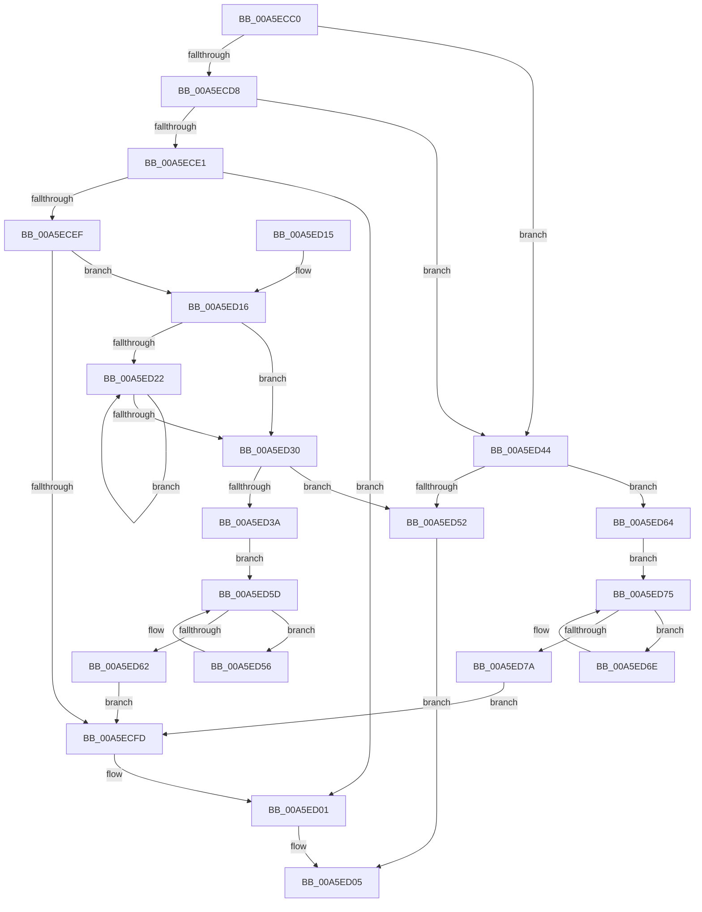

# RtlNextUnicodePrefix

- RVA: `0x00A5ECC0`–`0x00A5ED7C` (길이 `188` bytes)
- VA: `0x0000000140A5ECC0`
- 실행 섹션: `PAGE`
- PDB 이름 있음: `예`; PDB Function 태그: `아니요`
- unwind 정보 RVA: `0x00060CCC`
- 디코드: `61`개 명령, `188/188` bytes 표시
- 미해석 바이트: `0` (있으면 어셈블리에 `.byte`로 보존)

> 이 문서는 커널 이미지의 기계어와 PDB 기호를 분석해 생성했습니다. 4번과 5번은 함수 원형과 자료형을 바이너리 사용 방식에서 추정한 C 해석이며 원본 소스 복구 결과는 아닙니다.

## 1. Dependencies

- 직접 호출 지점: **1**; 고유 호출 대상: **1**
- 직접 호출자로 확인된 함수: **0**
- RIP 상대 이미지 참조: **0**

### Outgoing calls
- `0x00A5ECF3` → [RtlRealSuccessor](../../text/38/RtlRealSuccessor_function_0038DF40.md) (function, `0x0038DF40`)

### Direct callers
- 이 함수 시작 RVA로 연결되는 직접 call은 확인되지 않았습니다. 간접 호출은 완전히 역산할 수 없습니다.

### Static image references
- 디코드된 RIP-relative 메모리 참조가 없습니다.

## 2. Other-region calls and transfers

- 다른 실행 섹션으로 향하는 call: **1**
  - `0x00A5ECF3` → [RtlRealSuccessor](../../text/38/RtlRealSuccessor_function_0038DF40.md) (`PAGE` → `.text`)
- 별도 외부 분기/꼬리 이동을 확인하지 못했습니다.

## 3. Assembly (complete function range)

```asm
00A5ECC0  48 89 5C 24 08                  mov qword ptr [rsp + 8], rbx
00A5ECC5  48 89 74 24 10                  mov qword ptr [rsp + 0x10], rsi
00A5ECCA  57                              push rdi
00A5ECCB  48 83 EC 20                     sub rsp, 0x20
00A5ECCF  33 F6                           xor esi, esi
00A5ECD1  48 8B F9                        mov rdi, rcx
00A5ECD4  84 D2                           test dl, dl
00A5ECD6  75 6C                           jne 0x140a5ed44
00A5ECD8  48 8B 59 10                     mov rbx, qword ptr [rcx + 0x10]
00A5ECDC  48 85 DB                        test rbx, rbx
00A5ECDF  74 63                           je 0x140a5ed44
00A5ECE1  48 8B 43 10                     mov rax, qword ptr [rbx + 0x10]
00A5ECE5  B9 03 08 00 00                  mov ecx, 0x803
00A5ECEA  66 39 08                        cmp word ptr [rax], cx
00A5ECED  74 12                           je 0x140a5ed01
00A5ECEF  48 8D 48 18                     lea rcx, [rax + 0x18]
00A5ECF3  E8 48 F2 92 FF                  call 0x14038df40
00A5ECF8  48 85 C0                        test rax, rax
00A5ECFB  74 19                           je 0x140a5ed16
00A5ECFD  48 83 C0 E8                     add rax, -0x18
00A5ED01  48 89 47 10                     mov qword ptr [rdi + 0x10], rax
00A5ED05  48 8B 5C 24 30                  mov rbx, qword ptr [rsp + 0x30]
00A5ED0A  48 8B 74 24 38                  mov rsi, qword ptr [rsp + 0x38]
00A5ED0F  48 83 C4 20                     add rsp, 0x20
00A5ED13  5F                              pop rdi
00A5ED14  C3                              ret
00A5ED15  CC                              int3
00A5ED16  48 8D 4B 18                     lea rcx, [rbx + 0x18]
00A5ED1A  48 8B 11                        mov rdx, qword ptr [rcx]
00A5ED1D  48 3B D1                        cmp rdx, rcx
00A5ED20  74 0E                           je 0x140a5ed30
00A5ED22  48 8B 02                        mov rax, qword ptr [rdx]
00A5ED25  48 8B CA                        mov rcx, rdx
00A5ED28  48 8B D0                        mov rdx, rax
00A5ED2B  48 3B C1                        cmp rax, rcx
00A5ED2E  75 F2                           jne 0x140a5ed22
00A5ED30  48 8B 41 F0                     mov rax, qword ptr [rcx - 0x10]
00A5ED34  66 39 70 02                     cmp word ptr [rax + 2], si
00A5ED38  7E 18                           jle 0x140a5ed52
00A5ED3A  48 8B 48 20                     mov rcx, qword ptr [rax + 0x20]
00A5ED3E  48 83 C0 18                     add rax, 0x18
00A5ED42  EB 19                           jmp 0x140a5ed5d
00A5ED44  48 8B 41 08                     mov rax, qword ptr [rcx + 8]
00A5ED48  B9 00 08 00 00                  mov ecx, 0x800
00A5ED4D  66 39 08                        cmp word ptr [rax], cx
00A5ED50  75 12                           jne 0x140a5ed64
00A5ED52  33 C0                           xor eax, eax
00A5ED54  EB AF                           jmp 0x140a5ed05
00A5ED56  48 8B C1                        mov rax, rcx
00A5ED59  48 8B 49 08                     mov rcx, qword ptr [rcx + 8]
00A5ED5D  48 85 C9                        test rcx, rcx
00A5ED60  75 F4                           jne 0x140a5ed56
00A5ED62  EB 99                           jmp 0x140a5ecfd
00A5ED64  48 8B 48 20                     mov rcx, qword ptr [rax + 0x20]
00A5ED68  48 83 C0 18                     add rax, 0x18
00A5ED6C  EB 07                           jmp 0x140a5ed75
00A5ED6E  48 8B C1                        mov rax, rcx
00A5ED71  48 8B 49 08                     mov rcx, qword ptr [rcx + 8]
00A5ED75  48 85 C9                        test rcx, rcx
00A5ED78  75 F4                           jne 0x140a5ed6e
00A5ED7A  EB 81                           jmp 0x140a5ecfd
```

## 4. C-style interpretation (structured pseudocode)

```c
__int64 __fastcall RtlNextUnicodePrefix(__int64 a1, unsigned __int8 a2)
{
    __int64 result;
    __int64 v_rsi;
    __int64 v_rsp;
    unsigned __int64 v_stack_p10;
    unsigned __int64 v_stack_p8;

    v_stack_p8 = v_rbx;
    v_stack_p10 = v_rsi;
    v_rsp = (v_rsp) - (32);
    v_rsi = 0;
    if (a2 != 0) goto loc_00A5ED44;
    if (*(unsigned __int64 *)(a1 + 16) == 0) goto loc_00A5ED44;
    if ((*(unsigned __int16 *)(*(unsigned __int64 *)(*(unsigned __int64 *)(a1 + 16) + 16))) == ((unsigned __int16)((unsigned int)(0x803ULL)))) goto loc_00A5ED01;
    result = RtlRealSuccessor(*(unsigned __int64 *)(*(unsigned __int64 *)(a1 + 16) + 16) + 24, a2, a3, a4);
    if (result == 0) goto loc_00A5ED16;
loc_00A5ECFD:
    result = (result) + (-24);
loc_00A5ED01:
    *(unsigned __int64 *)(a1 + 16) = result;
loc_00A5ED05:
    v_rsp = (v_rsp) + (32);
    return result;
loc_00A5ED16:
    if ((*(unsigned __int64 *)(v_stack_p8 + 24)) == (v_stack_p8 + 24)) goto loc_00A5ED30;
loc_00A5ED22:
    if ((*(unsigned __int64 *)(*(unsigned __int64 *)(v_stack_p8 + 24))) != (*(unsigned __int64 *)(v_stack_p8 + 24))) goto loc_00A5ED22;
loc_00A5ED30:
    if ((*(unsigned __int16 *)(*(unsigned __int64 *)(*(unsigned __int64 *)(v_stack_p8 + 24) - 16) + 2)) <= ((unsigned __int16)(v_stack_p10))) goto loc_00A5ED52;
    result = (*(unsigned __int64 *)(*(unsigned __int64 *)(v_stack_p8 + 24) - 16)) + (24);
    goto loc_00A5ED5D;
loc_00A5ED44:
    if ((*(unsigned __int16 *)(*(unsigned __int64 *)(*(unsigned __int64 *)(*(unsigned __int64 *)(*(unsigned __int64 *)(v_stack_p8 + 24) - 16) + 32) + 8))) != ((unsigned __int16)((unsigned int)(0x800ULL)))) goto loc_00A5ED64;
loc_00A5ED52:
    result = 0;
    goto loc_00A5ED05;
loc_00A5ED56:
loc_00A5ED5D:
    if (*(unsigned __int64 *)((unsigned int)(0x800ULL) + 8) != 0) goto loc_00A5ED56;
    goto loc_00A5ECFD;
loc_00A5ED64:
    result = ((unsigned int)(0x800ULL)) + (24);
    goto loc_00A5ED75;
loc_00A5ED6E:
loc_00A5ED75:
    if (*(unsigned __int64 *)(*(unsigned __int64 *)((unsigned int)(0x800ULL) + 32) + 8) != 0) goto loc_00A5ED6E;
    goto loc_00A5ECFD;
}
```

## 5. (Beta) C Style

```c
int64_t RtlNextUnicodePrefix(void *Arg1, uint8_t Arg2)
{
    uint8_t *arg1 = (uint8_t *)Arg1;

    int64_t result;
    int64_t local_rsi;
    int64_t local_rsp;
    uint64_t v_stack_p10;
    uint64_t v_stack_p8;

    v_stack_p8 = local_rbx;
    v_stack_p10 = local_rsi;
    local_rsp = (local_rsp) - (32);
    local_rsi = 0;
    if (Arg2 != 0) goto loc_00A5ED44;
    if (*(uint64_t *)(arg1 + 0x10) == 0) goto loc_00A5ED44;
    if ((*(uint16_t *)(*(uint64_t *)(*(uint64_t *)(arg1 + 0x10) + 0x10))) == ((uint16_t)((uint32_t)(0x803ULL)))) goto loc_00A5ED01;
    result = RtlRealSuccessor(*(uint64_t *)(*(uint64_t *)(arg1 + 0x10) + 0x10) + 24, Arg2, a3, a4);
    if (result == 0) goto loc_00A5ED16;
loc_00A5ECFD:
    result = (result) + (-24);
loc_00A5ED01:
    *(uint64_t *)(arg1 + 0x10) = result;
loc_00A5ED05:
    local_rsp = (local_rsp) + (32);
    return result;
loc_00A5ED16:
    if ((*(uint64_t *)(v_stack_p8 + 0x18)) == (v_stack_p8 + 24)) goto loc_00A5ED30;
loc_00A5ED22:
    if ((*(uint64_t *)(*(uint64_t *)(v_stack_p8 + 0x18))) != (*(uint64_t *)(v_stack_p8 + 0x18))) goto loc_00A5ED22;
loc_00A5ED30:
    if ((*(uint16_t *)(*(uint64_t *)(*(uint64_t *)(v_stack_p8 + 0x18) - 0x10) + 0x2)) <= ((uint16_t)(v_stack_p10))) goto loc_00A5ED52;
    result = (*(uint64_t *)(*(uint64_t *)(v_stack_p8 + 0x18) - 0x10)) + (24);
    goto loc_00A5ED5D;
loc_00A5ED44:
    if ((*(uint16_t *)(*(uint64_t *)(*(uint64_t *)(*(uint64_t *)(*(uint64_t *)(v_stack_p8 + 0x18) - 0x10) + 0x20) + 0x8))) != ((uint16_t)((uint32_t)(0x800ULL)))) goto loc_00A5ED64;
loc_00A5ED52:
    result = 0;
    goto loc_00A5ED05;
loc_00A5ED56:
loc_00A5ED5D:
    if (*(uint64_t *)((uint32_t)(0x800ULL) + 0x8) != 0) goto loc_00A5ED56;
    goto loc_00A5ECFD;
loc_00A5ED64:
    result = ((uint32_t)(0x800ULL)) + (24);
    goto loc_00A5ED75;
loc_00A5ED6E:
loc_00A5ED75:
    if (*(uint64_t *)(*(uint64_t *)((uint32_t)(0x800ULL) + 0x20) + 0x8) != 0) goto loc_00A5ED6E;
    goto loc_00A5ECFD;
}
```

### 관측된 메모리 오프셋

구조체 형식이 확인되지 않은 접근은 인자 기준의 오프셋으로만 기록했습니다.

| 기준 인자 | 오프셋 표현 | 폭 (bit) | 접근 |
|---|---:|---:|---|
| `Arg1` | `+ 0x8` | `64` | `R` |
| `Arg1` | `+ 0x10` | `64` | `R` |
| `Arg1` | `+ 0x10` | `64` | `W` |

## 6. Execution-region graph

[열기: 2D/3D 그래프와 함수 탐색 컨트롤 패널](../../../control-panel.html?section=page&rva=0x00A5ECC0&view=graph)

- 2D 그래프는 위에서 아래로 흐르고, 3D 그래프는 빈 공간을 드래그해 회전합니다. Shift+드래그는 이동, 휠은 확대·축소, 함수 노드 선택은 대상 보고서 이동입니다.

### Static fallback


