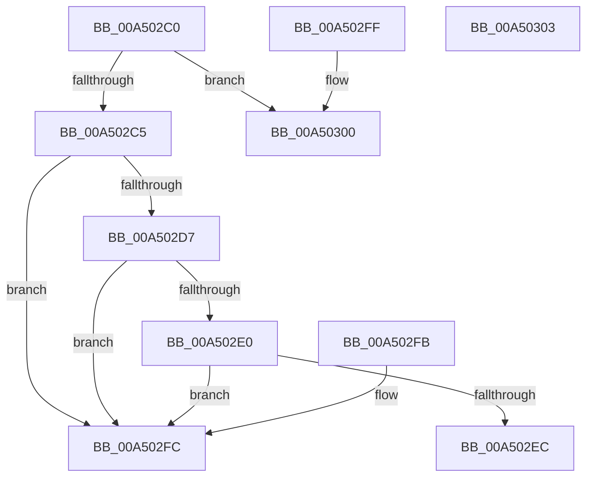

# RtlSetThreadPlaceholderCompatibilityMode

- RVA: `0x00A502C0`–`0x00A50304` (길이 `68` bytes)
- VA: `0x0000000140A502C0`
- 실행 섹션: `PAGE`
- PDB 이름 있음: `예`; PDB Function 태그: `아니요`
- unwind 정보 RVA: `0x000DB714`
- 디코드: `20`개 명령, `68/68` bytes 표시
- 미해석 바이트: `0` (있으면 어셈블리에 `.byte`로 보존)

> 이 문서는 커널 이미지의 기계어와 PDB 기호를 분석해 생성했습니다. 4번과 5번은 함수 원형과 자료형을 바이너리 사용 방식에서 추정한 C 해석이며 원본 소스 복구 결과는 아닙니다.

## 1. Dependencies

- 직접 호출 지점: **0**; 고유 호출 대상: **0**
- 직접 호출자로 확인된 함수: **0**
- RIP 상대 이미지 참조: **0**

### Outgoing calls
- 직접 디코드된 call 명령이 없습니다.

### Direct callers
- 이 함수 시작 RVA로 연결되는 직접 call은 확인되지 않았습니다. 간접 호출은 완전히 역산할 수 없습니다.

### Static image references
- 디코드된 RIP-relative 메모리 참조가 없습니다.

## 2. Other-region calls and transfers

- 다른 실행 섹션으로 향하는 call: **0**
- 별도 외부 분기/꼬리 이동을 확인하지 못했습니다.

## 3. Assembly (complete function range)

```asm
00A502C0  80 F9 03                        cmp cl, 3
00A502C3  77 3B                           ja 0x140a50300
00A502C5  65 48 8B 14 25 88 01 00 00      mov rdx, qword ptr gs:[0x188]
00A502CE  F7 42 74 00 04 00 00            test dword ptr [rdx + 0x74], 0x400
00A502D5  75 25                           jne 0x140a502fc
00A502D7  80 BA 4A 02 00 00 01            cmp byte ptr [rdx + 0x24a], 1
00A502DE  74 1C                           je 0x140a502fc
00A502E0  4C 8B 82 F0 00 00 00            mov r8, qword ptr [rdx + 0xf0]
00A502E7  4D 85 C0                        test r8, r8
00A502EA  74 10                           je 0x140a502fc
00A502EC  41 8A 80 80 02 00 00            mov al, byte ptr [r8 + 0x280]
00A502F3  41 88 88 80 02 00 00            mov byte ptr [r8 + 0x280], cl
00A502FA  C3                              ret
00A502FB  CC                              int3
00A502FC  B0 FE                           mov al, 0xfe
00A502FE  C3                              ret
00A502FF  CC                              int3
00A50300  B0 FF                           mov al, 0xff
00A50302  C3                              ret
00A50303  CC                              int3
```

## 4. C-style interpretation (structured pseudocode)

```c
__int64 __fastcall RtlSetThreadPlaceholderCompatibilityMode(unsigned __int8 a1)
{
    if (a1 > 3) goto loc_00A50300;
    if (((*(unsigned int *)(*(unsigned __int64 *)(gs_base + (0 + 392)) + 116)) & (0x400ULL)) != 0) goto loc_00A502FC;
    if ((*(unsigned __int8 *)(*(unsigned __int64 *)(gs_base + (0 + 392)) + 586)) == 1) goto loc_00A502FC;
    if (*(unsigned __int64 *)(*(unsigned __int64 *)(gs_base + (0 + 392)) + 240) == 0) goto loc_00A502FC;
    *(unsigned __int8 *)(*(unsigned __int64 *)(*(unsigned __int64 *)(gs_base + (0 + 392)) + 240) + 640) = a1;
    return *(unsigned __int8 *)(*(unsigned __int64 *)(*(unsigned __int64 *)(gs_base + (0 + 392)) + 240) + 640);
loc_00A502FC:
    return 254;
loc_00A50300:
    return 255;
}
```

## 5. (Beta) C Style

```c
int64_t RtlSetThreadPlaceholderCompatibilityMode(uint8_t Arg1)
{
    if (Arg1 > 3) goto loc_00A50300;
    if (((*(uint32_t *)(*(uint64_t *)(gs_base + (0 + 0x188)) + 0x74)) & (0x400ULL)) != 0) goto loc_00A502FC;
    if ((*(uint8_t *)(*(uint64_t *)(gs_base + (0 + 0x188)) + 0x24A)) == 1) goto loc_00A502FC;
    if (*(uint64_t *)(*(uint64_t *)(gs_base + (0 + 0x188)) + 0xF0) == 0) goto loc_00A502FC;
    *(uint8_t *)(*(uint64_t *)(*(uint64_t *)(gs_base + (0 + 0x188)) + 0xF0) + 0x280) = Arg1;
    return *(uint8_t *)(*(uint64_t *)(*(uint64_t *)(gs_base + (0 + 0x188)) + 0xF0) + 0x280);
loc_00A502FC:
    return 254;
loc_00A50300:
    return 255;
}
```

## 6. Execution-region graph

[열기: 2D/3D 그래프와 함수 탐색 컨트롤 패널](../../../control-panel.html?section=page&rva=0x00A502C0&view=graph)

- 2D 그래프는 위에서 아래로 흐르고, 3D 그래프는 빈 공간을 드래그해 회전합니다. Shift+드래그는 이동, 휠은 확대·축소, 함수 노드 선택은 대상 보고서 이동입니다.

### Static fallback


