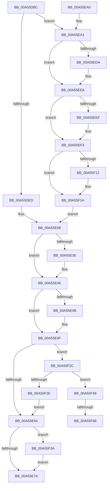

# SepDereferenceLowBoxNumberEntry

- RVA: `0x00A55DBC`–`0x00A55F73` (길이 `439` bytes)
- VA: `0x0000000140A55DBC`
- 실행 섹션: `PAGE`
- PDB 이름 있음: `예`; PDB Function 태그: `예`
- unwind 정보 RVA: `0x000B1304`
- 디코드: `117`개 명령, `439/439` bytes 표시
- 미해석 바이트: `0` (있으면 어셈블리에 `.byte`로 보존)

> 이 문서는 커널 이미지의 기계어와 PDB 기호를 분석해 생성했습니다. 4번과 5번은 함수 원형과 자료형을 바이너리 사용 방식에서 추정한 C 해석이며 원본 소스 복구 결과는 아닙니다.

## 1. Dependencies

- 직접 호출 지점: **12**; 고유 호출 대상: **9**
- 직접 호출자로 확인된 함수: **5**
- RIP 상대 이미지 참조: **2**

### Outgoing calls
- `0x00A55E26` → [KeAbPreAcquire](../../text/21/KeAbPreAcquire_function_00210230.md) (function, `0x00210230`)
- `0x00A55E41` → [ExfAcquirePushLockExclusiveEx](../../text/20/ExfAcquirePushLockExclusiveEx_function_0020FC90.md) (function, `0x0020FC90`)
- `0x00A55E7F` → [KeAbPostRelease](../../text/2E/KeAbPostRelease_function_002E1600.md) (function, `0x002E1600`)
- `0x00A55E84` → [KeLeaveCriticalRegion](../../text/25/KeLeaveCriticalRegion_function_0025D8B0.md) (function, `0x0025D8B0`)
- `0x00A55EC1` → [KeAbPreAcquire](../../text/21/KeAbPreAcquire_function_00210230.md) (function, `0x00210230`)
- `0x00A55EE5` → [ExfAcquirePushLockSharedEx](../../text/21/ExfAcquirePushLockSharedEx_function_0021044C.md) (function, `0x0021044C`)
- `0x00A55EFC` → [SepGetTokenSessionMapEntry](../../text/48/SepGetTokenSessionMapEntry_function_00489654.md) (function, `0x00489654`)
- `0x00A55F15` → [ExfReleasePushLockShared](../../text/26/ExfReleasePushLockShared_function_00263440.md) (function, `0x00263440`)
- `0x00A55F1D` → [KeAbPostRelease](../../text/2E/KeAbPostRelease_function_002E1600.md) (function, `0x002E1600`)
- `0x00A55F22` → [KeLeaveCriticalRegion](../../text/25/KeLeaveCriticalRegion_function_0025D8B0.md) (function, `0x0025D8B0`)
- `0x00A55F3F` → [ExfTryToWakePushLock](../../text/26/ExfTryToWakePushLock_function_00265DD0.md) (function, `0x00265DD0`)
- `0x00A55F58` → [RtlRemoveEntryHashTable](../../text/2E/RtlRemoveEntryHashTable_function_002EEF00.md) (function, `0x002EEF00`)

### Direct callers
- [SeExchangePrimaryToken](../7A/SeExchangePrimaryToken_function_007A07BC.md) at `0x007A096C`
- [SeExchangePrimaryToken](../7A/SeExchangePrimaryToken_function_007A07BC.md) at `0x007A0A21`
- [SeExchangePrimaryToken](../7A/SeExchangePrimaryToken_function_007A07BC.md) at `0x007A0A5E`
- [SeSubProcessToken](../AA/SeSubProcessToken_function_00AAD570.md) at `0x00AAD8FF`
- [SeSubProcessToken](../AA/SeSubProcessToken_function_00AAD570.md) at `0x00AADA13`
- [NtSetInformationToken](../AF/NtSetInformationToken_function_00AF0530.md) at `0x00AF1766`
- [NtSetInformationToken](../AF/NtSetInformationToken_function_00AF0530.md) at `0x00AF1D3C`
- [NtSetInformationToken](../AF/NtSetInformationToken_function_00AF0530.md) at `0x00AF1E28`
- [SeSetSessionIdToken](../AF/SeSetSessionIdToken_function_00AF1F0C.md) at `0x00AF202A`
- [SeSetSessionIdToken](../AF/SeSetSessionIdToken_function_00AF1F0C.md) at `0x00AF2047`
- [SeSetSessionIdToken](../AF/SeSetSessionIdToken_function_00AF1F0C.md) at `0x00AF208E`
- [SepTokenDeleteMethod](../AF/SepTokenDeleteMethod_function_00AF23D0.md) at `0x00AF2490`

### Static image references
- `0x00A55DF8` → RVA `0x00F0FEA0` (`.data`; read)
- `0x00A55EAA` → RVA `0x00F0FE88` (`.data`; read)

## 2. Other-region calls and transfers

- 다른 실행 섹션으로 향하는 call: **12**
  - `0x00A55E26` → [KeAbPreAcquire](../../text/21/KeAbPreAcquire_function_00210230.md) (`PAGE` → `.text`)
  - `0x00A55E41` → [ExfAcquirePushLockExclusiveEx](../../text/20/ExfAcquirePushLockExclusiveEx_function_0020FC90.md) (`PAGE` → `.text`)
  - `0x00A55E7F` → [KeAbPostRelease](../../text/2E/KeAbPostRelease_function_002E1600.md) (`PAGE` → `.text`)
  - `0x00A55E84` → [KeLeaveCriticalRegion](../../text/25/KeLeaveCriticalRegion_function_0025D8B0.md) (`PAGE` → `.text`)
  - `0x00A55EC1` → [KeAbPreAcquire](../../text/21/KeAbPreAcquire_function_00210230.md) (`PAGE` → `.text`)
  - `0x00A55EE5` → [ExfAcquirePushLockSharedEx](../../text/21/ExfAcquirePushLockSharedEx_function_0021044C.md) (`PAGE` → `.text`)
  - `0x00A55EFC` → [SepGetTokenSessionMapEntry](../../text/48/SepGetTokenSessionMapEntry_function_00489654.md) (`PAGE` → `.text`)
  - `0x00A55F15` → [ExfReleasePushLockShared](../../text/26/ExfReleasePushLockShared_function_00263440.md) (`PAGE` → `.text`)
  - `0x00A55F1D` → [KeAbPostRelease](../../text/2E/KeAbPostRelease_function_002E1600.md) (`PAGE` → `.text`)
  - `0x00A55F22` → [KeLeaveCriticalRegion](../../text/25/KeLeaveCriticalRegion_function_0025D8B0.md) (`PAGE` → `.text`)
  - `0x00A55F3F` → [ExfTryToWakePushLock](../../text/26/ExfTryToWakePushLock_function_00265DD0.md) (`PAGE` → `.text`)
  - `0x00A55F58` → [RtlRemoveEntryHashTable](../../text/2E/RtlRemoveEntryHashTable_function_002EEF00.md) (`PAGE` → `.text`)
- call이 아닌 외부 분기/꼬리 이동: **2**
  - `0x00A55F62` → [sub_00B3D6E4](../B3/Unknown_function_00B3D6E4.md) (`tail-transfer`)
  - `0x00A55F6E` → [sub_00B3D6E4 + 0x1A](../B3/Unknown_function_00B3D6E4.md) (`tail-transfer`)

## 3. Assembly (complete function range)

```asm
00A55DBC  48 89 5C 24 08                  mov qword ptr [rsp + 8], rbx
00A55DC1  55                              push rbp
00A55DC2  56                              push rsi
00A55DC3  57                              push rdi
00A55DC4  41 54                           push r12
00A55DC6  41 55                           push r13
00A55DC8  41 56                           push r14
00A55DCA  41 57                           push r15
00A55DCC  48 83 EC 20                     sub rsp, 0x20
00A55DD0  45 33 FF                        xor r15d, r15d
00A55DD3  8B E9                           mov ebp, ecx
00A55DD5  48 83 CB FF                     or rbx, 0xffffffffffffffff
00A55DD9  4C 89 7C 24 70                  mov qword ptr [rsp + 0x70], r15
00A55DDE  48 8B F2                        mov rsi, rdx
00A55DE1  45 8B F7                        mov r14d, r15d
00A55DE4  83 F9 05                        cmp ecx, 5
00A55DE7  0F 83 B4 00 00 00               jae 0x140a55ea1
00A55DED  48 8D 0C AD 00 00 00 00         lea rcx, [rbp*4]
00A55DF5  48 03 CD                        add rcx, rbp
00A55DF8  48 8D 05 A1 A0 4B 00            lea rax, [rip + 0x4ba0a1]
00A55DFF  48 8D 04 C8                     lea rax, [rax + rcx*8]
00A55E03  48 89 44 24 70                  mov qword ptr [rsp + 0x70], rax
00A55E08  65 48 8B 04 25 88 01 00 00      mov rax, qword ptr gs:[0x188]
00A55E11  45 33 C0                        xor r8d, r8d
00A55E14  48 8B 7C 24 70                  mov rdi, qword ptr [rsp + 0x70]
00A55E19  33 D2                           xor edx, edx
00A55E1B  48 8B CF                        mov rcx, rdi
00A55E1E  66 01 98 E4 01 00 00            add word ptr [rax + 0x1e4], bx
00A55E25  90                              nop
00A55E26  E8 05 A4 7B FF                  call 0x140210230
00A55E2B  F0 48 0F BA 2F 00               lock bts qword ptr [rdi], 0
00A55E31  48 8B E8                        mov rbp, rax
00A55E34  73 10                           jae 0x140a55e46
00A55E36  48 8B 4C 24 70                  mov rcx, qword ptr [rsp + 0x70]
00A55E3B  48 8B D0                        mov rdx, rax
00A55E3E  4C 8B C1                        mov r8, rcx
00A55E41  E8 4A 9E 7B FF                  call 0x14020fc90
00A55E46  48 85 ED                        test rbp, rbp
00A55E49  74 04                           je 0x140a55e4f
00A55E4B  C6 45 0A 01                     mov byte ptr [rbp + 0xa], 1
00A55E4F  48 8B C3                        mov rax, rbx
00A55E52  F0 48 0F C1 46 18               lock xadd qword ptr [rsi + 0x18], rax
00A55E58  48 03 C3                        add rax, rbx
00A55E5B  48 85 C0                        test rax, rax
00A55E5E  0F 8E C8 00 00 00               jle 0x140a55f2c
00A55E64  48 8B 44 24 70                  mov rax, qword ptr [rsp + 0x70]
00A55E69  F0 48 0F C1 18                  lock xadd qword ptr [rax], rbx
00A55E6E  80 E3 06                        and bl, 6
00A55E71  80 FB 02                        cmp bl, 2
00A55E74  0F 84 C0 00 00 00               je 0x140a55f3a
00A55E7A  48 8B 4C 24 70                  mov rcx, qword ptr [rsp + 0x70]
00A55E7F  E8 7C B7 88 FF                  call 0x1402e1600
00A55E84  E8 27 7A 80 FF                  call 0x14025d8b0
00A55E89  33 C0                           xor eax, eax
00A55E8B  48 8B 5C 24 60                  mov rbx, qword ptr [rsp + 0x60]
00A55E90  48 83 C4 20                     add rsp, 0x20
00A55E94  41 5F                           pop r15
00A55E96  41 5E                           pop r14
00A55E98  41 5D                           pop r13
00A55E9A  41 5C                           pop r12
00A55E9C  5F                              pop rdi
00A55E9D  5E                              pop rsi
00A55E9E  5D                              pop rbp
00A55E9F  C3                              ret
00A55EA0  CC                              int3
00A55EA1  65 48 8B 04 25 88 01 00 00      mov rax, qword ptr gs:[0x188]
00A55EAA  4C 8D 25 D7 9F 4B 00            lea r12, [rip + 0x4b9fd7]
00A55EB1  45 33 C0                        xor r8d, r8d
00A55EB4  33 D2                           xor edx, edx
00A55EB6  49 8B CC                        mov rcx, r12
00A55EB9  66 01 98 E4 01 00 00            add word ptr [rax + 0x1e4], bx
00A55EC0  90                              nop
00A55EC1  E8 6A A3 7B FF                  call 0x140210230
00A55EC6  48 8B F8                        mov rdi, rax
00A55EC9  33 C0                           xor eax, eax
00A55ECB  44 8D 68 11                     lea r13d, [rax + 0x11]
00A55ECF  F0 4C 0F B1 2D B0 9F 4B 00      lock cmpxchg qword ptr [rip + 0x4b9fb0], r13
00A55ED8  74 10                           je 0x140a55eea
00A55EDA  4D 8B CC                        mov r9, r12
00A55EDD  4C 8B C7                        mov r8, rdi
00A55EE0  33 D2                           xor edx, edx
00A55EE2  49 8B CC                        mov rcx, r12
00A55EE5  E8 62 A5 7B FF                  call 0x14021044c
00A55EEA  48 85 FF                        test rdi, rdi
00A55EED  74 04                           je 0x140a55ef3
00A55EEF  C6 47 0A 01                     mov byte ptr [rdi + 0xa], 1
00A55EF3  4C 8D 44 24 70                  lea r8, [rsp + 0x70]
00A55EF8  33 D2                           xor edx, edx
00A55EFA  8B CD                           mov ecx, ebp
00A55EFC  E8 53 37 A3 FF                  call 0x140489654
00A55F01  44 8B F0                        mov r14d, eax
00A55F04  49 8B C5                        mov rax, r13
00A55F07  F0 4C 0F B1 3D 78 9F 4B 00      lock cmpxchg qword ptr [rip + 0x4b9f78], r15
00A55F10  74 08                           je 0x140a55f1a
00A55F12  49 8B CC                        mov rcx, r12
00A55F15  E8 26 D5 80 FF                  call 0x140263440
00A55F1A  49 8B CC                        mov rcx, r12
00A55F1D  E8 DE B6 88 FF                  call 0x1402e1600
00A55F22  E8 89 79 80 FF                  call 0x14025d8b0
00A55F27  E9 DC FE FF FF                  jmp 0x140a55e08
00A55F2C  74 1B                           je 0x140a55f49
00A55F2E  B9 0E 00 00 00                  mov ecx, 0xe
00A55F33  CD 29                           int 0x29
00A55F35  E9 2A FF FF FF                  jmp 0x140a55e64
00A55F3A  48 8B 4C 24 70                  mov rcx, qword ptr [rsp + 0x70]
00A55F3F  E8 8C FE 80 FF                  call 0x140265dd0
00A55F44  E9 31 FF FF FF                  jmp 0x140a55e7a
00A55F49  48 8B 7C 24 70                  mov rdi, qword ptr [rsp + 0x70]
00A55F4E  45 33 C0                        xor r8d, r8d
00A55F51  48 8B D6                        mov rdx, rsi
00A55F54  48 8B 4F 18                     mov rcx, qword ptr [rdi + 0x18]
00A55F58  E8 A3 8F 89 FF                  call 0x1402eef00
00A55F5D  40 8A E8                        mov bpl, al
00A55F60  84 C0                           test al, al
00A55F62  0F 85 7C 77 0E 00               jne 0x140b3d6e4
00A55F68  41 BE 01 00 00 C0               mov r14d, 0xc0000001
00A55F6E  E9 8B 77 0E 00                  jmp 0x140b3d6fe
```

## 4. C-style interpretation (structured pseudocode)

```c
__int64 __fastcall SepDereferenceLowBoxNumberEntry(int a1, __int64 a2, int a3)
{
    __int64 result;
    __int64 v_r15;
    __int64 v_rbx;
    __int64 v_rsp;
    unsigned __int64 v_stack_p18;
    unsigned __int64 v_stack_p70;
    unsigned __int64 v_stack_p8;

    v_stack_p8 = v_rbx;
    v_rsp = (v_rsp) - (32);
    v_r15 = 0;
    v_rbx = (v_rbx) | (-1);
    v_stack_p18 = 0;
    if (a1 >= 5) goto loc_00A55EA1;
    a1 = ((unsigned int)(a1) * 4) + ((unsigned int)(a1));
    v_stack_p18 = v_rip + 4956321 + a1 * 8;
loc_00A55E08:
    a3 = 0;
    a2 = 0;
    result = KeAbPreAcquire(v_stack_p18, a2, a3, a4);
    if (!(condition_is_above_or_equal)) {
        a1 = v_stack_p18;
        a2 = result;
        a3 = a1;
        result = ExfAcquirePushLockExclusiveEx(a1, a2, a3, a4);
    }
    if (result != 0) {
        *(unsigned __int8 *)(result + 10) = 1;
    }
    result = (v_rbx) + (v_rbx);
    if (condition_is_less_or_equal) goto loc_00A55F2C;
loc_00A55E64:
    v_rbx = (unsigned __int8)((v_rbx) & (6));
    if (((unsigned __int8)(v_rbx)) == 2) goto loc_00A55F3A;
loc_00A55E7A:
    result = KeAbPostRelease(v_stack_p18, a2, a3, a4);
    result = KeLeaveCriticalRegion(v_stack_p18, a2, a3, a4);
    result = 0;
    v_rsp = (v_rsp) + (32);
    return result;
loc_00A55EA1:
    a3 = 0;
    a2 = 0;
    result = KeAbPreAcquire(v_rip + 4956119, a2, a3, a4);
    result = 0;
    if (!(condition_is_equal)) {
        a4 = v_rip + 4956119;
        a3 = 0;
        a2 = 0;
        a1 = v_rip + 4956119;
        result = ExfAcquirePushLockSharedEx(a1, a2, a3, a4);
    }
    if (result != 0) {
        *(unsigned __int8 *)(result + 10) = 1;
    }
    a2 = 0;
    result = SepGetTokenSessionMapEntry((unsigned int)((unsigned int)(result)), a2, v_stack_p70, a4);
    result = result + 17;
    if (!(condition_is_equal)) {
        a1 = v_rip + 4956119;
        result = ExfReleasePushLockShared(a1, a2, v_stack_p70, a4);
    }
    result = KeAbPostRelease(v_rip + 4956119, a2, v_stack_p70, a4);
    result = KeLeaveCriticalRegion(v_rip + 4956119, a2, v_stack_p70, a4);
    goto loc_00A55E08;
loc_00A55F2C:
    if (condition_is_equal) goto loc_00A55F49;
    goto loc_00A55E64;
loc_00A55F3A:
    result = ExfTryToWakePushLock(v_stack_p70, a2, v_stack_p70, a4);
    goto loc_00A55E7A;
loc_00A55F49:
    a3 = 0;
    result = RtlRemoveEntryHashTable(*(unsigned __int64 *)(v_stack_p70 + 24), 0, a3, a4);
}
```

## 5. (Beta) C Style

```c
int64_t SepDereferenceLowBoxNumberEntry(int32_t Arg1, void *Arg2, int32_t Arg3)
{
    uint8_t *arg2 = (uint8_t *)Arg2;

    int64_t result;
    int64_t local_r15;
    int64_t local_rbx;
    int64_t local_rsp;
    uint64_t v_stack_p18;
    uint64_t v_stack_p70;
    uint64_t v_stack_p8;

    v_stack_p8 = local_rbx;
    local_rsp = (local_rsp) - (32);
    local_r15 = 0;
    local_rbx = (local_rbx) | (-1);
    v_stack_p18 = 0;
    if (Arg1 >= 5) goto loc_00A55EA1;
    Arg1 = ((uint32_t)(Arg1) * 4) + ((uint32_t)(Arg1));
    v_stack_p18 = v_rip + 4956321 + Arg1 * 8;
loc_00A55E08:
    Arg3 = 0;
    Arg2 = 0;
    result = KeAbPreAcquire(v_stack_p18, Arg2, Arg3, a4);
    if (!(condition_is_above_or_equal)) {
        Arg1 = v_stack_p18;
        Arg2 = result;
        Arg3 = Arg1;
        result = ExfAcquirePushLockExclusiveEx(Arg1, Arg2, Arg3, a4);
    }
    if (result != 0) {
        *(uint8_t *)(result + 0xA) = 1;
    }
    result = (local_rbx) + (local_rbx);
    if (condition_is_less_or_equal) goto loc_00A55F2C;
loc_00A55E64:
    local_rbx = (uint8_t)((local_rbx) & (6));
    if (((uint8_t)(local_rbx)) == 2) goto loc_00A55F3A;
loc_00A55E7A:
    result = KeAbPostRelease(v_stack_p18, Arg2, Arg3, a4);
    result = KeLeaveCriticalRegion(v_stack_p18, Arg2, Arg3, a4);
    result = 0;
    local_rsp = (local_rsp) + (32);
    return result;
loc_00A55EA1:
    Arg3 = 0;
    Arg2 = 0;
    result = KeAbPreAcquire(v_rip + 4956119, Arg2, Arg3, a4);
    result = 0;
    if (!(condition_is_equal)) {
        a4 = v_rip + 4956119;
        Arg3 = 0;
        Arg2 = 0;
        Arg1 = v_rip + 4956119;
        result = ExfAcquirePushLockSharedEx(Arg1, Arg2, Arg3, a4);
    }
    if (result != 0) {
        *(uint8_t *)(result + 0xA) = 1;
    }
    Arg2 = 0;
    result = SepGetTokenSessionMapEntry((uint32_t)((uint32_t)(result)), Arg2, v_stack_p70, a4);
    result = result + 17;
    if (!(condition_is_equal)) {
        Arg1 = v_rip + 4956119;
        result = ExfReleasePushLockShared(Arg1, Arg2, v_stack_p70, a4);
    }
    result = KeAbPostRelease(v_rip + 4956119, Arg2, v_stack_p70, a4);
    result = KeLeaveCriticalRegion(v_rip + 4956119, Arg2, v_stack_p70, a4);
    goto loc_00A55E08;
loc_00A55F2C:
    if (condition_is_equal) goto loc_00A55F49;
    goto loc_00A55E64;
loc_00A55F3A:
    result = ExfTryToWakePushLock(v_stack_p70, Arg2, v_stack_p70, a4);
    goto loc_00A55E7A;
loc_00A55F49:
    Arg3 = 0;
    result = RtlRemoveEntryHashTable(*(uint64_t *)(v_stack_p70 + 0x18), 0, Arg3, a4);
}
```

### 관측된 메모리 오프셋

구조체 형식이 확인되지 않은 접근은 인자 기준의 오프셋으로만 기록했습니다.

| 기준 인자 | 오프셋 표현 | 폭 (bit) | 접근 |
|---|---:|---:|---|
| `Arg2` | `+ 0x18` | `64` | `R/W` |

## 6. Execution-region graph

[열기: 2D/3D 그래프와 함수 탐색 컨트롤 패널](../../../control-panel.html?section=page&rva=0x00A55DBC&view=graph)

- 2D 그래프는 위에서 아래로 흐르고, 3D 그래프는 빈 공간을 드래그해 회전합니다. Shift+드래그는 이동, 휠은 확대·축소, 함수 노드 선택은 대상 보고서 이동입니다.

### Static fallback


