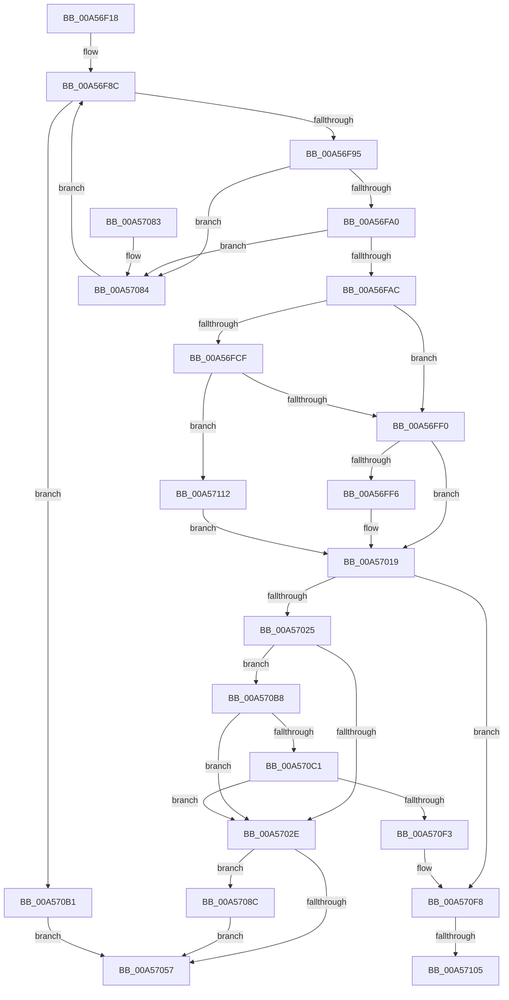

# SepGetLogonSessionAccountInfo

- RVA: `0x00A56F18`–`0x00A5711C` (길이 `516` bytes)
- VA: `0x0000000140A56F18`
- 실행 섹션: `PAGE`
- PDB 이름 있음: `예`; PDB Function 태그: `예`
- unwind 정보 RVA: `0x00067C6C`
- 디코드: `129`개 명령, `516/516` bytes 표시
- 미해석 바이트: `0` (있으면 어셈블리에 `.byte`로 보존)

> 이 문서는 커널 이미지의 기계어와 PDB 기호를 분석해 생성했습니다. 4번과 5번은 함수 원형과 자료형을 바이너리 사용 방식에서 추정한 C 해석이며 원본 소스 복구 결과는 아닙니다.

## 1. Dependencies

- 직접 호출 지점: **10**; 고유 호출 대상: **6**
- 직접 호출자로 확인된 함수: **1**
- RIP 상대 이미지 참조: **2**

### Outgoing calls
- `0x00A56F7C` → [ExAcquireResourceSharedLite](../../text/21/ExAcquireResourceSharedLite_function_00211BC0.md) (function, `0x00211BC0`)
- `0x00A56FDE` → [ExAllocatePool2](../../poolcode/B8/ExAllocatePool2_function_00B820F0.md) (function, `0x00B820F0`)
- `0x00A57005` → [ExAllocatePool2](../../poolcode/B8/ExAllocatePool2_function_00B820F0.md) (function, `0x00B820F0`)
- `0x00A5703B` → [memcpy](../../text/6C/memcpy_function_006C6840.md) (function, `0x006C6840`)
- `0x00A5704D` → [memcpy](../../text/6C/memcpy_function_006C6840.md) (function, `0x006C6840`)
- `0x00A5705A` → [ExReleaseResourceLite](../../text/25/ExReleaseResourceLite_function_0025FA10.md) (function, `0x0025FA10`)
- `0x00A5705F` → [KeLeaveCriticalRegion](../../text/25/KeLeaveCriticalRegion_function_0025D8B0.md) (function, `0x0025D8B0`)
- `0x00A570A6` → [memcpy](../../text/6C/memcpy_function_006C6840.md) (function, `0x006C6840`)
- `0x00A570E2` → [ExAllocatePool2](../../poolcode/B8/ExAllocatePool2_function_00B820F0.md) (function, `0x00B820F0`)
- `0x00A57107` → [ExFreePoolWithTag](../../poolcode/B8/ExFreePoolWithTag_function_00B82870.md) (function, `0x00B82870`)

### Direct callers
- [AdtpBuildLogonIdStrings](AdtpBuildLogonIdStrings_function_00A56DC8.md) at `0x00A56DFA`

### Static image references
- `0x00A56F6F` → RVA `0x00E67F20` (`.data`; read)
- `0x00A56F81` → RVA `0x00FD9AF0` (`PAGEDATA`; read)

## 2. Other-region calls and transfers

- 다른 실행 섹션으로 향하는 call: **10**
  - `0x00A56F7C` → [ExAcquireResourceSharedLite](../../text/21/ExAcquireResourceSharedLite_function_00211BC0.md) (`PAGE` → `.text`)
  - `0x00A56FDE` → [ExAllocatePool2](../../poolcode/B8/ExAllocatePool2_function_00B820F0.md) (`PAGE` → `POOLCODE`)
  - `0x00A57005` → [ExAllocatePool2](../../poolcode/B8/ExAllocatePool2_function_00B820F0.md) (`PAGE` → `POOLCODE`)
  - `0x00A5703B` → [memcpy](../../text/6C/memcpy_function_006C6840.md) (`PAGE` → `.text`)
  - `0x00A5704D` → [memcpy](../../text/6C/memcpy_function_006C6840.md) (`PAGE` → `.text`)
  - `0x00A5705A` → [ExReleaseResourceLite](../../text/25/ExReleaseResourceLite_function_0025FA10.md) (`PAGE` → `.text`)
  - `0x00A5705F` → [KeLeaveCriticalRegion](../../text/25/KeLeaveCriticalRegion_function_0025D8B0.md) (`PAGE` → `.text`)
  - `0x00A570A6` → [memcpy](../../text/6C/memcpy_function_006C6840.md) (`PAGE` → `.text`)
  - `0x00A570E2` → [ExAllocatePool2](../../poolcode/B8/ExAllocatePool2_function_00B820F0.md) (`PAGE` → `POOLCODE`)
  - `0x00A57107` → [ExFreePoolWithTag](../../poolcode/B8/ExFreePoolWithTag_function_00B82870.md) (`PAGE` → `POOLCODE`)
- call이 아닌 외부 분기/꼬리 이동: **2**
  - `0x00A570FF` → [sub_00B3D926](../B3/Unknown_function_00B3D926.md) (`tail-transfer`)
  - `0x00A5710D` → [sub_00B3D926](../B3/Unknown_function_00B3D926.md) (`tail-transfer`)

## 3. Assembly (complete function range)

```asm
00A56F18  48 89 5C 24 08                  mov qword ptr [rsp + 8], rbx
00A56F1D  48 89 6C 24 10                  mov qword ptr [rsp + 0x10], rbp
00A56F22  48 89 74 24 18                  mov qword ptr [rsp + 0x18], rsi
00A56F27  57                              push rdi
00A56F28  41 54                           push r12
00A56F2A  41 55                           push r13
00A56F2C  41 56                           push r14
00A56F2E  41 57                           push r15
00A56F30  48 83 EC 20                     sub rsp, 0x20
00A56F34  44 69 11 24 0A 25 5B            imul r10d, dword ptr [rcx], 0x5b250a24
00A56F3B  4C 8B F2                        mov r14, rdx
00A56F3E  65 48 8B 04 25 88 01 00 00      mov rax, qword ptr gs:[0x188]
00A56F47  48 8B F1                        mov rsi, rcx
00A56F4A  33 ED                           xor ebp, ebp
00A56F4C  B2 01                           mov dl, 1
00A56F4E  4D 8B E1                        mov r12, r9
00A56F51  4D 8B F8                        mov r15, r8
00A56F54  8B FD                           mov edi, ebp
00A56F56  66 FF 88 E4 01 00 00            dec word ptr [rax + 0x1e4]
00A56F5D  90                              nop
00A56F5E  41 C1 EA 1C                     shr r10d, 0x1c
00A56F62  41 8B C2                        mov eax, r10d
00A56F65  83 E0 03                        and eax, 3
00A56F68  41 8B DA                        mov ebx, r10d
00A56F6B  4C 6B E8 68                     imul r13, rax, 0x68
00A56F6F  48 8D 05 AA 0F 41 00            lea rax, [rip + 0x410faa]
00A56F76  4C 03 E8                        add r13, rax
00A56F79  49 8B CD                        mov rcx, r13
00A56F7C  E8 3F AC 7B FF                  call 0x140211bc0
00A56F81  48 8B 05 68 2B 58 00            mov rax, qword ptr [rip + 0x582b68]
00A56F88  48 8B 1C D8                     mov rbx, qword ptr [rax + rbx*8]
00A56F8C  48 85 DB                        test rbx, rbx
00A56F8F  0F 84 1C 01 00 00               je 0x140a570b1
00A56F95  8B 43 08                        mov eax, dword ptr [rbx + 8]
00A56F98  39 06                           cmp dword ptr [rsi], eax
00A56F9A  0F 85 E4 00 00 00               jne 0x140a57084
00A56FA0  8B 43 0C                        mov eax, dword ptr [rbx + 0xc]
00A56FA3  39 46 04                        cmp dword ptr [rsi + 4], eax
00A56FA6  0F 85 D8 00 00 00               jne 0x140a57084
00A56FAC  0F 10 43 40                     movups xmm0, xmmword ptr [rbx + 0x40]
00A56FB0  48 8B F5                        mov rsi, rbp
00A56FB3  F3 41 0F 7F 06                  movdqu xmmword ptr [r14], xmm0
00A56FB8  0F 10 4B 50                     movups xmm1, xmmword ptr [rbx + 0x50]
00A56FBC  F3 41 0F 7F 0F                  movdqu xmmword ptr [r15], xmm1
00A56FC1  49 89 6E 08                     mov qword ptr [r14 + 8], rbp
00A56FC5  49 89 6F 08                     mov qword ptr [r15 + 8], rbp
00A56FC9  48 39 6B 48                     cmp qword ptr [rbx + 0x48], rbp
00A56FCD  74 21                           je 0x140a56ff0
00A56FCF  0F B7 53 42                     movzx edx, word ptr [rbx + 0x42]
00A56FD3  B9 00 01 00 00                  mov ecx, 0x100
00A56FD8  41 B8 53 65 41 6B               mov r8d, 0x6b416553
00A56FDE  E8 0D B1 12 00                  call 0x140b820f0
00A56FE3  49 89 46 08                     mov qword ptr [r14 + 8], rax
00A56FE7  48 85 C0                        test rax, rax
00A56FEA  0F 84 22 01 00 00               je 0x140a57112
00A56FF0  48 39 6B 58                     cmp qword ptr [rbx + 0x58], rbp
00A56FF4  74 23                           je 0x140a57019
00A56FF6  0F B7 53 52                     movzx edx, word ptr [rbx + 0x52]
00A56FFA  B9 00 01 00 00                  mov ecx, 0x100
00A56FFF  41 B8 53 65 41 6B               mov r8d, 0x6b416553
00A57005  E8 E6 B0 12 00                  call 0x140b820f0
00A5700A  48 85 C0                        test rax, rax
00A5700D  49 89 47 08                     mov qword ptr [r15 + 8], rax
00A57011  B8 9A 00 00 C0                  mov eax, 0xc000009a
00A57016  0F 44 F8                        cmove edi, eax
00A57019  48 8B 6B 38                     mov rbp, qword ptr [rbx + 0x38]
00A5701D  85 FF                           test edi, edi
00A5701F  0F 88 D3 00 00 00               js 0x140a570f8
00A57025  4D 85 E4                        test r12, r12
00A57028  0F 85 8A 00 00 00               jne 0x140a570b8
00A5702E  44 0F B7 43 42                  movzx r8d, word ptr [rbx + 0x42]
00A57033  48 8B 53 48                     mov rdx, qword ptr [rbx + 0x48]
00A57037  49 8B 4E 08                     mov rcx, qword ptr [r14 + 8]
00A5703B  E8 00 F8 C6 FF                  call 0x1406c6840
00A57040  44 0F B7 43 52                  movzx r8d, word ptr [rbx + 0x52]
00A57045  48 8B 53 58                     mov rdx, qword ptr [rbx + 0x58]
00A57049  49 8B 4F 08                     mov rcx, qword ptr [r15 + 8]
00A5704D  E8 EE F7 C6 FF                  call 0x1406c6840
00A57052  48 85 F6                        test rsi, rsi
00A57055  75 35                           jne 0x140a5708c
00A57057  49 8B CD                        mov rcx, r13
00A5705A  E8 B1 89 80 FF                  call 0x14025fa10
00A5705F  E8 4C 68 80 FF                  call 0x14025d8b0
00A57064  48 8B 5C 24 50                  mov rbx, qword ptr [rsp + 0x50]
00A57069  8B C7                           mov eax, edi
00A5706B  48 8B 6C 24 58                  mov rbp, qword ptr [rsp + 0x58]
00A57070  48 8B 74 24 60                  mov rsi, qword ptr [rsp + 0x60]
00A57075  48 83 C4 20                     add rsp, 0x20
00A57079  41 5F                           pop r15
00A5707B  41 5E                           pop r14
00A5707D  41 5D                           pop r13
00A5707F  41 5C                           pop r12
00A57081  5F                              pop rdi
00A57082  C3                              ret
00A57083  CC                              int3
00A57084  48 8B 1B                        mov rbx, qword ptr [rbx]
00A57087  E9 00 FF FF FF                  jmp 0x140a56f8c
00A5708C  48 8B 85 98 00 00 00            mov rax, qword ptr [rbp + 0x98]
00A57093  48 8B CE                        mov rcx, rsi
00A57096  48 8B 10                        mov rdx, qword ptr [rax]
00A57099  44 0F B6 42 01                  movzx r8d, byte ptr [rdx + 1]
00A5709E  4E 8D 04 85 08 00 00 00         lea r8, [r8*4 + 8]
00A570A6  E8 95 F7 C6 FF                  call 0x1406c6840
00A570AB  49 89 34 24                     mov qword ptr [r12], rsi
00A570AF  EB A6                           jmp 0x140a57057
00A570B1  BF 5F 00 00 C0                  mov edi, 0xc000005f
00A570B6  EB 9F                           jmp 0x140a57057
00A570B8  48 85 ED                        test rbp, rbp
00A570BB  0F 84 6D FF FF FF               je 0x140a5702e
00A570C1  48 8B 85 98 00 00 00            mov rax, qword ptr [rbp + 0x98]
00A570C8  B9 00 01 00 00                  mov ecx, 0x100
00A570CD  41 B8 53 65 53 69               mov r8d, 0x69536553
00A570D3  48 8B 10                        mov rdx, qword ptr [rax]
00A570D6  0F B6 52 01                     movzx edx, byte ptr [rdx + 1]
00A570DA  48 8D 14 95 08 00 00 00         lea rdx, [rdx*4 + 8]
00A570E2  E8 09 B0 12 00                  call 0x140b820f0
00A570E7  48 8B F0                        mov rsi, rax
00A570EA  48 85 C0                        test rax, rax
00A570ED  0F 85 3B FF FF FF               jne 0x140a5702e
00A570F3  BF 9A 00 00 C0                  mov edi, 0xc000009a
00A570F8  49 8B 4E 08                     mov rcx, qword ptr [r14 + 8]
00A570FC  48 85 C9                        test rcx, rcx
00A570FF  0F 84 21 68 0E 00               je 0x140b3d926
00A57105  33 D2                           xor edx, edx
00A57107  E8 64 B7 12 00                  call 0x140b82870
00A5710C  90                              nop
00A5710D  E9 14 68 0E 00                  jmp 0x140b3d926
00A57112  BF 9A 00 00 C0                  mov edi, 0xc000009a
00A57117  E9 FD FE FF FF                  jmp 0x140a57019
```

## 4. C-style interpretation (structured pseudocode)

```c
__int64 __fastcall SepGetLogonSessionAccountInfo(__int64 a1, __int64 a2, __int64 a3, __int64 a4)
{
    __int64 result;
    __int64 v_r10;
    __int64 v_r13;
    __int64 v_rbp;
    __int64 v_rdi;
    __int64 v_rsp;
    unsigned __int64 v_stack_p10;
    unsigned __int64 v_stack_p18;
    unsigned __int64 v_stack_p8;

    v_stack_p8 = v_rbx;
    v_stack_p10 = v_rbp;
    v_stack_p18 = v_rsi;
    v_rsp = (v_rsp) - (32);
    v_r10 = (unsigned int)((v_r10) * (*(unsigned int *)(a1)));
    v_rbp = 0;
    v_r10 = (unsigned int)((v_r10) >> (28));
    result = (unsigned int)(((unsigned int)((unsigned int)(v_r10))) & (3));
    v_r13 = (v_r13) * (result);
    v_r13 = (v_r13) + (v_rip + 4263850);
    result = ExAcquireResourceSharedLite(v_r13, 1, a3, a4);
loc_00A56F8C:
    if (*(unsigned __int64 *)(*(unsigned __int64 *)(v_rip + 5778280) + (unsigned int)((unsigned int)(v_r10)) * 8) == 0) goto loc_00A570B1;
    if ((*(unsigned int *)(a1)) != ((unsigned int)((unsigned int)(*(unsigned int *)(*(unsigned __int64 *)(*(unsigned __int64 *)(v_rip + 5778280) + (unsigned int)((unsigned int)(v_r10)) * 8) + 8))))) goto loc_00A57084;
    if ((*(unsigned int *)(a1 + 4)) != ((unsigned int)((unsigned int)(*(unsigned int *)(*(unsigned __int64 *)(*(unsigned __int64 *)(v_rip + 5778280) + (unsigned int)((unsigned int)(v_r10)) * 8) + 12))))) goto loc_00A57084;
    *(unsigned __int64 *)(a2) = v_xmm0;
    *(unsigned __int64 *)(a3) = v_xmm1;
    *(unsigned __int64 *)(a2 + 8) = 0;
    *(unsigned __int64 *)(a3 + 8) = 0;
    if ((*(unsigned __int64 *)(*(unsigned __int64 *)(*(unsigned __int64 *)(v_rip + 5778280) + (unsigned int)((unsigned int)(v_r10)) * 8) + 72)) == 0) goto loc_00A56FF0;
    result = ExAllocatePool2(256, *(unsigned __int16 *)(*(unsigned __int64 *)(*(unsigned __int64 *)(v_rip + 5778280) + (unsigned int)((unsigned int)(v_r10)) * 8) + 66), (unsigned int)(0x6B416553ULL), a4);
    *(unsigned __int64 *)(a2 + 8) = result;
    if (result == 0) goto loc_00A57112;
loc_00A56FF0:
    v_rdi = 0;
    if ((*(unsigned __int64 *)(*(unsigned __int64 *)(*(unsigned __int64 *)(v_rip + 5778280) + (unsigned int)((unsigned int)(v_r10)) * 8) + 88)) != 0) {
        a2 = *(unsigned __int16 *)(*(unsigned __int64 *)(*(unsigned __int64 *)(v_rip + 5778280) + (unsigned int)((unsigned int)(v_r10)) * 8) + 82);
        a1 = 256;
        a3 = 0x6B416553ULL;
        result = ExAllocatePool2(a1, a2, a3, a4);
        *(unsigned __int64 *)(a3 + 8) = result;
        result = 0xC000009AULL;
        v_rdi = 0;
        if (result == 0) { v_rdi = (unsigned int)(result); }
    }
    if (sign_flag) goto loc_00A570F8;
    if (a4 != 0) goto loc_00A570B8;
loc_00A5702E:
    result = memcpy(*(unsigned __int64 *)(a2 + 8), *(unsigned __int64 *)(*(unsigned __int64 *)(*(unsigned __int64 *)(v_rip + 5778280) + (unsigned int)((unsigned int)(v_r10)) * 8) + 72), *(unsigned __int16 *)(*(unsigned __int64 *)(*(unsigned __int64 *)(v_rip + 5778280) + (unsigned int)((unsigned int)(v_r10)) * 8) + 66), a4);
    result = memcpy(*(unsigned __int64 *)(a3 + 8), *(unsigned __int64 *)(*(unsigned __int64 *)(*(unsigned __int64 *)(v_rip + 5778280) + (unsigned int)((unsigned int)(v_r10)) * 8) + 88), *(unsigned __int16 *)(*(unsigned __int64 *)(*(unsigned __int64 *)(v_rip + 5778280) + (unsigned int)((unsigned int)(v_r10)) * 8) + 82), a4);
    if (0 != 0) goto loc_00A5708C;
loc_00A57057:
    result = ExReleaseResourceLite(v_r13, *(unsigned __int64 *)(*(unsigned __int64 *)(*(unsigned __int64 *)(v_rip + 5778280) + (unsigned int)((unsigned int)(v_r10)) * 8) + 88), *(unsigned __int16 *)(*(unsigned __int64 *)(*(unsigned __int64 *)(v_rip + 5778280) + (unsigned int)((unsigned int)(v_r10)) * 8) + 82), a4);
    result = KeLeaveCriticalRegion(v_r13, *(unsigned __int64 *)(*(unsigned __int64 *)(*(unsigned __int64 *)(v_rip + 5778280) + (unsigned int)((unsigned int)(v_r10)) * 8) + 88), *(unsigned __int16 *)(*(unsigned __int64 *)(*(unsigned __int64 *)(v_rip + 5778280) + (unsigned int)((unsigned int)(v_r10)) * 8) + 82), a4);
    v_rsp = (v_rsp) + (32);
    return (unsigned int)((unsigned int)(v_rdi));
loc_00A57084:
    goto loc_00A56F8C;
loc_00A5708C:
    result = memcpy(v_stack_p18, *(unsigned __int64 *)(*(unsigned __int64 *)(v_stack_p10 + 152)), *(unsigned __int8 *)(*(unsigned __int64 *)(*(unsigned __int64 *)(v_stack_p10 + 152)) + 1) * 4 + 8, a4);
    *(unsigned __int64 *)(a4) = v_stack_p18;
    goto loc_00A57057;
loc_00A570B1:
    goto loc_00A57057;
loc_00A570B8:
    if (v_stack_p10 == 0) goto loc_00A5702E;
    result = ExAllocatePool2(256, *(unsigned __int8 *)(*(unsigned __int64 *)(*(unsigned __int64 *)(v_stack_p10 + 152)) + 1) * 4 + 8, (unsigned int)(0x69536553ULL), a4);
    if (result != 0) goto loc_00A5702E;
loc_00A570F8:
    a2 = 0;
    result = ExFreePoolWithTag(*(unsigned __int64 *)(a2 + 8), a2, (unsigned int)(0x69536553ULL), a4);
loc_00A57112:
    goto loc_00A57019;
}
```

## 5. (Beta) C Style

```c
int64_t SepGetLogonSessionAccountInfo(void *Arg1, void *Arg2, void *Arg3, int64_t Arg4)
{
    uint8_t *arg1 = (uint8_t *)Arg1;
    uint8_t *arg2 = (uint8_t *)Arg2;
    uint8_t *arg3 = (uint8_t *)Arg3;

    int64_t result;
    int64_t local_r10;
    int64_t local_r13;
    int64_t local_rbp;
    int64_t local_rdi;
    int64_t local_rsp;
    uint64_t v_stack_p10;
    uint64_t v_stack_p18;
    uint64_t v_stack_p8;

    v_stack_p8 = local_rbx;
    v_stack_p10 = local_rbp;
    v_stack_p18 = local_rsi;
    local_rsp = (local_rsp) - (32);
    local_r10 = (uint32_t)((local_r10) * (*(uint32_t *)(arg1)));
    local_rbp = 0;
    local_r10 = (uint32_t)((local_r10) >> (28));
    result = (uint32_t)(((uint32_t)((uint32_t)(local_r10))) & (3));
    local_r13 = (local_r13) * (result);
    local_r13 = (local_r13) + (v_rip + 4263850);
    result = ExAcquireResourceSharedLite(local_r13, 1, Arg3, Arg4);
loc_00A56F8C:
    if (*(uint64_t *)(*(uint64_t *)(v_rip + 0x582B68) + (uint32_t)((uint32_t)(local_r10)) * 8) == 0) goto loc_00A570B1;
    if ((*(uint32_t *)(arg1)) != ((uint32_t)((uint32_t)(*(uint32_t *)(*(uint64_t *)(*(uint64_t *)(v_rip + 0x582B68) + (uint32_t)((uint32_t)(local_r10)) * 8) + 0x8))))) goto loc_00A57084;
    if ((*(uint32_t *)(arg1 + 0x4)) != ((uint32_t)((uint32_t)(*(uint32_t *)(*(uint64_t *)(*(uint64_t *)(v_rip + 0x582B68) + (uint32_t)((uint32_t)(local_r10)) * 8) + 0xC))))) goto loc_00A57084;
    *(uint64_t *)(arg2) = v_xmm0;
    *(uint64_t *)(arg3) = v_xmm1;
    *(uint64_t *)(arg2 + 0x8) = 0;
    *(uint64_t *)(arg3 + 0x8) = 0;
    if ((*(uint64_t *)(*(uint64_t *)(*(uint64_t *)(v_rip + 0x582B68) + (uint32_t)((uint32_t)(local_r10)) * 8) + 0x48)) == 0) goto loc_00A56FF0;
    result = ExAllocatePool2(256, *(uint16_t *)(*(uint64_t *)(*(uint64_t *)(v_rip + 0x582B68) + (uint32_t)((uint32_t)(local_r10)) * 8) + 0x42), (uint32_t)(0x6B416553ULL), Arg4);
    *(uint64_t *)(arg2 + 0x8) = result;
    if (result == 0) goto loc_00A57112;
loc_00A56FF0:
    local_rdi = 0;
    if ((*(uint64_t *)(*(uint64_t *)(*(uint64_t *)(v_rip + 0x582B68) + (uint32_t)((uint32_t)(local_r10)) * 8) + 0x58)) != 0) {
        Arg2 = *(uint16_t *)(*(uint64_t *)(*(uint64_t *)(v_rip + 0x582B68) + (uint32_t)((uint32_t)(local_r10)) * 8) + 0x52);
        Arg1 = 256;
        Arg3 = 0x6B416553ULL;
        result = ExAllocatePool2(Arg1, Arg2, Arg3, Arg4);
        *(uint64_t *)(arg3 + 0x8) = result;
        result = 0xC000009AULL;
        local_rdi = 0;
        if (result == 0) { local_rdi = (uint32_t)(result); }
    }
    if (sign_flag) goto loc_00A570F8;
    if (Arg4 != 0) goto loc_00A570B8;
loc_00A5702E:
    result = memcpy(*(uint64_t *)(arg2 + 0x8), *(uint64_t *)(*(uint64_t *)(*(uint64_t *)(v_rip + 0x582B68) + (uint32_t)((uint32_t)(local_r10)) * 8) + 0x48), *(uint16_t *)(*(uint64_t *)(*(uint64_t *)(v_rip + 0x582B68) + (uint32_t)((uint32_t)(local_r10)) * 8) + 0x42), Arg4);
    result = memcpy(*(uint64_t *)(arg3 + 0x8), *(uint64_t *)(*(uint64_t *)(*(uint64_t *)(v_rip + 0x582B68) + (uint32_t)((uint32_t)(local_r10)) * 8) + 0x58), *(uint16_t *)(*(uint64_t *)(*(uint64_t *)(v_rip + 0x582B68) + (uint32_t)((uint32_t)(local_r10)) * 8) + 0x52), Arg4);
    if (0 != 0) goto loc_00A5708C;
loc_00A57057:
    result = ExReleaseResourceLite(local_r13, *(uint64_t *)(*(uint64_t *)(*(uint64_t *)(v_rip + 0x582B68) + (uint32_t)((uint32_t)(local_r10)) * 8) + 0x58), *(uint16_t *)(*(uint64_t *)(*(uint64_t *)(v_rip + 0x582B68) + (uint32_t)((uint32_t)(local_r10)) * 8) + 0x52), Arg4);
    result = KeLeaveCriticalRegion(local_r13, *(uint64_t *)(*(uint64_t *)(*(uint64_t *)(v_rip + 0x582B68) + (uint32_t)((uint32_t)(local_r10)) * 8) + 0x58), *(uint16_t *)(*(uint64_t *)(*(uint64_t *)(v_rip + 0x582B68) + (uint32_t)((uint32_t)(local_r10)) * 8) + 0x52), Arg4);
    local_rsp = (local_rsp) + (32);
    return (uint32_t)((uint32_t)(local_rdi));
loc_00A57084:
    goto loc_00A56F8C;
loc_00A5708C:
    result = memcpy(v_stack_p18, *(uint64_t *)(*(uint64_t *)(v_stack_p10 + 0x98)), *(uint8_t *)(*(uint64_t *)(*(uint64_t *)(v_stack_p10 + 0x98)) + 0x1) * 4 + 8, Arg4);
    *(uint64_t *)(Arg4) = v_stack_p18;
    goto loc_00A57057;
loc_00A570B1:
    goto loc_00A57057;
loc_00A570B8:
    if (v_stack_p10 == 0) goto loc_00A5702E;
    result = ExAllocatePool2(256, *(uint8_t *)(*(uint64_t *)(*(uint64_t *)(v_stack_p10 + 0x98)) + 0x1) * 4 + 8, (uint32_t)(0x69536553ULL), Arg4);
    if (result != 0) goto loc_00A5702E;
loc_00A570F8:
    Arg2 = 0;
    result = ExFreePoolWithTag(*(uint64_t *)(arg2 + 0x8), Arg2, (uint32_t)(0x69536553ULL), Arg4);
loc_00A57112:
    goto loc_00A57019;
}
```

### 관측된 메모리 오프셋

구조체 형식이 확인되지 않은 접근은 인자 기준의 오프셋으로만 기록했습니다.

| 기준 인자 | 오프셋 표현 | 폭 (bit) | 접근 |
|---|---:|---:|---|
| `Arg1` | `+ 0x0` | `32` | `R` |
| `Arg1` | `+ 0x4` | `32` | `R` |
| `Arg2` | `+ 0x0` | `128` | `W` |
| `Arg2` | `+ 0x8` | `64` | `R` |
| `Arg2` | `+ 0x8` | `64` | `W` |
| `Arg3` | `+ 0x0` | `128` | `W` |
| `Arg3` | `+ 0x8` | `64` | `R` |
| `Arg3` | `+ 0x8` | `64` | `W` |

## 6. Execution-region graph

[열기: 2D/3D 그래프와 함수 탐색 컨트롤 패널](../../../control-panel.html?section=page&rva=0x00A56F18&view=graph)

- 2D 그래프는 위에서 아래로 흐르고, 3D 그래프는 빈 공간을 드래그해 회전합니다. Shift+드래그는 이동, 휠은 확대·축소, 함수 노드 선택은 대상 보고서 이동입니다.

### Static fallback


