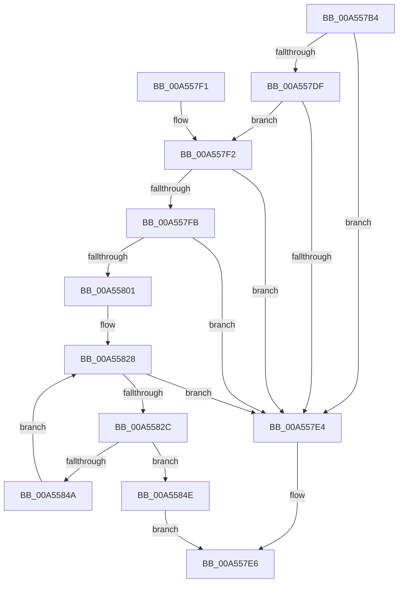

# SepIsNgenImage

- RVA: `0x00A557B4`–`0x00A55852` (길이 `158` bytes)
- VA: `0x0000000140A557B4`
- 실행 섹션: `PAGE`
- PDB 이름 있음: `예`; PDB Function 태그: `아니요`
- unwind 정보 RVA: `0x000B125C`
- 디코드: `49`개 명령, `158/158` bytes 표시
- 미해석 바이트: `0` (있으면 어셈블리에 `.byte`로 보존)

> 이 문서는 커널 이미지의 기계어와 PDB 기호를 분석해 생성했습니다. 4번과 5번은 함수 원형과 자료형을 바이너리 사용 방식에서 추정한 C 해석이며 원본 소스 복구 결과는 아닙니다.

## 1. Dependencies

- 직접 호출 지점: **3**; 고유 호출 대상: **3**
- 직접 호출자로 확인된 함수: **1**
- RIP 상대 이미지 참조: **0**

### Outgoing calls
- `0x00A557C6` → [PsGetCurrentServerSilo](../../text/22/PsGetCurrentServerSilo_function_00225710.md) (function, `0x00225710`)
- `0x00A557CE` → [PsGetServerSiloGlobals](../../text/22/PsGetServerSiloGlobals_function_002250A0.md) (function, `0x002250A0`)
- `0x00A55841` → [RtlEqualUnicodeString](../93/RtlEqualUnicodeString_function_00932A20.md) (function, `0x00932A20`)

### Direct callers
- [SeQuerySigningPolicyWorker](../A1/SeQuerySigningPolicyWorker_function_00A13788.md) at `0x00A139C0`

### Static image references
- 디코드된 RIP-relative 메모리 참조가 없습니다.

## 2. Other-region calls and transfers

- 다른 실행 섹션으로 향하는 call: **2**
  - `0x00A557C6` → [PsGetCurrentServerSilo](../../text/22/PsGetCurrentServerSilo_function_00225710.md) (`PAGE` → `.text`)
  - `0x00A557CE` → [PsGetServerSiloGlobals](../../text/22/PsGetServerSiloGlobals_function_002250A0.md) (`PAGE` → `.text`)
- 별도 외부 분기/꼬리 이동을 확인하지 못했습니다.

## 3. Assembly (complete function range)

```asm
00A557B4  48 89 5C 24 08                  mov qword ptr [rsp + 8], rbx
00A557B9  57                              push rdi
00A557BA  48 83 EC 30                     sub rsp, 0x30
00A557BE  83 64 24 24 00                  and dword ptr [rsp + 0x24], 0
00A557C3  48 8B F9                        mov rdi, rcx
00A557C6  E8 45 FF 7C FF                  call 0x140225710
00A557CB  48 8B C8                        mov rcx, rax
00A557CE  E8 CD F8 7C FF                  call 0x1402250a0
00A557D3  48 8B 98 08 03 00 00            mov rbx, qword ptr [rax + 0x308]
00A557DA  48 85 DB                        test rbx, rbx
00A557DD  74 05                           je 0x140a557e4
00A557DF  83 3B 00                        cmp dword ptr [rbx], 0
00A557E2  75 0E                           jne 0x140a557f2
00A557E4  32 C0                           xor al, al
00A557E6  48 8B 5C 24 40                  mov rbx, qword ptr [rsp + 0x40]
00A557EB  48 83 C4 30                     add rsp, 0x30
00A557EF  5F                              pop rdi
00A557F0  C3                              ret
00A557F1  CC                              int3
00A557F2  0F B7 0F                        movzx ecx, word ptr [rdi]
00A557F5  66 3B 4B 04                     cmp cx, word ptr [rbx + 4]
00A557F9  72 E9                           jb 0x140a557e4
00A557FB  66 3B 4B 06                     cmp cx, word ptr [rbx + 6]
00A557FF  77 E3                           ja 0x140a557e4
00A55801  48 8B 47 08                     mov rax, qword ptr [rdi + 8]
00A55805  BA 08 00 00 00                  mov edx, 8
00A5580A  48 03 C2                        add rax, rdx
00A5580D  66 2B CA                        sub cx, dx
00A55810  48 89 44 24 28                  mov qword ptr [rsp + 0x28], rax
00A55815  0F B7 47 02                     movzx eax, word ptr [rdi + 2]
00A55819  66 2B C2                        sub ax, dx
00A5581C  66 89 4C 24 20                  mov word ptr [rsp + 0x20], cx
00A55821  66 89 44 24 22                  mov word ptr [rsp + 0x22], ax
00A55826  33 FF                           xor edi, edi
00A55828  3B 3B                           cmp edi, dword ptr [rbx]
00A5582A  73 B8                           jae 0x140a557e4
00A5582C  8B D7                           mov edx, edi
00A5582E  48 8D 4C 24 20                  lea rcx, [rsp + 0x20]
00A55833  48 C1 E2 04                     shl rdx, 4
00A55837  41 B0 01                        mov r8b, 1
00A5583A  48 83 C2 08                     add rdx, 8
00A5583E  48 03 D3                        add rdx, rbx
00A55841  E8 DA D1 ED FF                  call 0x140932a20
00A55846  84 C0                           test al, al
00A55848  75 04                           jne 0x140a5584e
00A5584A  FF C7                           inc edi
00A5584C  EB DA                           jmp 0x140a55828
00A5584E  B0 01                           mov al, 1
00A55850  EB 94                           jmp 0x140a557e6
```

## 4. C-style interpretation (structured pseudocode)

```c
__int64 __fastcall SepIsNgenImage(__int64 a1)
{
    __int64 result;
    __int64 v_rdi;
    __int64 v_rsp;
    unsigned int v_stack_m14;
    unsigned __int16 v_stack_p20;
    unsigned __int16 v_stack_p22;
    unsigned __int64 v_stack_p28;
    unsigned __int64 v_stack_p8;

    v_stack_p8 = v_rbx;
    v_rsp = (v_rsp) - (48);
    result = PsGetCurrentServerSilo(a1, a2, a3, a4);
    result = PsGetServerSiloGlobals(result, a2, a3, a4);
    if (*(unsigned __int64 *)(result + 776) == 0) goto loc_00A557E4;
    if ((*(unsigned int *)(*(unsigned __int64 *)(result + 776))) != 0) goto loc_00A557F2;
loc_00A557E4:
    result = 0;
loc_00A557E6:
    v_rsp = (v_rsp) + (48);
    return result;
loc_00A557F2:
    if (((unsigned __int16)(*(unsigned __int16 *)(a1))) < (*(unsigned __int16 *)(v_stack_p8 + 4))) goto loc_00A557E4;
    if (((unsigned __int16)(*(unsigned __int16 *)(a1))) > (*(unsigned __int16 *)(v_stack_p8 + 6))) goto loc_00A557E4;
    result = (*(unsigned __int64 *)(a1 + 8)) + (8);
    a1 = (unsigned __int16)((*(unsigned __int16 *)(a1)) - (8));
    v_stack_p28 = result;
    result = (unsigned __int16)((*(unsigned __int16 *)(a1 + 2)) - (8));
    v_stack_p20 = (unsigned __int16)(a1);
    v_stack_p22 = (unsigned __int16)(result);
    v_rdi = 0;
loc_00A55828:
    if (0 >= (*(unsigned int *)(v_stack_p8))) goto loc_00A557E4;
    a2 = (0) << (4);
    a2 = (a2) + (8);
    a2 = (a2) + (v_stack_p8);
    result = RtlEqualUnicodeString(v_stack_p20, a2, 1, a4);
    if ((unsigned __int8)(result) != 0) goto loc_00A5584E;
    v_rdi = (unsigned int)((v_rdi) + 1);
    goto loc_00A55828;
loc_00A5584E:
    goto loc_00A557E6;
}
```

## 5. (Beta) C Style

```c
int64_t SepIsNgenImage(void *Arg1)
{
    uint8_t *arg1 = (uint8_t *)Arg1;

    int64_t result;
    int64_t local_rdi;
    int64_t local_rsp;
    uint32_t v_stack_m14;
    uint16_t v_stack_p20;
    uint16_t v_stack_p22;
    uint64_t v_stack_p28;
    uint64_t v_stack_p8;

    v_stack_p8 = local_rbx;
    local_rsp = (local_rsp) - (48);
    result = PsGetCurrentServerSilo(Arg1, a2, a3, a4);
    result = PsGetServerSiloGlobals(result, a2, a3, a4);
    if (*(uint64_t *)(result + 0x308) == 0) goto loc_00A557E4;
    if ((*(uint32_t *)(*(uint64_t *)(result + 0x308))) != 0) goto loc_00A557F2;
loc_00A557E4:
    result = 0;
loc_00A557E6:
    local_rsp = (local_rsp) + (48);
    return result;
loc_00A557F2:
    if (((uint16_t)(*(uint16_t *)(arg1))) < (*(uint16_t *)(v_stack_p8 + 0x4))) goto loc_00A557E4;
    if (((uint16_t)(*(uint16_t *)(arg1))) > (*(uint16_t *)(v_stack_p8 + 0x6))) goto loc_00A557E4;
    result = (*(uint64_t *)(arg1 + 0x8)) + (8);
    Arg1 = (uint16_t)((*(uint16_t *)(arg1)) - (8));
    v_stack_p28 = result;
    result = (uint16_t)((*(uint16_t *)(arg1 + 0x2)) - (8));
    v_stack_p20 = (uint16_t)(Arg1);
    v_stack_p22 = (uint16_t)(result);
    local_rdi = 0;
loc_00A55828:
    if (0 >= (*(uint32_t *)(v_stack_p8))) goto loc_00A557E4;
    a2 = (0) << (4);
    a2 = (a2) + (8);
    a2 = (a2) + (v_stack_p8);
    result = RtlEqualUnicodeString(v_stack_p20, a2, 1, a4);
    if ((uint8_t)(result) != 0) goto loc_00A5584E;
    local_rdi = (uint32_t)((local_rdi) + 1);
    goto loc_00A55828;
loc_00A5584E:
    goto loc_00A557E6;
}
```

### 관측된 메모리 오프셋

구조체 형식이 확인되지 않은 접근은 인자 기준의 오프셋으로만 기록했습니다.

| 기준 인자 | 오프셋 표현 | 폭 (bit) | 접근 |
|---|---:|---:|---|
| `Arg1` | `+ 0x0` | `16` | `R` |
| `Arg1` | `+ 0x2` | `16` | `R` |
| `Arg1` | `+ 0x8` | `64` | `R` |

## 6. Execution-region graph

[열기: 2D/3D 그래프와 함수 탐색 컨트롤 패널](../../../control-panel.html?section=page&rva=0x00A557B4&view=graph)

- 2D 그래프는 위에서 아래로 흐르고, 3D 그래프는 빈 공간을 드래그해 회전합니다. Shift+드래그는 이동, 휠은 확대·축소, 함수 노드 선택은 대상 보고서 이동입니다.

### Static fallback


