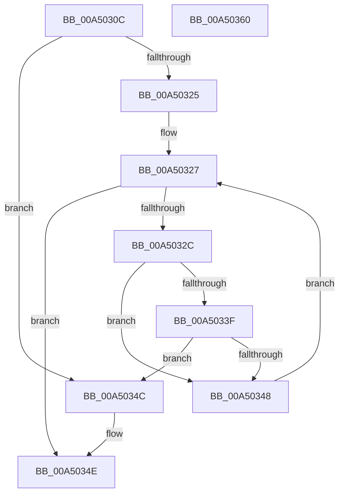

# SepShouldSetDelinkFlags

- RVA: `0x00A5030C`–`0x00A50361` (길이 `85` bytes)
- VA: `0x0000000140A5030C`
- 실행 섹션: `PAGE`
- PDB 이름 있음: `예`; PDB Function 태그: `아니요`
- unwind 정보 RVA: `0x00060BC4`
- 디코드: `30`개 명령, `85/85` bytes 표시
- 미해석 바이트: `0` (있으면 어셈블리에 `.byte`로 보존)

> 이 문서는 커널 이미지의 기계어와 PDB 기호를 분석해 생성했습니다. 4번과 5번은 함수 원형과 자료형을 바이너리 사용 방식에서 추정한 C 해석이며 원본 소스 복구 결과는 아닙니다.

## 1. Dependencies

- 직접 호출 지점: **1**; 고유 호출 대상: **1**
- 직접 호출자로 확인된 함수: **2**
- RIP 상대 이미지 참조: **0**

### Outgoing calls
- `0x00A5033F` → [SepPotentialGlobalTableAttribute](../../text/3A/SepPotentialGlobalTableAttribute_function_003A8828.md) (function, `0x003A8828`)

### Direct callers
- [SepInternalSetSecurityAttributesToken](../../text/3A/SepInternalSetSecurityAttributesToken_function_003A9474.md) at `0x003A94D7`
- [NtSetInformationToken](../AF/NtSetInformationToken_function_00AF0530.md) at `0x00AF15A4`

### Static image references
- 디코드된 RIP-relative 메모리 참조가 없습니다.

## 2. Other-region calls and transfers

- 다른 실행 섹션으로 향하는 call: **1**
  - `0x00A5033F` → [SepPotentialGlobalTableAttribute](../../text/3A/SepPotentialGlobalTableAttribute_function_003A8828.md) (`PAGE` → `.text`)
- 별도 외부 분기/꼬리 이동을 확인하지 못했습니다.

## 3. Assembly (complete function range)

```asm
00A5030C  48 89 5C 24 08                  mov qword ptr [rsp + 8], rbx
00A50311  48 89 74 24 10                  mov qword ptr [rsp + 0x10], rsi
00A50316  57                              push rdi
00A50317  48 83 EC 20                     sub rsp, 0x20
00A5031B  33 DB                           xor ebx, ebx
00A5031D  48 8B F2                        mov rsi, rdx
00A50320  83 39 01                        cmp dword ptr [rcx], 1
00A50323  74 27                           je 0x140a5034c
00A50325  8B FB                           mov edi, ebx
00A50327  3B 7E 04                        cmp edi, dword ptr [rsi + 4]
00A5032A  73 22                           jae 0x140a5034e
00A5032C  8B C7                           mov eax, edi
00A5032E  48 8D 0C 80                     lea rcx, [rax + rax*4]
00A50332  48 8B 46 08                     mov rax, qword ptr [rsi + 8]
00A50336  48 8D 0C C8                     lea rcx, [rax + rcx*8]
00A5033A  48 85 C9                        test rcx, rcx
00A5033D  74 09                           je 0x140a50348
00A5033F  E8 E4 84 95 FF                  call 0x1403a8828
00A50344  84 C0                           test al, al
00A50346  75 04                           jne 0x140a5034c
00A50348  FF C7                           inc edi
00A5034A  EB DB                           jmp 0x140a50327
00A5034C  B3 01                           mov bl, 1
00A5034E  48 8B 74 24 38                  mov rsi, qword ptr [rsp + 0x38]
00A50353  8A C3                           mov al, bl
00A50355  48 8B 5C 24 30                  mov rbx, qword ptr [rsp + 0x30]
00A5035A  48 83 C4 20                     add rsp, 0x20
00A5035E  5F                              pop rdi
00A5035F  C3                              ret
00A50360  CC                              int3
```

## 4. C-style interpretation (structured pseudocode)

```c
__int64 __fastcall SepShouldSetDelinkFlags(__int64 a1, __int64 a2)
{
    __int64 result;
    __int64 v_rbx;
    __int64 v_rdi;
    __int64 v_rsp;
    unsigned __int64 v_stack_p10;
    unsigned __int64 v_stack_p8;

    v_stack_p8 = v_rbx;
    v_stack_p10 = v_rsi;
    v_rsp = (v_rsp) - (32);
    v_rbx = 0;
    if ((*(unsigned int *)(a1)) == 1) goto loc_00A5034C;
loc_00A50327:
    if (0 >= (*(unsigned int *)(a2 + 4))) goto loc_00A5034E;
    if (*(unsigned __int64 *)(a2 + 8) + 0 + 0 * 4 * 8 == 0) goto loc_00A50348;
    result = SepPotentialGlobalTableAttribute(*(unsigned __int64 *)(a2 + 8) + 0 + 0 * 4 * 8, a2, a3, a4);
    if ((unsigned __int8)(result) != 0) goto loc_00A5034C;
loc_00A50348:
    v_rdi = (unsigned int)((0) + 1);
    goto loc_00A50327;
loc_00A5034C:
loc_00A5034E:
    v_rsp = (v_rsp) + (32);
    return 1;
}
```

## 5. (Beta) C Style

```c
int64_t SepShouldSetDelinkFlags(void *Arg1, void *Arg2)
{
    uint8_t *arg1 = (uint8_t *)Arg1;
    uint8_t *arg2 = (uint8_t *)Arg2;

    int64_t result;
    int64_t local_rbx;
    int64_t local_rdi;
    int64_t local_rsp;
    uint64_t v_stack_p10;
    uint64_t v_stack_p8;

    v_stack_p8 = local_rbx;
    v_stack_p10 = local_rsi;
    local_rsp = (local_rsp) - (32);
    local_rbx = 0;
    if ((*(uint32_t *)(arg1)) == 1) goto loc_00A5034C;
loc_00A50327:
    if (0 >= (*(uint32_t *)(arg2 + 0x4))) goto loc_00A5034E;
    if (*(uint64_t *)(arg2 + 0x8) + 0 + 0 * 4 * 8 == 0) goto loc_00A50348;
    result = SepPotentialGlobalTableAttribute(*(uint64_t *)(arg2 + 0x8) + 0 + 0 * 4 * 8, Arg2, a3, a4);
    if ((uint8_t)(result) != 0) goto loc_00A5034C;
loc_00A50348:
    local_rdi = (uint32_t)((0) + 1);
    goto loc_00A50327;
loc_00A5034C:
loc_00A5034E:
    local_rsp = (local_rsp) + (32);
    return 1;
}
```

### 관측된 메모리 오프셋

구조체 형식이 확인되지 않은 접근은 인자 기준의 오프셋으로만 기록했습니다.

| 기준 인자 | 오프셋 표현 | 폭 (bit) | 접근 |
|---|---:|---:|---|
| `Arg1` | `+ 0x0` | `32` | `R` |
| `Arg2` | `+ 0x4` | `32` | `R` |
| `Arg2` | `+ 0x8` | `64` | `R` |

## 6. Execution-region graph

[열기: 2D/3D 그래프와 함수 탐색 컨트롤 패널](../../../control-panel.html?section=page&rva=0x00A5030C&view=graph)

- 2D 그래프는 위에서 아래로 흐르고, 3D 그래프는 빈 공간을 드래그해 회전합니다. Shift+드래그는 이동, 휠은 확대·축소, 함수 노드 선택은 대상 보고서 이동입니다.

### Static fallback


