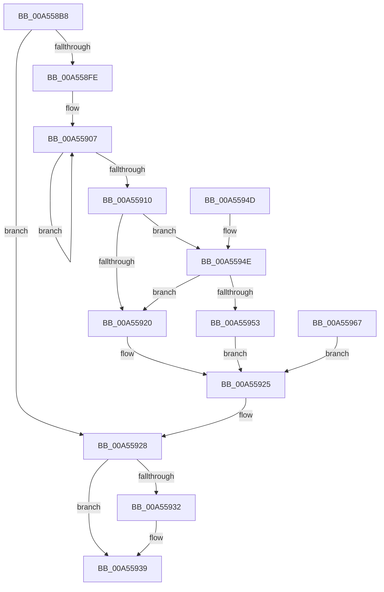

# SiGetSystemDeviceName

- RVA: `0x00A558B8`–`0x00A55974` (길이 `188` bytes)
- VA: `0x0000000140A558B8`
- 실행 섹션: `PAGE`
- PDB 이름 있음: `예`; PDB Function 태그: `아니요`
- unwind 정보 RVA: `0x000B127C`
- 디코드: `61`개 명령, `188/188` bytes 표시
- 미해석 바이트: `0` (있으면 어셈블리에 `.byte`로 보존)

> 이 문서는 커널 이미지의 기계어와 PDB 기호를 분석해 생성했습니다. 4번과 5번은 함수 원형과 자료형을 바이너리 사용 방식에서 추정한 C 해석이며 원본 소스 복구 결과는 아닙니다.

## 1. Dependencies

- 직접 호출 지점: **4**; 고유 호출 대상: **4**
- 직접 호출자로 확인된 함수: **6**
- RIP 상대 이미지 참조: **0**

### Outgoing calls
- `0x00A558E4` → [SiGetFirmwareType](SiGetFirmwareType_function_00A5597C.md) (function, `0x00A5597C`)
- `0x00A558F3` → [guard_dispatch_icall](../../text/6B/guard_dispatch_icall_function_006BAAD0.md) (function, `0x006BAAD0`)
- `0x00A55934` → [ExFreePoolWithTag](../../poolcode/B8/ExFreePoolWithTag_function_00B82870.md) (function, `0x00B82870`)
- `0x00A55960` → [memcpy](../../text/6C/memcpy_function_006C6840.md) (function, `0x006C6840`)

### Direct callers
- [SyspartGetFirmwarePartition](../6F/SyspartGetFirmwarePartition_function_006FF7C4.md) at `0x006FF813`
- [IopFindSystemDevice](../72/IopFindSystemDevice_function_007230E8.md) at `0x00723113`
- [IopFindSystemDevice](../72/IopFindSystemDevice_function_007230E8.md) at `0x00723163`
- [SyspartDirectGetFirmwareSystemPartition](../82/SyspartDirectGetFirmwareSystemPartition_function_008275D0.md) at `0x008275E4`
- [SyspartDirectGetSystemDisk](SyspartDirectGetSystemDisk_function_00A55860.md) at `0x00A55874`
- [SyspartDirectGetSystemPartition](SyspartDirectGetSystemPartition_function_00A55890.md) at `0x00A558A4`
- [SyspartGetSystemPartition](../A9/SyspartGetSystemPartition_function_00A973CC.md) at `0x00A9741B`

### Static image references
- 디코드된 RIP-relative 메모리 참조가 없습니다.

## 2. Other-region calls and transfers

- 다른 실행 섹션으로 향하는 call: **3**
  - `0x00A558F3` → [guard_dispatch_icall](../../text/6B/guard_dispatch_icall_function_006BAAD0.md) (`PAGE` → `.text`)
  - `0x00A55934` → [ExFreePoolWithTag](../../poolcode/B8/ExFreePoolWithTag_function_00B82870.md) (`PAGE` → `POOLCODE`)
  - `0x00A55960` → [memcpy](../../text/6C/memcpy_function_006C6840.md) (`PAGE` → `.text`)
- 별도 외부 분기/꼬리 이동을 확인하지 못했습니다.

## 3. Assembly (complete function range)

```asm
00A558B8  48 89 5C 24 10                  mov qword ptr [rsp + 0x10], rbx
00A558BD  4C 89 4C 24 20                  mov qword ptr [rsp + 0x20], r9
00A558C2  56                              push rsi
00A558C3  57                              push rdi
00A558C4  41 54                           push r12
00A558C6  41 56                           push r14
00A558C8  41 57                           push r15
00A558CA  48 83 EC 30                     sub rsp, 0x30
00A558CE  4D 8B F1                        mov r14, r9
00A558D1  45 8B E0                        mov r12d, r8d
00A558D4  4C 8B FA                        mov r15, rdx
00A558D7  48 8B D9                        mov rbx, rcx
00A558DA  33 FF                           xor edi, edi
00A558DC  41 89 39                        mov dword ptr [r9], edi
00A558DF  48 89 7C 24 20                  mov qword ptr [rsp + 0x20], rdi
00A558E4  E8 93 00 00 00                  call 0x140a5597c
00A558E9  48 8D 54 24 20                  lea rdx, [rsp + 0x20]
00A558EE  8B C8                           mov ecx, eax
00A558F0  48 8B C3                        mov rax, rbx
00A558F3  E8 D8 51 C6 FF                  call 0x1406baad0
00A558F8  8B F0                           mov esi, eax
00A558FA  85 C0                           test eax, eax
00A558FC  78 2A                           js 0x140a55928
00A558FE  48 8B 44 24 20                  mov rax, qword ptr [rsp + 0x20]
00A55903  48 83 CB FF                     or rbx, 0xffffffffffffffff
00A55907  48 FF C3                        inc rbx
00A5590A  66 39 3C 58                     cmp word ptr [rax + rbx*2], di
00A5590E  75 F7                           jne 0x140a55907
00A55910  8D 1C 5D 02 00 00 00            lea ebx, [rbx*2 + 2]
00A55917  89 5C 24 60                     mov dword ptr [rsp + 0x60], ebx
00A5591B  4D 85 FF                        test r15, r15
00A5591E  75 2E                           jne 0x140a5594e
00A55920  BE 23 00 00 C0                  mov esi, 0xc0000023
00A55925  41 89 1E                        mov dword ptr [r14], ebx
00A55928  48 8B 4C 24 20                  mov rcx, qword ptr [rsp + 0x20]
00A5592D  48 85 C9                        test rcx, rcx
00A55930  74 07                           je 0x140a55939
00A55932  33 D2                           xor edx, edx
00A55934  E8 37 CF 12 00                  call 0x140b82870
00A55939  8B C6                           mov eax, esi
00A5593B  48 8B 5C 24 68                  mov rbx, qword ptr [rsp + 0x68]
00A55940  48 83 C4 30                     add rsp, 0x30
00A55944  41 5F                           pop r15
00A55946  41 5E                           pop r14
00A55948  41 5C                           pop r12
00A5594A  5F                              pop rdi
00A5594B  5E                              pop rsi
00A5594C  C3                              ret
00A5594D  CC                              int3
00A5594E  44 3B E3                        cmp r12d, ebx
00A55951  72 CD                           jb 0x140a55920
00A55953  8B F7                           mov esi, edi
00A55955  44 8B C3                        mov r8d, ebx
00A55958  48 8B 54 24 20                  mov rdx, qword ptr [rsp + 0x20]
00A5595D  49 8B CF                        mov rcx, r15
00A55960  E8 DB 0E C7 FF                  call 0x1406c6840
00A55965  EB BE                           jmp 0x140a55925
00A55967  8B F0                           mov esi, eax
00A55969  4C 8B 74 24 78                  mov r14, qword ptr [rsp + 0x78]
00A5596E  8B 5C 24 60                     mov ebx, dword ptr [rsp + 0x60]
00A55972  EB B1                           jmp 0x140a55925
```

## 4. C-style interpretation (structured pseudocode)

```c
__int64 __fastcall SiGetSystemDeviceName(__int64 a1, __int64 a2, int a3, __int64 a4)
{
    __int64 result;
    __int64 v_rbx;
    __int64 v_rdi;
    __int64 v_rsp;
    unsigned __int64 v_stack_m38;
    unsigned __int64 v_stack_p10;
    unsigned __int64 v_stack_p20;
    unsigned int v_stack_p60;
    unsigned __int64 v_stack_p78;
    unsigned int v_stack_p8;

    v_stack_p10 = v_rbx;
    v_stack_p20 = a4;
    v_rsp = (v_rsp) - (48);
    v_rdi = 0;
    *(unsigned int *)(a4) = 0;
    v_stack_m38 = 0;
    result = SiGetFirmwareType(a1, a2, a3, a4);
    result = guard_dispatch_icall((unsigned int)((unsigned int)(result)), v_stack_m38, a3, a4);
    if (sign_flag) goto loc_00A55928;
    v_rbx = (a1) | (-1);
loc_00A55907:
    v_rbx = (v_rbx) + 1;
    if ((*(unsigned __int16 *)(v_stack_m38 + v_rbx * 2)) != 0) goto loc_00A55907;
    v_stack_p8 = (unsigned int)(v_rbx * 2 + 2);
    if (a2 != 0) goto loc_00A5594E;
loc_00A55920:
loc_00A55925:
    *(unsigned int *)(a4) = (unsigned int)(v_rbx * 2 + 2);
loc_00A55928:
    result = v_stack_m38;
    if (v_stack_m38 != 0) {
        a2 = 0;
        result = ExFreePoolWithTag(v_stack_m38, a2, a3, a4);
    }
    v_rsp = (v_rsp) + (48);
    return (unsigned int)((unsigned int)((unsigned int)(0xC0000023ULL)));
loc_00A5594E:
    if (((unsigned int)((unsigned int)(a3))) < ((unsigned int)(v_stack_p10))) goto loc_00A55920;
    result = memcpy(0, v_stack_p20, (unsigned int)((unsigned int)(v_stack_p10)), a4);
    goto loc_00A55925;
}
```

## 5. (Beta) C Style

```c
int64_t SiGetSystemDeviceName(int64_t Arg1, int64_t Arg2, int32_t Arg3, void *Arg4)
{
    uint8_t *arg4 = (uint8_t *)Arg4;

    int64_t result;
    int64_t local_rbx;
    int64_t local_rdi;
    int64_t local_rsp;
    uint64_t v_stack_m38;
    uint64_t v_stack_p10;
    uint64_t v_stack_p20;
    uint32_t v_stack_p60;
    uint64_t v_stack_p78;
    uint32_t v_stack_p8;

    v_stack_p10 = local_rbx;
    v_stack_p20 = Arg4;
    local_rsp = (local_rsp) - (48);
    local_rdi = 0;
    *(uint32_t *)(arg4) = 0;
    v_stack_m38 = 0;
    result = SiGetFirmwareType(Arg1, Arg2, Arg3, Arg4);
    result = guard_dispatch_icall((uint32_t)((uint32_t)(result)), v_stack_m38, Arg3, Arg4);
    if (sign_flag) goto loc_00A55928;
    local_rbx = (Arg1) | (-1);
loc_00A55907:
    local_rbx = (local_rbx) + 1;
    if ((*(uint16_t *)(v_stack_m38 + local_rbx * 2)) != 0) goto loc_00A55907;
    v_stack_p8 = (uint32_t)(local_rbx * 2 + 2);
    if (Arg2 != 0) goto loc_00A5594E;
loc_00A55920:
loc_00A55925:
    *(uint32_t *)(arg4) = (uint32_t)(local_rbx * 2 + 2);
loc_00A55928:
    result = v_stack_m38;
    if (v_stack_m38 != 0) {
        Arg2 = 0;
        result = ExFreePoolWithTag(v_stack_m38, Arg2, Arg3, Arg4);
    }
    local_rsp = (local_rsp) + (48);
    return (uint32_t)((uint32_t)((uint32_t)(0xC0000023ULL)));
loc_00A5594E:
    if (((uint32_t)((uint32_t)(Arg3))) < ((uint32_t)(v_stack_p10))) goto loc_00A55920;
    result = memcpy(0, v_stack_p20, (uint32_t)((uint32_t)(v_stack_p10)), Arg4);
    goto loc_00A55925;
}
```

### 관측된 메모리 오프셋

구조체 형식이 확인되지 않은 접근은 인자 기준의 오프셋으로만 기록했습니다.

| 기준 인자 | 오프셋 표현 | 폭 (bit) | 접근 |
|---|---:|---:|---|
| `Arg4` | `+ 0x0` | `32` | `W` |

## 6. Execution-region graph

[열기: 2D/3D 그래프와 함수 탐색 컨트롤 패널](../../../control-panel.html?section=page&rva=0x00A558B8&view=graph)

- 2D 그래프는 위에서 아래로 흐르고, 3D 그래프는 빈 공간을 드래그해 회전합니다. Shift+드래그는 이동, 휠은 확대·축소, 함수 노드 선택은 대상 보고서 이동입니다.

### Static fallback


