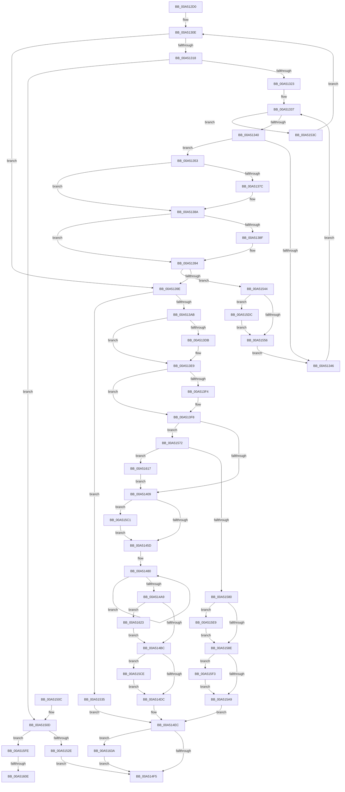

# SmKmStoreAdd

- RVA: `0x00A512D0`–`0x00A51647` (길이 `887` bytes)
- VA: `0x0000000140A512D0`
- 실행 섹션: `PAGE`
- PDB 이름 있음: `예`; PDB Function 태그: `예`
- unwind 정보 RVA: `0x000B0B90`
- 디코드: `226`개 명령, `887/887` bytes 표시
- 미해석 바이트: `0` (있으면 어셈블리에 `.byte`로 보존)

> 이 문서는 커널 이미지의 기계어와 PDB 기호를 분석해 생성했습니다. 4번과 5번은 함수 원형과 자료형을 바이너리 사용 방식에서 추정한 C 해석이며 원본 소스 복구 결과는 아닙니다.

## 1. Dependencies

- 직접 호출 지점: **24**; 고유 호출 대상: **10**
- 직접 호출자로 확인된 함수: **1**
- RIP 상대 이미지 참조: **1**

### Outgoing calls
- `0x00A5136C` → [KeAbPreAcquire](../../text/21/KeAbPreAcquire_function_00210230.md) (function, `0x00210230`)
- `0x00A51385` → [ExfAcquirePushLockExclusiveEx](../../text/20/ExfAcquirePushLockExclusiveEx_function_0020FC90.md) (function, `0x0020FC90`)
- `0x00A513CB` → [KeAbPreAcquire](../../text/21/KeAbPreAcquire_function_00210230.md) (function, `0x00210230`)
- `0x00A513E4` → [ExfAcquirePushLockExclusiveEx](../../text/20/ExfAcquirePushLockExclusiveEx_function_0020FC90.md) (function, `0x0020FC90`)
- `0x00A51460` → [KeAbPostRelease](../../text/2E/KeAbPostRelease_function_002E1600.md) (function, `0x002E1600`)
- `0x00A51465` → [KeLeaveCriticalRegion](../../text/25/KeLeaveCriticalRegion_function_0025D8B0.md) (function, `0x0025D8B0`)
- `0x00A514AE` → [SmEtwEnabled](../../text/3A/SmEtwEnabled_function_003AF2D0.md) (function, `0x003AF2D0`)
- `0x00A514C5` → [ExAcquireRundownProtection](../../text/21/ExAcquireRundownProtection_function_00216620.md) (function, `0x00216620`)
- `0x00A514E0` → [KeAbPostRelease](../../text/2E/KeAbPostRelease_function_002E1600.md) (function, `0x002E1600`)
- `0x00A514E5` → [KeLeaveCriticalRegion](../../text/25/KeLeaveCriticalRegion_function_0025D8B0.md) (function, `0x0025D8B0`)
- `0x00A5151B` → [SmAllocEx](../../text/34/SmAllocEx_function_0034C794.md) (function, `0x0034C794`)
- `0x00A51559` → [KeAbPostRelease](../../text/2E/KeAbPostRelease_function_002E1600.md) (function, `0x002E1600`)
- `0x00A5155E` → [KeLeaveCriticalRegion](../../text/25/KeLeaveCriticalRegion_function_0025D8B0.md) (function, `0x0025D8B0`)
- `0x00A51591` → [KeAbPostRelease](../../text/2E/KeAbPostRelease_function_002E1600.md) (function, `0x002E1600`)
- `0x00A51596` → [KeLeaveCriticalRegion](../../text/25/KeLeaveCriticalRegion_function_0025D8B0.md) (function, `0x0025D8B0`)
- `0x00A515AD` → [KeAbPostRelease](../../text/2E/KeAbPostRelease_function_002E1600.md) (function, `0x002E1600`)
- `0x00A515B2` → [KeLeaveCriticalRegion](../../text/25/KeLeaveCriticalRegion_function_0025D8B0.md) (function, `0x0025D8B0`)
- `0x00A515C4` → [ExfTryToWakePushLock](../../text/26/ExfTryToWakePushLock_function_00265DD0.md) (function, `0x00265DD0`)
- `0x00A515D2` → [ExfTryToWakePushLock](../../text/26/ExfTryToWakePushLock_function_00265DD0.md) (function, `0x00265DD0`)
- `0x00A515DF` → [ExfTryToWakePushLock](../../text/26/ExfTryToWakePushLock_function_00265DD0.md) (function, `0x00265DD0`)
- `0x00A515EC` → [ExfTryToWakePushLock](../../text/26/ExfTryToWakePushLock_function_00265DD0.md) (function, `0x00265DD0`)
- `0x00A515F7` → [ExfTryToWakePushLock](../../text/26/ExfTryToWakePushLock_function_00265DD0.md) (function, `0x00265DD0`)
- `0x00A51630` → [SmKmEtwLogStoreChange](../7A/SmKmEtwLogStoreChange_function_007A8194.md) (function, `0x007A8194`)
- `0x00A5163D` → [CmSiFreeMemory](../../text/47/CmSiFreeMemory_function_00475D80.md) (function, `0x00475D80`)

### Direct callers
- [SmProcessCreateRequest](SmProcessCreateRequest_function_00A50DD0.md) at `0x00A510E4`

### Static image references
- `0x00A51626` → RVA `0x00020DB0` (`.rdata`; read)

## 2. Other-region calls and transfers

- 다른 실행 섹션으로 향하는 call: **23**
  - `0x00A5136C` → [KeAbPreAcquire](../../text/21/KeAbPreAcquire_function_00210230.md) (`PAGE` → `.text`)
  - `0x00A51385` → [ExfAcquirePushLockExclusiveEx](../../text/20/ExfAcquirePushLockExclusiveEx_function_0020FC90.md) (`PAGE` → `.text`)
  - `0x00A513CB` → [KeAbPreAcquire](../../text/21/KeAbPreAcquire_function_00210230.md) (`PAGE` → `.text`)
  - `0x00A513E4` → [ExfAcquirePushLockExclusiveEx](../../text/20/ExfAcquirePushLockExclusiveEx_function_0020FC90.md) (`PAGE` → `.text`)
  - `0x00A51460` → [KeAbPostRelease](../../text/2E/KeAbPostRelease_function_002E1600.md) (`PAGE` → `.text`)
  - `0x00A51465` → [KeLeaveCriticalRegion](../../text/25/KeLeaveCriticalRegion_function_0025D8B0.md) (`PAGE` → `.text`)
  - `0x00A514AE` → [SmEtwEnabled](../../text/3A/SmEtwEnabled_function_003AF2D0.md) (`PAGE` → `.text`)
  - `0x00A514C5` → [ExAcquireRundownProtection](../../text/21/ExAcquireRundownProtection_function_00216620.md) (`PAGE` → `.text`)
  - `0x00A514E0` → [KeAbPostRelease](../../text/2E/KeAbPostRelease_function_002E1600.md) (`PAGE` → `.text`)
  - `0x00A514E5` → [KeLeaveCriticalRegion](../../text/25/KeLeaveCriticalRegion_function_0025D8B0.md) (`PAGE` → `.text`)
  - `0x00A5151B` → [SmAllocEx](../../text/34/SmAllocEx_function_0034C794.md) (`PAGE` → `.text`)
  - `0x00A51559` → [KeAbPostRelease](../../text/2E/KeAbPostRelease_function_002E1600.md) (`PAGE` → `.text`)
  - `0x00A5155E` → [KeLeaveCriticalRegion](../../text/25/KeLeaveCriticalRegion_function_0025D8B0.md) (`PAGE` → `.text`)
  - `0x00A51591` → [KeAbPostRelease](../../text/2E/KeAbPostRelease_function_002E1600.md) (`PAGE` → `.text`)
  - `0x00A51596` → [KeLeaveCriticalRegion](../../text/25/KeLeaveCriticalRegion_function_0025D8B0.md) (`PAGE` → `.text`)
  - `0x00A515AD` → [KeAbPostRelease](../../text/2E/KeAbPostRelease_function_002E1600.md) (`PAGE` → `.text`)
  - `0x00A515B2` → [KeLeaveCriticalRegion](../../text/25/KeLeaveCriticalRegion_function_0025D8B0.md) (`PAGE` → `.text`)
  - `0x00A515C4` → [ExfTryToWakePushLock](../../text/26/ExfTryToWakePushLock_function_00265DD0.md) (`PAGE` → `.text`)
  - `0x00A515D2` → [ExfTryToWakePushLock](../../text/26/ExfTryToWakePushLock_function_00265DD0.md) (`PAGE` → `.text`)
  - `0x00A515DF` → [ExfTryToWakePushLock](../../text/26/ExfTryToWakePushLock_function_00265DD0.md) (`PAGE` → `.text`)
  - `0x00A515EC` → [ExfTryToWakePushLock](../../text/26/ExfTryToWakePushLock_function_00265DD0.md) (`PAGE` → `.text`)
  - `0x00A515F7` → [ExfTryToWakePushLock](../../text/26/ExfTryToWakePushLock_function_00265DD0.md) (`PAGE` → `.text`)
  - `0x00A5163D` → [CmSiFreeMemory](../../text/47/CmSiFreeMemory_function_00475D80.md) (`PAGE` → `.text`)
- call이 아닌 외부 분기/꼬리 이동: **2**
  - `0x00A51608` → [sub_00B3C780 + 0x2F](../B3/Unknown_function_00B3C780.md) (`tail-transfer`)
  - `0x00A51612` → [sub_00B3C780 + 0x2](../B3/Unknown_function_00B3C780.md) (`tail-transfer`)

## 3. Assembly (complete function range)

```asm
00A512D0  48 8B C4                        mov rax, rsp
00A512D3  48 89 58 08                     mov qword ptr [rax + 8], rbx
00A512D7  4C 89 48 20                     mov qword ptr [rax + 0x20], r9
00A512DB  4C 89 40 18                     mov qword ptr [rax + 0x18], r8
00A512DF  48 89 50 10                     mov qword ptr [rax + 0x10], rdx
00A512E3  55                              push rbp
00A512E4  56                              push rsi
00A512E5  57                              push rdi
00A512E6  41 54                           push r12
00A512E8  41 55                           push r13
00A512EA  41 56                           push r14
00A512EC  41 57                           push r15
00A512EE  48 83 EC 30                     sub rsp, 0x30
00A512F2  49 8B 00                        mov rax, qword ptr [r8]
00A512F5  33 ED                           xor ebp, ebp
00A512F7  45 33 ED                        xor r13d, r13d
00A512FA  48 89 44 24 28                  mov qword ptr [rsp + 0x28], rax
00A512FF  33 FF                           xor edi, edi
00A51301  45 33 E4                        xor r12d, r12d
00A51304  4C 8B F1                        mov r14, rcx
00A51307  48 83 CB FF                     or rbx, 0xffffffffffffffff
00A5130B  8D 4D 01                        lea ecx, [rbp + 1]
00A5130E  41 83 FC 20                     cmp r12d, 0x20
00A51312  0F 83 86 00 00 00               jae 0x140a5139e
00A51318  4B 83 3C E6 00                  cmp qword ptr [r14 + r12*8], 0
00A5131D  0F 84 EA 01 00 00               je 0x140a5150d
00A51323  4B 8B 3C E6                     mov rdi, qword ptr [r14 + r12*8]
00A51327  48 8D 87 00 05 00 00            lea rax, [rdi + 0x500]
00A5132E  48 89 44 24 20                  mov qword ptr [rsp + 0x20], rax
00A51333  48 8D 77 10                     lea rsi, [rdi + 0x10]
00A51337  48 3B F8                        cmp rdi, rax
00A5133A  0F 83 FC 01 00 00               jae 0x140a5153c
00A51340  48 83 3F 00                     cmp qword ptr [rdi], 0
00A51344  74 0D                           je 0x140a51353
00A51346  48 83 C7 28                     add rdi, 0x28
00A5134A  48 83 C6 28                     add rsi, 0x28
00A5134E  44 03 E9                        add r13d, ecx
00A51351  EB E4                           jmp 0x140a51337
00A51353  65 48 8B 04 25 88 01 00 00      mov rax, qword ptr gs:[0x188]
00A5135C  45 33 C0                        xor r8d, r8d
00A5135F  33 D2                           xor edx, edx
00A51361  48 8B CE                        mov rcx, rsi
00A51364  66 01 98 E4 01 00 00            add word ptr [rax + 0x1e4], bx
00A5136B  90                              nop
00A5136C  E8 BF EE 7B FF                  call 0x140210230
00A51371  F0 48 0F BA 2E 00               lock bts qword ptr [rsi], 0
00A51377  4C 8B F8                        mov r15, rax
00A5137A  73 0E                           jae 0x140a5138a
00A5137C  4C 8B C6                        mov r8, rsi
00A5137F  48 8B D0                        mov rdx, rax
00A51382  48 8B CE                        mov rcx, rsi
00A51385  E8 06 E9 7B FF                  call 0x14020fc90
00A5138A  4D 85 FF                        test r15, r15
00A5138D  74 05                           je 0x140a51394
00A5138F  41 C6 47 0A 01                  mov byte ptr [r15 + 0xa], 1
00A51394  48 83 3F 00                     cmp qword ptr [rdi], 0
00A51398  0F 85 A6 01 00 00               jne 0x140a51544
00A5139E  41 81 FD 00 04 00 00            cmp r13d, 0x400
00A513A5  0F 83 8A 01 00 00               jae 0x140a51535
00A513AB  65 48 8B 04 25 88 01 00 00      mov rax, qword ptr gs:[0x188]
00A513B4  49 8D B6 A0 01 00 00            lea rsi, [r14 + 0x1a0]
00A513BB  45 33 C0                        xor r8d, r8d
00A513BE  33 D2                           xor edx, edx
00A513C0  48 8B CE                        mov rcx, rsi
00A513C3  66 01 98 E4 01 00 00            add word ptr [rax + 0x1e4], bx
00A513CA  90                              nop
00A513CB  E8 60 EE 7B FF                  call 0x140210230
00A513D0  F0 48 0F BA 2E 00               lock bts qword ptr [rsi], 0
00A513D6  4C 8B F8                        mov r15, rax
00A513D9  73 0E                           jae 0x140a513e9
00A513DB  4C 8B C6                        mov r8, rsi
00A513DE  48 8B D0                        mov rdx, rax
00A513E1  48 8B CE                        mov rcx, rsi
00A513E4  E8 A7 E8 7B FF                  call 0x14020fc90
00A513E9  41 BC 01 00 00 00               mov r12d, 1
00A513EF  4D 85 FF                        test r15, r15
00A513F2  74 04                           je 0x140a513f8
00A513F4  45 88 67 0A                     mov byte ptr [r15 + 0xa], r12b
00A513F8  48 8B 4C 24 28                  mov rcx, qword ptr [rsp + 0x28]
00A513FD  F7 01 00 01 00 00               test dword ptr [rcx], 0x100
00A51403  0F 85 69 01 00 00               jne 0x140a51572
00A51409  8A 47 22                        mov al, byte ptr [rdi + 0x22]
00A5140C  BA 80 00 00 00                  mov edx, 0x80
00A51411  24 FE                           and al, 0xfe
00A51413  88 47 22                        mov byte ptr [rdi + 0x22], al
00A51416  0F B7 47 20                     movzx eax, word ptr [rdi + 0x20]
00A5141A  80 67 22 FD                     and byte ptr [rdi + 0x22], 0xfd
00A5141E  8B 09                           mov ecx, dword ptr [rcx]
00A51420  C1 E9 11                        shr ecx, 0x11
00A51423  66 C1 E1 07                     shl cx, 7
00A51427  66 33 C8                        xor cx, ax
00A5142A  66 23 CA                        and cx, dx
00A5142D  66 33 C8                        xor cx, ax
00A51430  48 8B 84 24 80 00 00 00         mov rax, qword ptr [rsp + 0x80]
00A51438  66 89 4F 20                     mov word ptr [rdi + 0x20], cx
00A5143C  48 8B 40 10                     mov rax, qword ptr [rax + 0x10]
00A51440  48 89 47 18                     mov qword ptr [rdi + 0x18], rax
00A51444  48 8B C3                        mov rax, rbx
00A51447  45 01 A6 A8 01 00 00            add dword ptr [r14 + 0x1a8], r12d
00A5144E  F0 48 0F C1 06                  lock xadd qword ptr [rsi], rax
00A51453  24 06                           and al, 6
00A51455  3C 02                           cmp al, 2
00A51457  0F 84 64 01 00 00               je 0x140a515c1
00A5145D  48 8B CE                        mov rcx, rsi
00A51460  E8 9B 01 89 FF                  call 0x1402e1600
00A51465  E8 46 C4 80 FF                  call 0x14025d8b0
00A5146A  48 8B 44 24 78                  mov rax, qword ptr [rsp + 0x78]
00A5146F  41 B8 3F 00 00 00               mov r8d, 0x3f
00A51475  48 8B 94 24 88 00 00 00         mov rdx, qword ptr [rsp + 0x88]
00A5147D  48 89 07                        mov qword ptr [rdi], rax
00A51480  0F B7 47 20                     movzx eax, word ptr [rdi + 0x20]
00A51484  41 8D 0C 04                     lea ecx, [r12 + rax]
00A51488  66 33 C8                        xor cx, ax
00A5148B  66 41 23 C8                     and cx, r8w
00A5148F  66 33 C8                        xor cx, ax
00A51492  66 89 4F 20                     mov word ptr [rdi + 0x20], cx
00A51496  41 23 C8                        and ecx, r8d
00A51499  C1 E1 0A                        shl ecx, 0xa
00A5149C  41 0B CD                        or ecx, r13d
00A5149F  89 0A                           mov dword ptr [rdx], ecx
00A514A1  81 F9 FF 03 01 00               cmp ecx, 0x103ff
00A514A7  74 D7                           je 0x140a51480
00A514A9  B9 04 00 00 00                  mov ecx, 4
00A514AE  E8 1D DE 95 FF                  call 0x1403af2d0
00A514B3  48 85 C0                        test rax, rax
00A514B6  0F 85 67 01 00 00               jne 0x140a51623
00A514BC  48 8D 4F 08                     lea rcx, [rdi + 8]
00A514C0  33 C0                           xor eax, eax
00A514C2  48 87 01                        xchg qword ptr [rcx], rax
00A514C5  E8 56 51 7C FF                  call 0x140216620
00A514CA  F0 48 0F C1 5F 10               lock xadd qword ptr [rdi + 0x10], rbx
00A514D0  80 E3 06                        and bl, 6
00A514D3  80 FB 02                        cmp bl, 2
00A514D6  0F 84 F2 00 00 00               je 0x140a515ce
00A514DC  48 8D 4F 10                     lea rcx, [rdi + 0x10]
00A514E0  E8 1B 01 89 FF                  call 0x1402e1600
00A514E5  E8 C6 C3 80 FF                  call 0x14025d8b0
00A514EA  33 DB                           xor ebx, ebx
00A514EC  48 85 ED                        test rbp, rbp
00A514EF  0F 85 45 01 00 00               jne 0x140a5163a
00A514F5  8B C3                           mov eax, ebx
00A514F7  48 8B 5C 24 70                  mov rbx, qword ptr [rsp + 0x70]
00A514FC  48 83 C4 30                     add rsp, 0x30
00A51500  41 5F                           pop r15
00A51502  41 5E                           pop r14
00A51504  41 5D                           pop r13
00A51506  41 5C                           pop r12
00A51508  5F                              pop rdi
00A51509  5E                              pop rsi
00A5150A  5D                              pop rbp
00A5150B  C3                              ret
00A5150C  CC                              int3
00A5150D  41 83 C8 FF                     or r8d, 0xffffffff
00A51511  BA 73 6D 53 61                  mov edx, 0x61536d73
00A51516  B9 00 05 00 00                  mov ecx, 0x500
00A5151B  E8 74 B2 8F FF                  call 0x14034c794
00A51520  48 8B E8                        mov rbp, rax
00A51523  33 C0                           xor eax, eax
00A51525  48 85 ED                        test rbp, rbp
00A51528  0F 85 D0 00 00 00               jne 0x140a515fe
00A5152E  BB 9A 00 00 C0                  mov ebx, 0xc000009a
00A51533  EB C0                           jmp 0x140a514f5
00A51535  BB 99 00 00 C0                  mov ebx, 0xc0000099
00A5153A  EB B0                           jmp 0x140a514ec
00A5153C  44 03 E1                        add r12d, ecx
00A5153F  E9 CA FD FF FF                  jmp 0x140a5130e
00A51544  48 8B C3                        mov rax, rbx
00A51547  F0 48 0F C1 06                  lock xadd qword ptr [rsi], rax
00A5154C  24 06                           and al, 6
00A5154E  3C 02                           cmp al, 2
00A51550  0F 84 86 00 00 00               je 0x140a515dc
00A51556  48 8B CE                        mov rcx, rsi
00A51559  E8 A2 00 89 FF                  call 0x1402e1600
00A5155E  E8 4D C3 80 FF                  call 0x14025d8b0
00A51563  48 8B 44 24 20                  mov rax, qword ptr [rsp + 0x20]
00A51568  B9 01 00 00 00                  mov ecx, 1
00A5156D  E9 D4 FD FF FF                  jmp 0x140a51346
00A51572  41 83 BE B0 01 00 00 FF         cmp dword ptr [r14 + 0x1b0], -1
00A5157A  0F 84 97 00 00 00               je 0x140a51617
00A51580  48 8B C3                        mov rax, rbx
00A51583  F0 48 0F C1 06                  lock xadd qword ptr [rsi], rax
00A51588  24 06                           and al, 6
00A5158A  3C 02                           cmp al, 2
00A5158C  74 5B                           je 0x140a515e9
00A5158E  48 8B CE                        mov rcx, rsi
00A51591  E8 6A 00 89 FF                  call 0x1402e1600
00A51596  E8 15 C3 80 FF                  call 0x14025d8b0
00A5159B  F0 48 0F C1 5F 10               lock xadd qword ptr [rdi + 0x10], rbx
00A515A1  80 E3 06                        and bl, 6
00A515A4  80 FB 02                        cmp bl, 2
00A515A7  74 4A                           je 0x140a515f3
00A515A9  48 8D 4F 10                     lea rcx, [rdi + 0x10]
00A515AD  E8 4E 00 89 FF                  call 0x1402e1600
00A515B2  E8 F9 C2 80 FF                  call 0x14025d8b0
00A515B7  BB 2B 04 00 C0                  mov ebx, 0xc000042b
00A515BC  E9 2B FF FF FF                  jmp 0x140a514ec
00A515C1  48 8B CE                        mov rcx, rsi
00A515C4  E8 07 48 81 FF                  call 0x140265dd0
00A515C9  E9 8F FE FF FF                  jmp 0x140a5145d
00A515CE  48 8D 4F 10                     lea rcx, [rdi + 0x10]
00A515D2  E8 F9 47 81 FF                  call 0x140265dd0
00A515D7  E9 00 FF FF FF                  jmp 0x140a514dc
00A515DC  48 8B CE                        mov rcx, rsi
00A515DF  E8 EC 47 81 FF                  call 0x140265dd0
00A515E4  E9 6D FF FF FF                  jmp 0x140a51556
00A515E9  48 8B CE                        mov rcx, rsi
00A515EC  E8 DF 47 81 FF                  call 0x140265dd0
00A515F1  EB 9B                           jmp 0x140a5158e
00A515F3  48 8D 4F 10                     lea rcx, [rdi + 0x10]
00A515F7  E8 D4 47 81 FF                  call 0x140265dd0
00A515FC  EB AB                           jmp 0x140a515a9
00A515FE  48 8D B5 00 05 00 00            lea rsi, [rbp + 0x500]
00A51605  48 3B EE                        cmp rbp, rsi
00A51608  0F 83 A1 B1 0E 00               jae 0x140b3c7af
00A5160E  48 8D 7D 08                     lea rdi, [rbp + 8]
00A51612  E9 6B B1 0E 00                  jmp 0x140b3c782
00A51617  45 89 AE B0 01 00 00            mov dword ptr [r14 + 0x1b0], r13d
00A5161E  E9 E6 FD FF FF                  jmp 0x140a51409
00A51623  48 8B 17                        mov rdx, qword ptr [rdi]
00A51626  4C 8D 05 83 F7 5C FF            lea r8, [rip - 0xa3087d]
00A5162D  48 8B C8                        mov rcx, rax
00A51630  E8 5F 6B D5 FF                  call 0x1407a8194
00A51635  E9 82 FE FF FF                  jmp 0x140a514bc
00A5163A  48 8B CD                        mov rcx, rbp
00A5163D  E8 3E 47 A2 FF                  call 0x140475d80
00A51642  E9 AE FE FF FF                  jmp 0x140a514f5
```

## 4. C-style interpretation (structured pseudocode)

```c
__int64 __fastcall SmKmStoreAdd(__int64 a1, __int64 a2, __int64 a3, __int64 a4)
{
    __int64 result;
    __int64 v_r12;
    __int64 v_r13;
    __int64 v_rbp;
    __int64 v_rbx;
    __int64 v_rdi;
    __int64 v_rsi;
    __int64 v_rsp;
    unsigned __int64 v_stack_m40;
    unsigned __int64 v_stack_m48;
    unsigned __int64 v_stack_p10;
    unsigned __int64 v_stack_p18;
    unsigned __int64 v_stack_p20;
    unsigned __int64 v_stack_p8;

    *(unsigned __int64 *)(v_rsp + 8) = v_rbx;
    *(unsigned __int64 *)(v_rsp + 32) = a4;
    *(unsigned __int64 *)(v_rsp + 24) = a3;
    *(unsigned __int64 *)(v_rsp + 16) = a2;
    v_rsp = (v_rsp) - (48);
    v_rbp = 0;
    v_r13 = 0;
    v_stack_m40 = *(unsigned __int64 *)(a3);
    v_rdi = 0;
    v_r12 = 0;
    v_rbx = (v_rbx) | (-1);
loc_00A5130E:
    if (0 >= 32) goto loc_00A5139E;
    if ((*(unsigned __int64 *)(a1 + v_r12 * 8)) == 0) goto loc_00A5150D;
    v_stack_m48 = *(unsigned __int64 *)(a1 + v_r12 * 8) + 1280;
loc_00A51337:
    if ((*(unsigned __int64 *)(a1 + v_r12 * 8)) >= (*(unsigned __int64 *)(a1 + v_r12 * 8) + 1280)) goto loc_00A5153C;
    if ((*(unsigned __int64 *)(*(unsigned __int64 *)(a1 + v_r12 * 8))) == 0) goto loc_00A51353;
loc_00A51346:
    v_rdi = (*(unsigned __int64 *)(a1 + v_r12 * 8)) + (40);
    v_rsi = (*(unsigned __int64 *)(a1 + v_r12 * 8) + 16) + (40);
    v_r13 = (unsigned int)((v_r13) + ((unsigned int)(v_rbp + 1)));
    goto loc_00A51337;
loc_00A51353:
    a3 = 0;
    a2 = 0;
    result = KeAbPreAcquire(v_rsi, a2, a3, a4);
    if (!(condition_is_above_or_equal)) {
        a3 = v_rsi;
        a2 = result;
        a1 = v_rsi;
        result = ExfAcquirePushLockExclusiveEx(a1, a2, a3, a4);
    }
    if (result != 0) {
        *(unsigned __int8 *)(result + 10) = 1;
    }
    if ((*(unsigned __int64 *)(v_rdi)) != 0) goto loc_00A51544;
loc_00A5139E:
    if (((unsigned int)(v_r13)) >= 0x400ULL) goto loc_00A51535;
    a3 = 0;
    a2 = 0;
    result = KeAbPreAcquire(a1 + 416, a2, a3, a4);
    if (!(condition_is_above_or_equal)) {
        a3 = a1 + 416;
        a2 = result;
        a1 = a1 + 416;
        result = ExfAcquirePushLockExclusiveEx(a1, a2, a3, a4);
    }
    if (result != 0) {
        *(unsigned __int8 *)(result + 10) = 1;
    }
    if (((*(unsigned int *)(v_stack_m40)) & (256)) != 0) goto loc_00A51572;
loc_00A51409:
    result = (unsigned __int8)((*(unsigned __int8 *)(v_rdi + 34)) & (254));
    *(unsigned __int8 *)(v_rdi + 34) = (unsigned __int8)(result);
    a1 = (unsigned int)(((unsigned int)(*(unsigned int *)(v_stack_m40))) >> (17));
    a1 = (unsigned __int16)((a1) << (7));
    a1 = (unsigned __int16)((a1) ^ ((unsigned __int16)(*(unsigned __int16 *)(v_rdi + 32))));
    a1 = (unsigned __int16)((a1) & (128));
    a1 = (unsigned __int16)((a1) ^ ((unsigned __int16)(*(unsigned __int16 *)(v_rdi + 32))));
    *(unsigned __int16 *)(v_rdi + 32) = (unsigned __int16)(a1);
    *(unsigned __int64 *)(v_rdi + 24) = *(unsigned __int64 *)(v_stack_p18 + 16);
    result = (unsigned __int8)((v_rbx) & (6));
    if (((unsigned __int8)(result)) == 2) goto loc_00A515C1;
loc_00A5145D:
    result = KeAbPostRelease(a1 + 416, 128, a3, a4);
    result = KeLeaveCriticalRegion(a1 + 416, 128, a3, a4);
    *(unsigned __int64 *)(v_rdi) = v_stack_p10;
loc_00A51480:
    a1 = (unsigned __int16)((1 + *(unsigned __int16 *)(v_rdi + 32) * 1) ^ ((unsigned __int16)(*(unsigned __int16 *)(v_rdi + 32))));
    a1 = (unsigned __int16)((a1) & (63));
    a1 = (unsigned __int16)((a1) ^ ((unsigned __int16)(*(unsigned __int16 *)(v_rdi + 32))));
    *(unsigned __int16 *)(v_rdi + 32) = (unsigned __int16)(a1);
    a1 = (unsigned int)((a1) & (63));
    a1 = (unsigned int)((a1) << (10));
    a1 = (unsigned int)((a1) | ((unsigned int)(v_r13)));
    *(unsigned int *)(v_stack_p20) = (unsigned int)(a1);
    if (((unsigned int)(a1)) == 0x103FFULL) goto loc_00A51480;
    result = SmEtwEnabled(4, v_stack_p20, 63, a4);
    if (result != 0) goto loc_00A51623;
loc_00A514BC:
    result = 0;
    result = ExAcquireRundownProtection(v_rdi + 8, v_stack_p20, 63, a4);
    v_rbx = (unsigned __int8)((v_rbx) & (6));
    if (((unsigned __int8)(v_rbx)) == 2) goto loc_00A515CE;
loc_00A514DC:
    result = KeAbPostRelease(v_rdi + 16, v_stack_p20, 63, a4);
    result = KeLeaveCriticalRegion(v_rdi + 16, v_stack_p20, 63, a4);
    v_rbx = 0;
loc_00A514EC:
    if (0 != 0) goto loc_00A5163A;
loc_00A514F5:
    v_rsp = (v_rsp) + (48);
    return 0;
loc_00A5150D:
    a3 = (unsigned int)((63) | (0xFFFFFFFFULL));
    result = SmAllocEx((unsigned int)(0x500ULL), (unsigned int)(0x61536D73ULL), a3, a4);
    result = 0;
    if (0 != 0) goto loc_00A515FE;
    goto loc_00A514F5;
loc_00A51535:
    goto loc_00A514EC;
loc_00A5153C:
    v_r12 = (unsigned int)((1) + ((unsigned int)((unsigned int)(0x500ULL))));
    goto loc_00A5130E;
loc_00A51544:
    result = (unsigned __int8)(((unsigned int)(0xC0000099ULL)) & (6));
    if (((unsigned __int8)(result)) == 2) goto loc_00A515DC;
loc_00A51556:
    result = KeAbPostRelease(a1 + 416, (unsigned int)(0x61536D73ULL), a3, a4);
    result = KeLeaveCriticalRegion(a1 + 416, (unsigned int)(0x61536D73ULL), a3, a4);
    goto loc_00A51346;
loc_00A51572:
    if ((*(unsigned int *)(a1 + 432)) == -1) goto loc_00A51617;
    result = (unsigned __int8)(((unsigned int)(0xC0000099ULL)) & (6));
    if (((unsigned __int8)(result)) == 2) goto loc_00A515E9;
loc_00A5158E:
    result = KeAbPostRelease(a1 + 416, (unsigned int)(0x61536D73ULL), a3, a4);
    result = KeLeaveCriticalRegion(a1 + 416, (unsigned int)(0x61536D73ULL), a3, a4);
    v_rbx = (unsigned __int8)(((unsigned int)(0xC0000099ULL)) & (6));
    if (((unsigned __int8)(v_rbx)) == 2) goto loc_00A515F3;
loc_00A515A9:
    result = KeAbPostRelease(v_rdi + 16, (unsigned int)(0x61536D73ULL), a3, a4);
    result = KeLeaveCriticalRegion(v_rdi + 16, (unsigned int)(0x61536D73ULL), a3, a4);
    goto loc_00A514EC;
loc_00A515C1:
    result = ExfTryToWakePushLock(a1 + 416, (unsigned int)(0x61536D73ULL), a3, a4);
    goto loc_00A5145D;
loc_00A515CE:
    result = ExfTryToWakePushLock(v_rdi + 16, (unsigned int)(0x61536D73ULL), a3, a4);
    goto loc_00A514DC;
loc_00A515DC:
    result = ExfTryToWakePushLock(a1 + 416, (unsigned int)(0x61536D73ULL), a3, a4);
    goto loc_00A51556;
loc_00A515E9:
    result = ExfTryToWakePushLock(a1 + 416, (unsigned int)(0x61536D73ULL), a3, a4);
    goto loc_00A5158E;
loc_00A515F3:
    result = ExfTryToWakePushLock(v_rdi + 16, (unsigned int)(0x61536D73ULL), a3, a4);
    goto loc_00A515A9;
loc_00A515FE:
loc_00A51617:
    *(unsigned int *)(a1 + 432) = (unsigned int)(v_r13);
    goto loc_00A51409;
loc_00A51623:
    result = SmKmEtwLogStoreChange(result, *(unsigned __int64 *)(result + 8), v_rip - 10684541, a4);
    goto loc_00A514BC;
loc_00A5163A:
    result = CmSiFreeMemory(result, *(unsigned __int64 *)(result + 8), v_rip - 10684541, a4);
    goto loc_00A514F5;
}
```

## 5. (Beta) C Style

```c
int64_t SmKmStoreAdd(void *Arg1, int64_t Arg2, void *Arg3, int64_t Arg4)
{
    uint8_t *arg1 = (uint8_t *)Arg1;
    uint8_t *arg3 = (uint8_t *)Arg3;

    int64_t result;
    int64_t local_r12;
    int64_t local_r13;
    int64_t local_rbp;
    int64_t local_rbx;
    int64_t local_rdi;
    int64_t local_rsi;
    int64_t local_rsp;
    uint64_t v_stack_m40;
    uint64_t v_stack_m48;
    uint64_t v_stack_p10;
    uint64_t v_stack_p18;
    uint64_t v_stack_p20;
    uint64_t v_stack_p8;

    *(uint64_t *)(local_rsp + 0x8) = local_rbx;
    *(uint64_t *)(local_rsp + 0x20) = Arg4;
    *(void **)(local_rsp + 0x18) = Arg3;
    *(uint64_t *)(local_rsp + 0x10) = Arg2;
    local_rsp = (local_rsp) - (48);
    local_rbp = 0;
    local_r13 = 0;
    v_stack_m40 = *(uint64_t *)(arg3);
    local_rdi = 0;
    local_r12 = 0;
    local_rbx = (local_rbx) | (-1);
loc_00A5130E:
    if (0 >= 32) goto loc_00A5139E;
    if ((*(uint64_t *)(arg1 + local_r12 * 8)) == 0) goto loc_00A5150D;
    v_stack_m48 = *(uint64_t *)(arg1 + local_r12 * 8) + 1280;
loc_00A51337:
    if ((*(uint64_t *)(arg1 + local_r12 * 8)) >= (*(uint64_t *)(arg1 + local_r12 * 8) + 1280)) goto loc_00A5153C;
    if ((*(uint64_t *)(*(uint64_t *)(arg1 + local_r12 * 8))) == 0) goto loc_00A51353;
loc_00A51346:
    local_rdi = (*(uint64_t *)(arg1 + local_r12 * 8)) + (40);
    local_rsi = (*(uint64_t *)(arg1 + local_r12 * 8) + 16) + (40);
    local_r13 = (uint32_t)((local_r13) + ((uint32_t)(local_rbp + 1)));
    goto loc_00A51337;
loc_00A51353:
    Arg3 = 0;
    Arg2 = 0;
    result = KeAbPreAcquire(local_rsi, Arg2, Arg3, Arg4);
    if (!(condition_is_above_or_equal)) {
        Arg3 = local_rsi;
        Arg2 = result;
        Arg1 = local_rsi;
        result = ExfAcquirePushLockExclusiveEx(Arg1, Arg2, Arg3, Arg4);
    }
    if (result != 0) {
        *(uint8_t *)(result + 0xA) = 1;
    }
    if ((*(uint64_t *)(local_rdi)) != 0) goto loc_00A51544;
loc_00A5139E:
    if (((uint32_t)(local_r13)) >= 0x400ULL) goto loc_00A51535;
    Arg3 = 0;
    Arg2 = 0;
    result = KeAbPreAcquire(Arg1 + 416, Arg2, Arg3, Arg4);
    if (!(condition_is_above_or_equal)) {
        Arg3 = Arg1 + 416;
        Arg2 = result;
        Arg1 = Arg1 + 416;
        result = ExfAcquirePushLockExclusiveEx(Arg1, Arg2, Arg3, Arg4);
    }
    if (result != 0) {
        *(uint8_t *)(result + 0xA) = 1;
    }
    if (((*(uint32_t *)(v_stack_m40)) & (256)) != 0) goto loc_00A51572;
loc_00A51409:
    result = (uint8_t)((*(uint8_t *)(local_rdi + 0x22)) & (254));
    *(uint8_t *)(local_rdi + 0x22) = (uint8_t)(result);
    Arg1 = (uint32_t)(((uint32_t)(*(uint32_t *)(v_stack_m40))) >> (17));
    Arg1 = (uint16_t)((Arg1) << (7));
    Arg1 = (uint16_t)((Arg1) ^ ((uint16_t)(*(uint16_t *)(local_rdi + 0x20))));
    Arg1 = (uint16_t)((Arg1) & (128));
    Arg1 = (uint16_t)((Arg1) ^ ((uint16_t)(*(uint16_t *)(local_rdi + 0x20))));
    *(uint16_t *)(local_rdi + 0x20) = (uint16_t)(Arg1);
    *(uint64_t *)(local_rdi + 0x18) = *(uint64_t *)(v_stack_p18 + 0x10);
    result = (uint8_t)((local_rbx) & (6));
    if (((uint8_t)(result)) == 2) goto loc_00A515C1;
loc_00A5145D:
    result = KeAbPostRelease(Arg1 + 416, 128, Arg3, Arg4);
    result = KeLeaveCriticalRegion(Arg1 + 416, 128, Arg3, Arg4);
    *(uint64_t *)(local_rdi) = v_stack_p10;
loc_00A51480:
    Arg1 = (uint16_t)((1 + *(uint16_t *)(local_rdi + 0x20) * 1) ^ ((uint16_t)(*(uint16_t *)(local_rdi + 0x20))));
    Arg1 = (uint16_t)((Arg1) & (63));
    Arg1 = (uint16_t)((Arg1) ^ ((uint16_t)(*(uint16_t *)(local_rdi + 0x20))));
    *(uint16_t *)(local_rdi + 0x20) = (uint16_t)(Arg1);
    Arg1 = (uint32_t)((Arg1) & (63));
    Arg1 = (uint32_t)((Arg1) << (10));
    Arg1 = (uint32_t)((Arg1) | ((uint32_t)(local_r13)));
    *(uint32_t *)(v_stack_p20) = (uint32_t)(Arg1);
    if (((uint32_t)(Arg1)) == 0x103FFULL) goto loc_00A51480;
    result = SmEtwEnabled(4, v_stack_p20, 63, Arg4);
    if (result != 0) goto loc_00A51623;
loc_00A514BC:
    result = 0;
    result = ExAcquireRundownProtection(local_rdi + 8, v_stack_p20, 63, Arg4);
    local_rbx = (uint8_t)((local_rbx) & (6));
    if (((uint8_t)(local_rbx)) == 2) goto loc_00A515CE;
loc_00A514DC:
    result = KeAbPostRelease(local_rdi + 16, v_stack_p20, 63, Arg4);
    result = KeLeaveCriticalRegion(local_rdi + 16, v_stack_p20, 63, Arg4);
    local_rbx = 0;
loc_00A514EC:
    if (0 != 0) goto loc_00A5163A;
loc_00A514F5:
    local_rsp = (local_rsp) + (48);
    return 0;
loc_00A5150D:
    Arg3 = (uint32_t)((63) | (0xFFFFFFFFULL));
    result = SmAllocEx((uint32_t)(0x500ULL), (uint32_t)(0x61536D73ULL), Arg3, Arg4);
    result = 0;
    if (0 != 0) goto loc_00A515FE;
    goto loc_00A514F5;
loc_00A51535:
    goto loc_00A514EC;
loc_00A5153C:
    local_r12 = (uint32_t)((1) + ((uint32_t)((uint32_t)(0x500ULL))));
    goto loc_00A5130E;
loc_00A51544:
    result = (uint8_t)(((uint32_t)(0xC0000099ULL)) & (6));
    if (((uint8_t)(result)) == 2) goto loc_00A515DC;
loc_00A51556:
    result = KeAbPostRelease(Arg1 + 416, (uint32_t)(0x61536D73ULL), Arg3, Arg4);
    result = KeLeaveCriticalRegion(Arg1 + 416, (uint32_t)(0x61536D73ULL), Arg3, Arg4);
    goto loc_00A51346;
loc_00A51572:
    if ((*(uint32_t *)(arg1 + 0x1B0)) == -1) goto loc_00A51617;
    result = (uint8_t)(((uint32_t)(0xC0000099ULL)) & (6));
    if (((uint8_t)(result)) == 2) goto loc_00A515E9;
loc_00A5158E:
    result = KeAbPostRelease(Arg1 + 416, (uint32_t)(0x61536D73ULL), Arg3, Arg4);
    result = KeLeaveCriticalRegion(Arg1 + 416, (uint32_t)(0x61536D73ULL), Arg3, Arg4);
    local_rbx = (uint8_t)(((uint32_t)(0xC0000099ULL)) & (6));
    if (((uint8_t)(local_rbx)) == 2) goto loc_00A515F3;
loc_00A515A9:
    result = KeAbPostRelease(local_rdi + 16, (uint32_t)(0x61536D73ULL), Arg3, Arg4);
    result = KeLeaveCriticalRegion(local_rdi + 16, (uint32_t)(0x61536D73ULL), Arg3, Arg4);
    goto loc_00A514EC;
loc_00A515C1:
    result = ExfTryToWakePushLock(Arg1 + 416, (uint32_t)(0x61536D73ULL), Arg3, Arg4);
    goto loc_00A5145D;
loc_00A515CE:
    result = ExfTryToWakePushLock(local_rdi + 16, (uint32_t)(0x61536D73ULL), Arg3, Arg4);
    goto loc_00A514DC;
loc_00A515DC:
    result = ExfTryToWakePushLock(Arg1 + 416, (uint32_t)(0x61536D73ULL), Arg3, Arg4);
    goto loc_00A51556;
loc_00A515E9:
    result = ExfTryToWakePushLock(Arg1 + 416, (uint32_t)(0x61536D73ULL), Arg3, Arg4);
    goto loc_00A5158E;
loc_00A515F3:
    result = ExfTryToWakePushLock(local_rdi + 16, (uint32_t)(0x61536D73ULL), Arg3, Arg4);
    goto loc_00A515A9;
loc_00A515FE:
loc_00A51617:
    *(uint32_t *)(arg1 + 0x1B0) = (uint32_t)(local_r13);
    goto loc_00A51409;
loc_00A51623:
    result = SmKmEtwLogStoreChange(result, *(uint64_t *)(result + 0x8), v_rip - 10684541, Arg4);
    goto loc_00A514BC;
loc_00A5163A:
    result = CmSiFreeMemory(result, *(uint64_t *)(result + 0x8), v_rip - 10684541, Arg4);
    goto loc_00A514F5;
}
```

### 관측된 메모리 오프셋

구조체 형식이 확인되지 않은 접근은 인자 기준의 오프셋으로만 기록했습니다.

| 기준 인자 | 오프셋 표현 | 폭 (bit) | 접근 |
|---|---:|---:|---|
| `Arg1` | `+ 0x0` | `64` | `R/W` |
| `Arg1` | `+ 0x0 + r12*8` | `64` | `R` |
| `Arg1` | `+ 0x1A0` | `64` | `R` |
| `Arg1` | `+ 0x1A8` | `32` | `R/W` |
| `Arg1` | `+ 0x1B0` | `32` | `R` |
| `Arg1` | `+ 0x1B0` | `32` | `W` |
| `Arg3` | `+ 0x0` | `64` | `R` |

## 6. Execution-region graph

[열기: 2D/3D 그래프와 함수 탐색 컨트롤 패널](../../../control-panel.html?section=page&rva=0x00A512D0&view=graph)

- 2D 그래프는 위에서 아래로 흐르고, 3D 그래프는 빈 공간을 드래그해 회전합니다. Shift+드래그는 이동, 휠은 확대·축소, 함수 노드 선택은 대상 보고서 이동입니다.

### Static fallback


