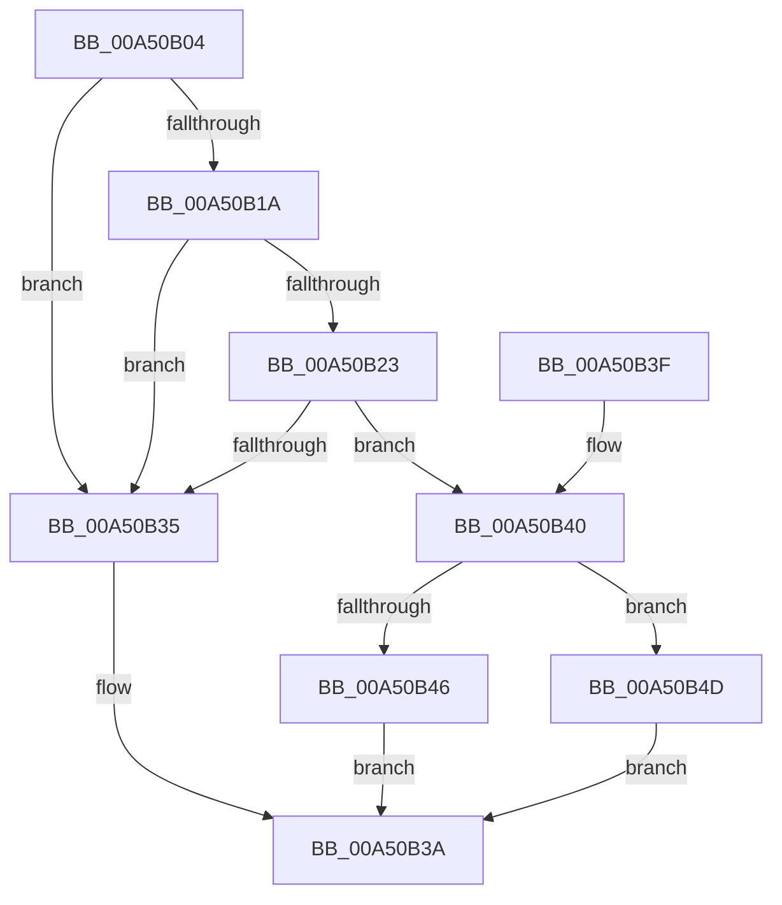

# SmProcessCreateNotification

- RVA: `0x00A50B04`–`0x00A50B5B` (길이 `87` bytes)
- VA: `0x0000000140A50B04`
- 실행 섹션: `PAGE`
- PDB 이름 있음: `예`; PDB Function 태그: `아니요`
- unwind 정보 RVA: `0x00094EEC`
- 디코드: `23`개 명령, `87/87` bytes 표시
- 미해석 바이트: `0` (있으면 어셈블리에 `.byte`로 보존)

> 이 문서는 커널 이미지의 기계어와 PDB 기호를 분석해 생성했습니다. 4번과 5번은 함수 원형과 자료형을 바이너리 사용 방식에서 추정한 C 해석이며 원본 소스 복구 결과는 아닙니다.

## 1. Dependencies

- 직접 호출 지점: **2**; 고유 호출 대상: **2**
- 직접 호출자로 확인된 함수: **1**
- RIP 상대 이미지 참조: **1**

### Outgoing calls
- `0x00A50B23` → [SmpGetProcessPartition](../../text/4A/SmpGetProcessPartition_function_004A3CCC.md) (function, `0x004A3CCC`)
- `0x00A50B54` → [SmpKeyedStoreCreate](SmpKeyedStoreCreate_function_00A50B64.md) (function, `0x00A50B64`)

### Direct callers
- [PspAllocateProcess](../A1/PspAllocateProcess_function_00A13B3C.md) at `0x00A15B3A`

### Static image references
- `0x00A50B1A` → RVA `0x00E288F0` (`.data`; read)

## 2. Other-region calls and transfers

- 다른 실행 섹션으로 향하는 call: **1**
  - `0x00A50B23` → [SmpGetProcessPartition](../../text/4A/SmpGetProcessPartition_function_004A3CCC.md) (`PAGE` → `.text`)
- 별도 외부 분기/꼬리 이동을 확인하지 못했습니다.

## 3. Assembly (complete function range)

```asm
00A50B04  48 83 EC 28                     sub rsp, 0x28
00A50B08  F7 81 FC 05 00 00 00 00 00 40   test dword ptr [rcx + 0x5fc], 0x40000000
00A50B12  44 8B CA                        mov r9d, edx
00A50B15  4C 8B C1                        mov r8, rcx
00A50B18  75 1B                           jne 0x140a50b35
00A50B1A  83 3D CF 7D 3D 00 00            cmp dword ptr [rip + 0x3d7dcf], 0
00A50B21  74 12                           je 0x140a50b35
00A50B23  E8 A4 31 A5 FF                  call 0x1404a3ccc
00A50B28  48 8B D0                        mov rdx, rax
00A50B2B  8B 80 B0 08 00 00               mov eax, dword ptr [rax + 0x8b0]
00A50B31  A8 0C                           test al, 0xc
00A50B33  75 0B                           jne 0x140a50b40
00A50B35  B8 BB 00 00 C0                  mov eax, 0xc00000bb
00A50B3A  48 83 C4 28                     add rsp, 0x28
00A50B3E  C3                              ret
00A50B3F  CC                              int3
00A50B40  41 F6 C1 03                     test r9b, 3
00A50B44  75 07                           jne 0x140a50b4d
00A50B46  B8 00 A2 00 C0                  mov eax, 0xc000a200
00A50B4B  EB ED                           jmp 0x140a50b3a
00A50B4D  48 8D 8A B8 08 00 00            lea rcx, [rdx + 0x8b8]
00A50B54  E8 0B 00 00 00                  call 0x140a50b64
00A50B59  EB DF                           jmp 0x140a50b3a
```

## 4. C-style interpretation (structured pseudocode)

```c
__int64 __fastcall SmProcessCreateNotification(__int64 a1, int a2)
{
    __int64 result;
    __int64 v_rsp;

    v_rsp = (v_rsp) - (40);
    if (((*(unsigned int *)(a1 + 1532)) & (0x40000000ULL)) != 0) goto loc_00A50B35;
    if ((*(unsigned int *)(v_rip + 4029903)) == 0) goto loc_00A50B35;
    result = SmpGetProcessPartition(a1, a2, a1, (unsigned int)(a2));
    if ((((unsigned __int8)((unsigned int)(*(unsigned int *)(result + 2224)))) & (12)) != 0) goto loc_00A50B40;
loc_00A50B35:
loc_00A50B3A:
    v_rsp = (v_rsp) + (40);
    return (unsigned int)(0xC00000BBULL);
loc_00A50B40:
    if ((((unsigned __int8)((unsigned int)(a2))) & (3)) != 0) goto loc_00A50B4D;
    goto loc_00A50B3A;
loc_00A50B4D:
    result = SmpKeyedStoreCreate(result + 2232, result, a1, (unsigned int)(a2));
    goto loc_00A50B3A;
}
```

## 5. (Beta) C Style

```c
int64_t SmProcessCreateNotification(void *Arg1, int32_t Arg2)
{
    uint8_t *arg1 = (uint8_t *)Arg1;

    int64_t result;
    int64_t local_rsp;

    local_rsp = (local_rsp) - (40);
    if (((*(uint32_t *)(arg1 + 0x5FC)) & (0x40000000ULL)) != 0) goto loc_00A50B35;
    if ((*(uint32_t *)(v_rip + 0x3D7DCF)) == 0) goto loc_00A50B35;
    result = SmpGetProcessPartition(Arg1, Arg2, Arg1, (uint32_t)(Arg2));
    if ((((uint8_t)((uint32_t)(*(uint32_t *)(result + 0x8B0)))) & (12)) != 0) goto loc_00A50B40;
loc_00A50B35:
loc_00A50B3A:
    local_rsp = (local_rsp) + (40);
    return (uint32_t)(0xC00000BBULL);
loc_00A50B40:
    if ((((uint8_t)((uint32_t)(Arg2))) & (3)) != 0) goto loc_00A50B4D;
    goto loc_00A50B3A;
loc_00A50B4D:
    result = SmpKeyedStoreCreate(result + 2232, result, Arg1, (uint32_t)(Arg2));
    goto loc_00A50B3A;
}
```

### 관측된 메모리 오프셋

구조체 형식이 확인되지 않은 접근은 인자 기준의 오프셋으로만 기록했습니다.

| 기준 인자 | 오프셋 표현 | 폭 (bit) | 접근 |
|---|---:|---:|---|
| `Arg1` | `+ 0x5FC` | `32` | `R` |

## 6. Execution-region graph

[열기: 2D/3D 그래프와 함수 탐색 컨트롤 패널](../../../control-panel.html?section=page&rva=0x00A50B04&view=graph)

- 2D 그래프는 위에서 아래로 흐르고, 3D 그래프는 빈 공간을 드래그해 회전합니다. Shift+드래그는 이동, 휠은 확대·축소, 함수 노드 선택은 대상 보고서 이동입니다.

### Static fallback


