# SmProcessCreateRequest

- RVA: `0x00A50DD0`–`0x00A512C8` (길이 `1,272` bytes)
- VA: `0x0000000140A50DD0`
- 실행 섹션: `PAGE`
- PDB 이름 있음: `예`; PDB Function 태그: `예`
- unwind 정보 RVA: `0x000B0B38`
- 디코드: `279`개 명령, `1,272/1,272` bytes 표시
- 미해석 바이트: `0` (있으면 어셈블리에 `.byte`로 보존)

> 이 문서는 커널 이미지의 기계어와 PDB 기호를 분석해 생성했습니다. 4번과 5번은 함수 원형과 자료형을 바이너리 사용 방식에서 추정한 C 해석이며 원본 소스 복구 결과는 아닙니다.

## 1. Dependencies

- 직접 호출 지점: **16**; 고유 호출 대상: **13**
- 직접 호출자로 확인된 함수: **2**
- RIP 상대 이미지 참조: **2**

### Outgoing calls
- `0x00A50E20` → [memset](../../text/6C/memset_function_006C6C40.md) (function, `0x006C6C40`)
- `0x00A50E62` → [memset](../../text/6C/memset_function_006C6C40.md) (function, `0x006C6C40`)
- `0x00A50E7B` → [ExRaiseDatatypeMisalignment](../89/ExRaiseDatatypeMisalignment_function_00899FD0.md) (function, `0x00899FD0`)
- `0x00A51008` → [SmAllocEx](../../text/34/SmAllocEx_function_0034C794.md) (function, `0x0034C794`)
- `0x00A5101C` → [SMKM_STORE<SM_TRAITS>::SmStInitialize](../../text/4E/SMKM_STORE_SM_TRAITS_SmStInitialize_function_004EAE6C.md) (function, `0x004EAE6C`)
- `0x00A5102C` → [SmFirstTimeInit](../../text/4E/SmFirstTimeInit_function_004EA944.md) (function, `0x004EA944`)
- `0x00A51077` → [SMKM_STORE<SM_TRAITS>::SmStStart](../../text/3B/SMKM_STORE_SM_TRAITS_SmStStart_function_003B14DC.md) (function, `0x003B14DC`)
- `0x00A510E4` → [SmKmStoreAdd](SmKmStoreAdd_function_00A512D0.md) (function, `0x00A512D0`)
- `0x00A5117D` → [_security_check_cookie](../../text/6A/_security_check_cookie_function_006AC640.md) (function, `0x006AC640`)
- `0x00A5121F` → [SmAllocEx](../../text/34/SmAllocEx_function_0034C794.md) (function, `0x0034C794`)
- `0x00A5125F` → [SeSinglePrivilegeCheck](../87/SeSinglePrivilegeCheck_function_00871E20.md) (function, `0x00871E20`)
- `0x00A51285` → [SmKmStoreDereference](../../text/20/SmKmStoreDereference_function_00206574.md) (function, `0x00206574`)
- `0x00A51292` → [SMKM_STORE<SM_TRAITS>::SmStCleanup](../../text/3B/SMKM_STORE_SM_TRAITS_SmStCleanup_function_003B00E0.md) (function, `0x003B00E0`)
- `0x00A5129A` → [CmSiFreeMemory](../../text/47/CmSiFreeMemory_function_00475D80.md) (function, `0x00475D80`)
- `0x00A512B1` → [SmKmStoreDelete](../A6/SmKmStoreDelete_function_00A6D7D0.md) (function, `0x00A6D7D0`)
- `0x00A512BE` → [CmSiFreeMemory](../../text/47/CmSiFreeMemory_function_00475D80.md) (function, `0x00475D80`)

### Direct callers
- [SmpDirtyStoreCreate](SmpDirtyStoreCreate_function_00A50CB8.md) at `0x00A50D96`
- [sub_00B419D6](../B4/Unknown_function_00B419D6.md) at `0x00B41A40`

### Static image references
- `0x00A50DE7` → RVA `0x00E0A740` (`.data`; read)
- `0x00A51258` → RVA `0x00FD9AD0` (`PAGEDATA`; read)

## 2. Other-region calls and transfers

- 다른 실행 섹션으로 향하는 call: **12**
  - `0x00A50E20` → [memset](../../text/6C/memset_function_006C6C40.md) (`PAGE` → `.text`)
  - `0x00A50E62` → [memset](../../text/6C/memset_function_006C6C40.md) (`PAGE` → `.text`)
  - `0x00A51008` → [SmAllocEx](../../text/34/SmAllocEx_function_0034C794.md) (`PAGE` → `.text`)
  - `0x00A5101C` → [SMKM_STORE<SM_TRAITS>::SmStInitialize](../../text/4E/SMKM_STORE_SM_TRAITS_SmStInitialize_function_004EAE6C.md) (`PAGE` → `.text`)
  - `0x00A5102C` → [SmFirstTimeInit](../../text/4E/SmFirstTimeInit_function_004EA944.md) (`PAGE` → `.text`)
  - `0x00A51077` → [SMKM_STORE<SM_TRAITS>::SmStStart](../../text/3B/SMKM_STORE_SM_TRAITS_SmStStart_function_003B14DC.md) (`PAGE` → `.text`)
  - `0x00A5117D` → [_security_check_cookie](../../text/6A/_security_check_cookie_function_006AC640.md) (`PAGE` → `.text`)
  - `0x00A5121F` → [SmAllocEx](../../text/34/SmAllocEx_function_0034C794.md) (`PAGE` → `.text`)
  - `0x00A51285` → [SmKmStoreDereference](../../text/20/SmKmStoreDereference_function_00206574.md) (`PAGE` → `.text`)
  - `0x00A51292` → [SMKM_STORE<SM_TRAITS>::SmStCleanup](../../text/3B/SMKM_STORE_SM_TRAITS_SmStCleanup_function_003B00E0.md) (`PAGE` → `.text`)
  - `0x00A5129A` → [CmSiFreeMemory](../../text/47/CmSiFreeMemory_function_00475D80.md) (`PAGE` → `.text`)
  - `0x00A512BE` → [CmSiFreeMemory](../../text/47/CmSiFreeMemory_function_00475D80.md) (`PAGE` → `.text`)
- call이 아닌 외부 분기/꼬리 이동: **2**
  - `0x00A5120E` → [sub_00B3C760](../B3/Unknown_function_00B3C760.md) (`tail-transfer`)
  - `0x00A5122A` → [sub_00B3C760](../B3/Unknown_function_00B3C760.md) (`tail-transfer`)

## 3. Assembly (complete function range)

```asm
00A50DD0  44 88 4C 24 20                  mov byte ptr [rsp + 0x20], r9b
00A50DD5  53                              push rbx
00A50DD6  56                              push rsi
00A50DD7  57                              push rdi
00A50DD8  41 54                           push r12
00A50DDA  41 55                           push r13
00A50DDC  41 56                           push r14
00A50DDE  41 57                           push r15
00A50DE0  48 81 EC 30 01 00 00            sub rsp, 0x130
00A50DE7  48 8B 05 52 99 3B 00            mov rax, qword ptr [rip + 0x3b9952]
00A50DEE  48 33 C4                        xor rax, rsp
00A50DF1  48 89 84 24 20 01 00 00         mov qword ptr [rsp + 0x120], rax
00A50DF9  45 8A E9                        mov r13b, r9b
00A50DFC  41 8B D8                        mov ebx, r8d
00A50DFF  4C 8B FA                        mov r15, rdx
00A50E02  4C 8B F1                        mov r14, rcx
00A50E05  48 89 4C 24 40                  mov qword ptr [rsp + 0x40], rcx
00A50E0A  48 83 64 24 58 00               and qword ptr [rsp + 0x58], 0
00A50E10  83 64 24 64 00                  and dword ptr [rsp + 0x64], 0
00A50E15  33 D2                           xor edx, edx
00A50E17  44 8D 42 48                     lea r8d, [rdx + 0x48]
00A50E1B  48 8D 4C 24 70                  lea rcx, [rsp + 0x70]
00A50E20  E8 1B 5E C7 FF                  call 0x1406c6c40
00A50E25  33 FF                           xor edi, edi
00A50E27  48 89 7C 24 38                  mov qword ptr [rsp + 0x38], rdi
00A50E2C  21 7C 24 24                     and dword ptr [rsp + 0x24], edi
00A50E30  83 CE FF                        or esi, 0xffffffff
00A50E33  89 74 24 20                     mov dword ptr [rsp + 0x20], esi
00A50E37  45 33 E4                        xor r12d, r12d
00A50E3A  4C 89 64 24 28                  mov qword ptr [rsp + 0x28], r12
00A50E3F  65 48 8B 04 25 88 01 00 00      mov rax, qword ptr gs:[0x188]
00A50E48  48 8B 80 B8 00 00 00            mov rax, qword ptr [rax + 0xb8]
00A50E4F  48 89 44 24 30                  mov qword ptr [rsp + 0x30], rax
00A50E54  33 D2                           xor edx, edx
00A50E56  44 8D 47 58                     lea r8d, [rdi + 0x58]
00A50E5A  48 8D 8C 24 C0 00 00 00         lea rcx, [rsp + 0xc0]
00A50E62  E8 D9 5D C7 FF                  call 0x1406c6c40
00A50E67  83 FB 58                        cmp ebx, 0x58
00A50E6A  0F 85 3A 03 00 00               jne 0x140a511aa
00A50E70  45 84 ED                        test r13b, r13b
00A50E73  74 27                           je 0x140a50e9c
00A50E75  41 F6 C7 07                     test r15b, 7
00A50E79  74 06                           je 0x140a50e81
00A50E7B  E8 50 91 E4 FF                  call 0x140899fd0
00A50E80  CC                              int3
00A50E81  48 B9 00 00 FF FF FF 7F 00 00   movabs rcx, 0x7fffffff0000
00A50E8B  4C 3B F9                        cmp r15, rcx
00A50E8E  49 0F 42 CF                     cmovb rcx, r15
00A50E92  8A 01                           mov al, byte ptr [rcx]
00A50E94  88 01                           mov byte ptr [rcx], al
00A50E96  8A 41 57                        mov al, byte ptr [rcx + 0x57]
00A50E99  88 41 57                        mov byte ptr [rcx + 0x57], al
00A50E9C  41 0F 10 07                     movups xmm0, xmmword ptr [r15]
00A50EA0  0F 29 84 24 C0 00 00 00         movaps xmmword ptr [rsp + 0xc0], xmm0
00A50EA8  41 0F 10 4F 10                  movups xmm1, xmmword ptr [r15 + 0x10]
00A50EAD  0F 29 8C 24 D0 00 00 00         movaps xmmword ptr [rsp + 0xd0], xmm1
00A50EB5  41 0F 10 47 20                  movups xmm0, xmmword ptr [r15 + 0x20]
00A50EBA  0F 29 84 24 E0 00 00 00         movaps xmmword ptr [rsp + 0xe0], xmm0
00A50EC2  41 0F 10 4F 30                  movups xmm1, xmmword ptr [r15 + 0x30]
00A50EC7  0F 29 8C 24 F0 00 00 00         movaps xmmword ptr [rsp + 0xf0], xmm1
00A50ECF  41 0F 10 47 40                  movups xmm0, xmmword ptr [r15 + 0x40]
00A50ED4  0F 29 84 24 00 01 00 00         movaps xmmword ptr [rsp + 0x100], xmm0
00A50EDC  F2 41 0F 10 4F 50               movsd xmm1, qword ptr [r15 + 0x50]
00A50EE2  F2 0F 11 8C 24 10 01 00 00      movsd qword ptr [rsp + 0x110], xmm1
00A50EEB  EB 1D                           jmp 0x140a50f0a
00A50EED  8B D8                           mov ebx, eax
00A50EEF  48 8B 7C 24 38                  mov rdi, qword ptr [rsp + 0x38]
00A50EF4  8B 74 24 20                     mov esi, dword ptr [rsp + 0x20]
00A50EF8  44 8B 7C 24 24                  mov r15d, dword ptr [rsp + 0x24]
00A50EFD  4C 8B 74 24 40                  mov r14, qword ptr [rsp + 0x40]
00A50F02  4C 8B E7                        mov r12, rdi
00A50F05  E9 42 02 00 00                  jmp 0x140a5114c
00A50F0A  45 33 E4                        xor r12d, r12d
00A50F0D  8B 84 24 C0 00 00 00            mov eax, dword ptr [rsp + 0xc0]
00A50F14  3C 06                           cmp al, 6
00A50F16  0F 85 95 02 00 00               jne 0x140a511b1
00A50F1C  A9 00 FC FF FF                  test eax, 0xfffffc00
00A50F21  0F 85 8A 02 00 00               jne 0x140a511b1
00A50F27  45 84 ED                        test r13b, r13b
00A50F2A  0F 85 8B 02 00 00               jne 0x140a511bb
00A50F30  44 38 A4 24 C8 00 00 00         cmp byte ptr [rsp + 0xc8], r12b
00A50F38  0F 85 C2 02 00 00               jne 0x140a51200
00A50F3E  45 33 ED                        xor r13d, r13d
00A50F41  33 C0                           xor eax, eax
00A50F43  48 8D 8C 24 C8 00 00 00         lea rcx, [rsp + 0xc8]
00A50F4B  48 89 4C 24 70                  mov qword ptr [rsp + 0x70], rcx
00A50F50  4C 89 64 24 78                  mov qword ptr [rsp + 0x78], r12
00A50F55  44 89 AC 24 80 00 00 00         mov dword ptr [rsp + 0x80], r13d
00A50F5D  48 89 84 24 88 00 00 00         mov qword ptr [rsp + 0x88], rax
00A50F65  4C 89 64 24 28                  mov qword ptr [rsp + 0x28], r12
00A50F6A  33 DB                           xor ebx, ebx
00A50F6C  44 8A AC 24 88 01 00 00         mov r13b, byte ptr [rsp + 0x188]
00A50F74  85 DB                           test ebx, ebx
00A50F76  0F 88 CD 01 00 00               js 0x140a51149
00A50F7C  48 8B 44 24 70                  mov rax, qword ptr [rsp + 0x70]
00A50F81  8B 08                           mov ecx, dword ptr [rax]
00A50F83  8B C1                           mov eax, ecx
00A50F85  25 FF 00 02 00                  and eax, 0x200ff
00A50F8A  BB 00 00 02 00                  mov ebx, 0x20000
00A50F8F  3B C3                           cmp eax, ebx
00A50F91  0F 85 46 02 00 00               jne 0x140a511dd
00A50F97  F7 C1 00 03 00 00               test ecx, 0x300
00A50F9D  0F 85 3A 02 00 00               jne 0x140a511dd
00A50FA3  84 C9                           test cl, cl
00A50FA5  0F 84 9C 02 00 00               je 0x140a51247
00A50FAB  48 8B 44 24 70                  mov rax, qword ptr [rsp + 0x70]
00A50FB0  8B 08                           mov ecx, dword ptr [rax]
00A50FB2  84 C9                           test cl, cl
00A50FB4  0F 84 12 02 00 00               je 0x140a511cc
00A50FBA  F7 84 24 C0 00 00 00 00 02 00 00  test dword ptr [rsp + 0xc0], 0x200
00A50FC5  0F 84 CB 01 00 00               je 0x140a51196
00A50FCB  48 8B 4C 24 30                  mov rcx, qword ptr [rsp + 0x30]
00A50FD0  8A 81 EE 06 00 00               mov al, byte ptr [rcx + 0x6ee]
00A50FD6  88 84 24 AC 00 00 00            mov byte ptr [rsp + 0xac], al
00A50FDD  0F B7 81 04 01 00 00            movzx eax, word ptr [rcx + 0x104]
00A50FE4  FF C0                           inc eax
00A50FE6  89 84 24 B0 00 00 00            mov dword ptr [rsp + 0xb0], eax
00A50FED  44 0F B7 81 04 01 00 00         movzx r8d, word ptr [rcx + 0x104]
00A50FF5  41 0F BA E8 1F                  bts r8d, 0x1f
00A50FFA  41 83 CD FF                     or r13d, 0xffffffff
00A50FFE  BA 73 6D 53 74                  mov edx, 0x74536d73
00A51003  B9 B0 1D 00 00                  mov ecx, 0x1db0
00A51008  E8 87 B7 8F FF                  call 0x14034c794
00A5100D  48 8B F8                        mov rdi, rax
00A51010  48 85 C0                        test rax, rax
00A51013  0F 84 5D 02 00 00               je 0x140a51276
00A51019  48 8B C8                        mov rcx, rax
00A5101C  E8 4B 9E A9 FF                  call 0x1404eae6c
00A51021  48 8B 54 24 70                  mov rdx, qword ptr [rsp + 0x70]
00A51026  8B 52 08                        mov edx, dword ptr [rdx + 8]
00A51029  49 8B CE                        mov rcx, r14
00A5102C  E8 13 99 A9 FF                  call 0x1404ea944
00A51031  8B D8                           mov ebx, eax
00A51033  85 C0                           test eax, eax
00A51035  0F 88 0E 01 00 00               js 0x140a51149
00A5103B  4C 89 B4 24 90 00 00 00         mov qword ptr [rsp + 0x90], r14
00A51043  49 8B 86 78 08 00 00            mov rax, qword ptr [r14 + 0x878]
00A5104A  48 89 84 24 98 00 00 00         mov qword ptr [rsp + 0x98], rax
00A51052  49 8B 86 70 08 00 00            mov rax, qword ptr [r14 + 0x870]
00A51059  48 89 84 24 A0 00 00 00         mov qword ptr [rsp + 0xa0], rax
00A51061  41 8B 86 60 08 00 00            mov eax, dword ptr [r14 + 0x860]
00A51068  89 84 24 B4 00 00 00            mov dword ptr [rsp + 0xb4], eax
00A5106F  48 8D 54 24 70                  lea rdx, [rsp + 0x70]
00A51074  48 8B CF                        mov rcx, rdi
00A51077  E8 60 04 96 FF                  call 0x1403b14dc
00A5107C  8B D8                           mov ebx, eax
00A5107E  85 C0                           test eax, eax
00A51080  0F 88 C3 00 00 00               js 0x140a51149
00A51086  83 64 24 64 00                  and dword ptr [rsp + 0x64], 0
00A5108B  48 8D 84 24 C8 00 00 00         lea rax, [rsp + 0xc8]
00A51093  48 89 44 24 48                  mov qword ptr [rsp + 0x48], rax
00A51098  48 8B 87 58 1B 00 00            mov rax, qword ptr [rdi + 0x1b58]
00A5109F  48 89 44 24 50                  mov qword ptr [rsp + 0x50], rax
00A510A4  8B 84 24 D8 00 00 00            mov eax, dword ptr [rsp + 0xd8]
00A510AB  89 44 24 60                     mov dword ptr [rsp + 0x60], eax
00A510AF  F7 84 24 C0 00 00 00 00 02 00 00  test dword ptr [rsp + 0xc0], 0x200
00A510BA  B8 00 00 00 00                  mov eax, 0
00A510BF  48 0F 45 44 24 30               cmovne rax, qword ptr [rsp + 0x30]
00A510C5  48 89 44 24 58                  mov qword ptr [rsp + 0x58], rax
00A510CA  48 8D 87 90 1A 00 00            lea rax, [rdi + 0x1a90]
00A510D1  48 89 44 24 30                  mov qword ptr [rsp + 0x30], rax
00A510D6  4C 8B C8                        mov r9, rax
00A510D9  4C 8D 44 24 48                  lea r8, [rsp + 0x48]
00A510DE  48 8B D7                        mov rdx, rdi
00A510E1  49 8B CE                        mov rcx, r14
00A510E4  E8 E7 01 00 00                  call 0x140a512d0
00A510E9  8B D8                           mov ebx, eax
00A510EB  85 C0                           test eax, eax
00A510ED  78 5A                           js 0x140a51149
00A510EF  48 8B 74 24 30                  mov rsi, qword ptr [rsp + 0x30]
00A510F4  8B 36                           mov esi, dword ptr [rsi]
00A510F6  89 74 24 20                     mov dword ptr [rsp + 0x20], esi
00A510FA  F0 83 0C 24 00                  lock or dword ptr [rsp], 0
00A510FF  41 C6 86 98 08 00 00 05         mov byte ptr [r14 + 0x898], 5
00A51107  33 FF                           xor edi, edi
00A51109  48 89 7C 24 38                  mov qword ptr [rsp + 0x38], rdi
00A5110E  C7 44 24 24 01 00 00 00         mov dword ptr [rsp + 0x24], 1
00A51116  33 DB                           xor ebx, ebx
00A51118  41 89 77 50                     mov dword ptr [r15 + 0x50], esi
00A5111C  EB 1C                           jmp 0x140a5113a
00A5111E  8B D8                           mov ebx, eax
00A51120  48 8B 7C 24 38                  mov rdi, qword ptr [rsp + 0x38]
00A51125  8B 74 24 20                     mov esi, dword ptr [rsp + 0x20]
00A51129  44 8B 7C 24 24                  mov r15d, dword ptr [rsp + 0x24]
00A5112E  4C 8B 74 24 40                  mov r14, qword ptr [rsp + 0x40]
00A51133  4C 8B 64 24 28                  mov r12, qword ptr [rsp + 0x28]
00A51138  EB 12                           jmp 0x140a5114c
00A5113A  F7 84 24 C0 00 00 00 00 01 00 00  test dword ptr [rsp + 0xc0], 0x100
00A51145  41 0F 45 F5                     cmovne esi, r13d
00A51149  45 33 FF                        xor r15d, r15d
00A5114C  83 FE FF                        cmp esi, -1
00A5114F  0F 85 2B 01 00 00               jne 0x140a51280
00A51155  48 85 FF                        test rdi, rdi
00A51158  0F 85 31 01 00 00               jne 0x140a5128f
00A5115E  45 85 FF                        test r15d, r15d
00A51161  0F 85 3D 01 00 00               jne 0x140a512a4
00A51167  4D 85 E4                        test r12, r12
00A5116A  0F 85 4B 01 00 00               jne 0x140a512bb
00A51170  8B C3                           mov eax, ebx
00A51172  48 8B 8C 24 20 01 00 00         mov rcx, qword ptr [rsp + 0x120]
00A5117A  48 33 CC                        xor rcx, rsp
00A5117D  E8 BE B4 C5 FF                  call 0x1406ac640
00A51182  48 81 C4 30 01 00 00            add rsp, 0x130
00A51189  41 5F                           pop r15
00A5118B  41 5E                           pop r14
00A5118D  41 5D                           pop r13
00A5118F  41 5C                           pop r12
00A51191  5F                              pop rdi
00A51192  5E                              pop rsi
00A51193  5B                              pop rbx
00A51194  C3                              ret
00A51195  CC                              int3
00A51196  C6 84 24 AC 00 00 00 FF         mov byte ptr [rsp + 0xac], 0xff
00A5119E  41 83 CD FF                     or r13d, 0xffffffff
00A511A2  45 8B C5                        mov r8d, r13d
00A511A5  E9 54 FE FF FF                  jmp 0x140a50ffe
00A511AA  BB 06 02 00 C0                  mov ebx, 0xc0000206
00A511AF  EB 98                           jmp 0x140a51149
00A511B1  BB 0D 00 00 C0                  mov ebx, 0xc000000d
00A511B6  E9 B9 FD FF FF                  jmp 0x140a50f74
00A511BB  A9 00 03 00 00                  test eax, 0x300
00A511C0  74 25                           je 0x140a511e7
00A511C2  BB 22 00 00 C0                  mov ebx, 0xc0000022
00A511C7  E9 A8 FD FF FF                  jmp 0x140a50f74
00A511CC  85 CB                           test ebx, ecx
00A511CE  0F 84 E6 FD FF FF               je 0x140a50fba
00A511D4  39 58 08                        cmp dword ptr [rax + 8], ebx
00A511D7  0F 86 DD FD FF FF               jbe 0x140a50fba
00A511DD  BB BB 00 00 C0                  mov ebx, 0xc00000bb
00A511E2  E9 62 FF FF FF                  jmp 0x140a51149
00A511E7  45 84 ED                        test r13b, r13b
00A511EA  0F 84 40 FD FF FF               je 0x140a50f30
00A511F0  44 38 A4 24 C8 00 00 00         cmp byte ptr [rsp + 0xc8], r12b
00A511F8  0F 84 40 FD FF FF               je 0x140a50f3e
00A511FE  EB C2                           jmp 0x140a511c2
00A51200  44 8B AC 24 F0 00 00 00         mov r13d, dword ptr [rsp + 0xf0]
00A51208  41 8B DD                        mov ebx, r13d
00A5120B  45 85 ED                        test r13d, r13d
00A5120E  0F 84 4C B5 0E 00               je 0x140b3c760
00A51214  41 83 C8 FF                     or r8d, 0xffffffff
00A51218  BA 73 6D 45 4B                  mov edx, 0x4b456d73
00A5121D  8B CB                           mov ecx, ebx
00A5121F  E8 70 B5 8F FF                  call 0x14034c794
00A51224  4C 8B E0                        mov r12, rax
00A51227  48 85 C0                        test rax, rax
00A5122A  0F 85 30 B5 0E 00               jne 0x140b3c760
00A51230  BB 9A 00 00 C0                  mov ebx, 0xc000009a
00A51235  44 8A AC 24 88 01 00 00         mov r13b, byte ptr [rsp + 0x188]
00A5123D  4C 8B 64 24 28                  mov r12, qword ptr [rsp + 0x28]
00A51242  E9 2D FD FF FF                  jmp 0x140a50f74
00A51247  81 E1 00 00 0B 00               and ecx, 0xb0000
00A5124D  3B CB                           cmp ecx, ebx
00A5124F  0F 84 56 FD FF FF               je 0x140a50fab
00A51255  41 8A D5                        mov dl, r13b
00A51258  48 8B 0D 71 88 58 00            mov rcx, qword ptr [rip + 0x588871]
00A5125F  E8 BC 0B E2 FF                  call 0x140871e20
00A51264  84 C0                           test al, al
00A51266  0F 85 3F FD FF FF               jne 0x140a50fab
00A5126C  BB 22 00 00 C0                  mov ebx, 0xc0000022
00A51271  E9 D3 FE FF FF                  jmp 0x140a51149
00A51276  BB 9A 00 00 C0                  mov ebx, 0xc000009a
00A5127B  E9 C9 FE FF FF                  jmp 0x140a51149
00A51280  8B D6                           mov edx, esi
00A51282  49 8B CE                        mov rcx, r14
00A51285  E8 EA 52 7B FF                  call 0x140206574
00A5128A  E9 C6 FE FF FF                  jmp 0x140a51155
00A5128F  48 8B CF                        mov rcx, rdi
00A51292  E8 49 EE 95 FF                  call 0x1403b00e0
00A51297  48 8B CF                        mov rcx, rdi
00A5129A  E8 E1 4A A2 FF                  call 0x140475d80
00A5129F  E9 BA FE FF FF                  jmp 0x140a5115e
00A512A4  44 8A 84 24 88 01 00 00         mov r8b, byte ptr [rsp + 0x188]
00A512AC  8B D6                           mov edx, esi
00A512AE  49 8B CE                        mov rcx, r14
00A512B1  E8 1A C5 01 00                  call 0x140a6d7d0
00A512B6  E9 AC FE FF FF                  jmp 0x140a51167
00A512BB  49 8B CC                        mov rcx, r12
00A512BE  E8 BD 4A A2 FF                  call 0x140475d80
00A512C3  E9 A8 FE FF FF                  jmp 0x140a51170
```

## 4. C-style interpretation (structured pseudocode)

```c
__int64 __fastcall SmProcessCreateRequest(__int64 a1, __int64 a2, int a3, unsigned __int8 a4)
{
    __int64 result;
    __int64 v_r12;
    __int64 v_r13;
    __int64 v_r15;
    __int64 v_rbx;
    __int64 v_rdi;
    __int64 v_rsi;
    __int64 v_rsp;
    unsigned int v_stack_m104;
    unsigned int v_stack_m108;
    unsigned __int64 v_stack_m110;
    unsigned __int64 v_stack_m118;
    unsigned __int64 v_stack_m120;
    unsigned __int64 v_stack_m128;
    unsigned __int64 v_stack_m130;
    unsigned __int64 v_stack_m138;
    unsigned __int64 v_stack_m140;
    unsigned int v_stack_m144;
    unsigned int v_stack_m148;
    unsigned int v_stack_m168;
    unsigned __int64 v_stack_m48;
    unsigned __int64 v_stack_m58;
    unsigned __int64 v_stack_m68;
    unsigned __int64 v_stack_m78;
    unsigned __int64 v_stack_m88;
    unsigned int v_stack_m90;
    unsigned __int64 v_stack_m98;
    unsigned __int8 v_stack_mA0;
    unsigned __int64 v_stack_mA8;
    unsigned int v_stack_mB4;
    unsigned int v_stack_mB8;
    unsigned __int8 v_stack_mBC;
    unsigned __int64 v_stack_mC8;
    unsigned __int64 v_stack_mD0;
    unsigned __int64 v_stack_mD8;
    unsigned __int64 v_stack_mE0;
    unsigned int v_stack_mE8;
    unsigned __int64 v_stack_mF0;
    unsigned __int64 v_stack_mF8;
    unsigned __int8 v_stack_p188;
    unsigned __int8 v_stack_p20;
    unsigned __int64 v_stack_p28;
    unsigned __int8 v_stack_pAC;
    unsigned __int8 v_stack_pC8;
    unsigned int v_stack_pF0;

    v_stack_p20 = a4;
    v_rsp = (v_rsp) - (304);
    result = (*(unsigned __int64 *)(v_rip + 3905874)) ^ (v_rsp);
    v_stack_m48 = result;
    v_stack_m128 = a1;
    a2 = 0;
    result = memset(v_stack_mF8, a2, a2 + 72, a4);
    v_rdi = 0;
    v_stack_m130 = 0;
    v_rsi = (unsigned int)((v_rsi) | (0xFFFFFFFFULL));
    v_stack_m148 = (unsigned int)(v_rsi);
    v_r12 = 0;
    v_stack_m140 = 0;
    v_stack_m138 = *(unsigned __int64 *)(*(unsigned __int64 *)(gs_base + (0 + 392)) + 184);
    a2 = 0;
    result = memset(v_stack_mA8, a2, v_rdi + 88, a4);
    if (((unsigned int)((unsigned int)(a3))) != 88) goto loc_00A511AA;
    if (a4 == 0) goto loc_00A50E9C;
    if (((0) & (7)) != 0) {
        result = ExRaiseDatatypeMisalignment(v_stack_mA8, a2, v_rdi + 88, a4);
    }
    a1 = v_stack_mA8;
    if (0 < v_stack_mA8) { a1 = 0; }
    *(unsigned __int8 *)(a1) = (unsigned __int8)(*(unsigned __int8 *)(a1));
    *(unsigned __int8 *)(a1 + 87) = (unsigned __int8)(*(unsigned __int8 *)(a1 + 87));
loc_00A50E9C:
    v_stack_mA8 = v_xmm0;
    v_stack_m98 = v_xmm1;
    v_stack_m88 = v_xmm0;
    v_stack_m78 = v_xmm1;
    v_stack_m68 = v_xmm0;
    v_stack_m58 = v_xmm1;
    goto loc_00A50F0A;
loc_00A50F0A:
    v_r12 = 0;
    if (((unsigned __int8)((unsigned int)(v_stack_mA8))) != 6) goto loc_00A511B1;
    if ((((unsigned int)((unsigned int)(v_stack_mA8))) & (0xFFFFFC00ULL)) != 0) goto loc_00A511B1;
    if (a4 != 0) goto loc_00A511BB;
loc_00A50F30:
    if (v_stack_mA0 != 0) goto loc_00A51200;
loc_00A50F3E:
    v_r13 = 0;
    result = 0;
    v_stack_mF8 = v_stack_mA0;
    v_stack_mF0 = 0;
    v_stack_mE8 = 0;
    v_stack_mE0 = 0;
    v_stack_m140 = 0;
    v_rbx = 0;
loc_00A50F74:
    if (sign_flag) goto loc_00A51149;
    result = (unsigned int)(((unsigned int)((unsigned int)((unsigned int)(*(unsigned int *)(v_stack_mF8))))) & (0x200FFULL));
    if (((unsigned int)(result)) != ((unsigned int)((unsigned int)(0x20000ULL)))) goto loc_00A511DD;
    if ((((unsigned int)((unsigned int)(*(unsigned int *)(v_stack_mF8)))) & (768)) != 0) goto loc_00A511DD;
    if ((unsigned __int8)((unsigned int)(*(unsigned int *)(v_stack_mF8))) == 0) goto loc_00A51247;
loc_00A50FAB:
    if ((unsigned __int8)((unsigned int)(*(unsigned int *)(v_stack_mF8))) == 0) goto loc_00A511CC;
loc_00A50FBA:
    if (((v_stack_mA8) & (512)) == 0) goto loc_00A51196;
    v_stack_mBC = (unsigned __int8)(*(unsigned __int8 *)(v_stack_m138 + 1774));
    result = (unsigned int)((*(unsigned __int16 *)(v_stack_m138 + 260)) + 1);
    v_stack_mB8 = (unsigned int)(result);
    v_r13 = (unsigned int)((v_stack_p20) | (0xFFFFFFFFULL));
loc_00A50FFE:
    result = SmAllocEx((unsigned int)(0x1DB0ULL), (unsigned int)(0x74536D73ULL), *(unsigned __int16 *)(v_stack_m138 + 260), a4);
    if (result == 0) goto loc_00A51276;
    result = SMKM_STORE_SM_TRAITS___SmStInitialize(result, (unsigned int)(0x74536D73ULL), *(unsigned __int16 *)(v_stack_m138 + 260), a4);
    result = SmFirstTimeInit(a1, (unsigned int)(*(unsigned int *)(v_stack_mF8 + 8)), *(unsigned __int16 *)(v_stack_m138 + 260), a4);
    if (sign_flag) goto loc_00A51149;
    v_stack_mD8 = a1;
    v_stack_mD0 = *(unsigned __int64 *)(a1 + 2168);
    v_stack_mC8 = *(unsigned __int64 *)(a1 + 2160);
    v_stack_mB4 = (unsigned int)((unsigned int)(*(unsigned int *)(a1 + 2144)));
    result = SMKM_STORE_SM_TRAITS___SmStStart(result, v_stack_mF8, *(unsigned __int16 *)(v_stack_m138 + 260), a4);
    if (sign_flag) goto loc_00A51149;
    v_stack_m120 = v_stack_mA0;
    v_stack_m118 = *(unsigned __int64 *)(result + 7000);
    v_stack_m108 = (unsigned int)((unsigned int)(v_stack_m90));
    result = 0;
    if (((v_stack_mA8) & (512)) != 0) { result = v_stack_m138; }
    v_stack_m110 = result;
    v_stack_m138 = result + 6800;
    result = SmKmStoreAdd(a1, result, v_stack_m120, result + 6800);
    if (sign_flag) goto loc_00A51149;
    v_stack_m148 = (unsigned int)((unsigned int)(*(unsigned int *)(v_stack_m138)));
    *(unsigned __int8 *)(a1 + 2200) = 5;
    v_rdi = 0;
    v_stack_m130 = 0;
    v_stack_m144 = 1;
    v_rbx = 0;
    *(unsigned int *)(a2 + 80) = (unsigned int)((unsigned int)(*(unsigned int *)(v_stack_m138)));
    goto loc_00A5113A;
loc_00A5113A:
    v_rsi = (unsigned int)(*(unsigned int *)(v_stack_m138));
    if (((v_stack_mA8) & (256)) != 0) { v_rsi = (unsigned int)(v_r13); }
loc_00A51149:
    v_r15 = 0;
loc_00A5114C:
    if (((unsigned int)(v_rsi)) != -1) goto loc_00A51280;
loc_00A51155:
    if (0 != 0) goto loc_00A5128F;
loc_00A5115E:
    if (0 != 0) goto loc_00A512A4;
loc_00A51167:
    if (0 != 0) goto loc_00A512BB;
loc_00A51170:
    a1 = (v_stack_m48) ^ (v_rsp);
    result = _security_check_cookie(a1, result, v_stack_m120, result + 6800);
    v_rsp = (v_rsp) + (304);
    return result;
loc_00A51196:
    v_stack_pAC = 255;
    v_r13 = (unsigned int)((v_r13) | (0xFFFFFFFFULL));
    goto loc_00A50FFE;
loc_00A511AA:
    goto loc_00A51149;
loc_00A511B1:
    goto loc_00A50F74;
loc_00A511BB:
    if ((((unsigned int)(result)) & (768)) == 0) goto loc_00A511E7;
loc_00A511C2:
    goto loc_00A50F74;
loc_00A511CC:
    if ((((unsigned int)((unsigned int)(0xC0000022ULL))) & ((unsigned int)(a1))) == 0) goto loc_00A50FBA;
    if ((*(unsigned int *)(result + 8)) <= ((unsigned int)((unsigned int)(0xC0000022ULL)))) goto loc_00A50FBA;
loc_00A511DD:
    goto loc_00A51149;
loc_00A511E7:
    if ((unsigned __int8)(v_r13) == 0) goto loc_00A50F30;
    if (v_stack_pC8 == 0) goto loc_00A50F3E;
    goto loc_00A511C2;
loc_00A51200:
    a3 = (unsigned int)(((unsigned int)((unsigned int)(v_r13))) | (0xFFFFFFFFULL));
    result = SmAllocEx((unsigned int)((unsigned int)((unsigned int)((unsigned int)((unsigned int)(v_stack_pF0))))), (unsigned int)(0x4B456D73ULL), a3, result + 6800);
    goto loc_00A50F74;
loc_00A51247:
    a1 = (unsigned int)(((unsigned int)((unsigned int)((unsigned int)((unsigned int)((unsigned int)(v_stack_pF0)))))) & (0xB0000ULL));
    if (((unsigned int)(a1)) == ((unsigned int)((unsigned int)(0xC000009AULL)))) goto loc_00A50FAB;
    result = SeSinglePrivilegeCheck(*(unsigned __int64 *)(v_rip + 5802097), (unsigned __int8)(v_stack_p188), a3, result + 6800);
    if ((unsigned __int8)(result) != 0) goto loc_00A50FAB;
    goto loc_00A51149;
loc_00A51276:
    goto loc_00A51149;
loc_00A51280:
    result = SmKmStoreDereference(a1, (unsigned int)((unsigned int)(v_rsi)), a3, result + 6800);
    goto loc_00A51155;
loc_00A5128F:
    result = SMKM_STORE_SM_TRAITS___SmStCleanup(0, (unsigned int)((unsigned int)(v_rsi)), a3, result + 6800);
    result = CmSiFreeMemory(0, (unsigned int)((unsigned int)(v_rsi)), a3, result + 6800);
    goto loc_00A5115E;
loc_00A512A4:
    result = SmKmStoreDelete(a1, (unsigned int)((unsigned int)(v_rsi)), v_stack_p188, result + 6800);
    goto loc_00A51167;
loc_00A512BB:
    result = CmSiFreeMemory(v_stack_p28, (unsigned int)((unsigned int)(v_rsi)), v_stack_p188, result + 6800);
    goto loc_00A51170;
}
```

## 5. (Beta) C Style

```c
int64_t SmProcessCreateRequest(void *Arg1, int64_t Arg2, int32_t Arg3, uint8_t Arg4)
{
    uint8_t *arg1 = (uint8_t *)Arg1;

    int64_t result;
    int64_t local_r12;
    int64_t local_r13;
    int64_t local_r15;
    int64_t local_rbx;
    int64_t local_rdi;
    int64_t local_rsi;
    int64_t local_rsp;
    uint32_t v_stack_m104;
    uint32_t v_stack_m108;
    uint64_t v_stack_m110;
    uint64_t v_stack_m118;
    uint64_t v_stack_m120;
    uint64_t v_stack_m128;
    uint64_t v_stack_m130;
    uint64_t v_stack_m138;
    uint64_t v_stack_m140;
    uint32_t v_stack_m144;
    uint32_t v_stack_m148;
    uint32_t v_stack_m168;
    uint64_t v_stack_m48;
    uint64_t v_stack_m58;
    uint64_t v_stack_m68;
    uint64_t v_stack_m78;
    uint64_t v_stack_m88;
    uint32_t v_stack_m90;
    uint64_t v_stack_m98;
    uint8_t v_stack_mA0;
    uint64_t v_stack_mA8;
    uint32_t v_stack_mB4;
    uint32_t v_stack_mB8;
    uint8_t v_stack_mBC;
    uint64_t v_stack_mC8;
    uint64_t v_stack_mD0;
    uint64_t v_stack_mD8;
    uint64_t v_stack_mE0;
    uint32_t v_stack_mE8;
    uint64_t v_stack_mF0;
    uint64_t v_stack_mF8;
    uint8_t v_stack_p188;
    uint8_t v_stack_p20;
    uint64_t v_stack_p28;
    uint8_t v_stack_pAC;
    uint8_t v_stack_pC8;
    uint32_t v_stack_pF0;

    v_stack_p20 = Arg4;
    local_rsp = (local_rsp) - (304);
    result = (*(uint64_t *)(v_rip + 0x3B9952)) ^ (local_rsp);
    v_stack_m48 = result;
    v_stack_m128 = Arg1;
    Arg2 = 0;
    result = memset(v_stack_mF8, Arg2, Arg2 + 72, Arg4);
    local_rdi = 0;
    v_stack_m130 = 0;
    local_rsi = (uint32_t)((local_rsi) | (0xFFFFFFFFULL));
    v_stack_m148 = (uint32_t)(local_rsi);
    local_r12 = 0;
    v_stack_m140 = 0;
    v_stack_m138 = *(uint64_t *)(*(uint64_t *)(gs_base + (0 + 0x188)) + 0xB8);
    Arg2 = 0;
    result = memset(v_stack_mA8, Arg2, local_rdi + 88, Arg4);
    if (((uint32_t)((uint32_t)(Arg3))) != 88) goto loc_00A511AA;
    if (Arg4 == 0) goto loc_00A50E9C;
    if (((0) & (7)) != 0) {
        result = ExRaiseDatatypeMisalignment(v_stack_mA8, Arg2, local_rdi + 88, Arg4);
    }
    Arg1 = v_stack_mA8;
    if (0 < v_stack_mA8) { Arg1 = 0; }
    *(uint8_t *)(arg1) = (uint8_t)(*(uint8_t *)(arg1));
    *(uint8_t *)(arg1 + 0x57) = (uint8_t)(*(uint8_t *)(arg1 + 0x57));
loc_00A50E9C:
    v_stack_mA8 = v_xmm0;
    v_stack_m98 = v_xmm1;
    v_stack_m88 = v_xmm0;
    v_stack_m78 = v_xmm1;
    v_stack_m68 = v_xmm0;
    v_stack_m58 = v_xmm1;
    goto loc_00A50F0A;
loc_00A50F0A:
    local_r12 = 0;
    if (((uint8_t)((uint32_t)(v_stack_mA8))) != 6) goto loc_00A511B1;
    if ((((uint32_t)((uint32_t)(v_stack_mA8))) & (0xFFFFFC00ULL)) != 0) goto loc_00A511B1;
    if (Arg4 != 0) goto loc_00A511BB;
loc_00A50F30:
    if (v_stack_mA0 != 0) goto loc_00A51200;
loc_00A50F3E:
    local_r13 = 0;
    result = 0;
    v_stack_mF8 = v_stack_mA0;
    v_stack_mF0 = 0;
    v_stack_mE8 = 0;
    v_stack_mE0 = 0;
    v_stack_m140 = 0;
    local_rbx = 0;
loc_00A50F74:
    if (sign_flag) goto loc_00A51149;
    result = (uint32_t)(((uint32_t)((uint32_t)((uint32_t)(*(uint32_t *)(v_stack_mF8))))) & (0x200FFULL));
    if (((uint32_t)(result)) != ((uint32_t)((uint32_t)(0x20000ULL)))) goto loc_00A511DD;
    if ((((uint32_t)((uint32_t)(*(uint32_t *)(v_stack_mF8)))) & (768)) != 0) goto loc_00A511DD;
    if ((uint8_t)((uint32_t)(*(uint32_t *)(v_stack_mF8))) == 0) goto loc_00A51247;
loc_00A50FAB:
    if ((uint8_t)((uint32_t)(*(uint32_t *)(v_stack_mF8))) == 0) goto loc_00A511CC;
loc_00A50FBA:
    if (((v_stack_mA8) & (512)) == 0) goto loc_00A51196;
    v_stack_mBC = (uint8_t)(*(uint8_t *)(v_stack_m138 + 0x6EE));
    result = (uint32_t)((*(uint16_t *)(v_stack_m138 + 0x104)) + 1);
    v_stack_mB8 = (uint32_t)(result);
    local_r13 = (uint32_t)((v_stack_p20) | (0xFFFFFFFFULL));
loc_00A50FFE:
    result = SmAllocEx((uint32_t)(0x1DB0ULL), (uint32_t)(0x74536D73ULL), *(uint16_t *)(v_stack_m138 + 0x104), Arg4);
    if (result == 0) goto loc_00A51276;
    result = SMKM_STORE_SM_TRAITS___SmStInitialize(result, (uint32_t)(0x74536D73ULL), *(uint16_t *)(v_stack_m138 + 0x104), Arg4);
    result = SmFirstTimeInit(Arg1, (uint32_t)(*(uint32_t *)(v_stack_mF8 + 0x8)), *(uint16_t *)(v_stack_m138 + 0x104), Arg4);
    if (sign_flag) goto loc_00A51149;
    v_stack_mD8 = Arg1;
    v_stack_mD0 = *(uint64_t *)(arg1 + 0x878);
    v_stack_mC8 = *(uint64_t *)(arg1 + 0x870);
    v_stack_mB4 = (uint32_t)((uint32_t)(*(uint32_t *)(arg1 + 0x860)));
    result = SMKM_STORE_SM_TRAITS___SmStStart(result, v_stack_mF8, *(uint16_t *)(v_stack_m138 + 0x104), Arg4);
    if (sign_flag) goto loc_00A51149;
    v_stack_m120 = v_stack_mA0;
    v_stack_m118 = *(uint64_t *)(result + 0x1B58);
    v_stack_m108 = (uint32_t)((uint32_t)(v_stack_m90));
    result = 0;
    if (((v_stack_mA8) & (512)) != 0) { result = v_stack_m138; }
    v_stack_m110 = result;
    v_stack_m138 = result + 6800;
    result = SmKmStoreAdd(Arg1, result, v_stack_m120, result + 6800);
    if (sign_flag) goto loc_00A51149;
    v_stack_m148 = (uint32_t)((uint32_t)(*(uint32_t *)(v_stack_m138)));
    *(uint8_t *)(arg1 + 0x898) = 5;
    local_rdi = 0;
    v_stack_m130 = 0;
    v_stack_m144 = 1;
    local_rbx = 0;
    *(uint32_t *)(Arg2 + 0x50) = (uint32_t)((uint32_t)(*(uint32_t *)(v_stack_m138)));
    goto loc_00A5113A;
loc_00A5113A:
    local_rsi = (uint32_t)(*(uint32_t *)(v_stack_m138));
    if (((v_stack_mA8) & (256)) != 0) { local_rsi = (uint32_t)(local_r13); }
loc_00A51149:
    local_r15 = 0;
loc_00A5114C:
    if (((uint32_t)(local_rsi)) != -1) goto loc_00A51280;
loc_00A51155:
    if (0 != 0) goto loc_00A5128F;
loc_00A5115E:
    if (0 != 0) goto loc_00A512A4;
loc_00A51167:
    if (0 != 0) goto loc_00A512BB;
loc_00A51170:
    Arg1 = (v_stack_m48) ^ (local_rsp);
    result = _security_check_cookie(Arg1, result, v_stack_m120, result + 6800);
    local_rsp = (local_rsp) + (304);
    return result;
loc_00A51196:
    v_stack_pAC = 255;
    local_r13 = (uint32_t)((local_r13) | (0xFFFFFFFFULL));
    goto loc_00A50FFE;
loc_00A511AA:
    goto loc_00A51149;
loc_00A511B1:
    goto loc_00A50F74;
loc_00A511BB:
    if ((((uint32_t)(result)) & (768)) == 0) goto loc_00A511E7;
loc_00A511C2:
    goto loc_00A50F74;
loc_00A511CC:
    if ((((uint32_t)((uint32_t)(0xC0000022ULL))) & ((uint32_t)(Arg1))) == 0) goto loc_00A50FBA;
    if ((*(uint32_t *)(result + 0x8)) <= ((uint32_t)((uint32_t)(0xC0000022ULL)))) goto loc_00A50FBA;
loc_00A511DD:
    goto loc_00A51149;
loc_00A511E7:
    if ((uint8_t)(local_r13) == 0) goto loc_00A50F30;
    if (v_stack_pC8 == 0) goto loc_00A50F3E;
    goto loc_00A511C2;
loc_00A51200:
    Arg3 = (uint32_t)(((uint32_t)((uint32_t)(local_r13))) | (0xFFFFFFFFULL));
    result = SmAllocEx((uint32_t)((uint32_t)((uint32_t)((uint32_t)((uint32_t)(v_stack_pF0))))), (uint32_t)(0x4B456D73ULL), Arg3, result + 6800);
    goto loc_00A50F74;
loc_00A51247:
    Arg1 = (uint32_t)(((uint32_t)((uint32_t)((uint32_t)((uint32_t)((uint32_t)(v_stack_pF0)))))) & (0xB0000ULL));
    if (((uint32_t)(Arg1)) == ((uint32_t)((uint32_t)(0xC000009AULL)))) goto loc_00A50FAB;
    result = SeSinglePrivilegeCheck(*(uint64_t *)(v_rip + 0x588871), (uint8_t)(v_stack_p188), Arg3, result + 6800);
    if ((uint8_t)(result) != 0) goto loc_00A50FAB;
    goto loc_00A51149;
loc_00A51276:
    goto loc_00A51149;
loc_00A51280:
    result = SmKmStoreDereference(Arg1, (uint32_t)((uint32_t)(local_rsi)), Arg3, result + 6800);
    goto loc_00A51155;
loc_00A5128F:
    result = SMKM_STORE_SM_TRAITS___SmStCleanup(0, (uint32_t)((uint32_t)(local_rsi)), Arg3, result + 6800);
    result = CmSiFreeMemory(0, (uint32_t)((uint32_t)(local_rsi)), Arg3, result + 6800);
    goto loc_00A5115E;
loc_00A512A4:
    result = SmKmStoreDelete(Arg1, (uint32_t)((uint32_t)(local_rsi)), v_stack_p188, result + 6800);
    goto loc_00A51167;
loc_00A512BB:
    result = CmSiFreeMemory(v_stack_p28, (uint32_t)((uint32_t)(local_rsi)), v_stack_p188, result + 6800);
    goto loc_00A51170;
}
```

### 관측된 메모리 오프셋

구조체 형식이 확인되지 않은 접근은 인자 기준의 오프셋으로만 기록했습니다.

| 기준 인자 | 오프셋 표현 | 폭 (bit) | 접근 |
|---|---:|---:|---|
| `Arg1` | `+ 0x860` | `32` | `R` |
| `Arg1` | `+ 0x870` | `64` | `R` |
| `Arg1` | `+ 0x878` | `64` | `R` |
| `Arg1` | `+ 0x898` | `8` | `W` |

## 6. Execution-region graph

[열기: 2D/3D 그래프와 함수 탐색 컨트롤 패널](../../../control-panel.html?section=page&rva=0x00A50DD0&view=graph)

- 2D 그래프는 위에서 아래로 흐르고, 3D 그래프는 빈 공간을 드래그해 회전합니다. Shift+드래그는 이동, 휠은 확대·축소, 함수 노드 선택은 대상 보고서 이동입니다.

### Static fallback

```mermaid
flowchart TD
  bb_00A50DD0[BB_00A50DD0]
  bb_00A50E70[BB_00A50E70]
  bb_00A50E75[BB_00A50E75]
  bb_00A50E7B[BB_00A50E7B]
  bb_00A50E81[BB_00A50E81]
  bb_00A50E9C[BB_00A50E9C]
  bb_00A50EED[BB_00A50EED]
  bb_00A50F0A[BB_00A50F0A]
  bb_00A50F1C[BB_00A50F1C]
  bb_00A50F27[BB_00A50F27]
  bb_00A50F30[BB_00A50F30]
  bb_00A50F3E[BB_00A50F3E]
  bb_00A50F74[BB_00A50F74]
  bb_00A50F7C[BB_00A50F7C]
  bb_00A50F97[BB_00A50F97]
  bb_00A50FA3[BB_00A50FA3]
  bb_00A50FAB[BB_00A50FAB]
  bb_00A50FBA[BB_00A50FBA]
  bb_00A50FCB[BB_00A50FCB]
  bb_00A50FFE[BB_00A50FFE]
  bb_00A51019[BB_00A51019]
  bb_00A5103B[BB_00A5103B]
  bb_00A51086[BB_00A51086]
  bb_00A510EF[BB_00A510EF]
  bb_00A5111E[BB_00A5111E]
  bb_00A5113A[BB_00A5113A]
  bb_00A51149[BB_00A51149]
  bb_00A5114C[BB_00A5114C]
  bb_00A51155[BB_00A51155]
  bb_00A5115E[BB_00A5115E]
  bb_00A51167[BB_00A51167]
  bb_00A51170[BB_00A51170]
  bb_00A51195[BB_00A51195]
  bb_00A51196[BB_00A51196]
  bb_00A511AA[BB_00A511AA]
  bb_00A511B1[BB_00A511B1]
  bb_00A511BB[BB_00A511BB]
  bb_00A511C2[BB_00A511C2]
  bb_00A511CC[BB_00A511CC]
  bb_00A511D4[BB_00A511D4]
  bb_00A511DD[BB_00A511DD]
  bb_00A511E7[BB_00A511E7]
  bb_00A511F0[BB_00A511F0]
  bb_00A511FE[BB_00A511FE]
  bb_00A51200[BB_00A51200]
  bb_00A51214[BB_00A51214]
  bb_00A51230[BB_00A51230]
  bb_00A51247[BB_00A51247]
  bb_00A51255[BB_00A51255]
  bb_00A5126C[BB_00A5126C]
  bb_00A51276[BB_00A51276]
  bb_00A51280[BB_00A51280]
  bb_00A5128F[BB_00A5128F]
  bb_00A512A4[BB_00A512A4]
  bb_00A512BB[BB_00A512BB]
  bb_00A50DD0 -->|branch| bb_00A511AA
  bb_00A50DD0 -->|fallthrough| bb_00A50E70
  bb_00A50E70 -->|branch| bb_00A50E9C
  bb_00A50E70 -->|fallthrough| bb_00A50E75
  bb_00A50E75 -->|branch| bb_00A50E81
  bb_00A50E75 -->|fallthrough| bb_00A50E7B
  bb_00A50E7B -->|flow| bb_00A50E81
  bb_00A50E81 -->|flow| bb_00A50E9C
  bb_00A50E9C -->|branch| bb_00A50F0A
  bb_00A50EED -->|branch| bb_00A5114C
  bb_00A50F0A -->|branch| bb_00A511B1
  bb_00A50F0A -->|fallthrough| bb_00A50F1C
  bb_00A50F1C -->|branch| bb_00A511B1
  bb_00A50F1C -->|fallthrough| bb_00A50F27
  bb_00A50F27 -->|branch| bb_00A511BB
  bb_00A50F27 -->|fallthrough| bb_00A50F30
  bb_00A50F30 -->|branch| bb_00A51200
  bb_00A50F30 -->|fallthrough| bb_00A50F3E
  bb_00A50F3E -->|flow| bb_00A50F74
  bb_00A50F74 -->|branch| bb_00A51149
  bb_00A50F74 -->|fallthrough| bb_00A50F7C
  bb_00A50F7C -->|branch| bb_00A511DD
  bb_00A50F7C -->|fallthrough| bb_00A50F97
  bb_00A50F97 -->|branch| bb_00A511DD
  bb_00A50F97 -->|fallthrough| bb_00A50FA3
  bb_00A50FA3 -->|branch| bb_00A51247
  bb_00A50FA3 -->|fallthrough| bb_00A50FAB
  bb_00A50FAB -->|branch| bb_00A511CC
  bb_00A50FAB -->|fallthrough| bb_00A50FBA
  bb_00A50FBA -->|branch| bb_00A51196
  bb_00A50FBA -->|fallthrough| bb_00A50FCB
  bb_00A50FCB -->|flow| bb_00A50FFE
  bb_00A50FFE -->|branch| bb_00A51276
  bb_00A50FFE -->|fallthrough| bb_00A51019
  bb_00A51019 -->|branch| bb_00A51149
  bb_00A51019 -->|fallthrough| bb_00A5103B
  bb_00A5103B -->|branch| bb_00A51149
  bb_00A5103B -->|fallthrough| bb_00A51086
  bb_00A51086 -->|branch| bb_00A51149
  bb_00A51086 -->|fallthrough| bb_00A510EF
  bb_00A510EF -->|branch| bb_00A5113A
  bb_00A5111E -->|branch| bb_00A5114C
  bb_00A5113A -->|flow| bb_00A51149
  bb_00A51149 -->|flow| bb_00A5114C
  bb_00A5114C -->|branch| bb_00A51280
  bb_00A5114C -->|fallthrough| bb_00A51155
  bb_00A51155 -->|branch| bb_00A5128F
  bb_00A51155 -->|fallthrough| bb_00A5115E
  bb_00A5115E -->|branch| bb_00A512A4
  bb_00A5115E -->|fallthrough| bb_00A51167
  bb_00A51167 -->|branch| bb_00A512BB
  bb_00A51167 -->|fallthrough| bb_00A51170
  bb_00A51195 -->|flow| bb_00A51196
  bb_00A51196 -->|branch| bb_00A50FFE
  bb_00A511AA -->|branch| bb_00A51149
  bb_00A511B1 -->|branch| bb_00A50F74
  bb_00A511BB -->|branch| bb_00A511E7
  bb_00A511BB -->|fallthrough| bb_00A511C2
  bb_00A511C2 -->|branch| bb_00A50F74
  bb_00A511CC -->|branch| bb_00A50FBA
  bb_00A511CC -->|fallthrough| bb_00A511D4
  bb_00A511D4 -->|branch| bb_00A50FBA
  bb_00A511D4 -->|fallthrough| bb_00A511DD
  bb_00A511DD -->|branch| bb_00A51149
  bb_00A511E7 -->|branch| bb_00A50F30
  bb_00A511E7 -->|fallthrough| bb_00A511F0
  bb_00A511F0 -->|branch| bb_00A50F3E
  bb_00A511F0 -->|fallthrough| bb_00A511FE
  bb_00A511FE -->|branch| bb_00A511C2
  bb_00A51200 -->|fallthrough| bb_00A51214
  bb_00A51214 -->|fallthrough| bb_00A51230
  bb_00A51230 -->|branch| bb_00A50F74
  bb_00A51247 -->|branch| bb_00A50FAB
  bb_00A51247 -->|fallthrough| bb_00A51255
  bb_00A51255 -->|branch| bb_00A50FAB
  bb_00A51255 -->|fallthrough| bb_00A5126C
  bb_00A5126C -->|branch| bb_00A51149
  bb_00A51276 -->|branch| bb_00A51149
  bb_00A51280 -->|branch| bb_00A51155
  bb_00A5128F -->|branch| bb_00A5115E
  bb_00A512A4 -->|branch| bb_00A51167
  bb_00A512BB -->|branch| bb_00A51170
```


