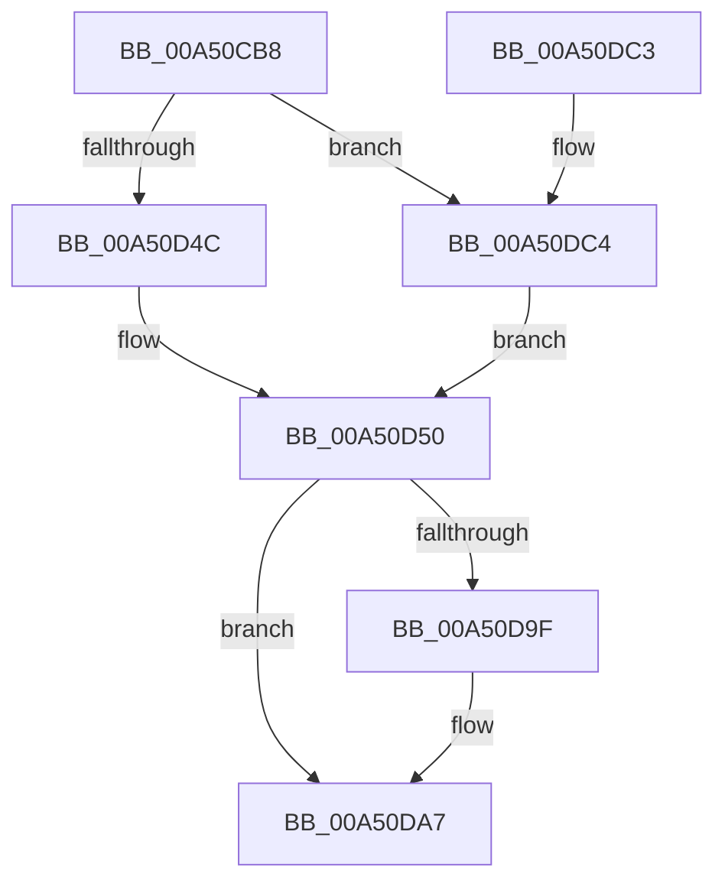

# SmpDirtyStoreCreate

- RVA: `0x00A50CB8`–`0x00A50DCA` (길이 `274` bytes)
- VA: `0x0000000140A50CB8`
- 실행 섹션: `PAGE`
- PDB 이름 있음: `예`; PDB Function 태그: `아니요`
- unwind 정보 RVA: `0x000B0B1C`
- 디코드: `79`개 명령, `274/274` bytes 표시
- 미해석 바이트: `0` (있으면 어셈블리에 `.byte`로 보존)

> 이 문서는 커널 이미지의 기계어와 PDB 기호를 분석해 생성했습니다. 4번과 5번은 함수 원형과 자료형을 바이너리 사용 방식에서 추정한 C 해석이며 원본 소스 복구 결과는 아닙니다.

## 1. Dependencies

- 직접 호출 지점: **3**; 고유 호출 대상: **3**
- 직접 호출자로 확인된 함수: **2**
- RIP 상대 이미지 참조: **1**

### Outgoing calls
- `0x00A50CEC` → [memset](../../text/6C/memset_function_006C6C40.md) (function, `0x006C6C40`)
- `0x00A50D96` → [SmProcessCreateRequest](SmProcessCreateRequest_function_00A50DD0.md) (function, `0x00A50DD0`)
- `0x00A50DB2` → [_security_check_cookie](../../text/6A/_security_check_cookie_function_006AC640.md) (function, `0x006AC640`)

### Direct callers
- [SmpSystemStoreCreate](../7A/SmpSystemStoreCreate_function_007A8024.md) at `0x007A80B2`
- [SmpKeyedStoreCreate](SmpKeyedStoreCreate_function_00A50B64.md) at `0x00A50BE4`

### Static image references
- `0x00A50CC4` → RVA `0x00E0A740` (`.data`; read)

## 2. Other-region calls and transfers

- 다른 실행 섹션으로 향하는 call: **2**
  - `0x00A50CEC` → [memset](../../text/6C/memset_function_006C6C40.md) (`PAGE` → `.text`)
  - `0x00A50DB2` → [_security_check_cookie](../../text/6A/_security_check_cookie_function_006AC640.md) (`PAGE` → `.text`)
- 별도 외부 분기/꼬리 이동을 확인하지 못했습니다.

## 3. Assembly (complete function range)

```asm
00A50CB8  40 53                           push rbx
00A50CBA  55                              push rbp
00A50CBB  56                              push rsi
00A50CBC  57                              push rdi
00A50CBD  48 81 EC 98 00 00 00            sub rsp, 0x98
00A50CC4  48 8B 05 75 9A 3B 00            mov rax, qword ptr [rip + 0x3b9a75]
00A50CCB  48 33 C4                        xor rax, rsp
00A50CCE  48 89 84 24 80 00 00 00         mov qword ptr [rsp + 0x80], rax
00A50CD6  8B EA                           mov ebp, edx
00A50CD8  41 8B D8                        mov ebx, r8d
00A50CDB  33 D2                           xor edx, edx
00A50CDD  48 8B F1                        mov rsi, rcx
00A50CE0  48 8D 4C 24 20                  lea rcx, [rsp + 0x20]
00A50CE5  49 8B F9                        mov rdi, r9
00A50CE8  44 8D 42 58                     lea r8d, [rdx + 0x58]
00A50CEC  E8 4F 5F C7 FF                  call 0x1406c6c40
00A50CF1  8B 8E B0 08 00 00               mov ecx, dword ptr [rsi + 0x8b0]
00A50CF7  8B C3                           mov eax, ebx
00A50CF9  83 E0 01                        and eax, 1
00A50CFC  C7 44 24 2C 80 00 00 00         mov dword ptr [rsp + 0x2c], 0x80
00A50D04  C1 E0 09                        shl eax, 9
00A50D07  44 8B C1                        mov r8d, ecx
00A50D0A  0D 06 01 00 00                  or eax, 0x106
00A50D0F  C7 44 24 30 00 00 02 00         mov dword ptr [rsp + 0x30], 0x20000
00A50D17  41 81 E0 00 07 00 00            and r8d, 0x700
00A50D1E  89 44 24 20                     mov dword ptr [rsp + 0x20], eax
00A50D22  41 83 C8 20                     or r8d, 0x20
00A50D26  8B C1                           mov eax, ecx
00A50D28  25 00 20 00 00                  and eax, 0x2000
00A50D2D  41 C1 E0 02                     shl r8d, 2
00A50D31  44 0B C0                        or r8d, eax
00A50D34  33 D2                           xor edx, edx
00A50D36  8B 44 24 28                     mov eax, dword ptr [rsp + 0x28]
00A50D3A  25 00 FF 0F FF                  and eax, 0xff0fff00
00A50D3F  41 C1 E0 0A                     shl r8d, 0xa
00A50D43  44 0B C0                        or r8d, eax
00A50D46  8B C1                           mov eax, ecx
00A50D48  85 DB                           test ebx, ebx
00A50D4A  75 78                           jne 0x140a50dc4
00A50D4C  24 03                           and al, 3
00A50D4E  3C 02                           cmp al, 2
00A50D50  0F 94 C2                        sete dl
00A50D53  48 8B C5                        mov rax, rbp
00A50D56  83 E1 40                        and ecx, 0x40
00A50D59  C1 E2 04                        shl edx, 4
00A50D5C  0B CA                           or ecx, edx
00A50D5E  48 C1 E0 14                     shl rax, 0x14
00A50D62  C1 E1 0C                        shl ecx, 0xc
00A50D65  48 8D 54 24 20                  lea rdx, [rsp + 0x20]
00A50D6A  41 81 E0 FF FF FA FF            and r8d, 0xfffaffff
00A50D71  48 C1 E8 11                     shr rax, 0x11
00A50D75  41 0B C8                        or ecx, r8d
00A50D78  89 4C 24 28                     mov dword ptr [rsp + 0x28], ecx
00A50D7C  B9 00 00 04 00                  mov ecx, 0x40000
00A50D81  48 3B C1                        cmp rax, rcx
00A50D84  48 0F 43 C1                     cmovae rax, rcx
00A50D88  45 33 C9                        xor r9d, r9d
00A50D8B  48 8B CE                        mov rcx, rsi
00A50D8E  89 44 24 34                     mov dword ptr [rsp + 0x34], eax
00A50D92  45 8D 41 58                     lea r8d, [r9 + 0x58]
00A50D96  E8 35 00 00 00                  call 0x140a50dd0
00A50D9B  85 C0                           test eax, eax
00A50D9D  78 08                           js 0x140a50da7
00A50D9F  8B 44 24 70                     mov eax, dword ptr [rsp + 0x70]
00A50DA3  89 07                           mov dword ptr [rdi], eax
00A50DA5  33 C0                           xor eax, eax
00A50DA7  48 8B 8C 24 80 00 00 00         mov rcx, qword ptr [rsp + 0x80]
00A50DAF  48 33 CC                        xor rcx, rsp
00A50DB2  E8 89 B8 C5 FF                  call 0x1406ac640
00A50DB7  48 81 C4 98 00 00 00            add rsp, 0x98
00A50DBE  5F                              pop rdi
00A50DBF  5E                              pop rsi
00A50DC0  5D                              pop rbp
00A50DC1  5B                              pop rbx
00A50DC2  C3                              ret
00A50DC3  CC                              int3
00A50DC4  24 0C                           and al, 0xc
00A50DC6  3C 08                           cmp al, 8
00A50DC8  EB 86                           jmp 0x140a50d50
```

## 4. C-style interpretation (structured pseudocode)

```c
__int64 __fastcall SmpDirtyStoreCreate(__int64 a1, int a2, int a3, __int64 a4)
{
    __int64 result;
    __int64 v_rsp;
    unsigned __int64 v_stack_m38;
    unsigned int v_stack_m48;
    unsigned int v_stack_m84;
    unsigned int v_stack_m88;
    unsigned int v_stack_m8C;
    unsigned int v_stack_m90;
    unsigned __int64 v_stack_m98;

    v_rsp = (v_rsp) - (152);
    result = (*(unsigned __int64 *)(v_rip + 3906165)) ^ (v_rsp);
    v_stack_m38 = result;
    a2 = 0;
    result = memset(v_stack_m98, a2, a2 + 88, a4);
    result = (unsigned int)(((unsigned int)((unsigned int)((unsigned int)(a3)))) & (1));
    v_stack_m8C = 128;
    result = (unsigned int)((result) << (9));
    result = (unsigned int)((result) | (262));
    v_stack_m88 = 0x20000ULL;
    a3 = (unsigned int)(((unsigned int)((unsigned int)((unsigned int)(*(unsigned int *)(a1 + 2224))))) & (0x700ULL));
    v_stack_m98 = (unsigned int)(result);
    a3 = (unsigned int)((a3) | (32));
    result = (unsigned int)(((unsigned int)((unsigned int)((unsigned int)(*(unsigned int *)(a1 + 2224))))) & (0x2000ULL));
    a3 = (unsigned int)((a3) << (2));
    a3 = (unsigned int)((a3) | ((unsigned int)(result)));
    a2 = 0;
    result = (unsigned int)(((unsigned int)(v_stack_m90)) & (0xFF0FFF00ULL));
    a3 = (unsigned int)((a3) << (10));
    a3 = (unsigned int)((a3) | ((unsigned int)(result)));
    if ((unsigned int)((unsigned int)(a3)) != 0) goto loc_00A50DC4;
    result = (unsigned __int8)(((unsigned int)((unsigned int)((unsigned int)(*(unsigned int *)(a1 + 2224))))) & (3));
loc_00A50D50:
    a2 = (((unsigned __int8)(result)) == 2) ? 1 : 0;
    a1 = (unsigned int)(((unsigned int)(*(unsigned int *)(a1 + 2224))) & (64));
    a2 = (unsigned int)((a2) << (4));
    a1 = (unsigned int)((a1) | (a2));
    result = ((unsigned int)(a2)) << (20);
    a1 = (unsigned int)((a1) << (12));
    a3 = (unsigned int)((a3) & (0xFFFAFFFFULL));
    result = (result) >> (17);
    a1 = (unsigned int)((a1) | (a3));
    v_stack_m90 = (unsigned int)(a1);
    if (result >= ((unsigned int)(0x40000ULL))) { result = (unsigned int)(0x40000ULL); }
    a4 = 0;
    v_stack_m84 = (unsigned int)(result);
    result = SmProcessCreateRequest(a1, v_stack_m98, a4 + 88, a4);
    if (!(sign_flag)) {
        result = v_stack_m48;
        *(unsigned int *)(a4) = (unsigned int)(result);
        result = 0;
    }
    a1 = (v_stack_m38) ^ (v_rsp);
    result = _security_check_cookie(a1, v_stack_m98, a4 + 88, a4);
    v_rsp = (v_rsp) + (152);
    return result;
loc_00A50DC4:
    result = (unsigned __int8)((result) & (12));
    goto loc_00A50D50;
}
```

## 5. (Beta) C Style

```c
int64_t SmpDirtyStoreCreate(void *Arg1, int32_t Arg2, int32_t Arg3, void *Arg4)
{
    uint8_t *arg1 = (uint8_t *)Arg1;
    uint8_t *arg4 = (uint8_t *)Arg4;

    int64_t result;
    int64_t local_rsp;
    uint64_t v_stack_m38;
    uint32_t v_stack_m48;
    uint32_t v_stack_m84;
    uint32_t v_stack_m88;
    uint32_t v_stack_m8C;
    uint32_t v_stack_m90;
    uint64_t v_stack_m98;

    local_rsp = (local_rsp) - (152);
    result = (*(uint64_t *)(v_rip + 0x3B9A75)) ^ (local_rsp);
    v_stack_m38 = result;
    Arg2 = 0;
    result = memset(v_stack_m98, Arg2, Arg2 + 88, Arg4);
    result = (uint32_t)(((uint32_t)((uint32_t)((uint32_t)(Arg3)))) & (1));
    v_stack_m8C = 128;
    result = (uint32_t)((result) << (9));
    result = (uint32_t)((result) | (262));
    v_stack_m88 = 0x20000ULL;
    Arg3 = (uint32_t)(((uint32_t)((uint32_t)((uint32_t)(*(uint32_t *)(arg1 + 0x8B0))))) & (0x700ULL));
    v_stack_m98 = (uint32_t)(result);
    Arg3 = (uint32_t)((Arg3) | (32));
    result = (uint32_t)(((uint32_t)((uint32_t)((uint32_t)(*(uint32_t *)(arg1 + 0x8B0))))) & (0x2000ULL));
    Arg3 = (uint32_t)((Arg3) << (2));
    Arg3 = (uint32_t)((Arg3) | ((uint32_t)(result)));
    Arg2 = 0;
    result = (uint32_t)(((uint32_t)(v_stack_m90)) & (0xFF0FFF00ULL));
    Arg3 = (uint32_t)((Arg3) << (10));
    Arg3 = (uint32_t)((Arg3) | ((uint32_t)(result)));
    if ((uint32_t)((uint32_t)(Arg3)) != 0) goto loc_00A50DC4;
    result = (uint8_t)(((uint32_t)((uint32_t)((uint32_t)(*(uint32_t *)(arg1 + 0x8B0))))) & (3));
loc_00A50D50:
    Arg2 = (((uint8_t)(result)) == 2) ? 1 : 0;
    Arg1 = (uint32_t)(((uint32_t)(*(uint32_t *)(arg1 + 0x8B0))) & (64));
    Arg2 = (uint32_t)((Arg2) << (4));
    Arg1 = (uint32_t)((Arg1) | (Arg2));
    result = ((uint32_t)(Arg2)) << (20);
    Arg1 = (uint32_t)((Arg1) << (12));
    Arg3 = (uint32_t)((Arg3) & (0xFFFAFFFFULL));
    result = (result) >> (17);
    Arg1 = (uint32_t)((Arg1) | (Arg3));
    v_stack_m90 = (uint32_t)(Arg1);
    if (result >= ((uint32_t)(0x40000ULL))) { result = (uint32_t)(0x40000ULL); }
    Arg4 = 0;
    v_stack_m84 = (uint32_t)(result);
    result = SmProcessCreateRequest(Arg1, v_stack_m98, Arg4 + 88, Arg4);
    if (!(sign_flag)) {
        result = v_stack_m48;
        *(uint32_t *)(arg4) = (uint32_t)(result);
        result = 0;
    }
    Arg1 = (v_stack_m38) ^ (local_rsp);
    result = _security_check_cookie(Arg1, v_stack_m98, Arg4 + 88, Arg4);
    local_rsp = (local_rsp) + (152);
    return result;
loc_00A50DC4:
    result = (uint8_t)((result) & (12));
    goto loc_00A50D50;
}
```

### 관측된 메모리 오프셋

구조체 형식이 확인되지 않은 접근은 인자 기준의 오프셋으로만 기록했습니다.

| 기준 인자 | 오프셋 표현 | 폭 (bit) | 접근 |
|---|---:|---:|---|
| `Arg1` | `+ 0x8B0` | `32` | `R` |
| `Arg4` | `+ 0x0` | `32` | `W` |

## 6. Execution-region graph

[열기: 2D/3D 그래프와 함수 탐색 컨트롤 패널](../../../control-panel.html?section=page&rva=0x00A50CB8&view=graph)

- 2D 그래프는 위에서 아래로 흐르고, 3D 그래프는 빈 공간을 드래그해 회전합니다. Shift+드래그는 이동, 휠은 확대·축소, 함수 노드 선택은 대상 보고서 이동입니다.

### Static fallback


