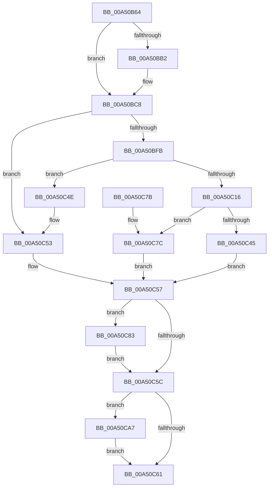

# SmpKeyedStoreCreate

- RVA: `0x00A50B64`–`0x00A50CB1` (길이 `333` bytes)
- VA: `0x0000000140A50B64`
- 실행 섹션: `PAGE`
- PDB 이름 있음: `예`; PDB Function 태그: `아니요`
- unwind 정보 RVA: `0x000B0B00`
- 디코드: `102`개 명령, `333/333` bytes 표시
- 미해석 바이트: `0` (있으면 어셈블리에 `.byte`로 보존)

> 이 문서는 커널 이미지의 기계어와 PDB 기호를 분석해 생성했습니다. 4번과 5번은 함수 원형과 자료형을 바이너리 사용 방식에서 추정한 C 해석이며 원본 소스 복구 결과는 아닙니다.

## 1. Dependencies

- 직접 호출 지점: **11**; 고유 호출 대상: **11**
- 직접 호출자로 확인된 함수: **1**
- RIP 상대 이미지 참조: **1**

### Outgoing calls
- `0x00A50BA3` → [SmpGetProcessPartition](../../text/4A/SmpGetProcessPartition_function_004A3CCC.md) (function, `0x004A3CCC`)
- `0x00A50BCF` → [KiStackAttachProcess](../../text/21/KiStackAttachProcess_function_00216820.md) (function, `0x00216820`)
- `0x00A50BE4` → [SmpDirtyStoreCreate](SmpDirtyStoreCreate_function_00A50CB8.md) (function, `0x00A50CB8`)
- `0x00A50BF2` → [KiUnstackDetachProcess](../../text/21/KiUnstackDetachProcess_function_00217D30.md) (function, `0x00217D30`)
- `0x00A50C09` → [SmAllocEx](../../text/34/SmAllocEx_function_0034C794.md) (function, `0x0034C794`)
- `0x00A50C3B` → [SmpKeyedStoreEntryGet](../../text/34/SmpKeyedStoreEntryGet_function_00349FB0.md) (function, `0x00349FB0`)
- `0x00A50C6B` → [_security_check_cookie](../../text/6A/_security_check_cookie_function_006AC640.md) (function, `0x006AC640`)
- `0x00A50C88` → [SmKmStoreGet](../../text/34/SmKmStoreGet_function_00349F24.md) (function, `0x00349F24`)
- `0x00A50C96` → [SmKmStoreDeleteWhenEmpty](../../text/45/SmKmStoreDeleteWhenEmpty_function_00450D50.md) (function, `0x00450D50`)
- `0x00A50CA0` → [SmKmStoreDereference](../../text/20/SmKmStoreDereference_function_00206574.md) (function, `0x00206574`)
- `0x00A50CAA` → [CmSiFreeMemory](../../text/47/CmSiFreeMemory_function_00475D80.md) (function, `0x00475D80`)

### Direct callers
- [SmProcessCreateNotification](SmProcessCreateNotification_function_00A50B04.md) at `0x00A50B54`

### Static image references
- `0x00A50B6F` → RVA `0x00E0A740` (`.data`; read)

## 2. Other-region calls and transfers

- 다른 실행 섹션으로 향하는 call: **10**
  - `0x00A50BA3` → [SmpGetProcessPartition](../../text/4A/SmpGetProcessPartition_function_004A3CCC.md) (`PAGE` → `.text`)
  - `0x00A50BCF` → [KiStackAttachProcess](../../text/21/KiStackAttachProcess_function_00216820.md) (`PAGE` → `.text`)
  - `0x00A50BF2` → [KiUnstackDetachProcess](../../text/21/KiUnstackDetachProcess_function_00217D30.md) (`PAGE` → `.text`)
  - `0x00A50C09` → [SmAllocEx](../../text/34/SmAllocEx_function_0034C794.md) (`PAGE` → `.text`)
  - `0x00A50C3B` → [SmpKeyedStoreEntryGet](../../text/34/SmpKeyedStoreEntryGet_function_00349FB0.md) (`PAGE` → `.text`)
  - `0x00A50C6B` → [_security_check_cookie](../../text/6A/_security_check_cookie_function_006AC640.md) (`PAGE` → `.text`)
  - `0x00A50C88` → [SmKmStoreGet](../../text/34/SmKmStoreGet_function_00349F24.md) (`PAGE` → `.text`)
  - `0x00A50C96` → [SmKmStoreDeleteWhenEmpty](../../text/45/SmKmStoreDeleteWhenEmpty_function_00450D50.md) (`PAGE` → `.text`)
  - `0x00A50CA0` → [SmKmStoreDereference](../../text/20/SmKmStoreDereference_function_00206574.md) (`PAGE` → `.text`)
  - `0x00A50CAA` → [CmSiFreeMemory](../../text/47/CmSiFreeMemory_function_00475D80.md) (`PAGE` → `.text`)
- 별도 외부 분기/꼬리 이동을 확인하지 못했습니다.

## 3. Assembly (complete function range)

```asm
00A50B64  40 53                           push rbx
00A50B66  55                              push rbp
00A50B67  56                              push rsi
00A50B68  57                              push rdi
00A50B69  41 56                           push r14
00A50B6B  48 83 EC 60                     sub rsp, 0x60
00A50B6F  48 8B 05 CA 9B 3B 00            mov rax, qword ptr [rip + 0x3b9bca]
00A50B76  48 33 C4                        xor rax, rsp
00A50B79  48 89 44 24 58                  mov qword ptr [rsp + 0x58], rax
00A50B7E  83 4C 24 20 FF                  or dword ptr [rsp + 0x20], 0xffffffff
00A50B83  0F 57 C0                        xorps xmm0, xmm0
00A50B86  4C 8B F1                        mov r14, rcx
00A50B89  49 8B F0                        mov rsi, r8
00A50B8C  49 8B C8                        mov rcx, r8
00A50B8F  48 8B EA                        mov rbp, rdx
00A50B92  0F 11 44 24 28                  movups xmmword ptr [rsp + 0x28], xmm0
00A50B97  33 FF                           xor edi, edi
00A50B99  0F 11 44 24 38                  movups xmmword ptr [rsp + 0x38], xmm0
00A50B9E  0F 11 44 24 48                  movups xmmword ptr [rsp + 0x48], xmm0
00A50BA3  E8 24 31 A5 FF                  call 0x1404a3ccc
00A50BA8  8B 98 B4 08 00 00               mov ebx, dword ptr [rax + 0x8b4]
00A50BAE  85 DB                           test ebx, ebx
00A50BB0  75 16                           jne 0x140a50bc8
00A50BB2  41 8A 80 FC 05 00 00            mov al, byte ptr [r8 + 0x5fc]
00A50BB9  24 01                           and al, 1
00A50BBB  F6 D8                           neg al
00A50BBD  B8 00 04 00 00                  mov eax, 0x400
00A50BC2  1B DB                           sbb ebx, ebx
00A50BC4  23 D8                           and ebx, eax
00A50BC6  03 D8                           add ebx, eax
00A50BC8  4C 8D 44 24 28                  lea r8, [rsp + 0x28]
00A50BCD  33 D2                           xor edx, edx
00A50BCF  E8 4C 5C 7C FF                  call 0x140216820
00A50BD4  4C 8D 4C 24 20                  lea r9, [rsp + 0x20]
00A50BD9  41 B8 01 00 00 00               mov r8d, 1
00A50BDF  8B D3                           mov edx, ebx
00A50BE1  48 8B CD                        mov rcx, rbp
00A50BE4  E8 CF 00 00 00                  call 0x140a50cb8
00A50BE9  33 D2                           xor edx, edx
00A50BEB  48 8D 4C 24 28                  lea rcx, [rsp + 0x28]
00A50BF0  8B D8                           mov ebx, eax
00A50BF2  E8 39 71 7C FF                  call 0x140217d30
00A50BF7  85 DB                           test ebx, ebx
00A50BF9  78 58                           js 0x140a50c53
00A50BFB  41 83 C8 FF                     or r8d, 0xffffffff
00A50BFF  BA 73 6D 50 53                  mov edx, 0x53506d73
00A50C04  B9 18 00 00 00                  mov ecx, 0x18
00A50C09  E8 86 BB 8F FF                  call 0x14034c794
00A50C0E  48 8B F8                        mov rdi, rax
00A50C11  48 85 C0                        test rax, rax
00A50C14  74 38                           je 0x140a50c4e
00A50C16  33 C0                           xor eax, eax
00A50C18  48 8D 57 08                     lea rdx, [rdi + 8]
00A50C1C  0F 57 C0                        xorps xmm0, xmm0
00A50C1F  45 33 C9                        xor r9d, r9d
00A50C22  0F 11 07                        movups xmmword ptr [rdi], xmm0
00A50C25  48 89 47 10                     mov qword ptr [rdi + 0x10], rax
00A50C29  49 8B CE                        mov rcx, r14
00A50C2C  48 89 32                        mov qword ptr [rdx], rsi
00A50C2F  44 8D 40 01                     lea r8d, [rax + 1]
00A50C33  8B 74 24 20                     mov esi, dword ptr [rsp + 0x20]
00A50C37  66 89 77 10                     mov word ptr [rdi + 0x10], si
00A50C3B  E8 70 93 8F FF                  call 0x140349fb0
00A50C40  48 85 C0                        test rax, rax
00A50C43  74 37                           je 0x140a50c7c
00A50C45  83 CE FF                        or esi, 0xffffffff
00A50C48  33 FF                           xor edi, edi
00A50C4A  33 DB                           xor ebx, ebx
00A50C4C  EB 09                           jmp 0x140a50c57
00A50C4E  BB 9A 00 00 C0                  mov ebx, 0xc000009a
00A50C53  8B 74 24 20                     mov esi, dword ptr [rsp + 0x20]
00A50C57  83 FE FF                        cmp esi, -1
00A50C5A  75 27                           jne 0x140a50c83
00A50C5C  48 85 FF                        test rdi, rdi
00A50C5F  75 46                           jne 0x140a50ca7
00A50C61  8B C3                           mov eax, ebx
00A50C63  48 8B 4C 24 58                  mov rcx, qword ptr [rsp + 0x58]
00A50C68  48 33 CC                        xor rcx, rsp
00A50C6B  E8 D0 B9 C5 FF                  call 0x1406ac640
00A50C70  48 83 C4 60                     add rsp, 0x60
00A50C74  41 5E                           pop r14
00A50C76  5F                              pop rdi
00A50C77  5E                              pop rsi
00A50C78  5D                              pop rbp
00A50C79  5B                              pop rbx
00A50C7A  C3                              ret
00A50C7B  CC                              int3
00A50C7C  BB 9A 00 00 C0                  mov ebx, 0xc000009a
00A50C81  EB D4                           jmp 0x140a50c57
00A50C83  8B D6                           mov edx, esi
00A50C85  48 8B CD                        mov rcx, rbp
00A50C88  E8 97 92 8F FF                  call 0x140349f24
00A50C8D  41 B8 01 00 00 00               mov r8d, 1
00A50C93  48 8B D0                        mov rdx, rax
00A50C96  E8 B5 00 A0 FF                  call 0x140450d50
00A50C9B  8B D6                           mov edx, esi
00A50C9D  48 8B CD                        mov rcx, rbp
00A50CA0  E8 CF 58 7B FF                  call 0x140206574
00A50CA5  EB B5                           jmp 0x140a50c5c
00A50CA7  48 8B CF                        mov rcx, rdi
00A50CAA  E8 D1 50 A2 FF                  call 0x140475d80
00A50CAF  EB B0                           jmp 0x140a50c61
```

## 4. C-style interpretation (structured pseudocode)

```c
__int64 __fastcall SmpKeyedStoreCreate(__int64 a1, __int64 a2, __int64 a3)
{
    __int64 result;
    __int64 v_rbx;
    __int64 v_rdi;
    __int64 v_rsi;
    __int64 v_rsp;
    unsigned __int64 v_stack_m30;
    unsigned __int64 v_stack_m40;
    unsigned __int64 v_stack_m50;
    unsigned __int64 v_stack_m60;
    unsigned int v_stack_m68;

    v_rsp = (v_rsp) - (96);
    result = (*(unsigned __int64 *)(v_rip + 3906506)) ^ (v_rsp);
    v_stack_m30 = result;
    v_stack_m60 = v_xmm0;
    v_rdi = 0;
    v_stack_m50 = v_xmm0;
    v_stack_m40 = v_xmm0;
    result = SmpGetProcessPartition(a3, a2, a3, a4);
    v_rbx = (unsigned int)(*(unsigned int *)(result + 2228));
    if ((unsigned int)((unsigned int)(*(unsigned int *)(result + 2228))) == 0) {
        result = *(unsigned __int8 *)(a3 + 1532);
        result = (unsigned __int8)((result) & (1));
        result = (unsigned __int8)(-(result));
        result = 0x400ULL;
        v_rbx = (unsigned int)(((unsigned int)(*(unsigned int *)(result + 2228))) & ((unsigned int)(result)));
        v_rbx = (unsigned int)((v_rbx) + ((unsigned int)(result)));
    }
    a2 = 0;
    result = KiStackAttachProcess(a3, a2, v_stack_m60, a4);
    result = SmpDirtyStoreCreate(0, (unsigned int)((unsigned int)(v_rbx)), 1, v_stack_m68);
    a2 = 0;
    result = KiUnstackDetachProcess(v_stack_m60, a2, 1, v_stack_m68);
    if (sign_flag) goto loc_00A50C53;
    a3 = (unsigned int)((1) | (0xFFFFFFFFULL));
    result = SmAllocEx(24, (unsigned int)(0x53506D73ULL), a3, v_stack_m68);
    if (result == 0) goto loc_00A50C4E;
    result = 0;
    a4 = 0;
    *(unsigned __int64 *)(result) = v_xmm0;
    *(unsigned __int64 *)(result + 16) = 0;
    *(unsigned __int64 *)(result + 8) = a3;
    *(unsigned __int16 *)(result + 16) = (unsigned __int16)((unsigned int)(v_stack_m68));
    result = SmpKeyedStoreEntryGet(a1, result + 8, result + 1, a4);
    if (result == 0) goto loc_00A50C7C;
    v_rsi = (unsigned int)(((unsigned int)(v_stack_m68)) | (0xFFFFFFFFULL));
    v_rdi = 0;
    v_rbx = 0;
    goto loc_00A50C57;
loc_00A50C4E:
loc_00A50C53:
loc_00A50C57:
    if (((unsigned int)((unsigned int)(v_stack_m68))) != -1) goto loc_00A50C83;
loc_00A50C5C:
    if (0 != 0) goto loc_00A50CA7;
loc_00A50C61:
    a1 = (v_stack_m30) ^ (v_rsp);
    result = _security_check_cookie(a1, result + 8, result + 1, a4);
    v_rsp = (v_rsp) + (96);
    return result;
loc_00A50C7C:
    goto loc_00A50C57;
loc_00A50C83:
    result = SmKmStoreGet(0, (unsigned int)((unsigned int)((unsigned int)(v_stack_m68))), result + 1, a4);
    result = SmKmStoreDeleteWhenEmpty(0, result, 1, a4);
    result = SmKmStoreDereference(0, (unsigned int)((unsigned int)((unsigned int)(v_stack_m68))), 1, a4);
    goto loc_00A50C5C;
loc_00A50CA7:
    result = CmSiFreeMemory(0, (unsigned int)((unsigned int)((unsigned int)(v_stack_m68))), 1, a4);
    goto loc_00A50C61;
}
```

## 5. (Beta) C Style

```c
int64_t SmpKeyedStoreCreate(int64_t Arg1, int64_t Arg2, int64_t Arg3)
{
    int64_t result;
    int64_t local_rbx;
    int64_t local_rdi;
    int64_t local_rsi;
    int64_t local_rsp;
    uint64_t v_stack_m30;
    uint64_t v_stack_m40;
    uint64_t v_stack_m50;
    uint64_t v_stack_m60;
    uint32_t v_stack_m68;

    local_rsp = (local_rsp) - (96);
    result = (*(uint64_t *)(v_rip + 0x3B9BCA)) ^ (local_rsp);
    v_stack_m30 = result;
    v_stack_m60 = v_xmm0;
    local_rdi = 0;
    v_stack_m50 = v_xmm0;
    v_stack_m40 = v_xmm0;
    result = SmpGetProcessPartition(Arg3, Arg2, Arg3, a4);
    local_rbx = (uint32_t)(*(uint32_t *)(result + 0x8B4));
    if ((uint32_t)((uint32_t)(*(uint32_t *)(result + 0x8B4))) == 0) {
        result = *(uint8_t *)(Arg3 + 0x5FC);
        result = (uint8_t)((result) & (1));
        result = (uint8_t)(-(result));
        result = 0x400ULL;
        local_rbx = (uint32_t)(((uint32_t)(*(uint32_t *)(result + 0x8B4))) & ((uint32_t)(result)));
        local_rbx = (uint32_t)((local_rbx) + ((uint32_t)(result)));
    }
    Arg2 = 0;
    result = KiStackAttachProcess(Arg3, Arg2, v_stack_m60, a4);
    result = SmpDirtyStoreCreate(0, (uint32_t)((uint32_t)(local_rbx)), 1, v_stack_m68);
    Arg2 = 0;
    result = KiUnstackDetachProcess(v_stack_m60, Arg2, 1, v_stack_m68);
    if (sign_flag) goto loc_00A50C53;
    Arg3 = (uint32_t)((1) | (0xFFFFFFFFULL));
    result = SmAllocEx(24, (uint32_t)(0x53506D73ULL), Arg3, v_stack_m68);
    if (result == 0) goto loc_00A50C4E;
    result = 0;
    a4 = 0;
    *(uint64_t *)(result) = v_xmm0;
    *(uint64_t *)(result + 0x10) = 0;
    *(uint64_t *)(result + 0x8) = Arg3;
    *(uint16_t *)(result + 0x10) = (uint16_t)((uint32_t)(v_stack_m68));
    result = SmpKeyedStoreEntryGet(Arg1, result + 8, result + 1, a4);
    if (result == 0) goto loc_00A50C7C;
    local_rsi = (uint32_t)(((uint32_t)(v_stack_m68)) | (0xFFFFFFFFULL));
    local_rdi = 0;
    local_rbx = 0;
    goto loc_00A50C57;
loc_00A50C4E:
loc_00A50C53:
loc_00A50C57:
    if (((uint32_t)((uint32_t)(v_stack_m68))) != -1) goto loc_00A50C83;
loc_00A50C5C:
    if (0 != 0) goto loc_00A50CA7;
loc_00A50C61:
    Arg1 = (v_stack_m30) ^ (local_rsp);
    result = _security_check_cookie(Arg1, result + 8, result + 1, a4);
    local_rsp = (local_rsp) + (96);
    return result;
loc_00A50C7C:
    goto loc_00A50C57;
loc_00A50C83:
    result = SmKmStoreGet(0, (uint32_t)((uint32_t)((uint32_t)(v_stack_m68))), result + 1, a4);
    result = SmKmStoreDeleteWhenEmpty(0, result, 1, a4);
    result = SmKmStoreDereference(0, (uint32_t)((uint32_t)((uint32_t)(v_stack_m68))), 1, a4);
    goto loc_00A50C5C;
loc_00A50CA7:
    result = CmSiFreeMemory(0, (uint32_t)((uint32_t)((uint32_t)(v_stack_m68))), 1, a4);
    goto loc_00A50C61;
}
```

## 6. Execution-region graph

[열기: 2D/3D 그래프와 함수 탐색 컨트롤 패널](../../../control-panel.html?section=page&rva=0x00A50B64&view=graph)

- 2D 그래프는 위에서 아래로 흐르고, 3D 그래프는 빈 공간을 드래그해 회전합니다. Shift+드래그는 이동, 휠은 확대·축소, 함수 노드 선택은 대상 보고서 이동입니다.

### Static fallback


