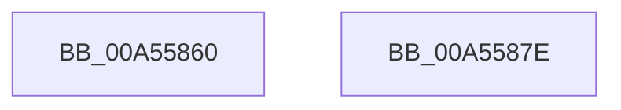

# SyspartDirectGetSystemDisk

- RVA: `0x00A55860`–`0x00A5587F` (길이 `31` bytes)
- VA: `0x0000000140A55860`
- 실행 섹션: `PAGE`
- PDB 이름 있음: `예`; PDB Function 태그: `아니요`
- unwind 정보 RVA: `0x0005C788`
- 디코드: `9`개 명령, `31/31` bytes 표시
- 미해석 바이트: `0` (있으면 어셈블리에 `.byte`로 보존)

> 이 문서는 커널 이미지의 기계어와 PDB 기호를 분석해 생성했습니다. 4번과 5번은 함수 원형과 자료형을 바이너리 사용 방식에서 추정한 C 해석이며 원본 소스 복구 결과는 아닙니다.

## 1. Dependencies

- 직접 호출 지점: **1**; 고유 호출 대상: **1**
- 직접 호출자로 확인된 함수: **0**
- RIP 상대 이미지 참조: **1**

### Outgoing calls
- `0x00A55874` → [SiGetSystemDeviceName](SiGetSystemDeviceName_function_00A558B8.md) (function, `0x00A558B8`)

### Direct callers
- 이 함수 시작 RVA로 연결되는 직접 call은 확인되지 않았습니다. 간접 호출은 완전히 역산할 수 없습니다.

### Static image references
- `0x00A5586D` → RVA `0x00A376F0` (`SiGetSystemDisk`; read)

## 2. Other-region calls and transfers

- 다른 실행 섹션으로 향하는 call: **0**
- 별도 외부 분기/꼬리 이동을 확인하지 못했습니다.

## 3. Assembly (complete function range)

```asm
00A55860  48 83 EC 28                     sub rsp, 0x28
00A55864  4D 8B C8                        mov r9, r8
00A55867  44 8B C2                        mov r8d, edx
00A5586A  48 8B D1                        mov rdx, rcx
00A5586D  48 8D 0D 7C 1E FE FF            lea rcx, [rip - 0x1e184]
00A55874  E8 3F 00 00 00                  call 0x140a558b8
00A55879  48 83 C4 28                     add rsp, 0x28
00A5587D  C3                              ret
00A5587E  CC                              int3
```

## 4. C-style interpretation (structured pseudocode)

```c
__int64 __fastcall SyspartDirectGetSystemDisk(__int64 a1, int a2, __int64 a3)
{
    __int64 result;
    __int64 v_rsp;

    v_rsp = (v_rsp) - (40);
    result = SiGetSystemDeviceName(v_rip - 123268, a1, (unsigned int)(a2), a3);
    v_rsp = (v_rsp) + (40);
    return result;
}
```

## 5. (Beta) C Style

```c
int64_t SyspartDirectGetSystemDisk(int64_t Arg1, int32_t Arg2, int64_t Arg3)
{
    int64_t result;
    int64_t local_rsp;

    local_rsp = (local_rsp) - (40);
    result = SiGetSystemDeviceName(v_rip - 123268, Arg1, (uint32_t)(Arg2), Arg3);
    local_rsp = (local_rsp) + (40);
    return result;
}
```

## 6. Execution-region graph

[열기: 2D/3D 그래프와 함수 탐색 컨트롤 패널](../../../control-panel.html?section=page&rva=0x00A55860&view=graph)

- 2D 그래프는 위에서 아래로 흐르고, 3D 그래프는 빈 공간을 드래그해 회전합니다. Shift+드래그는 이동, 휠은 확대·축소, 함수 노드 선택은 대상 보고서 이동입니다.

### Static fallback


