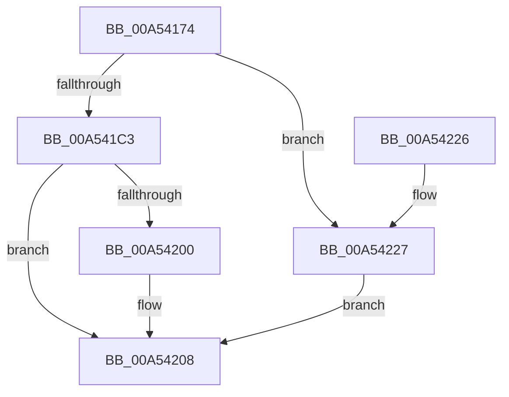

# VslAllocateKernelShadowStack

- RVA: `0x00A54174`–`0x00A5422E` (길이 `186` bytes)
- VA: `0x0000000140A54174`
- 실행 섹션: `PAGE`
- PDB 이름 있음: `예`; PDB Function 태그: `아니요`
- unwind 정보 RVA: `0x000B1098`
- 디코드: `52`개 명령, `186/186` bytes 표시
- 미해석 바이트: `0` (있으면 어셈블리에 `.byte`로 보존)

> 이 문서는 커널 이미지의 기계어와 PDB 기호를 분석해 생성했습니다. 4번과 5번은 함수 원형과 자료형을 바이너리 사용 방식에서 추정한 C 해석이며 원본 소스 복구 결과는 아닙니다.

## 1. Dependencies

- 직접 호출 지점: **4**; 고유 호출 대상: **4**
- 직접 호출자로 확인된 함수: **1**
- RIP 상대 이미지 참조: **1**

### Outgoing calls
- `0x00A541B2` → [memset](../../text/6C/memset_function_006C6C40.md) (function, `0x006C6C40`)
- `0x00A541E3` → [memcpy](../../text/6C/memcpy_function_006C6840.md) (function, `0x006C6840`)
- `0x00A541F7` → [VslpEnterIumSecureMode](../../text/23/VslpEnterIumSecureMode_function_00235E50.md) (function, `0x00235E50`)
- `0x00A54213` → [_security_check_cookie](../../text/6A/_security_check_cookie_function_006AC640.md) (function, `0x006AC640`)

### Direct callers
- [MiAllocateKernelStackPages](../../text/2A/MiAllocateKernelStackPages_function_002A1BEC.md) at `0x002A2202`

### Static image references
- `0x00A54182` → RVA `0x00E0A740` (`.data`; read)

## 2. Other-region calls and transfers

- 다른 실행 섹션으로 향하는 call: **4**
  - `0x00A541B2` → [memset](../../text/6C/memset_function_006C6C40.md) (`PAGE` → `.text`)
  - `0x00A541E3` → [memcpy](../../text/6C/memcpy_function_006C6840.md) (`PAGE` → `.text`)
  - `0x00A541F7` → [VslpEnterIumSecureMode](../../text/23/VslpEnterIumSecureMode_function_00235E50.md) (`PAGE` → `.text`)
  - `0x00A54213` → [_security_check_cookie](../../text/6A/_security_check_cookie_function_006AC640.md) (`PAGE` → `.text`)
- 별도 외부 분기/꼬리 이동을 확인하지 못했습니다.

## 3. Assembly (complete function range)

```asm
00A54174  40 53                           push rbx
00A54176  55                              push rbp
00A54177  56                              push rsi
00A54178  57                              push rdi
00A54179  41 56                           push r14
00A5417B  48 81 EC A0 00 00 00            sub rsp, 0xa0
00A54182  48 8B 05 B7 65 3B 00            mov rax, qword ptr [rip + 0x3b65b7]
00A54189  48 33 C4                        xor rax, rsp
00A5418C  48 89 84 24 90 00 00 00         mov qword ptr [rsp + 0x90], rax
00A54194  48 8B 9C 24 F8 00 00 00         mov rbx, qword ptr [rsp + 0xf8]
00A5419C  8B F2                           mov esi, edx
00A5419E  33 D2                           xor edx, edx
00A541A0  41 8B E8                        mov ebp, r8d
00A541A3  48 8B F9                        mov rdi, rcx
00A541A6  4D 8B F1                        mov r14, r9
00A541A9  48 8D 4C 24 20                  lea rcx, [rsp + 0x20]
00A541AE  44 8D 42 68                     lea r8d, [rdx + 0x68]
00A541B2  E8 89 2A C7 FF                  call 0x1406c6c40
00A541B7  8B 84 24 F0 00 00 00            mov eax, dword ptr [rsp + 0xf0]
00A541BE  83 F8 09                        cmp eax, 9
00A541C1  77 64                           ja 0x140a54227
00A541C3  44 8B C0                        mov r8d, eax
00A541C6  48 89 7C 24 28                  mov qword ptr [rsp + 0x28], rdi
00A541CB  49 C1 E0 03                     shl r8, 3
00A541CF  48 8D 4C 24 40                  lea rcx, [rsp + 0x40]
00A541D4  49 8B D6                        mov rdx, r14
00A541D7  89 74 24 30                     mov dword ptr [rsp + 0x30], esi
00A541DB  89 6C 24 38                     mov dword ptr [rsp + 0x38], ebp
00A541DF  89 44 24 34                     mov dword ptr [rsp + 0x34], eax
00A541E3  E8 58 26 C7 FF                  call 0x1406c6840
00A541E8  BA E6 00 00 00                  mov edx, 0xe6
00A541ED  4C 8D 4C 24 20                  lea r9, [rsp + 0x20]
00A541F2  45 33 C0                        xor r8d, r8d
00A541F5  B1 02                           mov cl, 2
00A541F7  E8 54 1C 7E FF                  call 0x140235e50
00A541FC  85 C0                           test eax, eax
00A541FE  78 08                           js 0x140a54208
00A54200  48 8B 4C 24 30                  mov rcx, qword ptr [rsp + 0x30]
00A54205  48 89 0B                        mov qword ptr [rbx], rcx
00A54208  48 8B 8C 24 90 00 00 00         mov rcx, qword ptr [rsp + 0x90]
00A54210  48 33 CC                        xor rcx, rsp
00A54213  E8 28 84 C5 FF                  call 0x1406ac640
00A54218  48 81 C4 A0 00 00 00            add rsp, 0xa0
00A5421F  41 5E                           pop r14
00A54221  5F                              pop rdi
00A54222  5E                              pop rsi
00A54223  5D                              pop rbp
00A54224  5B                              pop rbx
00A54225  C3                              ret
00A54226  CC                              int3
00A54227  B8 0D 00 00 C0                  mov eax, 0xc000000d
00A5422C  EB DA                           jmp 0x140a54208
```

## 4. C-style interpretation (structured pseudocode)

```c
__int64 __fastcall VslAllocateKernelShadowStack(__int64 a1, int a2, int a3, __int64 a4, unsigned int a5, __int64 a6)
{
    __int64 result;
    __int64 v_rsp;
    unsigned __int64 v_stack_m38;
    unsigned __int64 v_stack_m88;
    unsigned int v_stack_m90;
    unsigned int v_stack_m94;
    unsigned int v_stack_m98;
    unsigned __int64 v_stack_mA0;
    unsigned __int64 v_stack_mA8;

    v_rsp = (v_rsp) - (160);
    result = (*(unsigned __int64 *)(v_rip + 3892663)) ^ (v_rsp);
    v_stack_m38 = result;
    a2 = 0;
    result = memset(v_stack_mA8, a2, a2 + 104, a4);
    if (((unsigned int)((unsigned int)(a5))) > 9) goto loc_00A54227;
    v_stack_mA0 = a1;
    a3 = ((unsigned int)((unsigned int)((unsigned int)(a5)))) << (3);
    v_stack_m98 = (unsigned int)((unsigned int)(a2));
    v_stack_m90 = (unsigned int)((unsigned int)(a3));
    v_stack_m94 = (unsigned int)((unsigned int)(a5));
    result = memcpy(v_stack_m88, a4, a3, a4);
    a3 = 0;
    result = VslpEnterIumSecureMode(2, 230, a3, v_stack_mA8);
    if (!(sign_flag)) {
        a1 = v_stack_m98;
        *(unsigned __int64 *)(a6) = a1;
    }
    a1 = (v_stack_m38) ^ (v_rsp);
    result = _security_check_cookie(a1, 230, a3, v_stack_mA8);
    v_rsp = (v_rsp) + (160);
    return result;
loc_00A54227:
    goto loc_00A54208;
}
```

## 5. (Beta) C Style

```c
int64_t VslAllocateKernelShadowStack(int64_t Arg1, int32_t Arg2, int32_t Arg3, int64_t Arg4, uint32_t Arg5, void *Arg6)
{
    uint8_t *arg6 = (uint8_t *)Arg6;

    int64_t result;
    int64_t local_rsp;
    uint64_t v_stack_m38;
    uint64_t v_stack_m88;
    uint32_t v_stack_m90;
    uint32_t v_stack_m94;
    uint32_t v_stack_m98;
    uint64_t v_stack_mA0;
    uint64_t v_stack_mA8;

    local_rsp = (local_rsp) - (160);
    result = (*(uint64_t *)(v_rip + 0x3B65B7)) ^ (local_rsp);
    v_stack_m38 = result;
    Arg2 = 0;
    result = memset(v_stack_mA8, Arg2, Arg2 + 104, Arg4);
    if (((uint32_t)((uint32_t)(Arg5))) > 9) goto loc_00A54227;
    v_stack_mA0 = Arg1;
    Arg3 = ((uint32_t)((uint32_t)((uint32_t)(Arg5)))) << (3);
    v_stack_m98 = (uint32_t)((uint32_t)(Arg2));
    v_stack_m90 = (uint32_t)((uint32_t)(Arg3));
    v_stack_m94 = (uint32_t)((uint32_t)(Arg5));
    result = memcpy(v_stack_m88, Arg4, Arg3, Arg4);
    Arg3 = 0;
    result = VslpEnterIumSecureMode(2, 230, Arg3, v_stack_mA8);
    if (!(sign_flag)) {
        Arg1 = v_stack_m98;
        *(uint64_t *)(arg6) = Arg1;
    }
    Arg1 = (v_stack_m38) ^ (local_rsp);
    result = _security_check_cookie(Arg1, 230, Arg3, v_stack_mA8);
    local_rsp = (local_rsp) + (160);
    return result;
loc_00A54227:
    goto loc_00A54208;
}
```

### 관측된 메모리 오프셋

구조체 형식이 확인되지 않은 접근은 인자 기준의 오프셋으로만 기록했습니다.

| 기준 인자 | 오프셋 표현 | 폭 (bit) | 접근 |
|---|---:|---:|---|
| `Arg6` | `+ 0x0` | `64` | `W` |

## 6. Execution-region graph

[열기: 2D/3D 그래프와 함수 탐색 컨트롤 패널](../../../control-panel.html?section=page&rva=0x00A54174&view=graph)

- 2D 그래프는 위에서 아래로 흐르고, 3D 그래프는 빈 공간을 드래그해 회전합니다. Shift+드래그는 이동, 휠은 확대·축소, 함수 노드 선택은 대상 보고서 이동입니다.

### Static fallback


