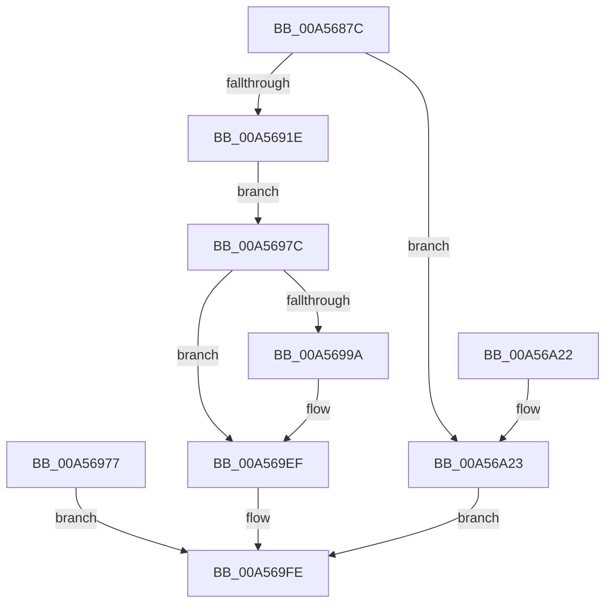

# VslValidateDynamicCodePages

- RVA: `0x00A5687C`–`0x00A56A2A` (길이 `430` bytes)
- VA: `0x0000000140A5687C`
- 실행 섹션: `PAGE`
- PDB 이름 있음: `예`; PDB Function 태그: `아니요`
- unwind 정보 RVA: `0x000B1520`
- 디코드: `94`개 명령, `430/430` bytes 표시
- 미해석 바이트: `0` (있으면 어셈블리에 `.byte`로 보존)

> 이 문서는 커널 이미지의 기계어와 PDB 기호를 분석해 생성했습니다. 4번과 5번은 함수 원형과 자료형을 바이너리 사용 방식에서 추정한 C 해석이며 원본 소스 복구 결과는 아닙니다.

## 1. Dependencies

- 직접 호출 지점: **9**; 고유 호출 대상: **8**
- 직접 호출자로 확인된 함수: **1**
- RIP 상대 이미지 참조: **1**

### Outgoing calls
- `0x00A568B5` → [memset](../../text/6C/memset_function_006C6C40.md) (function, `0x006C6C40`)
- `0x00A568E4` → [memset](../../text/6C/memset_function_006C6C40.md) (function, `0x006C6C40`)
- `0x00A568F3` → [MmSizeOfMdl](../../text/46/MmSizeOfMdl_function_00460A10.md) (function, `0x00460A10`)
- `0x00A56970` → [MmProbeAndLockPages](../../text/23/MmProbeAndLockPages_function_0023B990.md) (function, `0x0023B990`)
- `0x00A5698F` → [VslpLockPagesForTransfer](../../text/29/VslpLockPagesForTransfer_function_0029E0FC.md) (function, `0x0029E0FC`)
- `0x00A569DE` → [VslpEnterIumSecureMode](../../text/23/VslpEnterIumSecureMode_function_00235E50.md) (function, `0x00235E50`)
- `0x00A569EA` → [VslpUnlockPagesForTransfer](../../text/29/VslpUnlockPagesForTransfer_function_0029EE4C.md) (function, `0x0029EE4C`)
- `0x00A569F7` → [MmUnlockPages](../../text/29/MmUnlockPages_function_0029EEE0.md) (function, `0x0029EEE0`)
- `0x00A56A09` → [_security_check_cookie](../../text/6A/_security_check_cookie_function_006AC640.md) (function, `0x006AC640`)

### Direct callers
- [MmChangeImageProtection](MmChangeImageProtection_function_00A565F0.md) at `0x00A5681B`

### Static image references
- `0x00A5688C` → RVA `0x00E0A740` (`.data`; read)

## 2. Other-region calls and transfers

- 다른 실행 섹션으로 향하는 call: **9**
  - `0x00A568B5` → [memset](../../text/6C/memset_function_006C6C40.md) (`PAGE` → `.text`)
  - `0x00A568E4` → [memset](../../text/6C/memset_function_006C6C40.md) (`PAGE` → `.text`)
  - `0x00A568F3` → [MmSizeOfMdl](../../text/46/MmSizeOfMdl_function_00460A10.md) (`PAGE` → `.text`)
  - `0x00A56970` → [MmProbeAndLockPages](../../text/23/MmProbeAndLockPages_function_0023B990.md) (`PAGE` → `.text`)
  - `0x00A5698F` → [VslpLockPagesForTransfer](../../text/29/VslpLockPagesForTransfer_function_0029E0FC.md) (`PAGE` → `.text`)
  - `0x00A569DE` → [VslpEnterIumSecureMode](../../text/23/VslpEnterIumSecureMode_function_00235E50.md) (`PAGE` → `.text`)
  - `0x00A569EA` → [VslpUnlockPagesForTransfer](../../text/29/VslpUnlockPagesForTransfer_function_0029EE4C.md) (`PAGE` → `.text`)
  - `0x00A569F7` → [MmUnlockPages](../../text/29/MmUnlockPages_function_0029EEE0.md) (`PAGE` → `.text`)
  - `0x00A56A09` → [_security_check_cookie](../../text/6A/_security_check_cookie_function_006AC640.md) (`PAGE` → `.text`)
- 별도 외부 분기/꼬리 이동을 확인하지 못했습니다.

## 3. Assembly (complete function range)

```asm
00A5687C  48 89 5C 24 20                  mov qword ptr [rsp + 0x20], rbx
00A56881  56                              push rsi
00A56882  57                              push rdi
00A56883  41 56                           push r14
00A56885  48 81 EC 30 01 00 00            sub rsp, 0x130
00A5688C  48 8B 05 AD 3E 3B 00            mov rax, qword ptr [rip + 0x3b3ead]
00A56893  48 33 C4                        xor rax, rsp
00A56896  48 89 84 24 28 01 00 00         mov qword ptr [rsp + 0x128], rax
00A5689E  41 8B F0                        mov esi, r8d
00A568A1  48 8B DA                        mov rbx, rdx
00A568A4  48 8B F9                        mov rdi, rcx
00A568A7  33 D2                           xor edx, edx
00A568A9  44 8D 42 68                     lea r8d, [rdx + 0x68]
00A568AD  48 8D 8C 24 80 00 00 00         lea rcx, [rsp + 0x80]
00A568B5  E8 86 03 C7 FF                  call 0x1406c6c40
00A568BA  0F 57 C0                        xorps xmm0, xmm0
00A568BD  F3 0F 7F 84 24 FC 00 00 00      movdqu xmmword ptr [rsp + 0xfc], xmm0
00A568C6  45 33 F6                        xor r14d, r14d
00A568C9  44 89 B4 24 0C 01 00 00         mov dword ptr [rsp + 0x10c], r14d
00A568D1  4C 89 B4 24 20 01 00 00         mov qword ptr [rsp + 0x120], r14
00A568D9  33 D2                           xor edx, edx
00A568DB  45 8D 46 48                     lea r8d, [r14 + 0x48]
00A568DF  48 8D 4C 24 30                  lea rcx, [rsp + 0x30]
00A568E4  E8 57 03 C7 FF                  call 0x1406c6c40
00A568E9  8B 57 2C                        mov edx, dword ptr [rdi + 0x2c]
00A568EC  03 57 28                        add edx, dword ptr [rdi + 0x28]
00A568EF  48 8B 4F 20                     mov rcx, qword ptr [rdi + 0x20]
00A568F3  E8 18 A1 A0 FF                  call 0x140460a10
00A568F8  4C 8B C8                        mov r9, rax
00A568FB  44 8B C7                        mov r8d, edi
00A568FE  41 8B D0                        mov edx, r8d
00A56901  41 BA FF 0F 00 00               mov r10d, 0xfff
00A56907  49 23 D2                        and rdx, r10
00A5690A  49 03 D2                        add rdx, r10
00A5690D  48 03 D0                        add rdx, rax
00A56910  48 C1 EA 0C                     shr rdx, 0xc
00A56914  48 83 FA 01                     cmp rdx, 1
00A56918  0F 87 05 01 00 00               ja 0x140a56a23
00A5691E  4C 89 B4 24 F0 00 00 00         mov qword ptr [rsp + 0xf0], r14
00A56926  66 83 C2 06                     add dx, 6
00A5692A  66 C1 E2 03                     shl dx, 3
00A5692E  66 89 94 24 F8 00 00 00         mov word ptr [rsp + 0xf8], dx
00A56936  66 44 89 B4 24 FA 00 00 00      mov word ptr [rsp + 0xfa], r14w
00A5693F  48 8B C7                        mov rax, rdi
00A56942  48 25 00 F0 FF FF               and rax, 0xfffffffffffff000
00A56948  48 89 84 24 10 01 00 00         mov qword ptr [rsp + 0x110], rax
00A56950  45 23 C2                        and r8d, r10d
00A56953  44 89 84 24 1C 01 00 00         mov dword ptr [rsp + 0x11c], r8d
00A5695B  44 89 8C 24 18 01 00 00         mov dword ptr [rsp + 0x118], r9d
00A56963  45 33 C0                        xor r8d, r8d
00A56966  33 D2                           xor edx, edx
00A56968  48 8D 8C 24 F0 00 00 00         lea rcx, [rsp + 0xf0]
00A56970  E8 1B 50 7E FF                  call 0x14023b990
00A56975  EB 05                           jmp 0x140a5697c
00A56977  E9 82 00 00 00                  jmp 0x140a569fe
00A5697C  44 89 74 24 20                  mov dword ptr [rsp + 0x20], r14d
00A56981  45 33 C9                        xor r9d, r9d
00A56984  44 8B C6                        mov r8d, esi
00A56987  48 8B D3                        mov rdx, rbx
00A5698A  48 8D 4C 24 30                  lea rcx, [rsp + 0x30]
00A5698F  E8 68 77 84 FF                  call 0x14029e0fc
00A56994  8B D8                           mov ebx, eax
00A56996  85 C0                           test eax, eax
00A56998  78 55                           js 0x140a569ef
00A5699A  48 89 BC 24 88 00 00 00         mov qword ptr [rsp + 0x88], rdi
00A569A2  48 8B 84 24 20 01 00 00         mov rax, qword ptr [rsp + 0x120]
00A569AA  48 89 84 24 90 00 00 00         mov qword ptr [rsp + 0x90], rax
00A569B2  48 8B 44 24 30                  mov rax, qword ptr [rsp + 0x30]
00A569B7  48 89 84 24 98 00 00 00         mov qword ptr [rsp + 0x98], rax
00A569BF  48 8B 44 24 68                  mov rax, qword ptr [rsp + 0x68]
00A569C4  48 89 84 24 A0 00 00 00         mov qword ptr [rsp + 0xa0], rax
00A569CC  BA 20 00 00 00                  mov edx, 0x20
00A569D1  4C 8D 8C 24 80 00 00 00         lea r9, [rsp + 0x80]
00A569D9  45 33 C0                        xor r8d, r8d
00A569DC  B1 02                           mov cl, 2
00A569DE  E8 6D F4 7D FF                  call 0x140235e50
00A569E3  8B D8                           mov ebx, eax
00A569E5  48 8D 4C 24 30                  lea rcx, [rsp + 0x30]
00A569EA  E8 5D 84 84 FF                  call 0x14029ee4c
00A569EF  48 8D 8C 24 F0 00 00 00         lea rcx, [rsp + 0xf0]
00A569F7  E8 E4 84 84 FF                  call 0x14029eee0
00A569FC  8B C3                           mov eax, ebx
00A569FE  48 8B 8C 24 28 01 00 00         mov rcx, qword ptr [rsp + 0x128]
00A56A06  48 33 CC                        xor rcx, rsp
00A56A09  E8 32 5C C5 FF                  call 0x1406ac640
00A56A0E  48 8B 9C 24 68 01 00 00         mov rbx, qword ptr [rsp + 0x168]
00A56A16  48 81 C4 30 01 00 00            add rsp, 0x130
00A56A1D  41 5E                           pop r14
00A56A1F  5F                              pop rdi
00A56A20  5E                              pop rsi
00A56A21  C3                              ret
00A56A22  CC                              int3
00A56A23  B8 0D 00 00 C0                  mov eax, 0xc000000d
00A56A28  EB D4                           jmp 0x140a569fe
```

## 4. C-style interpretation (structured pseudocode)

```c
__int64 __fastcall VslValidateDynamicCodePages(__int64 a1, __int64 a2, int a3)
{
    __int64 result;
    __int64 v_r14;
    __int64 v_rbx;
    __int64 v_rsp;
    unsigned __int64 v_stack_m118;
    unsigned int v_stack_m128;
    unsigned __int64 v_stack_m20;
    unsigned __int64 v_stack_m28;
    unsigned int v_stack_m2C;
    unsigned int v_stack_m30;
    unsigned __int64 v_stack_m38;
    unsigned int v_stack_m3C;
    unsigned __int64 v_stack_m4C;
    unsigned __int16 v_stack_m4E;
    unsigned __int16 v_stack_m50;
    unsigned __int64 v_stack_m58;
    unsigned __int64 v_stack_mA8;
    unsigned __int64 v_stack_mB0;
    unsigned __int64 v_stack_mB8;
    unsigned __int64 v_stack_mC0;
    unsigned __int64 v_stack_mC8;
    unsigned __int64 v_stack_mE0;
    unsigned __int64 v_stack_p20;

    v_stack_p20 = v_rbx;
    v_rsp = (v_rsp) - (304);
    result = (*(unsigned __int64 *)(v_rip + 3882669)) ^ (v_rsp);
    v_stack_m20 = result;
    a2 = 0;
    result = memset(v_stack_mC8, a2, a2 + 104, a4);
    v_stack_m4C = v_xmm0;
    v_r14 = 0;
    v_stack_m3C = 0;
    v_stack_m28 = 0;
    a2 = 0;
    result = memset(v_stack_m118, a2, v_r14 + 72, a4);
    a2 = (unsigned int)(((unsigned int)(*(unsigned int *)(a1 + 44))) + (*(unsigned int *)(a1 + 40)));
    result = MmSizeOfMdl(*(unsigned __int64 *)(a1 + 32), a2, v_r14 + 72, a4);
    a2 = ((unsigned int)((unsigned int)((unsigned int)((unsigned int)(a1))))) & ((unsigned int)(0xFFFULL));
    a2 = (a2) + ((unsigned int)(0xFFFULL));
    a2 = (a2) + (result);
    a2 = (a2) >> (12);
    if (a2 > 1) goto loc_00A56A23;
    v_stack_m58 = 0;
    a2 = (unsigned __int16)((a2) + (6));
    a2 = (unsigned __int16)((a2) << (3));
    v_stack_m50 = (unsigned __int16)(a2);
    v_stack_m4E = 0;
    result = (a1) & (0xFFFFFFFFFFFFF000ULL);
    v_stack_m38 = result;
    a3 = (unsigned int)(((unsigned int)((unsigned int)(a1))) & ((unsigned int)((unsigned int)(0xFFFULL))));
    v_stack_m2C = a3;
    v_stack_m30 = (unsigned int)(result);
    a3 = 0;
    a2 = 0;
    result = MmProbeAndLockPages(v_stack_m58, a2, a3, result);
    goto loc_00A5697C;
loc_00A5697C:
    v_stack_m128 = 0;
    a4 = 0;
    result = VslpLockPagesForTransfer(v_stack_m118, 0, (unsigned int)((unsigned int)((unsigned int)(a3))), a4);
    v_rbx = (unsigned int)((unsigned int)(result));
    if (!(sign_flag)) {
        v_stack_mC0 = a1;
        result = v_stack_m28;
        v_stack_mB8 = result;
        result = v_stack_m118;
        v_stack_mB0 = result;
        result = v_stack_mE0;
        v_stack_mA8 = result;
        a2 = 32;
        a4 = v_stack_mC8;
        a3 = 0;
        a1 = 2;
        result = VslpEnterIumSecureMode(a1, a2, a3, a4);
        v_rbx = (unsigned int)(result);
        a1 = v_stack_m118;
        result = VslpUnlockPagesForTransfer(a1, a2, a3, a4);
    }
    result = MmUnlockPages(v_stack_m58, a2, a3, a4);
loc_00A569FE:
    a1 = (v_stack_m20) ^ (v_rsp);
    result = _security_check_cookie(a1, a2, a3, a4);
    v_rsp = (v_rsp) + (304);
    return result;
loc_00A56A23:
    goto loc_00A569FE;
}
```

## 5. (Beta) C Style

```c
int64_t VslValidateDynamicCodePages(void *Arg1, int64_t Arg2, int32_t Arg3)
{
    uint8_t *arg1 = (uint8_t *)Arg1;

    int64_t result;
    int64_t local_r14;
    int64_t local_rbx;
    int64_t local_rsp;
    uint64_t v_stack_m118;
    uint32_t v_stack_m128;
    uint64_t v_stack_m20;
    uint64_t v_stack_m28;
    uint32_t v_stack_m2C;
    uint32_t v_stack_m30;
    uint64_t v_stack_m38;
    uint32_t v_stack_m3C;
    uint64_t v_stack_m4C;
    uint16_t v_stack_m4E;
    uint16_t v_stack_m50;
    uint64_t v_stack_m58;
    uint64_t v_stack_mA8;
    uint64_t v_stack_mB0;
    uint64_t v_stack_mB8;
    uint64_t v_stack_mC0;
    uint64_t v_stack_mC8;
    uint64_t v_stack_mE0;
    uint64_t v_stack_p20;

    v_stack_p20 = local_rbx;
    local_rsp = (local_rsp) - (304);
    result = (*(uint64_t *)(v_rip + 0x3B3EAD)) ^ (local_rsp);
    v_stack_m20 = result;
    Arg2 = 0;
    result = memset(v_stack_mC8, Arg2, Arg2 + 104, a4);
    v_stack_m4C = v_xmm0;
    local_r14 = 0;
    v_stack_m3C = 0;
    v_stack_m28 = 0;
    Arg2 = 0;
    result = memset(v_stack_m118, Arg2, local_r14 + 72, a4);
    Arg2 = (uint32_t)(((uint32_t)(*(uint32_t *)(arg1 + 0x2C))) + (*(uint32_t *)(arg1 + 0x28)));
    result = MmSizeOfMdl(*(uint64_t *)(arg1 + 0x20), Arg2, local_r14 + 72, a4);
    Arg2 = ((uint32_t)((uint32_t)((uint32_t)((uint32_t)(Arg1))))) & ((uint32_t)(0xFFFULL));
    Arg2 = (Arg2) + ((uint32_t)(0xFFFULL));
    Arg2 = (Arg2) + (result);
    Arg2 = (Arg2) >> (12);
    if (Arg2 > 1) goto loc_00A56A23;
    v_stack_m58 = 0;
    Arg2 = (uint16_t)((Arg2) + (6));
    Arg2 = (uint16_t)((Arg2) << (3));
    v_stack_m50 = (uint16_t)(Arg2);
    v_stack_m4E = 0;
    result = (Arg1) & (0xFFFFFFFFFFFFF000ULL);
    v_stack_m38 = result;
    Arg3 = (uint32_t)(((uint32_t)((uint32_t)(Arg1))) & ((uint32_t)((uint32_t)(0xFFFULL))));
    v_stack_m2C = Arg3;
    v_stack_m30 = (uint32_t)(result);
    Arg3 = 0;
    Arg2 = 0;
    result = MmProbeAndLockPages(v_stack_m58, Arg2, Arg3, result);
    goto loc_00A5697C;
loc_00A5697C:
    v_stack_m128 = 0;
    a4 = 0;
    result = VslpLockPagesForTransfer(v_stack_m118, 0, (uint32_t)((uint32_t)((uint32_t)(Arg3))), a4);
    local_rbx = (uint32_t)((uint32_t)(result));
    if (!(sign_flag)) {
        v_stack_mC0 = Arg1;
        result = v_stack_m28;
        v_stack_mB8 = result;
        result = v_stack_m118;
        v_stack_mB0 = result;
        result = v_stack_mE0;
        v_stack_mA8 = result;
        Arg2 = 32;
        a4 = v_stack_mC8;
        Arg3 = 0;
        Arg1 = 2;
        result = VslpEnterIumSecureMode(Arg1, Arg2, Arg3, a4);
        local_rbx = (uint32_t)(result);
        Arg1 = v_stack_m118;
        result = VslpUnlockPagesForTransfer(Arg1, Arg2, Arg3, a4);
    }
    result = MmUnlockPages(v_stack_m58, Arg2, Arg3, a4);
loc_00A569FE:
    Arg1 = (v_stack_m20) ^ (local_rsp);
    result = _security_check_cookie(Arg1, Arg2, Arg3, a4);
    local_rsp = (local_rsp) + (304);
    return result;
loc_00A56A23:
    goto loc_00A569FE;
}
```

### 관측된 메모리 오프셋

구조체 형식이 확인되지 않은 접근은 인자 기준의 오프셋으로만 기록했습니다.

| 기준 인자 | 오프셋 표현 | 폭 (bit) | 접근 |
|---|---:|---:|---|
| `Arg1` | `+ 0x20` | `64` | `R` |
| `Arg1` | `+ 0x28` | `32` | `R` |
| `Arg1` | `+ 0x2C` | `32` | `R` |

## 6. Execution-region graph

[열기: 2D/3D 그래프와 함수 탐색 컨트롤 패널](../../../control-panel.html?section=page&rva=0x00A5687C&view=graph)

- 2D 그래프는 위에서 아래로 흐르고, 3D 그래프는 빈 공간을 드래그해 회전합니다. Shift+드래그는 이동, 휠은 확대·축소, 함수 노드 선택은 대상 보고서 이동입니다.

### Static fallback


