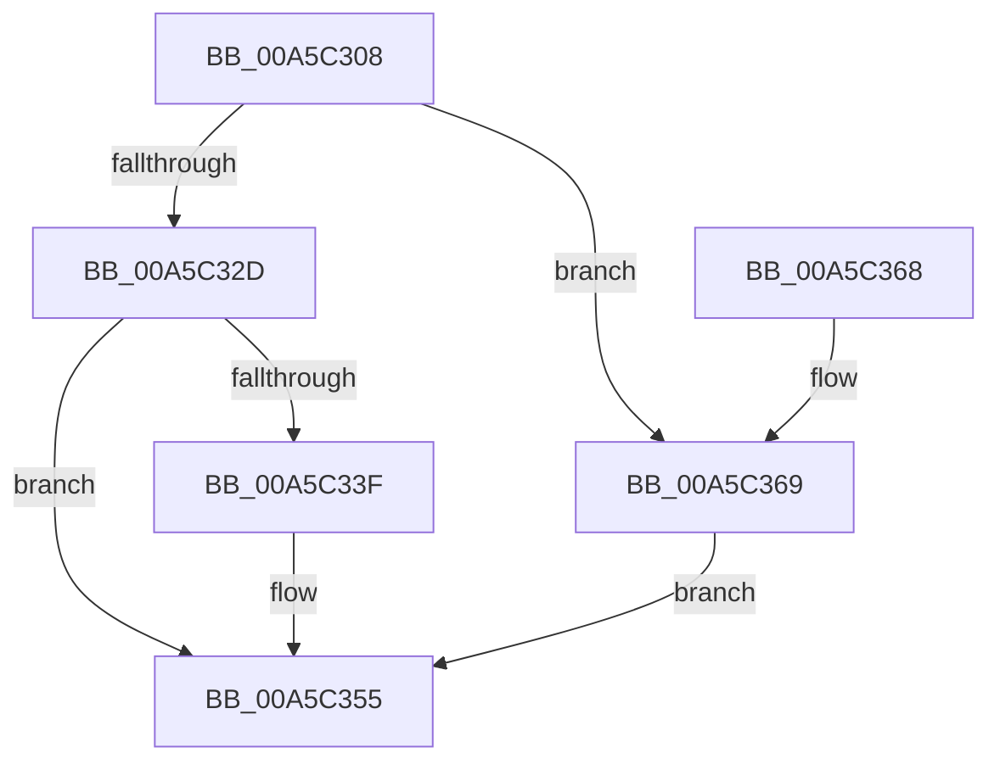

# WdiDispatchControl

- RVA: `0x00A5C308`–`0x00A5C370` (길이 `104` bytes)
- VA: `0x0000000140A5C308`
- 실행 섹션: `PAGE`
- PDB 이름 있음: `예`; PDB Function 태그: `아니요`
- unwind 정보 RVA: `0x000B2724`
- 디코드: `30`개 명령, `104/104` bytes 표시
- 미해석 바이트: `0` (있으면 어셈블리에 `.byte`로 보존)

> 이 문서는 커널 이미지의 기계어와 PDB 기호를 분석해 생성했습니다. 4번과 5번은 함수 원형과 자료형을 바이너리 사용 방식에서 추정한 C 해석이며 원본 소스 복구 결과는 아닙니다.

## 1. Dependencies

- 직접 호출 지점: **3**; 고유 호출 대상: **3**
- 직접 호출자로 확인된 함수: **1**
- RIP 상대 이미지 참조: **1**

### Outgoing calls
- `0x00A5C336` → [EtwGetProviderIdFromHandle](../../text/4B/EtwGetProviderIdFromHandle_function_004B8850.md) (function, `0x004B8850`)
- `0x00A5C350` → [WdipStartEndScenario](WdipStartEndScenario_function_00A5C378.md) (function, `0x00A5C378`)
- `0x00A5C35D` → [_security_check_cookie](../../text/6A/_security_check_cookie_function_006AC640.md) (function, `0x006AC640`)

### Direct callers
- [NtTraceControl](../A9/NtTraceControl_function_00A9ED40.md) at `0x00A9EFBE`

### Static image references
- `0x00A5C30E` → RVA `0x00E0A740` (`.data`; read)

## 2. Other-region calls and transfers

- 다른 실행 섹션으로 향하는 call: **2**
  - `0x00A5C336` → [EtwGetProviderIdFromHandle](../../text/4B/EtwGetProviderIdFromHandle_function_004B8850.md) (`PAGE` → `.text`)
  - `0x00A5C35D` → [_security_check_cookie](../../text/6A/_security_check_cookie_function_006AC640.md) (`PAGE` → `.text`)
- 별도 외부 분기/꼬리 이동을 확인하지 못했습니다.

## 3. Assembly (complete function range)

```asm
00A5C308  40 53                           push rbx
00A5C30A  48 83 EC 40                     sub rsp, 0x40
00A5C30E  48 8B 05 2B E4 3A 00            mov rax, qword ptr [rip + 0x3ae42b]
00A5C315  48 33 C4                        xor rax, rsp
00A5C318  48 89 44 24 30                  mov qword ptr [rsp + 0x30], rax
00A5C31D  0F 57 C0                        xorps xmm0, xmm0
00A5C320  48 8B D9                        mov rbx, rcx
00A5C323  0F 11 44 24 20                  movups xmmword ptr [rsp + 0x20], xmm0
00A5C328  48 85 C9                        test rcx, rcx
00A5C32B  74 3C                           je 0x140a5c369
00A5C32D  8B 09                           mov ecx, dword ptr [rcx]
00A5C32F  4C 8D 44 24 20                  lea r8, [rsp + 0x20]
00A5C334  B2 01                           mov dl, 1
00A5C336  E8 15 C5 A5 FF                  call 0x1404b8850
00A5C33B  85 C0                           test eax, eax
00A5C33D  78 16                           js 0x140a5c355
00A5C33F  44 8B 4B 28                     mov r9d, dword ptr [rbx + 0x28]
00A5C343  4C 8D 43 08                     lea r8, [rbx + 8]
00A5C347  48 8D 53 18                     lea rdx, [rbx + 0x18]
00A5C34B  48 8D 4C 24 20                  lea rcx, [rsp + 0x20]
00A5C350  E8 23 00 00 00                  call 0x140a5c378
00A5C355  48 8B 4C 24 30                  mov rcx, qword ptr [rsp + 0x30]
00A5C35A  48 33 CC                        xor rcx, rsp
00A5C35D  E8 DE 02 C5 FF                  call 0x1406ac640
00A5C362  48 83 C4 40                     add rsp, 0x40
00A5C366  5B                              pop rbx
00A5C367  C3                              ret
00A5C368  CC                              int3
00A5C369  B8 0D 00 00 C0                  mov eax, 0xc000000d
00A5C36E  EB E5                           jmp 0x140a5c355
```

## 4. C-style interpretation (structured pseudocode)

```c
__int64 __fastcall WdiDispatchControl(__int64 a1)
{
    __int64 result;
    __int64 v_rsp;
    unsigned __int64 v_stack_m18;
    unsigned __int64 v_stack_m28;

    v_rsp = (v_rsp) - (64);
    result = (*(unsigned __int64 *)(v_rip + 3859499)) ^ (v_rsp);
    v_stack_m18 = result;
    v_stack_m28 = v_xmm0;
    if (a1 == 0) goto loc_00A5C369;
    result = EtwGetProviderIdFromHandle((unsigned int)(*(unsigned int *)(a1)), 1, v_stack_m28, a4);
    if (!(sign_flag)) {
        a4 = *(unsigned int *)(a1 + 40);
        a3 = a1 + 8;
        a2 = a1 + 24;
        a1 = v_stack_m28;
        result = WdipStartEndScenario(a1, a2, a3, a4);
    }
    a1 = (v_stack_m18) ^ (v_rsp);
    result = _security_check_cookie(a1, a2, a3, a4);
    v_rsp = (v_rsp) + (64);
    return result;
loc_00A5C369:
    goto loc_00A5C355;
}
```

## 5. (Beta) C Style

```c
int64_t WdiDispatchControl(void *Arg1)
{
    uint8_t *arg1 = (uint8_t *)Arg1;

    int64_t result;
    int64_t local_rsp;
    uint64_t v_stack_m18;
    uint64_t v_stack_m28;

    local_rsp = (local_rsp) - (64);
    result = (*(uint64_t *)(v_rip + 0x3AE42B)) ^ (local_rsp);
    v_stack_m18 = result;
    v_stack_m28 = v_xmm0;
    if (Arg1 == NULL) goto loc_00A5C369;
    result = EtwGetProviderIdFromHandle((uint32_t)(*(uint32_t *)(arg1)), 1, v_stack_m28, a4);
    if (!(sign_flag)) {
        a4 = *(uint32_t *)(arg1 + 0x28);
        a3 = Arg1 + 8;
        a2 = Arg1 + 24;
        Arg1 = v_stack_m28;
        result = WdipStartEndScenario(Arg1, a2, a3, a4);
    }
    Arg1 = (v_stack_m18) ^ (local_rsp);
    result = _security_check_cookie(Arg1, a2, a3, a4);
    local_rsp = (local_rsp) + (64);
    return result;
loc_00A5C369:
    goto loc_00A5C355;
}
```

### 관측된 메모리 오프셋

구조체 형식이 확인되지 않은 접근은 인자 기준의 오프셋으로만 기록했습니다.

| 기준 인자 | 오프셋 표현 | 폭 (bit) | 접근 |
|---|---:|---:|---|
| `Arg1` | `+ 0x8` | `64` | `R` |
| `Arg1` | `+ 0x18` | `64` | `R` |
| `Arg1` | `+ 0x28` | `32` | `R` |

## 6. Execution-region graph

[열기: 2D/3D 그래프와 함수 탐색 컨트롤 패널](../../../control-panel.html?section=page&rva=0x00A5C308&view=graph)

- 2D 그래프는 위에서 아래로 흐르고, 3D 그래프는 빈 공간을 드래그해 회전합니다. Shift+드래그는 이동, 휠은 확대·축소, 함수 노드 선택은 대상 보고서 이동입니다.

### Static fallback


