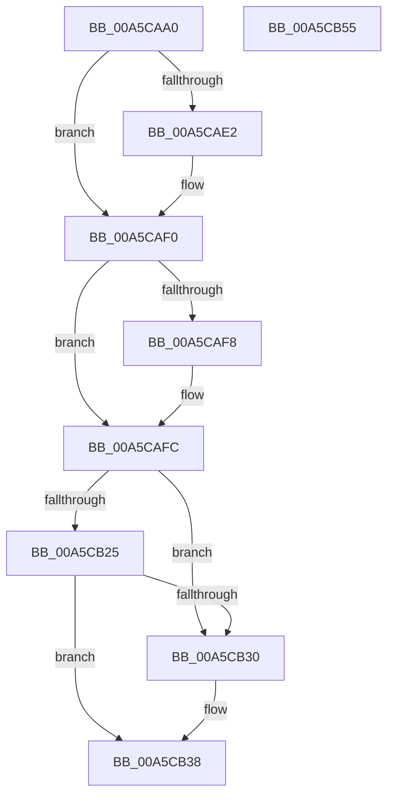

# WdipSemActivateInstance

- RVA: `0x00A5CAA0`–`0x00A5CB56` (길이 `182` bytes)
- VA: `0x0000000140A5CAA0`
- 실행 섹션: `PAGE`
- PDB 이름 있음: `예`; PDB Function 태그: `아니요`
- unwind 정보 RVA: `0x00060BC4`
- 디코드: `47`개 명령, `182/182` bytes 표시
- 미해석 바이트: `0` (있으면 어셈블리에 `.byte`로 보존)

> 이 문서는 커널 이미지의 기계어와 PDB 기호를 분석해 생성했습니다. 4번과 5번은 함수 원형과 자료형을 바이너리 사용 방식에서 추정한 C 해석이며 원본 소스 복구 결과는 아닙니다.

## 1. Dependencies

- 직접 호출 지점: **5**; 고유 호출 대상: **5**
- 직접 호출자로 확인된 함수: **2**
- RIP 상대 이미지 참조: **1**

### Outgoing calls
- `0x00A5CAD2` → [KeAbPreAcquire](../../text/21/KeAbPreAcquire_function_00210230.md) (function, `0x00210230`)
- `0x00A5CAEB` → [ExfAcquirePushLockExclusiveEx](../../text/20/ExfAcquirePushLockExclusiveEx_function_0020FC90.md) (function, `0x0020FC90`)
- `0x00A5CB33` → [ExfReleasePushLock](../../text/26/ExfReleasePushLock_function_002638D0.md) (function, `0x002638D0`)
- `0x00A5CB3B` → [KeAbPostRelease](../../text/2E/KeAbPostRelease_function_002E1600.md) (function, `0x002E1600`)
- `0x00A5CB40` → [KeLeaveCriticalRegion](../../text/25/KeLeaveCriticalRegion_function_0025D8B0.md) (function, `0x0025D8B0`)

### Direct callers
- [WdipSemEnableScenario](WdipSemEnableScenario_function_00A5C424.md) at `0x00A5C526`
- [sub_00B3DB56](../B3/Unknown_function_00B3DB56.md) at `0x00B3DBC4`

### Static image references
- `0x00A5CAB8` → RVA `0x00F01DF8` (`.data`; read)

## 2. Other-region calls and transfers

- 다른 실행 섹션으로 향하는 call: **5**
  - `0x00A5CAD2` → [KeAbPreAcquire](../../text/21/KeAbPreAcquire_function_00210230.md) (`PAGE` → `.text`)
  - `0x00A5CAEB` → [ExfAcquirePushLockExclusiveEx](../../text/20/ExfAcquirePushLockExclusiveEx_function_0020FC90.md) (`PAGE` → `.text`)
  - `0x00A5CB33` → [ExfReleasePushLock](../../text/26/ExfReleasePushLock_function_002638D0.md) (`PAGE` → `.text`)
  - `0x00A5CB3B` → [KeAbPostRelease](../../text/2E/KeAbPostRelease_function_002E1600.md) (`PAGE` → `.text`)
  - `0x00A5CB40` → [KeLeaveCriticalRegion](../../text/25/KeLeaveCriticalRegion_function_0025D8B0.md) (`PAGE` → `.text`)
- 별도 외부 분기/꼬리 이동을 확인하지 못했습니다.

## 3. Assembly (complete function range)

```asm
00A5CAA0  48 89 5C 24 08                  mov qword ptr [rsp + 8], rbx
00A5CAA5  48 89 74 24 10                  mov qword ptr [rsp + 0x10], rsi
00A5CAAA  57                              push rdi
00A5CAAB  48 83 EC 20                     sub rsp, 0x20
00A5CAAF  65 48 8B 04 25 88 01 00 00      mov rax, qword ptr gs:[0x188]
00A5CAB8  48 8D 35 39 53 4A 00            lea rsi, [rip + 0x4a5339]
00A5CABF  48 8B F9                        mov rdi, rcx
00A5CAC2  45 33 C0                        xor r8d, r8d
00A5CAC5  33 D2                           xor edx, edx
00A5CAC7  48 8B CE                        mov rcx, rsi
00A5CACA  66 FF 88 E4 01 00 00            dec word ptr [rax + 0x1e4]
00A5CAD1  90                              nop
00A5CAD2  E8 59 37 7B FF                  call 0x140210230
00A5CAD7  F0 48 0F BA 2E 00               lock bts qword ptr [rsi], 0
00A5CADD  48 8B D8                        mov rbx, rax
00A5CAE0  73 0E                           jae 0x140a5caf0
00A5CAE2  4C 8B C6                        mov r8, rsi
00A5CAE5  48 8B D0                        mov rdx, rax
00A5CAE8  48 8B CE                        mov rcx, rsi
00A5CAEB  E8 A0 31 7B FF                  call 0x14020fc90
00A5CAF0  45 33 C0                        xor r8d, r8d
00A5CAF3  48 85 DB                        test rbx, rbx
00A5CAF6  74 04                           je 0x140a5cafc
00A5CAF8  C6 43 0A 01                     mov byte ptr [rbx + 0xa], 1
00A5CAFC  44 89 47 2C                     mov dword ptr [rdi + 0x2c], r8d
00A5CB00  0F 0D 0D F1 52 4A 00            prefetchw byte ptr [rip + 0x4a52f1]
00A5CB07  48 8B 05 EA 52 4A 00            mov rax, qword ptr [rip + 0x4a52ea]
00A5CB0E  48 8B C8                        mov rcx, rax
00A5CB11  48 83 E1 F0                     and rcx, 0xfffffffffffffff0
00A5CB15  48 83 F9 10                     cmp rcx, 0x10
00A5CB19  48 8D 50 F0                     lea rdx, [rax - 0x10]
00A5CB1D  49 0F 46 D0                     cmovbe rdx, r8
00A5CB21  A8 02                           test al, 2
00A5CB23  75 0B                           jne 0x140a5cb30
00A5CB25  F0 48 0F B1 15 CA 52 4A 00      lock cmpxchg qword ptr [rip + 0x4a52ca], rdx
00A5CB2E  74 08                           je 0x140a5cb38
00A5CB30  48 8B CE                        mov rcx, rsi
00A5CB33  E8 98 6D 80 FF                  call 0x1402638d0
00A5CB38  48 8B CE                        mov rcx, rsi
00A5CB3B  E8 C0 4A 88 FF                  call 0x1402e1600
00A5CB40  E8 6B 0D 80 FF                  call 0x14025d8b0
00A5CB45  48 8B 5C 24 30                  mov rbx, qword ptr [rsp + 0x30]
00A5CB4A  48 8B 74 24 38                  mov rsi, qword ptr [rsp + 0x38]
00A5CB4F  48 83 C4 20                     add rsp, 0x20
00A5CB53  5F                              pop rdi
00A5CB54  C3                              ret
00A5CB55  CC                              int3
```

## 4. C-style interpretation (structured pseudocode)

```c
__int64 __fastcall WdipSemActivateInstance(__int64 a1, int a2, int a3)
{
    __int64 result;
    __int64 v_rsp;
    unsigned __int64 v_stack_p10;
    unsigned __int64 v_stack_p8;

    v_stack_p8 = v_rbx;
    v_stack_p10 = v_rsi;
    v_rsp = (v_rsp) - (32);
    a3 = 0;
    a2 = 0;
    result = KeAbPreAcquire(v_rip + 4870969, a2, a3, a4);
    if (!(condition_is_above_or_equal)) {
        a3 = v_rip + 4870969;
        a2 = result;
        a1 = v_rip + 4870969;
        result = ExfAcquirePushLockExclusiveEx(a1, a2, a3, a4);
    }
    a3 = 0;
    if (result != 0) {
        *(unsigned __int8 *)(result + 10) = 1;
    }
    *(unsigned int *)(a1 + 44) = 0;
    a1 = (*(unsigned __int64 *)(v_rip + 4870890)) & (-16);
    a2 = *(unsigned __int64 *)(v_rip + 4870890) - 16;
    if (a1 <= 16) { a2 = 0; }
    if ((((unsigned __int8)(*(unsigned __int64 *)(v_rip + 4870890))) & (2)) != 0) goto loc_00A5CB30;
    result = *(unsigned __int64 *)(v_rip + 4870890);
    if ((((unsigned __int8)(*(unsigned __int64 *)(v_rip + 4870890))) & (2)) != 0) {
        a1 = v_rip + 4870969;
        result = ExfReleasePushLock(a1, a2, a3, a4);
    }
    result = KeAbPostRelease(v_rip + 4870969, a2, a3, a4);
    result = KeLeaveCriticalRegion(v_rip + 4870969, a2, a3, a4);
    v_rsp = (v_rsp) + (32);
    return result;
}
```

## 5. (Beta) C Style

```c
int64_t WdipSemActivateInstance(void *Arg1, int32_t Arg2, int32_t Arg3)
{
    uint8_t *arg1 = (uint8_t *)Arg1;

    int64_t result;
    int64_t local_rsp;
    uint64_t v_stack_p10;
    uint64_t v_stack_p8;

    v_stack_p8 = local_rbx;
    v_stack_p10 = local_rsi;
    local_rsp = (local_rsp) - (32);
    Arg3 = 0;
    Arg2 = 0;
    result = KeAbPreAcquire(v_rip + 4870969, Arg2, Arg3, a4);
    if (!(condition_is_above_or_equal)) {
        Arg3 = v_rip + 4870969;
        Arg2 = result;
        Arg1 = v_rip + 4870969;
        result = ExfAcquirePushLockExclusiveEx(Arg1, Arg2, Arg3, a4);
    }
    Arg3 = 0;
    if (result != 0) {
        *(uint8_t *)(result + 0xA) = 1;
    }
    *(uint32_t *)(arg1 + 0x2C) = 0;
    Arg1 = (*(uint64_t *)(v_rip + 0x4A52EA)) & (-16);
    Arg2 = *(uint64_t *)(v_rip + 0x4A52EA) - 16;
    if (Arg1 <= 16) { Arg2 = 0; }
    if ((((uint8_t)(*(uint64_t *)(v_rip + 0x4A52EA))) & (2)) != 0) goto loc_00A5CB30;
    result = *(uint64_t *)(v_rip + 0x4A52EA);
    if ((((uint8_t)(*(uint64_t *)(v_rip + 0x4A52EA))) & (2)) != 0) {
        Arg1 = v_rip + 4870969;
        result = ExfReleasePushLock(Arg1, Arg2, Arg3, a4);
    }
    result = KeAbPostRelease(v_rip + 4870969, Arg2, Arg3, a4);
    result = KeLeaveCriticalRegion(v_rip + 4870969, Arg2, Arg3, a4);
    local_rsp = (local_rsp) + (32);
    return result;
}
```

### 관측된 메모리 오프셋

구조체 형식이 확인되지 않은 접근은 인자 기준의 오프셋으로만 기록했습니다.

| 기준 인자 | 오프셋 표현 | 폭 (bit) | 접근 |
|---|---:|---:|---|
| `Arg1` | `+ 0x2C` | `32` | `W` |

## 6. Execution-region graph

[열기: 2D/3D 그래프와 함수 탐색 컨트롤 패널](../../../control-panel.html?section=page&rva=0x00A5CAA0&view=graph)

- 2D 그래프는 위에서 아래로 흐르고, 3D 그래프는 빈 공간을 드래그해 회전합니다. Shift+드래그는 이동, 휠은 확대·축소, 함수 노드 선택은 대상 보고서 이동입니다.

### Static fallback


