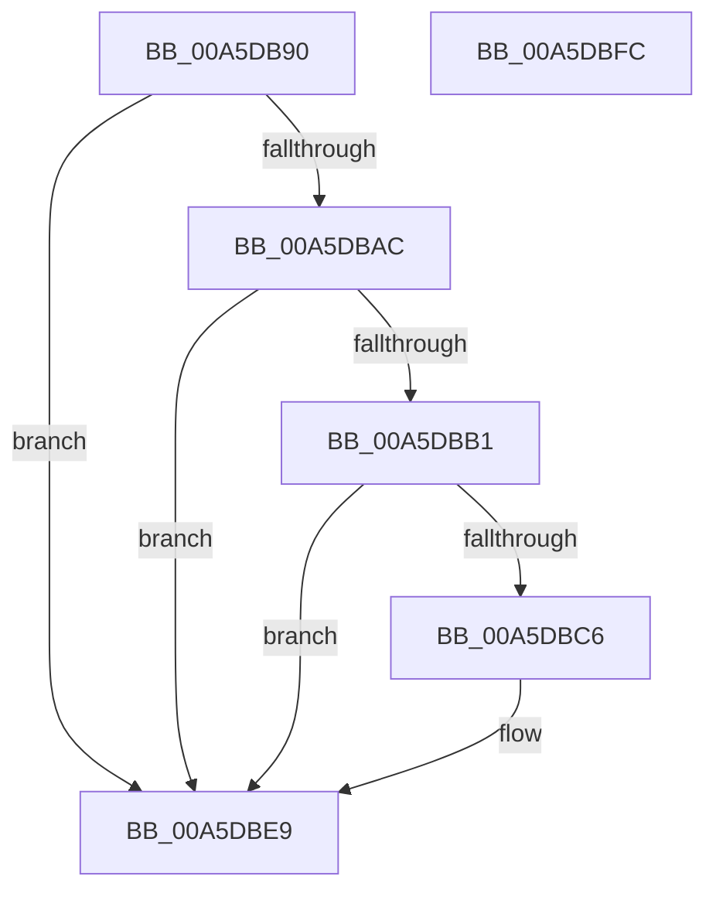

# WdipSemBuildScenarioInstance

- RVA: `0x00A5DB90`–`0x00A5DBFD` (길이 `109` bytes)
- VA: `0x0000000140A5DB90`
- 실행 섹션: `PAGE`
- PDB 이름 있음: `예`; PDB Function 태그: `아니요`
- unwind 정보 RVA: `0x00060BC4`
- 디코드: `32`개 명령, `109/109` bytes 표시
- 미해석 바이트: `0` (있으면 어셈블리에 `.byte`로 보존)

> 이 문서는 커널 이미지의 기계어와 PDB 기호를 분석해 생성했습니다. 4번과 5번은 함수 원형과 자료형을 바이너리 사용 방식에서 추정한 C 해석이며 원본 소스 복구 결과는 아닙니다.

## 1. Dependencies

- 직접 호출 지점: **2**; 고유 호출 대상: **2**
- 직접 호출자로 확인된 함수: **1**
- RIP 상대 이미지 참조: **0**

### Outgoing calls
- `0x00A5DBB9` → [WdipSemFastAllocate](WdipSemFastAllocate_function_00A5DC04.md) (function, `0x00A5DC04`)
- `0x00A5DBD1` → [memset](../../text/6C/memset_function_006C6C40.md) (function, `0x006C6C40`)

### Direct callers
- [WdipSemReserveInstanceTableEntry](WdipSemReserveInstanceTableEntry_function_00A5DA08.md) at `0x00A5DAA0`

### Static image references
- 디코드된 RIP-relative 메모리 참조가 없습니다.

## 2. Other-region calls and transfers

- 다른 실행 섹션으로 향하는 call: **1**
  - `0x00A5DBD1` → [memset](../../text/6C/memset_function_006C6C40.md) (`PAGE` → `.text`)
- 별도 외부 분기/꼬리 이동을 확인하지 못했습니다.

## 3. Assembly (complete function range)

```asm
00A5DB90  48 89 5C 24 08                  mov qword ptr [rsp + 8], rbx
00A5DB95  48 89 74 24 10                  mov qword ptr [rsp + 0x10], rsi
00A5DB9A  57                              push rdi
00A5DB9B  48 83 EC 20                     sub rsp, 0x20
00A5DB9F  33 DB                           xor ebx, ebx
00A5DBA1  48 8B FA                        mov rdi, rdx
00A5DBA4  48 8B F1                        mov rsi, rcx
00A5DBA7  48 85 C9                        test rcx, rcx
00A5DBAA  74 3D                           je 0x140a5dbe9
00A5DBAC  48 85 D2                        test rdx, rdx
00A5DBAF  74 38                           je 0x140a5dbe9
00A5DBB1  BA 20 02 00 00                  mov edx, 0x220
00A5DBB6  8D 4B 03                        lea ecx, [rbx + 3]
00A5DBB9  E8 46 00 00 00                  call 0x140a5dc04
00A5DBBE  48 8B D8                        mov rbx, rax
00A5DBC1  48 85 C0                        test rax, rax
00A5DBC4  74 23                           je 0x140a5dbe9
00A5DBC6  33 D2                           xor edx, edx
00A5DBC8  41 B8 20 02 00 00               mov r8d, 0x220
00A5DBCE  48 8B C8                        mov rcx, rax
00A5DBD1  E8 6A 90 C6 FF                  call 0x1406c6c40
00A5DBD6  0F 10 07                        movups xmm0, xmmword ptr [rdi]
00A5DBD9  48 89 73 20                     mov qword ptr [rbx + 0x20], rsi
00A5DBDD  C7 43 2C 01 00 00 00            mov dword ptr [rbx + 0x2c], 1
00A5DBE4  F3 0F 7F 43 10                  movdqu xmmword ptr [rbx + 0x10], xmm0
00A5DBE9  48 8B 74 24 38                  mov rsi, qword ptr [rsp + 0x38]
00A5DBEE  48 8B C3                        mov rax, rbx
00A5DBF1  48 8B 5C 24 30                  mov rbx, qword ptr [rsp + 0x30]
00A5DBF6  48 83 C4 20                     add rsp, 0x20
00A5DBFA  5F                              pop rdi
00A5DBFB  C3                              ret
00A5DBFC  CC                              int3
```

## 4. C-style interpretation (structured pseudocode)

```c
__int64 __fastcall WdipSemBuildScenarioInstance(__int64 a1, __int64 a2)
{
    __int64 result;
    __int64 v_rbx;
    __int64 v_rsp;
    unsigned __int64 v_stack_p10;
    unsigned __int64 v_stack_p8;

    v_stack_p8 = v_rbx;
    v_stack_p10 = v_rsi;
    v_rsp = (v_rsp) - (32);
    v_rbx = 0;
    if (a1 == 0) goto loc_00A5DBE9;
    if (a2 == 0) goto loc_00A5DBE9;
    result = WdipSemFastAllocate(v_rbx + 3, 544, a3, a4);
    if (result != 0) {
        a2 = 0;
        a3 = 544;
        a1 = result;
        result = memset(a1, a2, a3, a4);
        *(unsigned __int64 *)(result + 32) = a1;
        *(unsigned int *)(result + 44) = 1;
        *(unsigned __int64 *)(result + 16) = v_xmm0;
    }
    v_rsp = (v_rsp) + (32);
    return result;
}
```

## 5. (Beta) C Style

```c
int64_t WdipSemBuildScenarioInstance(int64_t Arg1, void *Arg2)
{
    uint8_t *arg2 = (uint8_t *)Arg2;

    int64_t result;
    int64_t local_rbx;
    int64_t local_rsp;
    uint64_t v_stack_p10;
    uint64_t v_stack_p8;

    v_stack_p8 = local_rbx;
    v_stack_p10 = local_rsi;
    local_rsp = (local_rsp) - (32);
    local_rbx = 0;
    if (Arg1 == 0) goto loc_00A5DBE9;
    if (Arg2 == NULL) goto loc_00A5DBE9;
    result = WdipSemFastAllocate(local_rbx + 3, 544, a3, a4);
    if (result != 0) {
        Arg2 = 0;
        a3 = 544;
        Arg1 = result;
        result = memset(Arg1, Arg2, a3, a4);
        *(uint64_t *)(result + 0x20) = Arg1;
        *(uint32_t *)(result + 0x2C) = 1;
        *(uint64_t *)(result + 0x10) = v_xmm0;
    }
    local_rsp = (local_rsp) + (32);
    return result;
}
```

### 관측된 메모리 오프셋

구조체 형식이 확인되지 않은 접근은 인자 기준의 오프셋으로만 기록했습니다.

| 기준 인자 | 오프셋 표현 | 폭 (bit) | 접근 |
|---|---:|---:|---|
| `Arg2` | `+ 0x0` | `128` | `R` |

## 6. Execution-region graph

[열기: 2D/3D 그래프와 함수 탐색 컨트롤 패널](../../../control-panel.html?section=page&rva=0x00A5DB90&view=graph)

- 2D 그래프는 위에서 아래로 흐르고, 3D 그래프는 빈 공간을 드래그해 회전합니다. Shift+드래그는 이동, 휠은 확대·축소, 함수 노드 선택은 대상 보고서 이동입니다.

### Static fallback


