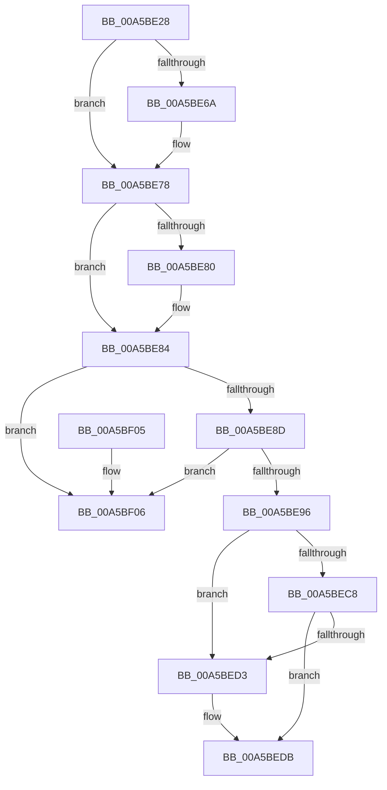

# WdipSemDeleteTransitionalInstance

- RVA: `0x00A5BE28`–`0x00A5BF0D` (길이 `229` bytes)
- VA: `0x0000000140A5BE28`
- 실행 섹션: `PAGE`
- PDB 이름 있음: `예`; PDB Function 태그: `아니요`
- unwind 정보 RVA: `0x0006383C`
- 디코드: `60`개 명령, `229/229` bytes 표시
- 미해석 바이트: `0` (있으면 어셈블리에 `.byte`로 보존)

> 이 문서는 커널 이미지의 기계어와 PDB 기호를 분석해 생성했습니다. 4번과 5번은 함수 원형과 자료형을 바이너리 사용 방식에서 추정한 C 해석이며 원본 소스 복구 결과는 아닙니다.

## 1. Dependencies

- 직접 호출 지점: **6**; 고유 호출 대상: **6**
- 직접 호출자로 확인된 함수: **3**
- RIP 상대 이미지 참조: **2**

### Outgoing calls
- `0x00A5BE5A` → [KeAbPreAcquire](../../text/21/KeAbPreAcquire_function_00210230.md) (function, `0x00210230`)
- `0x00A5BE73` → [ExfAcquirePushLockExclusiveEx](../../text/20/ExfAcquirePushLockExclusiveEx_function_0020FC90.md) (function, `0x0020FC90`)
- `0x00A5BED6` → [ExfReleasePushLock](../../text/26/ExfReleasePushLock_function_002638D0.md) (function, `0x002638D0`)
- `0x00A5BEDE` → [KeAbPostRelease](../../text/2E/KeAbPostRelease_function_002E1600.md) (function, `0x002E1600`)
- `0x00A5BEE3` → [KeLeaveCriticalRegion](../../text/25/KeLeaveCriticalRegion_function_0025D8B0.md) (function, `0x0025D8B0`)
- `0x00A5BEF0` → [WdipSemFastFree](../70/WdipSemFastFree_function_0070303C.md) (function, `0x0070303C`)

### Direct callers
- [WdipTimeoutCheckRoutine](WdipTimeoutCheckRoutine_function_00A5B910.md) at `0x00A5BA5B`
- [WdipSemDisableScenario](WdipSemDisableScenario_function_00A5BC00.md) at `0x00A5BCDC`
- [sub_00B3DC32](../B3/Unknown_function_00B3DC32.md) at `0x00B3DC6F`

### Static image references
- `0x00A5BE40` → RVA `0x00F01DF8` (`.data`; read)
- `0x00A5BE9D` → RVA `0x00F01DF0` (`.data`; read/write)

## 2. Other-region calls and transfers

- 다른 실행 섹션으로 향하는 call: **5**
  - `0x00A5BE5A` → [KeAbPreAcquire](../../text/21/KeAbPreAcquire_function_00210230.md) (`PAGE` → `.text`)
  - `0x00A5BE73` → [ExfAcquirePushLockExclusiveEx](../../text/20/ExfAcquirePushLockExclusiveEx_function_0020FC90.md) (`PAGE` → `.text`)
  - `0x00A5BED6` → [ExfReleasePushLock](../../text/26/ExfReleasePushLock_function_002638D0.md) (`PAGE` → `.text`)
  - `0x00A5BEDE` → [KeAbPostRelease](../../text/2E/KeAbPostRelease_function_002E1600.md) (`PAGE` → `.text`)
  - `0x00A5BEE3` → [KeLeaveCriticalRegion](../../text/25/KeLeaveCriticalRegion_function_0025D8B0.md) (`PAGE` → `.text`)
- 별도 외부 분기/꼬리 이동을 확인하지 못했습니다.

## 3. Assembly (complete function range)

```asm
00A5BE28  48 89 5C 24 08                  mov qword ptr [rsp + 8], rbx
00A5BE2D  48 89 74 24 10                  mov qword ptr [rsp + 0x10], rsi
00A5BE32  57                              push rdi
00A5BE33  48 83 EC 20                     sub rsp, 0x20
00A5BE37  65 48 8B 04 25 88 01 00 00      mov rax, qword ptr gs:[0x188]
00A5BE40  48 8D 35 B1 5F 4A 00            lea rsi, [rip + 0x4a5fb1]
00A5BE47  48 8B D9                        mov rbx, rcx
00A5BE4A  45 33 C0                        xor r8d, r8d
00A5BE4D  33 D2                           xor edx, edx
00A5BE4F  48 8B CE                        mov rcx, rsi
00A5BE52  66 FF 88 E4 01 00 00            dec word ptr [rax + 0x1e4]
00A5BE59  90                              nop
00A5BE5A  E8 D1 43 7B FF                  call 0x140210230
00A5BE5F  F0 48 0F BA 2E 00               lock bts qword ptr [rsi], 0
00A5BE65  48 8B F8                        mov rdi, rax
00A5BE68  73 0E                           jae 0x140a5be78
00A5BE6A  4C 8B C6                        mov r8, rsi
00A5BE6D  48 8B D0                        mov rdx, rax
00A5BE70  48 8B CE                        mov rcx, rsi
00A5BE73  E8 18 3E 7B FF                  call 0x14020fc90
00A5BE78  45 33 C0                        xor r8d, r8d
00A5BE7B  48 85 FF                        test rdi, rdi
00A5BE7E  74 04                           je 0x140a5be84
00A5BE80  C6 47 0A 01                     mov byte ptr [rdi + 0xa], 1
00A5BE84  48 8B 0B                        mov rcx, qword ptr [rbx]
00A5BE87  48 39 59 08                     cmp qword ptr [rcx + 8], rbx
00A5BE8B  75 79                           jne 0x140a5bf06
00A5BE8D  48 8B 43 08                     mov rax, qword ptr [rbx + 8]
00A5BE91  48 39 18                        cmp qword ptr [rax], rbx
00A5BE94  75 70                           jne 0x140a5bf06
00A5BE96  48 89 08                        mov qword ptr [rax], rcx
00A5BE99  48 89 41 08                     mov qword ptr [rcx + 8], rax
00A5BE9D  FF 0D 4D 5F 4A 00               dec dword ptr [rip + 0x4a5f4d]
00A5BEA3  0F 0D 0D 4E 5F 4A 00            prefetchw byte ptr [rip + 0x4a5f4e]
00A5BEAA  48 8B 05 47 5F 4A 00            mov rax, qword ptr [rip + 0x4a5f47]
00A5BEB1  48 8B C8                        mov rcx, rax
00A5BEB4  48 83 E1 F0                     and rcx, 0xfffffffffffffff0
00A5BEB8  48 83 F9 10                     cmp rcx, 0x10
00A5BEBC  48 8D 50 F0                     lea rdx, [rax - 0x10]
00A5BEC0  49 0F 46 D0                     cmovbe rdx, r8
00A5BEC4  A8 02                           test al, 2
00A5BEC6  75 0B                           jne 0x140a5bed3
00A5BEC8  F0 48 0F B1 15 27 5F 4A 00      lock cmpxchg qword ptr [rip + 0x4a5f27], rdx
00A5BED1  74 08                           je 0x140a5bedb
00A5BED3  48 8B CE                        mov rcx, rsi
00A5BED6  E8 F5 79 80 FF                  call 0x1402638d0
00A5BEDB  48 8B CE                        mov rcx, rsi
00A5BEDE  E8 1D 57 88 FF                  call 0x1402e1600
00A5BEE3  E8 C8 19 80 FF                  call 0x14025d8b0
00A5BEE8  48 8B D3                        mov rdx, rbx
00A5BEEB  B9 03 00 00 00                  mov ecx, 3
00A5BEF0  E8 47 71 CA FF                  call 0x14070303c
00A5BEF5  48 8B 5C 24 30                  mov rbx, qword ptr [rsp + 0x30]
00A5BEFA  48 8B 74 24 38                  mov rsi, qword ptr [rsp + 0x38]
00A5BEFF  48 83 C4 20                     add rsp, 0x20
00A5BF03  5F                              pop rdi
00A5BF04  C3                              ret
00A5BF05  CC                              int3
00A5BF06  B9 03 00 00 00                  mov ecx, 3
00A5BF0B  CD 29                           int 0x29
```

## 4. C-style interpretation (structured pseudocode)

```c
__int64 __fastcall WdipSemDeleteTransitionalInstance(__int64 a1, int a2, int a3)
{
    __int64 result;
    __int64 v_rsp;
    unsigned __int64 v_stack_p10;
    unsigned __int64 v_stack_p8;

    v_stack_p8 = v_rbx;
    v_stack_p10 = v_rsi;
    v_rsp = (v_rsp) - (32);
    a3 = 0;
    a2 = 0;
    result = KeAbPreAcquire(v_rip + 4874161, a2, a3, a4);
    if (!(condition_is_above_or_equal)) {
        a3 = v_rip + 4874161;
        a2 = result;
        a1 = v_rip + 4874161;
        result = ExfAcquirePushLockExclusiveEx(a1, a2, a3, a4);
    }
    a3 = 0;
    if (result != 0) {
        *(unsigned __int8 *)(result + 10) = 1;
    }
    if ((*(unsigned __int64 *)(*(unsigned __int64 *)(a1) + 8)) != a1) goto loc_00A5BF06;
    if ((*(unsigned __int64 *)(*(unsigned __int64 *)(a1 + 8))) != a1) goto loc_00A5BF06;
    *(unsigned __int64 *)(*(unsigned __int64 *)(a1 + 8)) = *(unsigned __int64 *)(a1);
    *(unsigned __int64 *)(*(unsigned __int64 *)(a1) + 8) = *(unsigned __int64 *)(a1 + 8);
    a1 = (*(unsigned __int64 *)(v_rip + 4874055)) & (-16);
    a2 = *(unsigned __int64 *)(v_rip + 4874055) - 16;
    if (a1 <= 16) { a2 = 0; }
    if ((((unsigned __int8)(*(unsigned __int64 *)(v_rip + 4874055))) & (2)) != 0) goto loc_00A5BED3;
    result = *(unsigned __int64 *)(v_rip + 4874055);
    if ((((unsigned __int8)(*(unsigned __int64 *)(v_rip + 4874055))) & (2)) != 0) {
        a1 = v_rip + 4874161;
        result = ExfReleasePushLock(a1, a2, a3, a4);
    }
    result = KeAbPostRelease(v_rip + 4874161, a2, a3, a4);
    result = KeLeaveCriticalRegion(v_rip + 4874161, a2, a3, a4);
    result = WdipSemFastFree(3, a1, a3, a4);
    v_rsp = (v_rsp) + (32);
    return result;
loc_00A5BF06:
    return result;
}
```

## 5. (Beta) C Style

```c
int64_t WdipSemDeleteTransitionalInstance(void *Arg1, int32_t Arg2, int32_t Arg3)
{
    uint8_t *arg1 = (uint8_t *)Arg1;

    int64_t result;
    int64_t local_rsp;
    uint64_t v_stack_p10;
    uint64_t v_stack_p8;

    v_stack_p8 = local_rbx;
    v_stack_p10 = local_rsi;
    local_rsp = (local_rsp) - (32);
    Arg3 = 0;
    Arg2 = 0;
    result = KeAbPreAcquire(v_rip + 4874161, Arg2, Arg3, a4);
    if (!(condition_is_above_or_equal)) {
        Arg3 = v_rip + 4874161;
        Arg2 = result;
        Arg1 = v_rip + 4874161;
        result = ExfAcquirePushLockExclusiveEx(Arg1, Arg2, Arg3, a4);
    }
    Arg3 = 0;
    if (result != 0) {
        *(uint8_t *)(result + 0xA) = 1;
    }
    if ((*(uint64_t *)(*(uint64_t *)(arg1) + 0x8)) != Arg1) goto loc_00A5BF06;
    if ((*(uint64_t *)(*(uint64_t *)(arg1 + 0x8))) != Arg1) goto loc_00A5BF06;
    *(uint64_t *)(*(uint64_t *)(arg1 + 0x8)) = *(uint64_t *)(arg1);
    *(uint64_t *)(*(uint64_t *)(arg1) + 0x8) = *(uint64_t *)(arg1 + 0x8);
    Arg1 = (*(uint64_t *)(v_rip + 0x4A5F47)) & (-16);
    Arg2 = *(uint64_t *)(v_rip + 0x4A5F47) - 16;
    if (Arg1 <= 16) { Arg2 = 0; }
    if ((((uint8_t)(*(uint64_t *)(v_rip + 0x4A5F47))) & (2)) != 0) goto loc_00A5BED3;
    result = *(uint64_t *)(v_rip + 0x4A5F47);
    if ((((uint8_t)(*(uint64_t *)(v_rip + 0x4A5F47))) & (2)) != 0) {
        Arg1 = v_rip + 4874161;
        result = ExfReleasePushLock(Arg1, Arg2, Arg3, a4);
    }
    result = KeAbPostRelease(v_rip + 4874161, Arg2, Arg3, a4);
    result = KeLeaveCriticalRegion(v_rip + 4874161, Arg2, Arg3, a4);
    result = WdipSemFastFree(3, Arg1, Arg3, a4);
    local_rsp = (local_rsp) + (32);
    return result;
loc_00A5BF06:
    return result;
}
```

### 관측된 메모리 오프셋

구조체 형식이 확인되지 않은 접근은 인자 기준의 오프셋으로만 기록했습니다.

| 기준 인자 | 오프셋 표현 | 폭 (bit) | 접근 |
|---|---:|---:|---|
| `Arg1` | `+ 0x0` | `64` | `R` |
| `Arg1` | `+ 0x8` | `64` | `R` |

## 6. Execution-region graph

[열기: 2D/3D 그래프와 함수 탐색 컨트롤 패널](../../../control-panel.html?section=page&rva=0x00A5BE28&view=graph)

- 2D 그래프는 위에서 아래로 흐르고, 3D 그래프는 빈 공간을 드래그해 회전합니다. Shift+드래그는 이동, 휠은 확대·축소, 함수 노드 선택은 대상 보고서 이동입니다.

### Static fallback


