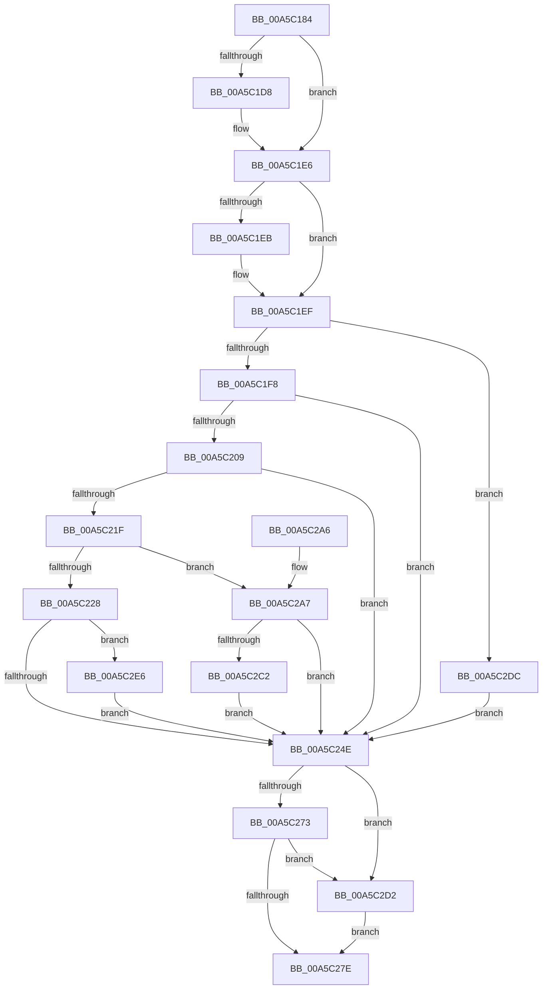

# WdipSemDisableContextProvider

- RVA: `0x00A5C184`–`0x00A5C2FF` (길이 `379` bytes)
- VA: `0x0000000140A5C184`
- 실행 섹션: `PAGE`
- PDB 이름 있음: `예`; PDB Function 태그: `아니요`
- unwind 정보 RVA: `0x000B2708`
- 디코드: `101`개 명령, `379/379` bytes 표시
- 미해석 바이트: `0` (있으면 어셈블리에 `.byte`로 보존)

> 이 문서는 커널 이미지의 기계어와 PDB 기호를 분석해 생성했습니다. 4번과 5번은 함수 원형과 자료형을 바이너리 사용 방식에서 추정한 C 해석이며 원본 소스 복구 결과는 아닙니다.

## 1. Dependencies

- 직접 호출 지점: **8**; 고유 호출 대상: **7**
- 직접 호출자로 확인된 함수: **1**
- RIP 상대 이미지 참조: **3**

### Outgoing calls
- `0x00A5C1C8` → [KeAbPreAcquire](../../text/21/KeAbPreAcquire_function_00210230.md) (function, `0x00210230`)
- `0x00A5C1E1` → [ExfAcquirePushLockExclusiveEx](../../text/20/ExfAcquirePushLockExclusiveEx_function_0020FC90.md) (function, `0x0020FC90`)
- `0x00A5C1FE` → [WdipSemCaptureState](../../text/4B/WdipSemCaptureState_function_004BA9A4.md) (function, `0x004BA9A4`)
- `0x00A5C23F` → [WdipSemEnableDisableTrace](WdipSemEnableDisableTrace_function_00A5C7F8.md) (function, `0x00A5C7F8`)
- `0x00A5C281` → [KeAbPostRelease](../../text/2E/KeAbPostRelease_function_002E1600.md) (function, `0x002E1600`)
- `0x00A5C286` → [KeLeaveCriticalRegion](../../text/25/KeLeaveCriticalRegion_function_0025D8B0.md) (function, `0x0025D8B0`)
- `0x00A5C2B7` → [WdipSemEnableDisableTrace](WdipSemEnableDisableTrace_function_00A5C7F8.md) (function, `0x00A5C7F8`)
- `0x00A5C2D5` → [ExfReleasePushLock](../../text/26/ExfReleasePushLock_function_002638D0.md) (function, `0x002638D0`)

### Direct callers
- [WdipSemDisableContextProviders](WdipSemDisableContextProviders_function_00A5BDB4.md) at `0x00A5BE15`

### Static image references
- `0x00A5C1A5` → RVA `0x00F01DC8` (`.data`; read)
- `0x00A5C20D` → RVA `0x00F02454` (`.data`; read)
- `0x00A5C213` → RVA `0x00F02454` (`.data`; read/write)

## 2. Other-region calls and transfers

- 다른 실행 섹션으로 향하는 call: **6**
  - `0x00A5C1C8` → [KeAbPreAcquire](../../text/21/KeAbPreAcquire_function_00210230.md) (`PAGE` → `.text`)
  - `0x00A5C1E1` → [ExfAcquirePushLockExclusiveEx](../../text/20/ExfAcquirePushLockExclusiveEx_function_0020FC90.md) (`PAGE` → `.text`)
  - `0x00A5C1FE` → [WdipSemCaptureState](../../text/4B/WdipSemCaptureState_function_004BA9A4.md) (`PAGE` → `.text`)
  - `0x00A5C281` → [KeAbPostRelease](../../text/2E/KeAbPostRelease_function_002E1600.md) (`PAGE` → `.text`)
  - `0x00A5C286` → [KeLeaveCriticalRegion](../../text/25/KeLeaveCriticalRegion_function_0025D8B0.md) (`PAGE` → `.text`)
  - `0x00A5C2D5` → [ExfReleasePushLock](../../text/26/ExfReleasePushLock_function_002638D0.md) (`PAGE` → `.text`)
- 별도 외부 분기/꼬리 이동을 확인하지 못했습니다.

## 3. Assembly (complete function range)

```asm
00A5C184  48 89 5C 24 08                  mov qword ptr [rsp + 8], rbx
00A5C189  48 89 6C 24 10                  mov qword ptr [rsp + 0x10], rbp
00A5C18E  48 89 74 24 18                  mov qword ptr [rsp + 0x18], rsi
00A5C193  57                              push rdi
00A5C194  41 56                           push r14
00A5C196  41 57                           push r15
00A5C198  48 83 EC 30                     sub rsp, 0x30
00A5C19C  65 48 8B 04 25 88 01 00 00      mov rax, qword ptr gs:[0x188]
00A5C1A5  4C 8D 3D 1C 5C 4A 00            lea r15, [rip + 0x4a5c1c]
00A5C1AC  40 8A EA                        mov bpl, dl
00A5C1AF  48 8B F9                        mov rdi, rcx
00A5C1B2  45 33 F6                        xor r14d, r14d
00A5C1B5  45 33 C0                        xor r8d, r8d
00A5C1B8  33 D2                           xor edx, edx
00A5C1BA  49 8B CF                        mov rcx, r15
00A5C1BD  66 FF 88 E4 01 00 00            dec word ptr [rax + 0x1e4]
00A5C1C4  41 8B F6                        mov esi, r14d
00A5C1C7  90                              nop
00A5C1C8  E8 63 40 7B FF                  call 0x140210230
00A5C1CD  F0 49 0F BA 2F 00               lock bts qword ptr [r15], 0
00A5C1D3  48 8B D8                        mov rbx, rax
00A5C1D6  73 0E                           jae 0x140a5c1e6
00A5C1D8  4D 8B C7                        mov r8, r15
00A5C1DB  48 8B D0                        mov rdx, rax
00A5C1DE  49 8B CF                        mov rcx, r15
00A5C1E1  E8 AA 3A 7B FF                  call 0x14020fc90
00A5C1E6  48 85 DB                        test rbx, rbx
00A5C1E9  74 04                           je 0x140a5c1ef
00A5C1EB  C6 43 0A 01                     mov byte ptr [rbx + 0xa], 1
00A5C1EF  48 85 FF                        test rdi, rdi
00A5C1F2  0F 84 E4 00 00 00               je 0x140a5c2dc
00A5C1F8  40 8A D5                        mov dl, bpl
00A5C1FB  48 8B CF                        mov rcx, rdi
00A5C1FE  E8 A1 E7 A5 FF                  call 0x1404ba9a4
00A5C203  83 7F 20 01                     cmp dword ptr [rdi + 0x20], 1
00A5C207  74 45                           je 0x140a5c24e
00A5C209  48 8B 5F 28                     mov rbx, qword ptr [rdi + 0x28]
00A5C20D  8B 0D 41 62 4A 00               mov ecx, dword ptr [rip + 0x4a6241]
00A5C213  87 0D 3B 62 4A 00               xchg dword ptr [rip + 0x4a623b], ecx
00A5C219  83 43 48 FF                     add dword ptr [rbx + 0x48], -1
00A5C21D  75 2F                           jne 0x140a5c24e
00A5C21F  48 8B D7                        mov rdx, rdi
00A5C222  44 39 73 28                     cmp dword ptr [rbx + 0x28], r14d
00A5C226  74 7F                           je 0x140a5c2a7
00A5C228  8B 43 20                        mov eax, dword ptr [rbx + 0x20]
00A5C22B  4C 8B 4B 18                     mov r9, qword ptr [rbx + 0x18]
00A5C22F  44 8A 43 10                     mov r8b, byte ptr [rbx + 0x10]
00A5C233  C7 44 24 28 01 00 00 00         mov dword ptr [rsp + 0x28], 1
00A5C23B  89 44 24 20                     mov dword ptr [rsp + 0x20], eax
00A5C23F  E8 B4 05 00 00                  call 0x140a5c7f8
00A5C244  8B F0                           mov esi, eax
00A5C246  85 C0                           test eax, eax
00A5C248  0F 89 98 00 00 00               jns 0x140a5c2e6
00A5C24E  0F 0D 0D 73 5B 4A 00            prefetchw byte ptr [rip + 0x4a5b73]
00A5C255  48 8B 05 6C 5B 4A 00            mov rax, qword ptr [rip + 0x4a5b6c]
00A5C25C  48 8B C8                        mov rcx, rax
00A5C25F  48 83 E1 F0                     and rcx, 0xfffffffffffffff0
00A5C263  48 83 F9 10                     cmp rcx, 0x10
00A5C267  48 8D 50 F0                     lea rdx, [rax - 0x10]
00A5C26B  49 0F 46 D6                     cmovbe rdx, r14
00A5C26F  A8 02                           test al, 2
00A5C271  75 5F                           jne 0x140a5c2d2
00A5C273  F0 48 0F B1 15 4C 5B 4A 00      lock cmpxchg qword ptr [rip + 0x4a5b4c], rdx
00A5C27C  75 54                           jne 0x140a5c2d2
00A5C27E  49 8B CF                        mov rcx, r15
00A5C281  E8 7A 53 88 FF                  call 0x1402e1600
00A5C286  E8 25 16 80 FF                  call 0x14025d8b0
00A5C28B  48 8B 5C 24 50                  mov rbx, qword ptr [rsp + 0x50]
00A5C290  8B C6                           mov eax, esi
00A5C292  48 8B 74 24 60                  mov rsi, qword ptr [rsp + 0x60]
00A5C297  48 8B 6C 24 58                  mov rbp, qword ptr [rsp + 0x58]
00A5C29C  48 83 C4 30                     add rsp, 0x30
00A5C2A0  41 5F                           pop r15
00A5C2A2  41 5E                           pop r14
00A5C2A4  5F                              pop rdi
00A5C2A5  C3                              ret
00A5C2A6  CC                              int3
00A5C2A7  44 89 74 24 28                  mov dword ptr [rsp + 0x28], r14d
00A5C2AC  45 33 C9                        xor r9d, r9d
00A5C2AF  45 33 C0                        xor r8d, r8d
00A5C2B2  44 89 74 24 20                  mov dword ptr [rsp + 0x20], r14d
00A5C2B7  E8 3C 05 00 00                  call 0x140a5c7f8
00A5C2BC  8B F0                           mov esi, eax
00A5C2BE  85 C0                           test eax, eax
00A5C2C0  78 8C                           js 0x140a5c24e
00A5C2C2  0F 57 C0                        xorps xmm0, xmm0
00A5C2C5  0F 11 43 30                     movups xmmword ptr [rbx + 0x30], xmm0
00A5C2C9  0F 11 43 40                     movups xmmword ptr [rbx + 0x40], xmm0
00A5C2CD  E9 7C FF FF FF                  jmp 0x140a5c24e
00A5C2D2  49 8B CF                        mov rcx, r15
00A5C2D5  E8 F6 75 80 FF                  call 0x1402638d0
00A5C2DA  EB A2                           jmp 0x140a5c27e
00A5C2DC  BE 0D 00 00 C0                  mov esi, 0xc000000d
00A5C2E1  E9 68 FF FF FF                  jmp 0x140a5c24e
00A5C2E6  8A 43 10                        mov al, byte ptr [rbx + 0x10]
00A5C2E9  88 43 30                        mov byte ptr [rbx + 0x30], al
00A5C2EC  48 8B 43 18                     mov rax, qword ptr [rbx + 0x18]
00A5C2F0  48 89 43 38                     mov qword ptr [rbx + 0x38], rax
00A5C2F4  8B 43 20                        mov eax, dword ptr [rbx + 0x20]
00A5C2F7  89 43 40                        mov dword ptr [rbx + 0x40], eax
00A5C2FA  E9 4F FF FF FF                  jmp 0x140a5c24e
```

## 4. C-style interpretation (structured pseudocode)

```c
__int64 __fastcall WdipSemDisableContextProvider(__int64 a1, int a2, int a3)
{
    __int64 result;
    __int64 v_r14;
    __int64 v_rsp;
    unsigned int v_stack_m20;
    unsigned int v_stack_m28;
    unsigned __int64 v_stack_p10;
    unsigned __int64 v_stack_p18;
    unsigned int v_stack_p20;
    unsigned int v_stack_p28;
    unsigned __int64 v_stack_p8;

    v_stack_p8 = v_rbx;
    v_stack_p10 = v_rbp;
    v_stack_p18 = v_rsi;
    v_rsp = (v_rsp) - (48);
    v_r14 = 0;
    a3 = 0;
    a2 = 0;
    result = KeAbPreAcquire(v_rip + 4873244, a2, a3, a4);
    if (!(condition_is_above_or_equal)) {
        a3 = v_rip + 4873244;
        a2 = result;
        a1 = v_rip + 4873244;
        result = ExfAcquirePushLockExclusiveEx(a1, a2, a3, a4);
    }
    if (result != 0) {
        *(unsigned __int8 *)(result + 10) = 1;
    }
    if (a1 == 0) goto loc_00A5C2DC;
    result = WdipSemCaptureState(a1, (unsigned __int8)((unsigned __int8)(a2)), a3, a4);
    if ((*(unsigned int *)(a1 + 32)) == 1) goto loc_00A5C24E;
    if ((*(unsigned int *)(a1 + 32)) != 1) goto loc_00A5C24E;
    if ((*(unsigned int *)(*(unsigned __int64 *)(a1 + 40) + 40)) == 0) goto loc_00A5C2A7;
    v_stack_m20 = 1;
    v_stack_m28 = (unsigned int)((unsigned int)(*(unsigned int *)(*(unsigned __int64 *)(a1 + 40) + 32)));
    result = WdipSemEnableDisableTrace((unsigned int)(*(unsigned int *)(v_rip + 4874817)), a1, *(unsigned __int8 *)(*(unsigned __int64 *)(a1 + 40) + 16), *(unsigned __int64 *)(*(unsigned __int64 *)(a1 + 40) + 24));
    if (!sign_flag) goto loc_00A5C2E6;
loc_00A5C24E:
    a1 = (*(unsigned __int64 *)(v_rip + 4873068)) & (-16);
    a2 = *(unsigned __int64 *)(v_rip + 4873068) - 16;
    if (a1 <= 16) { a2 = 0; }
    if ((((unsigned __int8)(*(unsigned __int64 *)(v_rip + 4873068))) & (2)) != 0) goto loc_00A5C2D2;
    if ((((unsigned __int8)(*(unsigned __int64 *)(v_rip + 4873068))) & (2)) != 0) goto loc_00A5C2D2;
loc_00A5C27E:
    result = KeAbPostRelease(v_rip + 4873244, a2, *(unsigned __int8 *)(*(unsigned __int64 *)(a1 + 40) + 16), *(unsigned __int64 *)(*(unsigned __int64 *)(a1 + 40) + 24));
    result = KeLeaveCriticalRegion(v_rip + 4873244, a2, *(unsigned __int8 *)(*(unsigned __int64 *)(a1 + 40) + 16), *(unsigned __int64 *)(*(unsigned __int64 *)(a1 + 40) + 24));
    v_rsp = (v_rsp) + (48);
    return (unsigned int)((unsigned int)((unsigned int)((unsigned int)(result))));
loc_00A5C2A7:
    v_stack_p28 = 0;
    a4 = 0;
    a3 = 0;
    v_stack_p20 = 0;
    result = WdipSemEnableDisableTrace(v_rip + 4873244, a2, a3, a4);
    if (sign_flag) goto loc_00A5C24E;
    *(unsigned __int64 *)(v_stack_p8 + 48) = v_xmm0;
    *(unsigned __int64 *)(v_stack_p8 + 64) = v_xmm0;
    goto loc_00A5C24E;
loc_00A5C2D2:
    result = ExfReleasePushLock(v_rip + 4873244, a2, a3, a4);
    goto loc_00A5C27E;
loc_00A5C2DC:
    goto loc_00A5C24E;
loc_00A5C2E6:
    *(unsigned __int8 *)(v_stack_p8 + 48) = (unsigned __int8)(*(unsigned __int8 *)(v_stack_p8 + 16));
    *(unsigned __int64 *)(v_stack_p8 + 56) = *(unsigned __int64 *)(v_stack_p8 + 24);
    *(unsigned int *)(v_stack_p8 + 64) = (unsigned int)((unsigned int)(*(unsigned int *)(v_stack_p8 + 32)));
    goto loc_00A5C24E;
}
```

## 5. (Beta) C Style

```c
int64_t WdipSemDisableContextProvider(int64_t Arg1, int32_t Arg2, int32_t Arg3)
{
    int64_t result;
    int64_t local_r14;
    int64_t local_rsp;
    uint32_t v_stack_m20;
    uint32_t v_stack_m28;
    uint64_t v_stack_p10;
    uint64_t v_stack_p18;
    uint32_t v_stack_p20;
    uint32_t v_stack_p28;
    uint64_t v_stack_p8;

    v_stack_p8 = local_rbx;
    v_stack_p10 = local_rbp;
    v_stack_p18 = local_rsi;
    local_rsp = (local_rsp) - (48);
    local_r14 = 0;
    Arg3 = 0;
    Arg2 = 0;
    result = KeAbPreAcquire(v_rip + 4873244, Arg2, Arg3, a4);
    if (!(condition_is_above_or_equal)) {
        Arg3 = v_rip + 4873244;
        Arg2 = result;
        Arg1 = v_rip + 4873244;
        result = ExfAcquirePushLockExclusiveEx(Arg1, Arg2, Arg3, a4);
    }
    if (result != 0) {
        *(uint8_t *)(result + 0xA) = 1;
    }
    if (Arg1 == 0) goto loc_00A5C2DC;
    result = WdipSemCaptureState(Arg1, (uint8_t)((uint8_t)(Arg2)), Arg3, a4);
    if ((*(uint32_t *)(Arg1 + 0x20)) == 1) goto loc_00A5C24E;
    if ((*(uint32_t *)(Arg1 + 0x20)) != 1) goto loc_00A5C24E;
    if ((*(uint32_t *)(*(uint64_t *)(Arg1 + 0x28) + 0x28)) == 0) goto loc_00A5C2A7;
    v_stack_m20 = 1;
    v_stack_m28 = (uint32_t)((uint32_t)(*(uint32_t *)(*(uint64_t *)(Arg1 + 0x28) + 0x20)));
    result = WdipSemEnableDisableTrace((uint32_t)(*(uint32_t *)(v_rip + 0x4A6241)), Arg1, *(uint8_t *)(*(uint64_t *)(Arg1 + 0x28) + 0x10), *(uint64_t *)(*(uint64_t *)(Arg1 + 0x28) + 0x18));
    if (!sign_flag) goto loc_00A5C2E6;
loc_00A5C24E:
    Arg1 = (*(uint64_t *)(v_rip + 0x4A5B6C)) & (-16);
    Arg2 = *(uint64_t *)(v_rip + 0x4A5B6C) - 16;
    if (Arg1 <= 16) { Arg2 = 0; }
    if ((((uint8_t)(*(uint64_t *)(v_rip + 0x4A5B6C))) & (2)) != 0) goto loc_00A5C2D2;
    if ((((uint8_t)(*(uint64_t *)(v_rip + 0x4A5B6C))) & (2)) != 0) goto loc_00A5C2D2;
loc_00A5C27E:
    result = KeAbPostRelease(v_rip + 4873244, Arg2, *(uint8_t *)(*(uint64_t *)(Arg1 + 0x28) + 0x10), *(uint64_t *)(*(uint64_t *)(Arg1 + 0x28) + 0x18));
    result = KeLeaveCriticalRegion(v_rip + 4873244, Arg2, *(uint8_t *)(*(uint64_t *)(Arg1 + 0x28) + 0x10), *(uint64_t *)(*(uint64_t *)(Arg1 + 0x28) + 0x18));
    local_rsp = (local_rsp) + (48);
    return (uint32_t)((uint32_t)((uint32_t)((uint32_t)(result))));
loc_00A5C2A7:
    v_stack_p28 = 0;
    a4 = 0;
    Arg3 = 0;
    v_stack_p20 = 0;
    result = WdipSemEnableDisableTrace(v_rip + 4873244, Arg2, Arg3, a4);
    if (sign_flag) goto loc_00A5C24E;
    *(uint64_t *)(v_stack_p8 + 0x30) = v_xmm0;
    *(uint64_t *)(v_stack_p8 + 0x40) = v_xmm0;
    goto loc_00A5C24E;
loc_00A5C2D2:
    result = ExfReleasePushLock(v_rip + 4873244, Arg2, Arg3, a4);
    goto loc_00A5C27E;
loc_00A5C2DC:
    goto loc_00A5C24E;
loc_00A5C2E6:
    *(uint8_t *)(v_stack_p8 + 0x30) = (uint8_t)(*(uint8_t *)(v_stack_p8 + 0x10));
    *(uint64_t *)(v_stack_p8 + 0x38) = *(uint64_t *)(v_stack_p8 + 0x18);
    *(uint32_t *)(v_stack_p8 + 0x40) = (uint32_t)((uint32_t)(*(uint32_t *)(v_stack_p8 + 0x20)));
    goto loc_00A5C24E;
}
```

## 6. Execution-region graph

[열기: 2D/3D 그래프와 함수 탐색 컨트롤 패널](../../../control-panel.html?section=page&rva=0x00A5C184&view=graph)

- 2D 그래프는 위에서 아래로 흐르고, 3D 그래프는 빈 공간을 드래그해 회전합니다. Shift+드래그는 이동, 휠은 확대·축소, 함수 노드 선택은 대상 보고서 이동입니다.

### Static fallback


