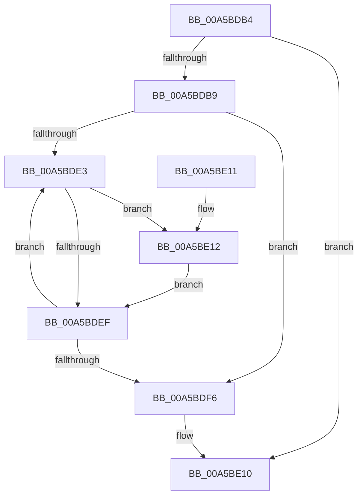

# WdipSemDisableContextProviders

- RVA: `0x00A5BDB4`–`0x00A5BE20` (길이 `108` bytes)
- VA: `0x0000000140A5BDB4`
- 실행 섹션: `PAGE`
- PDB 이름 있음: `예`; PDB Function 태그: `아니요`
- unwind 정보 RVA: `0x000B26B8`
- 디코드: `33`개 명령, `108/108` bytes 표시
- 미해석 바이트: `0` (있으면 어셈블리에 `.byte`로 보존)

> 이 문서는 커널 이미지의 기계어와 PDB 기호를 분석해 생성했습니다. 4번과 5번은 함수 원형과 자료형을 바이너리 사용 방식에서 추정한 C 해석이며 원본 소스 복구 결과는 아닙니다.

## 1. Dependencies

- 직접 호출 지점: **1**; 고유 호출 대상: **1**
- 직접 호출자로 확인된 함수: **2**
- RIP 상대 이미지 참조: **0**

### Outgoing calls
- `0x00A5BE15` → [WdipSemDisableContextProvider](WdipSemDisableContextProvider_function_00A5C184.md) (function, `0x00A5C184`)

### Direct callers
- [WdipTimeoutCheckRoutine](WdipTimeoutCheckRoutine_function_00A5B910.md) at `0x00A5BA34`
- [WdipSemDisableScenario](WdipSemDisableScenario_function_00A5BC00.md) at `0x00A5BCBD`

### Static image references
- 디코드된 RIP-relative 메모리 참조가 없습니다.

## 2. Other-region calls and transfers

- 다른 실행 섹션으로 향하는 call: **0**
- 별도 외부 분기/꼬리 이동을 확인하지 못했습니다.

## 3. Assembly (complete function range)

```asm
00A5BDB4  48 85 C9                        test rcx, rcx
00A5BDB7  74 57                           je 0x140a5be10
00A5BDB9  48 8B C4                        mov rax, rsp
00A5BDBC  48 89 58 08                     mov qword ptr [rax + 8], rbx
00A5BDC0  48 89 68 10                     mov qword ptr [rax + 0x10], rbp
00A5BDC4  48 89 70 18                     mov qword ptr [rax + 0x18], rsi
00A5BDC8  48 89 78 20                     mov qword ptr [rax + 0x20], rdi
00A5BDCC  41 56                           push r14
00A5BDCE  48 83 EC 20                     sub rsp, 0x20
00A5BDD2  48 8B 71 20                     mov rsi, qword ptr [rcx + 0x20]
00A5BDD6  33 DB                           xor ebx, ebx
00A5BDD8  44 8A F2                        mov r14b, dl
00A5BDDB  48 8B F9                        mov rdi, rcx
00A5BDDE  39 5E 30                        cmp dword ptr [rsi + 0x30], ebx
00A5BDE1  76 13                           jbe 0x140a5bdf6
00A5BDE3  83 7C 9F 30 00                  cmp dword ptr [rdi + rbx*4 + 0x30], 0
00A5BDE8  48 8B 4C DE 38                  mov rcx, qword ptr [rsi + rbx*8 + 0x38]
00A5BDED  7D 23                           jge 0x140a5be12
00A5BDEF  FF C3                           inc ebx
00A5BDF1  3B 5E 30                        cmp ebx, dword ptr [rsi + 0x30]
00A5BDF4  72 ED                           jb 0x140a5bde3
00A5BDF6  48 8B 5C 24 30                  mov rbx, qword ptr [rsp + 0x30]
00A5BDFB  48 8B 6C 24 38                  mov rbp, qword ptr [rsp + 0x38]
00A5BE00  48 8B 74 24 40                  mov rsi, qword ptr [rsp + 0x40]
00A5BE05  48 8B 7C 24 48                  mov rdi, qword ptr [rsp + 0x48]
00A5BE0A  48 83 C4 20                     add rsp, 0x20
00A5BE0E  41 5E                           pop r14
00A5BE10  C3                              ret
00A5BE11  CC                              int3
00A5BE12  41 8A D6                        mov dl, r14b
00A5BE15  E8 6A 03 00 00                  call 0x140a5c184
00A5BE1A  89 44 9F 30                     mov dword ptr [rdi + rbx*4 + 0x30], eax
00A5BE1E  EB CF                           jmp 0x140a5bdef
```

## 4. C-style interpretation (structured pseudocode)

```c
__int64 __fastcall WdipSemDisableContextProviders(__int64 a1, unsigned __int8 a2)
{
    __int64 result;
    __int64 v_rbx;
    __int64 v_rsp;
    unsigned __int64 v_stack_p10;
    unsigned __int64 v_stack_p18;
    unsigned __int64 v_stack_p20;
    unsigned __int64 v_stack_p8;

    if (a1 == 0) goto loc_00A5BE10;
    *(unsigned __int64 *)(v_rsp + 8) = v_rbx;
    *(unsigned __int64 *)(v_rsp + 16) = v_rbp;
    *(unsigned __int64 *)(v_rsp + 24) = v_rsi;
    *(unsigned __int64 *)(v_rsp + 32) = v_rdi;
    v_rsp = (v_rsp) - (32);
    v_rbx = 0;
    if ((*(unsigned int *)(*(unsigned __int64 *)(a1 + 32) + 48)) <= 0) goto loc_00A5BDF6;
loc_00A5BDE3:
    if ((*(unsigned int *)(a1 + v_rbx * 4 + 48)) >= 0) goto loc_00A5BE12;
loc_00A5BDEF:
    v_rbx = (unsigned int)((v_rbx) + 1);
    if (((unsigned int)(v_rbx)) < (*(unsigned int *)(*(unsigned __int64 *)(a1 + 32) + 48))) goto loc_00A5BDE3;
loc_00A5BDF6:
    v_rsp = (v_rsp) + (32);
loc_00A5BE10:
    return v_rsp;
loc_00A5BE12:
    result = WdipSemDisableContextProvider(*(unsigned __int64 *)(*(unsigned __int64 *)(a1 + 32) + v_rbx * 8 + 56), a2, a3, a4);
    *(unsigned int *)(v_stack_p20 + v_stack_p8 * 4 + 48) = (unsigned int)(result);
    goto loc_00A5BDEF;
}
```

## 5. (Beta) C Style

```c
int64_t WdipSemDisableContextProviders(int64_t Arg1, uint8_t Arg2)
{
    int64_t result;
    int64_t local_rbx;
    int64_t local_rsp;
    uint64_t v_stack_p10;
    uint64_t v_stack_p18;
    uint64_t v_stack_p20;
    uint64_t v_stack_p8;

    if (Arg1 == 0) goto loc_00A5BE10;
    *(uint64_t *)(local_rsp + 0x8) = local_rbx;
    *(uint64_t *)(local_rsp + 0x10) = local_rbp;
    *(uint64_t *)(local_rsp + 0x18) = local_rsi;
    *(uint64_t *)(local_rsp + 0x20) = local_rdi;
    local_rsp = (local_rsp) - (32);
    local_rbx = 0;
    if ((*(uint32_t *)(*(uint64_t *)(Arg1 + 0x20) + 0x30)) <= 0) goto loc_00A5BDF6;
loc_00A5BDE3:
    if ((*(uint32_t *)(Arg1 + local_rbx * 4 + 0x30)) >= 0) goto loc_00A5BE12;
loc_00A5BDEF:
    local_rbx = (uint32_t)((local_rbx) + 1);
    if (((uint32_t)(local_rbx)) < (*(uint32_t *)(*(uint64_t *)(Arg1 + 0x20) + 0x30))) goto loc_00A5BDE3;
loc_00A5BDF6:
    local_rsp = (local_rsp) + (32);
loc_00A5BE10:
    return local_rsp;
loc_00A5BE12:
    result = WdipSemDisableContextProvider(*(uint64_t *)(*(uint64_t *)(Arg1 + 0x20) + local_rbx * 8 + 0x38), Arg2, a3, a4);
    *(uint32_t *)(v_stack_p20 + v_stack_p8 * 4 + 0x30) = (uint32_t)(result);
    goto loc_00A5BDEF;
}
```

## 6. Execution-region graph

[열기: 2D/3D 그래프와 함수 탐색 컨트롤 패널](../../../control-panel.html?section=page&rva=0x00A5BDB4&view=graph)

- 2D 그래프는 위에서 아래로 흐르고, 3D 그래프는 빈 공간을 드래그해 회전합니다. Shift+드래그는 이동, 휠은 확대·축소, 함수 노드 선택은 대상 보고서 이동입니다.

### Static fallback


