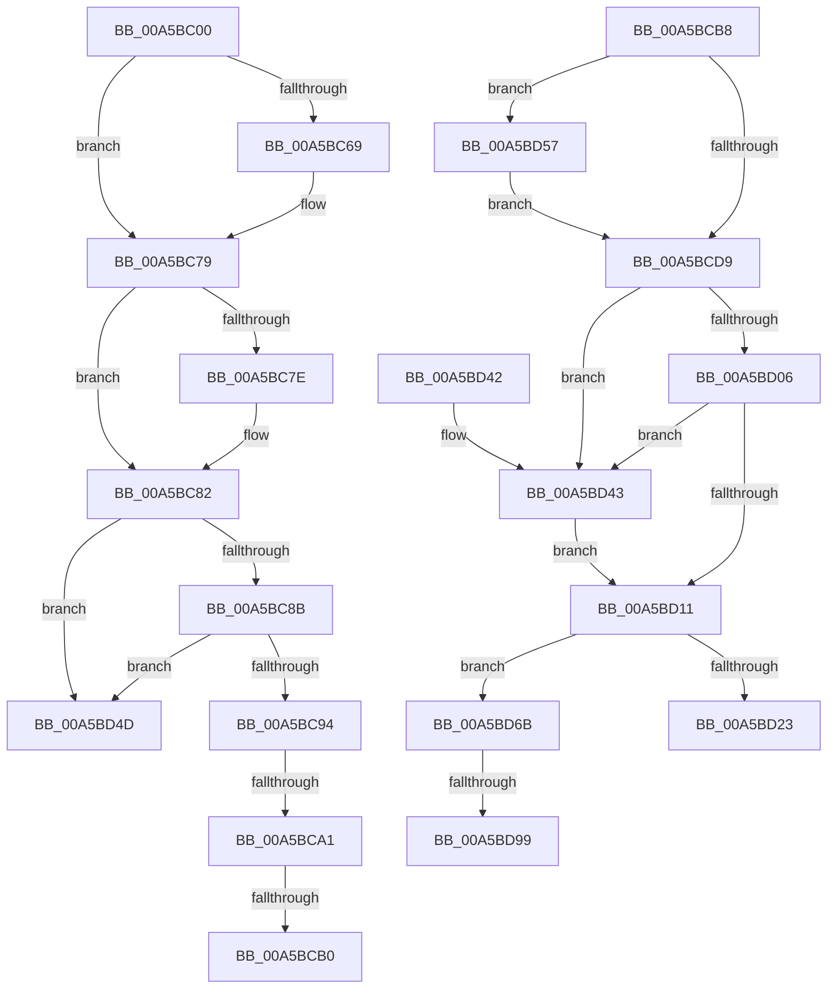

# WdipSemDisableScenario

- RVA: `0x00A5BC00`–`0x00A5BDAD` (길이 `429` bytes)
- VA: `0x0000000140A5BC00`
- 실행 섹션: `PAGE`
- PDB 이름 있음: `예`; PDB Function 태그: `예`
- unwind 정보 RVA: `0x000B2688`
- 디코드: `111`개 명령, `429/429` bytes 표시
- 미해석 바이트: `0` (있으면 어셈블리에 `.byte`로 보존)

> 이 문서는 커널 이미지의 기계어와 PDB 기호를 분석해 생성했습니다. 4번과 5번은 함수 원형과 자료형을 바이너리 사용 방식에서 추정한 C 해석이며 원본 소스 복구 결과는 아닙니다.

## 1. Dependencies

- 직접 호출 지점: **12**; 고유 호출 대상: **11**
- 직접 호출자로 확인된 함수: **2**
- RIP 상대 이미지 참조: **4**

### Outgoing calls
- `0x00A5BC4F` → [KeAbPreAcquire](../../text/21/KeAbPreAcquire_function_00210230.md) (function, `0x00210230`)
- `0x00A5BC74` → [ExfAcquirePushLockSharedEx](../../text/21/ExfAcquirePushLockSharedEx_function_0021044C.md) (function, `0x0021044C`)
- `0x00A5BCA1` → [WdipSemGetLoggerIds](WdipSemGetLoggerIds_function_00A5CBB4.md) (function, `0x00A5CBB4`)
- `0x00A5BCBD` → [WdipSemDisableContextProviders](WdipSemDisableContextProviders_function_00A5BDB4.md) (function, `0x00A5BDB4`)
- `0x00A5BCD0` → [EtwEventEnabled](../../text/39/EtwEventEnabled_function_00392450.md) (function, `0x00392450`)
- `0x00A5BCDC` → [WdipSemDeleteTransitionalInstance](WdipSemDeleteTransitionalInstance_function_00A5BE28.md) (function, `0x00A5BE28`)
- `0x00A5BD14` → [KeAbPostRelease](../../text/2E/KeAbPostRelease_function_002E1600.md) (function, `0x002E1600`)
- `0x00A5BD19` → [KeLeaveCriticalRegion](../../text/25/KeLeaveCriticalRegion_function_0025D8B0.md) (function, `0x0025D8B0`)
- `0x00A5BD46` → [ExfReleasePushLock](../../text/26/ExfReleasePushLock_function_002638D0.md) (function, `0x002638D0`)
- `0x00A5BD61` → [WdipSemWriteSemActionsEvent](../AB/WdipSemWriteSemActionsEvent_function_00ABC618.md) (function, `0x00ABC618`)
- `0x00A5BD84` → [KeAbPreAcquire](../../text/21/KeAbPreAcquire_function_00210230.md) (function, `0x00210230`)
- `0x00A5BDA2` → [ExfAcquirePushLockExclusiveEx](../../text/20/ExfAcquirePushLockExclusiveEx_function_0020FC90.md) (function, `0x0020FC90`)

### Direct callers
- [EtwWriteEndScenario](EtwWriteEndScenario_function_00A5B7F0.md) at `0x00A5B89B`
- [WdipStartEndScenario](WdipStartEndScenario_function_00A5C378.md) at `0x00A5C3CD`

### Static image references
- `0x00A5BC25` → RVA `0x00F01E08` (`.data`; read)
- `0x00A5BC94` → RVA `0x00F01E18` (`.data`; read)
- `0x00A5BCC2` → RVA `0x00F01DD0` (`.data`; read)
- `0x00A5BCC9` → RVA `0x0001A758` (`.rdata`; read)

## 2. Other-region calls and transfers

- 다른 실행 섹션으로 향하는 call: **8**
  - `0x00A5BC4F` → [KeAbPreAcquire](../../text/21/KeAbPreAcquire_function_00210230.md) (`PAGE` → `.text`)
  - `0x00A5BC74` → [ExfAcquirePushLockSharedEx](../../text/21/ExfAcquirePushLockSharedEx_function_0021044C.md) (`PAGE` → `.text`)
  - `0x00A5BCD0` → [EtwEventEnabled](../../text/39/EtwEventEnabled_function_00392450.md) (`PAGE` → `.text`)
  - `0x00A5BD14` → [KeAbPostRelease](../../text/2E/KeAbPostRelease_function_002E1600.md) (`PAGE` → `.text`)
  - `0x00A5BD19` → [KeLeaveCriticalRegion](../../text/25/KeLeaveCriticalRegion_function_0025D8B0.md) (`PAGE` → `.text`)
  - `0x00A5BD46` → [ExfReleasePushLock](../../text/26/ExfReleasePushLock_function_002638D0.md) (`PAGE` → `.text`)
  - `0x00A5BD84` → [KeAbPreAcquire](../../text/21/KeAbPreAcquire_function_00210230.md) (`PAGE` → `.text`)
  - `0x00A5BDA2` → [ExfAcquirePushLockExclusiveEx](../../text/20/ExfAcquirePushLockExclusiveEx_function_0020FC90.md) (`PAGE` → `.text`)
- call이 아닌 외부 분기/꼬리 이동: **6**
  - `0x00A5BC9B` → [sub_00B3DB56](../B3/Unknown_function_00B3DB56.md) (`tail-transfer`)
  - `0x00A5BCAA` → [sub_00B3DB56 + 0x7](../B3/Unknown_function_00B3DB56.md) (`tail-transfer`)
  - `0x00A5BCB3` → [sub_00B3DB56 + 0x31](../B3/Unknown_function_00B3DB56.md) (`tail-transfer`)
  - `0x00A5BD52` → [sub_00B3DB56 + 0x31](../B3/Unknown_function_00B3DB56.md) (`tail-transfer`)
  - `0x00A5BD93` → [sub_00B3DB56 + 0x79](../B3/Unknown_function_00B3DB56.md) (`tail-transfer`)
  - `0x00A5BDA8` → [sub_00B3DB56 + 0x79](../B3/Unknown_function_00B3DB56.md) (`tail-transfer`)

## 3. Assembly (complete function range)

```asm
00A5BC00  48 89 5C 24 08                  mov qword ptr [rsp + 8], rbx
00A5BC05  48 89 6C 24 10                  mov qword ptr [rsp + 0x10], rbp
00A5BC0A  48 89 74 24 18                  mov qword ptr [rsp + 0x18], rsi
00A5BC0F  57                              push rdi
00A5BC10  41 54                           push r12
00A5BC12  41 55                           push r13
00A5BC14  41 56                           push r14
00A5BC16  41 57                           push r15
00A5BC18  48 83 EC 30                     sub rsp, 0x30
00A5BC1C  65 48 8B 04 25 88 01 00 00      mov rax, qword ptr gs:[0x188]
00A5BC25  4C 8D 2D DC 61 4A 00            lea r13, [rip + 0x4a61dc]
00A5BC2C  49 8B E8                        mov rbp, r8
00A5BC2F  44 0F B7 FA                     movzx r15d, dx
00A5BC33  4C 8B F1                        mov r14, rcx
00A5BC36  45 33 E4                        xor r12d, r12d
00A5BC39  45 33 C0                        xor r8d, r8d
00A5BC3C  33 D2                           xor edx, edx
00A5BC3E  66 FF 88 E4 01 00 00            dec word ptr [rax + 0x1e4]
00A5BC45  49 8B CD                        mov rcx, r13
00A5BC48  90                              nop
00A5BC49  41 8B FC                        mov edi, r12d
00A5BC4C  41 8A F4                        mov sil, r12b
00A5BC4F  E8 DC 45 7B FF                  call 0x140210230
00A5BC54  48 8B D8                        mov rbx, rax
00A5BC57  41 8D 4C 24 11                  lea ecx, [r12 + 0x11]
00A5BC5C  33 C0                           xor eax, eax
00A5BC5E  F0 48 0F B1 0D A1 61 4A 00      lock cmpxchg qword ptr [rip + 0x4a61a1], rcx
00A5BC67  74 10                           je 0x140a5bc79
00A5BC69  4D 8B CD                        mov r9, r13
00A5BC6C  4C 8B C3                        mov r8, rbx
00A5BC6F  33 D2                           xor edx, edx
00A5BC71  49 8B CD                        mov rcx, r13
00A5BC74  E8 D3 47 7B FF                  call 0x14021044c
00A5BC79  48 85 DB                        test rbx, rbx
00A5BC7C  74 04                           je 0x140a5bc82
00A5BC7E  C6 43 0A 01                     mov byte ptr [rbx + 0xa], 1
00A5BC82  4D 85 F6                        test r14, r14
00A5BC85  0F 84 C2 00 00 00               je 0x140a5bd4d
00A5BC8B  48 85 ED                        test rbp, rbp
00A5BC8E  0F 84 B9 00 00 00               je 0x140a5bd4d
00A5BC94  44 38 25 7D 61 4A 00            cmp byte ptr [rip + 0x4a617d], r12b
00A5BC9B  0F 84 B5 1E 0E 00               je 0x140b3db56
00A5BCA1  E8 0E 0F 00 00                  call 0x140a5cbb4
00A5BCA6  8B D8                           mov ebx, eax
00A5BCA8  85 C0                           test eax, eax
00A5BCAA  0F 89 AD 1E 0E 00               jns 0x140b3db5d
00A5BCB0  40 B6 01                        mov sil, 1
00A5BCB3  E9 CF 1E 0E 00                  jmp 0x140b3db87
00A5BCB8  33 D2                           xor edx, edx
00A5BCBA  48 8B CF                        mov rcx, rdi
00A5BCBD  E8 F2 00 00 00                  call 0x140a5bdb4
00A5BCC2  48 8B 0D 07 61 4A 00            mov rcx, qword ptr [rip + 0x4a6107]
00A5BCC9  48 8D 15 88 EA 5B FF            lea rdx, [rip - 0xa41578]
00A5BCD0  E8 7B 67 93 FF                  call 0x140392450
00A5BCD5  84 C0                           test al, al
00A5BCD7  75 7E                           jne 0x140a5bd57
00A5BCD9  48 8B CF                        mov rcx, rdi
00A5BCDC  E8 47 01 00 00                  call 0x140a5be28
00A5BCE1  0F 0D 0D 20 61 4A 00            prefetchw byte ptr [rip + 0x4a6120]
00A5BCE8  48 8B 05 19 61 4A 00            mov rax, qword ptr [rip + 0x4a6119]
00A5BCEF  48 8B C8                        mov rcx, rax
00A5BCF2  48 83 E1 F0                     and rcx, 0xfffffffffffffff0
00A5BCF6  48 83 F9 10                     cmp rcx, 0x10
00A5BCFA  48 8D 50 F0                     lea rdx, [rax - 0x10]
00A5BCFE  49 0F 46 D4                     cmovbe rdx, r12
00A5BD02  A8 02                           test al, 2
00A5BD04  75 3D                           jne 0x140a5bd43
00A5BD06  F0 48 0F B1 15 F9 60 4A 00      lock cmpxchg qword ptr [rip + 0x4a60f9], rdx
00A5BD0F  75 32                           jne 0x140a5bd43
00A5BD11  49 8B CD                        mov rcx, r13
00A5BD14  E8 E7 58 88 FF                  call 0x1402e1600
00A5BD19  E8 92 1B 80 FF                  call 0x14025d8b0
00A5BD1E  40 84 F6                        test sil, sil
00A5BD21  75 48                           jne 0x140a5bd6b
00A5BD23  48 8B 6C 24 68                  mov rbp, qword ptr [rsp + 0x68]
00A5BD28  8B C3                           mov eax, ebx
00A5BD2A  48 8B 5C 24 60                  mov rbx, qword ptr [rsp + 0x60]
00A5BD2F  48 8B 74 24 70                  mov rsi, qword ptr [rsp + 0x70]
00A5BD34  48 83 C4 30                     add rsp, 0x30
00A5BD38  41 5F                           pop r15
00A5BD3A  41 5E                           pop r14
00A5BD3C  41 5D                           pop r13
00A5BD3E  41 5C                           pop r12
00A5BD40  5F                              pop rdi
00A5BD41  C3                              ret
00A5BD42  CC                              int3
00A5BD43  49 8B CD                        mov rcx, r13
00A5BD46  E8 85 7B 80 FF                  call 0x1402638d0
00A5BD4B  EB C4                           jmp 0x140a5bd11
00A5BD4D  BB 0D 00 00 C0                  mov ebx, 0xc000000d
00A5BD52  E9 30 1E 0E 00                  jmp 0x140b3db87
00A5BD57  48 8B D7                        mov rdx, rdi
00A5BD5A  48 8D 0D F7 E9 5B FF            lea rcx, [rip - 0xa41609]
00A5BD61  E8 B2 08 06 00                  call 0x140abc618
00A5BD66  E9 6E FF FF FF                  jmp 0x140a5bcd9
00A5BD6B  65 48 8B 04 25 88 01 00 00      mov rax, qword ptr gs:[0x188]
00A5BD74  45 33 C0                        xor r8d, r8d
00A5BD77  33 D2                           xor edx, edx
00A5BD79  49 8B CD                        mov rcx, r13
00A5BD7C  66 FF 88 E4 01 00 00            dec word ptr [rax + 0x1e4]
00A5BD83  90                              nop
00A5BD84  E8 A7 44 7B FF                  call 0x140210230
00A5BD89  F0 49 0F BA 6D 00 00            lock bts qword ptr [r13], 0
00A5BD90  48 8B F8                        mov rdi, rax
00A5BD93  0F 83 36 1E 0E 00               jae 0x140b3dbcf
00A5BD99  4D 8B C5                        mov r8, r13
00A5BD9C  48 8B D0                        mov rdx, rax
00A5BD9F  49 8B CD                        mov rcx, r13
00A5BDA2  E8 E9 3E 7B FF                  call 0x14020fc90
00A5BDA7  90                              nop
00A5BDA8  E9 22 1E 0E 00                  jmp 0x140b3dbcf
```

## 4. C-style interpretation (structured pseudocode)

```c
__int64 __fastcall WdipSemDisableScenario(__int64 a1, int a2, __int64 a3)
{
    __int64 result;
    __int64 v_r12;
    __int64 v_rsp;
    unsigned __int64 v_stack_p10;
    unsigned __int64 v_stack_p18;
    unsigned __int64 v_stack_p8;

    v_stack_p8 = v_rbx;
    v_stack_p10 = v_rbp;
    v_stack_p18 = v_rsi;
    v_rsp = (v_rsp) - (48);
    v_r12 = 0;
    a3 = 0;
    a2 = 0;
    result = KeAbPreAcquire(v_rip + 4874716, a2, a3, a4);
    result = 0;
    if (!(condition_is_equal)) {
        a4 = v_rip + 4874716;
        a3 = 0;
        a2 = 0;
        a1 = v_rip + 4874716;
        result = ExfAcquirePushLockSharedEx(a1, a2, a3, a4);
    }
    if (result != 0) {
        *(unsigned __int8 *)(result + 10) = 1;
    }
    if (a1 == 0) goto loc_00A5BD4D;
    if (a3 == 0) goto loc_00A5BD4D;
    result = WdipSemGetLoggerIds(a1, a2, a3, a4);
loc_00A5BD4D:
}
```

## 5. (Beta) C Style

```c
int64_t WdipSemDisableScenario(int64_t Arg1, int32_t Arg2, int64_t Arg3)
{
    int64_t result;
    int64_t local_r12;
    int64_t local_rsp;
    uint64_t v_stack_p10;
    uint64_t v_stack_p18;
    uint64_t v_stack_p8;

    v_stack_p8 = local_rbx;
    v_stack_p10 = local_rbp;
    v_stack_p18 = local_rsi;
    local_rsp = (local_rsp) - (48);
    local_r12 = 0;
    Arg3 = 0;
    Arg2 = 0;
    result = KeAbPreAcquire(v_rip + 4874716, Arg2, Arg3, a4);
    result = 0;
    if (!(condition_is_equal)) {
        a4 = v_rip + 4874716;
        Arg3 = 0;
        Arg2 = 0;
        Arg1 = v_rip + 4874716;
        result = ExfAcquirePushLockSharedEx(Arg1, Arg2, Arg3, a4);
    }
    if (result != 0) {
        *(uint8_t *)(result + 0xA) = 1;
    }
    if (Arg1 == 0) goto loc_00A5BD4D;
    if (Arg3 == 0) goto loc_00A5BD4D;
    result = WdipSemGetLoggerIds(Arg1, Arg2, Arg3, a4);
loc_00A5BD4D:
}
```

## 6. Execution-region graph

[열기: 2D/3D 그래프와 함수 탐색 컨트롤 패널](../../../control-panel.html?section=page&rva=0x00A5BC00&view=graph)

- 2D 그래프는 위에서 아래로 흐르고, 3D 그래프는 빈 공간을 드래그해 회전합니다. Shift+드래그는 이동, 휠은 확대·축소, 함수 노드 선택은 대상 보고서 이동입니다.

### Static fallback


