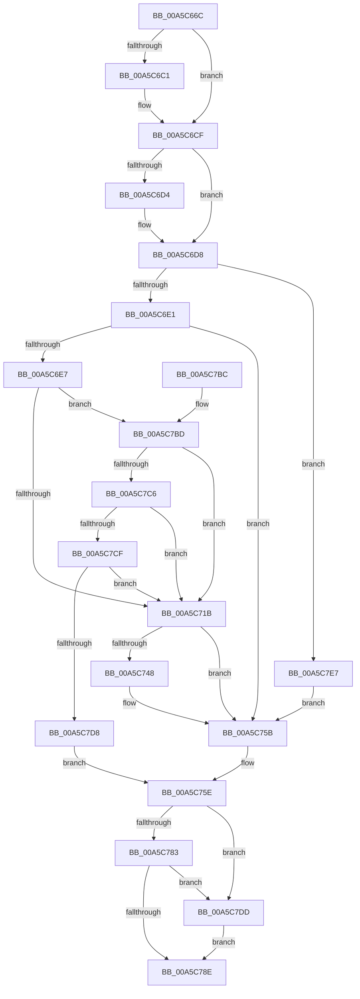

# WdipSemEnableContextProvider

- RVA: `0x00A5C66C`–`0x00A5C7F1` (길이 `389` bytes)
- VA: `0x0000000140A5C66C`
- 실행 섹션: `PAGE`
- PDB 이름 있음: `예`; PDB Function 태그: `아니요`
- unwind 정보 RVA: `0x000B2774`
- 디코드: `103`개 명령, `389/389` bytes 표시
- 미해석 바이트: `0` (있으면 어셈블리에 `.byte`로 보존)

> 이 문서는 커널 이미지의 기계어와 PDB 기호를 분석해 생성했습니다. 4번과 5번은 함수 원형과 자료형을 바이너리 사용 방식에서 추정한 C 해석이며 원본 소스 복구 결과는 아닙니다.

## 1. Dependencies

- 직접 호출 지점: **6**; 고유 호출 대상: **6**
- 직접 호출자로 확인된 함수: **1**
- RIP 상대 이미지 참조: **3**

### Outgoing calls
- `0x00A5C6B0` → [KeAbPreAcquire](../../text/21/KeAbPreAcquire_function_00210230.md) (function, `0x00210230`)
- `0x00A5C6CA` → [ExfAcquirePushLockExclusiveEx](../../text/20/ExfAcquirePushLockExclusiveEx_function_0020FC90.md) (function, `0x0020FC90`)
- `0x00A5C73D` → [WdipSemEnableDisableTrace](WdipSemEnableDisableTrace_function_00A5C7F8.md) (function, `0x00A5C7F8`)
- `0x00A5C791` → [KeAbPostRelease](../../text/2E/KeAbPostRelease_function_002E1600.md) (function, `0x002E1600`)
- `0x00A5C796` → [KeLeaveCriticalRegion](../../text/25/KeLeaveCriticalRegion_function_0025D8B0.md) (function, `0x0025D8B0`)
- `0x00A5C7E0` → [ExfReleasePushLock](../../text/26/ExfReleasePushLock_function_002638D0.md) (function, `0x002638D0`)

### Direct callers
- [WdipSemEnableContextProviders](WdipSemEnableContextProviders_function_00A5C610.md) at `0x00A5C63E`

### Static image references
- `0x00A5C68B` → RVA `0x00F01DC8` (`.data`; read)
- `0x00A5C71B` → RVA `0x00F02454` (`.data`; read)
- `0x00A5C724` → RVA `0x00F02454` (`.data`; read/write)

## 2. Other-region calls and transfers

- 다른 실행 섹션으로 향하는 call: **5**
  - `0x00A5C6B0` → [KeAbPreAcquire](../../text/21/KeAbPreAcquire_function_00210230.md) (`PAGE` → `.text`)
  - `0x00A5C6CA` → [ExfAcquirePushLockExclusiveEx](../../text/20/ExfAcquirePushLockExclusiveEx_function_0020FC90.md) (`PAGE` → `.text`)
  - `0x00A5C791` → [KeAbPostRelease](../../text/2E/KeAbPostRelease_function_002E1600.md) (`PAGE` → `.text`)
  - `0x00A5C796` → [KeLeaveCriticalRegion](../../text/25/KeLeaveCriticalRegion_function_0025D8B0.md) (`PAGE` → `.text`)
  - `0x00A5C7E0` → [ExfReleasePushLock](../../text/26/ExfReleasePushLock_function_002638D0.md) (`PAGE` → `.text`)
- 별도 외부 분기/꼬리 이동을 확인하지 못했습니다.

## 3. Assembly (complete function range)

```asm
00A5C66C  48 8B C4                        mov rax, rsp
00A5C66F  48 89 58 08                     mov qword ptr [rax + 8], rbx
00A5C673  48 89 68 10                     mov qword ptr [rax + 0x10], rbp
00A5C677  48 89 70 18                     mov qword ptr [rax + 0x18], rsi
00A5C67B  48 89 78 20                     mov qword ptr [rax + 0x20], rdi
00A5C67F  41 54                           push r12
00A5C681  41 56                           push r14
00A5C683  41 57                           push r15
00A5C685  48 83 EC 30                     sub rsp, 0x30
00A5C689  33 C0                           xor eax, eax
00A5C68B  4C 8D 25 36 57 4A 00            lea r12, [rip + 0x4a5736]
00A5C692  8B F0                           mov esi, eax
00A5C694  48 8B F9                        mov rdi, rcx
00A5C697  65 48 8B 04 25 88 01 00 00      mov rax, qword ptr gs:[0x188]
00A5C6A0  45 33 C0                        xor r8d, r8d
00A5C6A3  33 D2                           xor edx, edx
00A5C6A5  49 8B CC                        mov rcx, r12
00A5C6A8  66 FF 88 E4 01 00 00            dec word ptr [rax + 0x1e4]
00A5C6AF  90                              nop
00A5C6B0  E8 7B 3B 7B FF                  call 0x140210230
00A5C6B5  F0 49 0F BA 2C 24 00            lock bts qword ptr [r12], 0
00A5C6BC  48 8B D8                        mov rbx, rax
00A5C6BF  73 0E                           jae 0x140a5c6cf
00A5C6C1  4D 8B C4                        mov r8, r12
00A5C6C4  48 8B D0                        mov rdx, rax
00A5C6C7  49 8B CC                        mov rcx, r12
00A5C6CA  E8 C1 35 7B FF                  call 0x14020fc90
00A5C6CF  48 85 DB                        test rbx, rbx
00A5C6D2  74 04                           je 0x140a5c6d8
00A5C6D4  C6 43 0A 01                     mov byte ptr [rbx + 0xa], 1
00A5C6D8  48 85 FF                        test rdi, rdi
00A5C6DB  0F 84 06 01 00 00               je 0x140a5c7e7
00A5C6E1  83 7F 20 01                     cmp dword ptr [rdi + 0x20], 1
00A5C6E5  74 74                           je 0x140a5c75b
00A5C6E7  48 8B 5F 28                     mov rbx, qword ptr [rdi + 0x28]
00A5C6EB  0F B6 6F 12                     movzx ebp, byte ptr [rdi + 0x12]
00A5C6EF  0F B6 43 30                     movzx eax, byte ptr [rbx + 0x30]
00A5C6F3  48 8B 4B 38                     mov rcx, qword ptr [rbx + 0x38]
00A5C6F7  40 3A E8                        cmp bpl, al
00A5C6FA  8B 53 40                        mov edx, dword ptr [rbx + 0x40]
00A5C6FD  4C 8B F9                        mov r15, rcx
00A5C700  0F 46 E8                        cmovbe ebp, eax
00A5C703  44 8B F2                        mov r14d, edx
00A5C706  4C 0B 7F 18                     or r15, qword ptr [rdi + 0x18]
00A5C70A  45 33 C0                        xor r8d, r8d
00A5C70D  44 0B 77 24                     or r14d, dword ptr [rdi + 0x24]
00A5C711  44 38 43 45                     cmp byte ptr [rbx + 0x45], r8b
00A5C715  0F 85 A2 00 00 00               jne 0x140a5c7bd
00A5C71B  8B 0D 33 5D 4A 00               mov ecx, dword ptr [rip + 0x4a5d33]
00A5C721  4D 8B CF                        mov r9, r15
00A5C724  87 0D 2A 5D 4A 00               xchg dword ptr [rip + 0x4a5d2a], ecx
00A5C72A  C7 44 24 28 01 00 00 00         mov dword ptr [rsp + 0x28], 1
00A5C732  44 8A C5                        mov r8b, bpl
00A5C735  48 8B D7                        mov rdx, rdi
00A5C738  44 89 74 24 20                  mov dword ptr [rsp + 0x20], r14d
00A5C73D  E8 B6 00 00 00                  call 0x140a5c7f8
00A5C742  8B F0                           mov esi, eax
00A5C744  85 C0                           test eax, eax
00A5C746  78 13                           js 0x140a5c75b
00A5C748  FF 43 48                        inc dword ptr [rbx + 0x48]
00A5C74B  C6 43 45 01                     mov byte ptr [rbx + 0x45], 1
00A5C74F  4C 89 7B 38                     mov qword ptr [rbx + 0x38], r15
00A5C753  40 88 6B 30                     mov byte ptr [rbx + 0x30], bpl
00A5C757  44 89 73 40                     mov dword ptr [rbx + 0x40], r14d
00A5C75B  45 33 C0                        xor r8d, r8d
00A5C75E  0F 0D 0D 63 56 4A 00            prefetchw byte ptr [rip + 0x4a5663]
00A5C765  48 8B 05 5C 56 4A 00            mov rax, qword ptr [rip + 0x4a565c]
00A5C76C  48 8B C8                        mov rcx, rax
00A5C76F  48 83 E1 F0                     and rcx, 0xfffffffffffffff0
00A5C773  48 83 F9 10                     cmp rcx, 0x10
00A5C777  48 8D 50 F0                     lea rdx, [rax - 0x10]
00A5C77B  49 0F 46 D0                     cmovbe rdx, r8
00A5C77F  A8 02                           test al, 2
00A5C781  75 5A                           jne 0x140a5c7dd
00A5C783  F0 48 0F B1 15 3C 56 4A 00      lock cmpxchg qword ptr [rip + 0x4a563c], rdx
00A5C78C  75 4F                           jne 0x140a5c7dd
00A5C78E  49 8B CC                        mov rcx, r12
00A5C791  E8 6A 4E 88 FF                  call 0x1402e1600
00A5C796  E8 15 11 80 FF                  call 0x14025d8b0
00A5C79B  48 8B 5C 24 50                  mov rbx, qword ptr [rsp + 0x50]
00A5C7A0  8B C6                           mov eax, esi
00A5C7A2  48 8B 74 24 60                  mov rsi, qword ptr [rsp + 0x60]
00A5C7A7  48 8B 6C 24 58                  mov rbp, qword ptr [rsp + 0x58]
00A5C7AC  48 8B 7C 24 68                  mov rdi, qword ptr [rsp + 0x68]
00A5C7B1  48 83 C4 30                     add rsp, 0x30
00A5C7B5  41 5F                           pop r15
00A5C7B7  41 5E                           pop r14
00A5C7B9  41 5C                           pop r12
00A5C7BB  C3                              ret
00A5C7BC  CC                              int3
00A5C7BD  4C 3B F9                        cmp r15, rcx
00A5C7C0  0F 85 55 FF FF FF               jne 0x140a5c71b
00A5C7C6  40 3A E8                        cmp bpl, al
00A5C7C9  0F 85 4C FF FF FF               jne 0x140a5c71b
00A5C7CF  44 3B F2                        cmp r14d, edx
00A5C7D2  0F 85 43 FF FF FF               jne 0x140a5c71b
00A5C7D8  FF 43 48                        inc dword ptr [rbx + 0x48]
00A5C7DB  EB 81                           jmp 0x140a5c75e
00A5C7DD  49 8B CC                        mov rcx, r12
00A5C7E0  E8 EB 70 80 FF                  call 0x1402638d0
00A5C7E5  EB A7                           jmp 0x140a5c78e
00A5C7E7  BE 0D 00 00 C0                  mov esi, 0xc000000d
00A5C7EC  E9 6A FF FF FF                  jmp 0x140a5c75b
```

## 4. C-style interpretation (structured pseudocode)

```c
__int64 __fastcall WdipSemEnableContextProvider(__int64 a1, int a2, int a3)
{
    __int64 result;
    __int64 v_r14;
    __int64 v_r15;
    __int64 v_rbp;
    __int64 v_rsp;
    unsigned int v_stack_m20;
    unsigned int v_stack_m28;
    unsigned __int64 v_stack_p10;
    unsigned __int64 v_stack_p18;
    unsigned __int64 v_stack_p20;
    unsigned __int64 v_stack_p8;

    *(unsigned __int64 *)(v_rsp + 8) = v_rbx;
    *(unsigned __int64 *)(v_rsp + 16) = v_rbp;
    *(unsigned __int64 *)(v_rsp + 24) = v_rsi;
    *(unsigned __int64 *)(v_rsp + 32) = v_rdi;
    v_rsp = (v_rsp) - (48);
    result = 0;
    a3 = 0;
    a2 = 0;
    result = KeAbPreAcquire(v_rip + 4871990, a2, a3, a4);
    if (!(condition_is_above_or_equal)) {
        a3 = v_rip + 4871990;
        a2 = result;
        a1 = v_rip + 4871990;
        result = ExfAcquirePushLockExclusiveEx(a1, a2, a3, a4);
    }
    if (result != 0) {
        *(unsigned __int8 *)(result + 10) = 1;
    }
    if (a1 == 0) goto loc_00A5C7E7;
    if ((*(unsigned int *)(a1 + 32)) == 1) goto loc_00A5C75B;
    v_rbp = *(unsigned __int8 *)(a1 + 18);
    if (((unsigned __int8)(*(unsigned __int8 *)(a1 + 18))) <= ((unsigned __int8)(*(unsigned __int8 *)(*(unsigned __int64 *)(a1 + 40) + 48)))) { v_rbp = (unsigned int)(*(unsigned __int8 *)(*(unsigned __int64 *)(a1 + 40) + 48)); }
    v_r15 = (*(unsigned __int64 *)(*(unsigned __int64 *)(a1 + 40) + 56)) | (*(unsigned __int64 *)(a1 + 24));
    a3 = 0;
    v_r14 = (unsigned int)(((unsigned int)((unsigned int)((unsigned int)(*(unsigned int *)(*(unsigned __int64 *)(a1 + 40) + 64))))) | (*(unsigned int *)(a1 + 36)));
    if ((*(unsigned __int8 *)(*(unsigned __int64 *)(a1 + 40) + 69)) != 0) goto loc_00A5C7BD;
loc_00A5C71B:
    v_stack_m20 = 1;
    v_stack_m28 = (unsigned int)(v_r14);
    result = WdipSemEnableDisableTrace((unsigned int)(*(unsigned int *)(v_rip + 4873523)), a1, (unsigned __int8)(v_rbp), v_r15);
    if (!(sign_flag)) {
        *(unsigned __int8 *)(*(unsigned __int64 *)(a1 + 40) + 69) = 1;
        *(unsigned __int64 *)(*(unsigned __int64 *)(a1 + 40) + 56) = v_r15;
        *(unsigned __int8 *)(*(unsigned __int64 *)(a1 + 40) + 48) = (unsigned __int8)(v_rbp);
        *(unsigned int *)(*(unsigned __int64 *)(a1 + 40) + 64) = (unsigned int)(v_r14);
    }
    a3 = 0;
loc_00A5C75E:
    a1 = (*(unsigned __int64 *)(v_rip + 4871772)) & (-16);
    a2 = *(unsigned __int64 *)(v_rip + 4871772) - 16;
    if (a1 <= 16) { a2 = 0; }
    if ((((unsigned __int8)(*(unsigned __int64 *)(v_rip + 4871772))) & (2)) != 0) goto loc_00A5C7DD;
    if ((((unsigned __int8)(*(unsigned __int64 *)(v_rip + 4871772))) & (2)) != 0) goto loc_00A5C7DD;
loc_00A5C78E:
    result = KeAbPostRelease(v_rip + 4871990, a2, a3, v_r15);
    result = KeLeaveCriticalRegion(v_rip + 4871990, a2, a3, v_r15);
    v_rsp = (v_rsp) + (48);
    return (unsigned int)((unsigned int)((unsigned int)((unsigned int)(result))));
loc_00A5C7BD:
    if (v_r15 != (v_rip + 4871990)) goto loc_00A5C71B;
    if (((unsigned __int8)(v_stack_p10)) != ((unsigned __int8)((unsigned int)((unsigned int)((unsigned int)((unsigned int)(result))))))) goto loc_00A5C71B;
    if (((unsigned int)(v_r14)) != a2) goto loc_00A5C71B;
    goto loc_00A5C75E;
loc_00A5C7DD:
    result = ExfReleasePushLock(v_rip + 4871990, a2, a3, v_r15);
    goto loc_00A5C78E;
loc_00A5C7E7:
    goto loc_00A5C75B;
}
```

## 5. (Beta) C Style

```c
int64_t WdipSemEnableContextProvider(int64_t Arg1, int32_t Arg2, int32_t Arg3)
{
    int64_t result;
    int64_t local_r14;
    int64_t local_r15;
    int64_t local_rbp;
    int64_t local_rsp;
    uint32_t v_stack_m20;
    uint32_t v_stack_m28;
    uint64_t v_stack_p10;
    uint64_t v_stack_p18;
    uint64_t v_stack_p20;
    uint64_t v_stack_p8;

    *(uint64_t *)(local_rsp + 0x8) = local_rbx;
    *(uint64_t *)(local_rsp + 0x10) = local_rbp;
    *(uint64_t *)(local_rsp + 0x18) = local_rsi;
    *(uint64_t *)(local_rsp + 0x20) = local_rdi;
    local_rsp = (local_rsp) - (48);
    result = 0;
    Arg3 = 0;
    Arg2 = 0;
    result = KeAbPreAcquire(v_rip + 4871990, Arg2, Arg3, a4);
    if (!(condition_is_above_or_equal)) {
        Arg3 = v_rip + 4871990;
        Arg2 = result;
        Arg1 = v_rip + 4871990;
        result = ExfAcquirePushLockExclusiveEx(Arg1, Arg2, Arg3, a4);
    }
    if (result != 0) {
        *(uint8_t *)(result + 0xA) = 1;
    }
    if (Arg1 == 0) goto loc_00A5C7E7;
    if ((*(uint32_t *)(Arg1 + 0x20)) == 1) goto loc_00A5C75B;
    local_rbp = *(uint8_t *)(Arg1 + 0x12);
    if (((uint8_t)(*(uint8_t *)(Arg1 + 0x12))) <= ((uint8_t)(*(uint8_t *)(*(uint64_t *)(Arg1 + 0x28) + 0x30)))) { local_rbp = (uint32_t)(*(uint8_t *)(*(uint64_t *)(Arg1 + 0x28) + 0x30)); }
    local_r15 = (*(uint64_t *)(*(uint64_t *)(Arg1 + 0x28) + 0x38)) | (*(uint64_t *)(Arg1 + 0x18));
    Arg3 = 0;
    local_r14 = (uint32_t)(((uint32_t)((uint32_t)((uint32_t)(*(uint32_t *)(*(uint64_t *)(Arg1 + 0x28) + 0x40))))) | (*(uint32_t *)(Arg1 + 0x24)));
    if ((*(uint8_t *)(*(uint64_t *)(Arg1 + 0x28) + 0x45)) != 0) goto loc_00A5C7BD;
loc_00A5C71B:
    v_stack_m20 = 1;
    v_stack_m28 = (uint32_t)(local_r14);
    result = WdipSemEnableDisableTrace((uint32_t)(*(uint32_t *)(v_rip + 0x4A5D33)), Arg1, (uint8_t)(local_rbp), local_r15);
    if (!(sign_flag)) {
        *(uint8_t *)(*(uint64_t *)(Arg1 + 0x28) + 0x45) = 1;
        *(uint64_t *)(*(uint64_t *)(Arg1 + 0x28) + 0x38) = local_r15;
        *(uint8_t *)(*(uint64_t *)(Arg1 + 0x28) + 0x30) = (uint8_t)(local_rbp);
        *(uint32_t *)(*(uint64_t *)(Arg1 + 0x28) + 0x40) = (uint32_t)(local_r14);
    }
    Arg3 = 0;
loc_00A5C75E:
    Arg1 = (*(uint64_t *)(v_rip + 0x4A565C)) & (-16);
    Arg2 = *(uint64_t *)(v_rip + 0x4A565C) - 16;
    if (Arg1 <= 16) { Arg2 = 0; }
    if ((((uint8_t)(*(uint64_t *)(v_rip + 0x4A565C))) & (2)) != 0) goto loc_00A5C7DD;
    if ((((uint8_t)(*(uint64_t *)(v_rip + 0x4A565C))) & (2)) != 0) goto loc_00A5C7DD;
loc_00A5C78E:
    result = KeAbPostRelease(v_rip + 4871990, Arg2, Arg3, local_r15);
    result = KeLeaveCriticalRegion(v_rip + 4871990, Arg2, Arg3, local_r15);
    local_rsp = (local_rsp) + (48);
    return (uint32_t)((uint32_t)((uint32_t)((uint32_t)(result))));
loc_00A5C7BD:
    if (local_r15 != (v_rip + 4871990)) goto loc_00A5C71B;
    if (((uint8_t)(v_stack_p10)) != ((uint8_t)((uint32_t)((uint32_t)((uint32_t)((uint32_t)(result))))))) goto loc_00A5C71B;
    if (((uint32_t)(local_r14)) != Arg2) goto loc_00A5C71B;
    goto loc_00A5C75E;
loc_00A5C7DD:
    result = ExfReleasePushLock(v_rip + 4871990, Arg2, Arg3, local_r15);
    goto loc_00A5C78E;
loc_00A5C7E7:
    goto loc_00A5C75B;
}
```

## 6. Execution-region graph

[열기: 2D/3D 그래프와 함수 탐색 컨트롤 패널](../../../control-panel.html?section=page&rva=0x00A5C66C&view=graph)

- 2D 그래프는 위에서 아래로 흐르고, 3D 그래프는 빈 공간을 드래그해 회전합니다. Shift+드래그는 이동, 휠은 확대·축소, 함수 노드 선택은 대상 보고서 이동입니다.

### Static fallback


