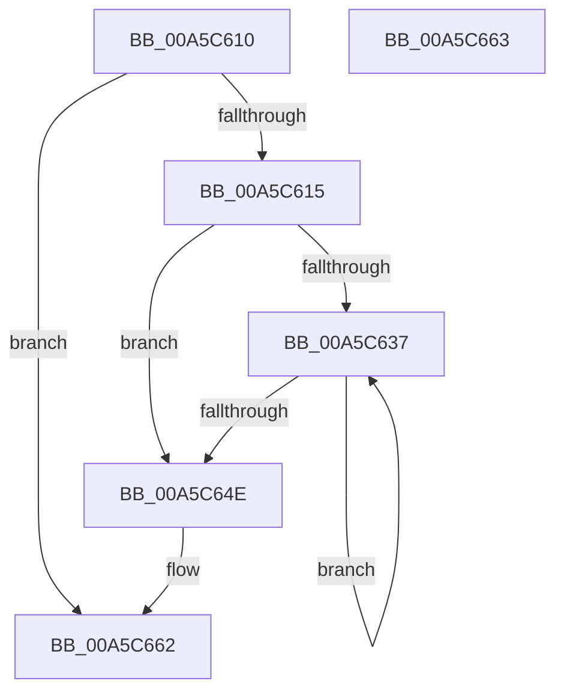

# WdipSemEnableContextProviders

- RVA: `0x00A5C610`–`0x00A5C664` (길이 `84` bytes)
- VA: `0x0000000140A5C610`
- 실행 섹션: `PAGE`
- PDB 이름 있음: `예`; PDB Function 태그: `아니요`
- unwind 정보 RVA: `0x000926AC`
- 디코드: `26`개 명령, `84/84` bytes 표시
- 미해석 바이트: `0` (있으면 어셈블리에 `.byte`로 보존)

> 이 문서는 커널 이미지의 기계어와 PDB 기호를 분석해 생성했습니다. 4번과 5번은 함수 원형과 자료형을 바이너리 사용 방식에서 추정한 C 해석이며 원본 소스 복구 결과는 아닙니다.

## 1. Dependencies

- 직접 호출 지점: **1**; 고유 호출 대상: **1**
- 직접 호출자로 확인된 함수: **1**
- RIP 상대 이미지 참조: **0**

### Outgoing calls
- `0x00A5C63E` → [WdipSemEnableContextProvider](WdipSemEnableContextProvider_function_00A5C66C.md) (function, `0x00A5C66C`)

### Direct callers
- [WdipSemEnableScenario](WdipSemEnableScenario_function_00A5C424.md) at `0x00A5C503`

### Static image references
- 디코드된 RIP-relative 메모리 참조가 없습니다.

## 2. Other-region calls and transfers

- 다른 실행 섹션으로 향하는 call: **0**
- 별도 외부 분기/꼬리 이동을 확인하지 못했습니다.

## 3. Assembly (complete function range)

```asm
00A5C610  48 85 C9                        test rcx, rcx
00A5C613  74 4D                           je 0x140a5c662
00A5C615  48 89 5C 24 08                  mov qword ptr [rsp + 8], rbx
00A5C61A  48 89 6C 24 10                  mov qword ptr [rsp + 0x10], rbp
00A5C61F  48 89 74 24 18                  mov qword ptr [rsp + 0x18], rsi
00A5C624  57                              push rdi
00A5C625  48 83 EC 20                     sub rsp, 0x20
00A5C629  48 8B 69 20                     mov rbp, qword ptr [rcx + 0x20]
00A5C62D  33 FF                           xor edi, edi
00A5C62F  48 8B F1                        mov rsi, rcx
00A5C632  39 7D 30                        cmp dword ptr [rbp + 0x30], edi
00A5C635  76 17                           jbe 0x140a5c64e
00A5C637  8B DF                           mov ebx, edi
00A5C639  48 8B 4C DD 38                  mov rcx, qword ptr [rbp + rbx*8 + 0x38]
00A5C63E  E8 29 00 00 00                  call 0x140a5c66c
00A5C643  FF C7                           inc edi
00A5C645  89 44 9E 30                     mov dword ptr [rsi + rbx*4 + 0x30], eax
00A5C649  3B 7D 30                        cmp edi, dword ptr [rbp + 0x30]
00A5C64C  72 E9                           jb 0x140a5c637
00A5C64E  48 8B 5C 24 30                  mov rbx, qword ptr [rsp + 0x30]
00A5C653  48 8B 6C 24 38                  mov rbp, qword ptr [rsp + 0x38]
00A5C658  48 8B 74 24 40                  mov rsi, qword ptr [rsp + 0x40]
00A5C65D  48 83 C4 20                     add rsp, 0x20
00A5C661  5F                              pop rdi
00A5C662  C3                              ret
00A5C663  CC                              int3
```

## 4. C-style interpretation (structured pseudocode)

```c
__int64 __fastcall WdipSemEnableContextProviders(__int64 a1)
{
    __int64 result;
    __int64 v_rdi;
    __int64 v_rsp;
    unsigned __int64 v_stack_p10;
    unsigned __int64 v_stack_p18;
    unsigned __int64 v_stack_p8;

    if (a1 == 0) goto loc_00A5C662;
    v_stack_p8 = v_rbx;
    v_stack_p10 = v_rbp;
    v_stack_p18 = v_rsi;
    v_rsp = (v_rsp) - (32);
    v_rdi = 0;
    if ((*(unsigned int *)(*(unsigned __int64 *)(a1 + 32) + 48)) <= 0) goto loc_00A5C64E;
loc_00A5C637:
    result = WdipSemEnableContextProvider(*(unsigned __int64 *)(*(unsigned __int64 *)(a1 + 32) + 0 * 8 + 56), a2, a3, a4);
    v_rdi = (unsigned int)((v_rdi) + 1);
    *(unsigned int *)(a1 + 0 * 4 + 48) = (unsigned int)(result);
    if (((unsigned int)(v_rdi)) < (*(unsigned int *)(*(unsigned __int64 *)(a1 + 32) + 48))) goto loc_00A5C637;
loc_00A5C64E:
    v_rsp = (v_rsp) + (32);
loc_00A5C662:
    return result;
}
```

## 5. (Beta) C Style

```c
int64_t WdipSemEnableContextProviders(int64_t Arg1)
{
    int64_t result;
    int64_t local_rdi;
    int64_t local_rsp;
    uint64_t v_stack_p10;
    uint64_t v_stack_p18;
    uint64_t v_stack_p8;

    if (Arg1 == 0) goto loc_00A5C662;
    v_stack_p8 = local_rbx;
    v_stack_p10 = local_rbp;
    v_stack_p18 = local_rsi;
    local_rsp = (local_rsp) - (32);
    local_rdi = 0;
    if ((*(uint32_t *)(*(uint64_t *)(Arg1 + 0x20) + 0x30)) <= 0) goto loc_00A5C64E;
loc_00A5C637:
    result = WdipSemEnableContextProvider(*(uint64_t *)(*(uint64_t *)(Arg1 + 0x20) + 0x0 * 8 + 0x38), a2, a3, a4);
    local_rdi = (uint32_t)((local_rdi) + 1);
    *(uint32_t *)(Arg1 + 0x0 * 4 + 0x30) = (uint32_t)(result);
    if (((uint32_t)(local_rdi)) < (*(uint32_t *)(*(uint64_t *)(Arg1 + 0x20) + 0x30))) goto loc_00A5C637;
loc_00A5C64E:
    local_rsp = (local_rsp) + (32);
loc_00A5C662:
    return result;
}
```

## 6. Execution-region graph

[열기: 2D/3D 그래프와 함수 탐색 컨트롤 패널](../../../control-panel.html?section=page&rva=0x00A5C610&view=graph)

- 2D 그래프는 위에서 아래로 흐르고, 3D 그래프는 빈 공간을 드래그해 회전합니다. Shift+드래그는 이동, 휠은 확대·축소, 함수 노드 선택은 대상 보고서 이동입니다.

### Static fallback


