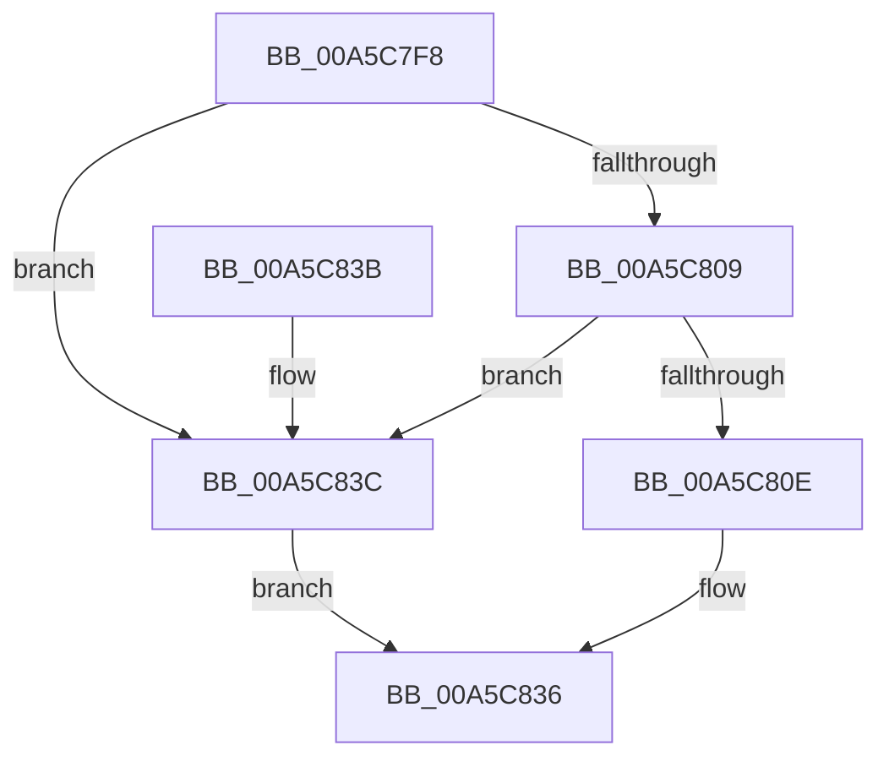

# WdipSemEnableDisableTrace

- RVA: `0x00A5C7F8`–`0x00A5C843` (길이 `75` bytes)
- VA: `0x0000000140A5C7F8`
- 실행 섹션: `PAGE`
- PDB 이름 있음: `예`; PDB Function 태그: `아니요`
- unwind 정보 RVA: `0x00082E10`
- 디코드: `22`개 명령, `75/75` bytes 표시
- 미해석 바이트: `0` (있으면 어셈블리에 `.byte`로 보존)

> 이 문서는 커널 이미지의 기계어와 PDB 기호를 분석해 생성했습니다. 4번과 5번은 함수 원형과 자료형을 바이너리 사용 방식에서 추정한 C 해석이며 원본 소스 복구 결과는 아닙니다.

## 1. Dependencies

- 직접 호출 지점: **1**; 고유 호출 대상: **1**
- 직접 호출자로 확인된 함수: **6**
- RIP 상대 이미지 참조: **0**

### Outgoing calls
- `0x00A5C831` → [EtwEnableTrace](EtwEnableTrace_function_00A5C850.md) (function, `0x00A5C850`)

### Direct callers
- [sub_006FC598](../../text/6F/Unknown_function_006FC598.md) at `0x006FC5D3`
- [sub_006FC598](../../text/6F/Unknown_function_006FC598.md) at `0x006FC5FB`
- [sub_006FC598](../../text/6F/Unknown_function_006FC598.md) at `0x006FC621`
- [WdipSemDisableAllProviders](../7B/WdipSemDisableAllProviders_function_007B1968.md) at `0x007B19C9`
- [WdipSemDisableAllProviders](../7B/WdipSemDisableAllProviders_function_007B1968.md) at `0x007B19EE`
- [WdipSemEnableAllProviders](../7B/WdipSemEnableAllProviders_function_007B1A1C.md) at `0x007B1AB8`
- [WdipSemEnableAllProviders](../7B/WdipSemEnableAllProviders_function_007B1A1C.md) at `0x007B1AE8`
- [WdipSemEnableSemProvider](../7B/WdipSemEnableSemProvider_function_007B1B54.md) at `0x007B1B8B`
- [WdipSemEnableSemProvider](../7B/WdipSemEnableSemProvider_function_007B1B54.md) at `0x007B1BC3`
- [WdipSemDisableContextProvider](WdipSemDisableContextProvider_function_00A5C184.md) at `0x00A5C23F`
- [WdipSemDisableContextProvider](WdipSemDisableContextProvider_function_00A5C184.md) at `0x00A5C2B7`
- [WdipSemEnableContextProvider](WdipSemEnableContextProvider_function_00A5C66C.md) at `0x00A5C73D`

### Static image references
- 디코드된 RIP-relative 메모리 참조가 없습니다.

## 2. Other-region calls and transfers

- 다른 실행 섹션으로 향하는 call: **0**
- 별도 외부 분기/꼬리 이동을 확인하지 못했습니다.

## 3. Assembly (complete function range)

```asm
00A5C7F8  48 83 EC 48                     sub rsp, 0x48
00A5C7FC  4C 8B D2                        mov r10, rdx
00A5C7FF  45 8A D8                        mov r11b, r8b
00A5C802  33 D2                           xor edx, edx
00A5C804  4D 85 D2                        test r10, r10
00A5C807  74 33                           je 0x140a5c83c
00A5C809  66 85 C9                        test cx, cx
00A5C80C  74 2E                           je 0x140a5c83c
00A5C80E  8B 44 24 70                     mov eax, dword ptr [rsp + 0x70]
00A5C812  89 44 24 38                     mov dword ptr [rsp + 0x38], eax
00A5C816  48 89 54 24 30                  mov qword ptr [rsp + 0x30], rdx
00A5C81B  4C 89 4C 24 28                  mov qword ptr [rsp + 0x28], r9
00A5C820  44 8B 4C 24 78                  mov r9d, dword ptr [rsp + 0x78]
00A5C825  44 0F B7 C1                     movzx r8d, cx
00A5C829  49 8B CA                        mov rcx, r10
00A5C82C  44 88 5C 24 20                  mov byte ptr [rsp + 0x20], r11b
00A5C831  E8 1A 00 00 00                  call 0x140a5c850
00A5C836  48 83 C4 48                     add rsp, 0x48
00A5C83A  C3                              ret
00A5C83B  CC                              int3
00A5C83C  B8 0D 00 00 C0                  mov eax, 0xc000000d
00A5C841  EB F3                           jmp 0x140a5c836
```

## 4. C-style interpretation (structured pseudocode)

```c
__int64 __fastcall WdipSemEnableDisableTrace(unsigned __int16 a1, __int64 a2, unsigned __int8 a3, __int64 a4, unsigned int a5, unsigned int a6)
{
    __int64 result;
    __int64 v_rsp;
    unsigned int v_stack_m10;
    unsigned __int64 v_stack_m18;
    unsigned __int64 v_stack_m20;
    unsigned __int8 v_stack_m28;

    v_rsp = (v_rsp) - (72);
    a2 = 0;
    if (0 == 0) goto loc_00A5C83C;
    if (a1 == 0) goto loc_00A5C83C;
    v_stack_m10 = (unsigned int)((unsigned int)(a5));
    v_stack_m18 = 0;
    v_stack_m20 = a4;
    v_stack_m28 = a3;
    result = EtwEnableTrace(0, a2, a1, (unsigned int)(a6));
loc_00A5C836:
    v_rsp = (v_rsp) + (72);
    return result;
loc_00A5C83C:
    goto loc_00A5C836;
}
```

## 5. (Beta) C Style

```c
int64_t WdipSemEnableDisableTrace(uint16_t Arg1, int64_t Arg2, uint8_t Arg3, int64_t Arg4, uint32_t Arg5, uint32_t Arg6)
{
    int64_t result;
    int64_t local_rsp;
    uint32_t v_stack_m10;
    uint64_t v_stack_m18;
    uint64_t v_stack_m20;
    uint8_t v_stack_m28;

    local_rsp = (local_rsp) - (72);
    Arg2 = 0;
    if (0 == 0) goto loc_00A5C83C;
    if (Arg1 == 0) goto loc_00A5C83C;
    v_stack_m10 = (uint32_t)((uint32_t)(Arg5));
    v_stack_m18 = 0;
    v_stack_m20 = Arg4;
    v_stack_m28 = Arg3;
    result = EtwEnableTrace(0, Arg2, Arg1, (uint32_t)(Arg6));
loc_00A5C836:
    local_rsp = (local_rsp) + (72);
    return result;
loc_00A5C83C:
    goto loc_00A5C836;
}
```

## 6. Execution-region graph

[열기: 2D/3D 그래프와 함수 탐색 컨트롤 패널](../../../control-panel.html?section=page&rva=0x00A5C7F8&view=graph)

- 2D 그래프는 위에서 아래로 흐르고, 3D 그래프는 빈 공간을 드래그해 회전합니다. Shift+드래그는 이동, 휠은 확대·축소, 함수 노드 선택은 대상 보고서 이동입니다.

### Static fallback


