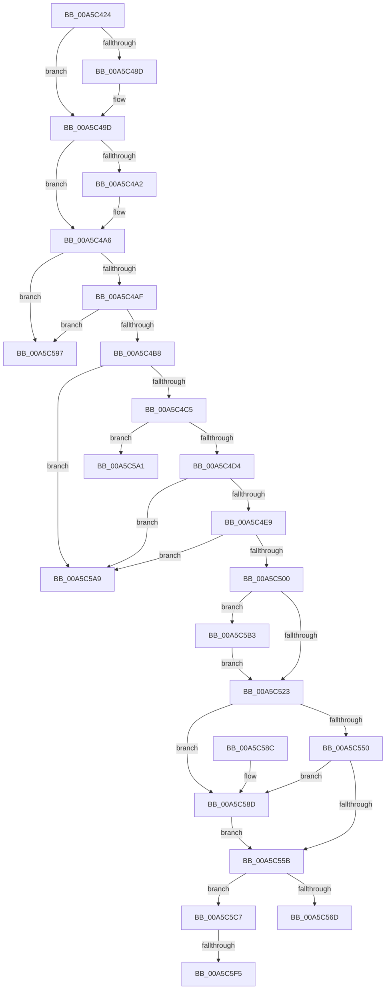

# WdipSemEnableScenario

- RVA: `0x00A5C424`–`0x00A5C609` (길이 `485` bytes)
- VA: `0x0000000140A5C424`
- 실행 섹션: `PAGE`
- PDB 이름 있음: `예`; PDB Function 태그: `예`
- unwind 정보 RVA: `0x000B2744`
- 디코드: `123`개 명령, `485/485` bytes 표시
- 미해석 바이트: `0` (있으면 어셈블리에 `.byte`로 보존)

> 이 문서는 커널 이미지의 기계어와 PDB 기호를 분석해 생성했습니다. 4번과 5번은 함수 원형과 자료형을 바이너리 사용 방식에서 추정한 C 해석이며 원본 소스 복구 결과는 아닙니다.

## 1. Dependencies

- 직접 호출 지점: **14**; 고유 호출 대상: **13**
- 직접 호출자로 확인된 함수: **1**
- RIP 상대 이미지 참조: **4**

### Outgoing calls
- `0x00A5C473` → [KeAbPreAcquire](../../text/21/KeAbPreAcquire_function_00210230.md) (function, `0x00210230`)
- `0x00A5C498` → [ExfAcquirePushLockSharedEx](../../text/21/ExfAcquirePushLockSharedEx_function_0021044C.md) (function, `0x0021044C`)
- `0x00A5C4C5` → [WdipSemGetLoggerIds](WdipSemGetLoggerIds_function_00A5CBB4.md) (function, `0x00A5CBB4`)
- `0x00A5C4DB` → [WdipSemQueryScenarioTable](WdipSemQueryScenarioTable_function_00A5CB5C.md) (function, `0x00A5CB5C`)
- `0x00A5C4EF` → [WdipSemReserveInstanceTableEntry](WdipSemReserveInstanceTableEntry_function_00A5DA08.md) (function, `0x00A5DA08`)
- `0x00A5C503` → [WdipSemEnableContextProviders](WdipSemEnableContextProviders_function_00A5C610.md) (function, `0x00A5C610`)
- `0x00A5C516` → [EtwEventEnabled](../../text/39/EtwEventEnabled_function_00392450.md) (function, `0x00392450`)
- `0x00A5C526` → [WdipSemActivateInstance](WdipSemActivateInstance_function_00A5CAA0.md) (function, `0x00A5CAA0`)
- `0x00A5C55E` → [KeAbPostRelease](../../text/2E/KeAbPostRelease_function_002E1600.md) (function, `0x002E1600`)
- `0x00A5C563` → [KeLeaveCriticalRegion](../../text/25/KeLeaveCriticalRegion_function_0025D8B0.md) (function, `0x0025D8B0`)
- `0x00A5C590` → [ExfReleasePushLock](../../text/26/ExfReleasePushLock_function_002638D0.md) (function, `0x002638D0`)
- `0x00A5C5BD` → [WdipSemWriteSemActionsEvent](../AB/WdipSemWriteSemActionsEvent_function_00ABC618.md) (function, `0x00ABC618`)
- `0x00A5C5E0` → [KeAbPreAcquire](../../text/21/KeAbPreAcquire_function_00210230.md) (function, `0x00210230`)
- `0x00A5C5FE` → [ExfAcquirePushLockExclusiveEx](../../text/20/ExfAcquirePushLockExclusiveEx_function_0020FC90.md) (function, `0x0020FC90`)

### Direct callers
- [WdipStartEndScenario](WdipStartEndScenario_function_00A5C378.md) at `0x00A5C3AC`

### Static image references
- `0x00A5C449` → RVA `0x00F01E08` (`.data`; read)
- `0x00A5C4B8` → RVA `0x00F01E18` (`.data`; read)
- `0x00A5C508` → RVA `0x00F01DD0` (`.data`; read)
- `0x00A5C50F` → RVA `0x0001A778` (`.rdata`; read)

## 2. Other-region calls and transfers

- 다른 실행 섹션으로 향하는 call: **8**
  - `0x00A5C473` → [KeAbPreAcquire](../../text/21/KeAbPreAcquire_function_00210230.md) (`PAGE` → `.text`)
  - `0x00A5C498` → [ExfAcquirePushLockSharedEx](../../text/21/ExfAcquirePushLockSharedEx_function_0021044C.md) (`PAGE` → `.text`)
  - `0x00A5C516` → [EtwEventEnabled](../../text/39/EtwEventEnabled_function_00392450.md) (`PAGE` → `.text`)
  - `0x00A5C55E` → [KeAbPostRelease](../../text/2E/KeAbPostRelease_function_002E1600.md) (`PAGE` → `.text`)
  - `0x00A5C563` → [KeLeaveCriticalRegion](../../text/25/KeLeaveCriticalRegion_function_0025D8B0.md) (`PAGE` → `.text`)
  - `0x00A5C590` → [ExfReleasePushLock](../../text/26/ExfReleasePushLock_function_002638D0.md) (`PAGE` → `.text`)
  - `0x00A5C5E0` → [KeAbPreAcquire](../../text/21/KeAbPreAcquire_function_00210230.md) (`PAGE` → `.text`)
  - `0x00A5C5FE` → [ExfAcquirePushLockExclusiveEx](../../text/20/ExfAcquirePushLockExclusiveEx_function_0020FC90.md) (`PAGE` → `.text`)
- call이 아닌 외부 분기/꼬리 이동: **5**
  - `0x00A5C59C` → [sub_00B3DC32](../B3/Unknown_function_00B3DC32.md) (`tail-transfer`)
  - `0x00A5C5A4` → [sub_00B3DC32](../B3/Unknown_function_00B3DC32.md) (`tail-transfer`)
  - `0x00A5C5AE` → [sub_00B3DC32](../B3/Unknown_function_00B3DC32.md) (`tail-transfer`)
  - `0x00A5C5EF` → [sub_00B3DC32 + 0x48](../B3/Unknown_function_00B3DC32.md) (`tail-transfer`)
  - `0x00A5C604` → [sub_00B3DC32 + 0x48](../B3/Unknown_function_00B3DC32.md) (`tail-transfer`)

## 3. Assembly (complete function range)

```asm
00A5C424  48 89 5C 24 08                  mov qword ptr [rsp + 8], rbx
00A5C429  48 89 6C 24 10                  mov qword ptr [rsp + 0x10], rbp
00A5C42E  48 89 74 24 18                  mov qword ptr [rsp + 0x18], rsi
00A5C433  57                              push rdi
00A5C434  41 54                           push r12
00A5C436  41 55                           push r13
00A5C438  41 56                           push r14
00A5C43A  41 57                           push r15
00A5C43C  48 83 EC 30                     sub rsp, 0x30
00A5C440  65 48 8B 04 25 88 01 00 00      mov rax, qword ptr gs:[0x188]
00A5C449  4C 8D 2D B8 59 4A 00            lea r13, [rip + 0x4a59b8]
00A5C450  4D 8B F0                        mov r14, r8
00A5C453  44 0F B7 FA                     movzx r15d, dx
00A5C457  48 8B E9                        mov rbp, rcx
00A5C45A  45 33 E4                        xor r12d, r12d
00A5C45D  45 33 C0                        xor r8d, r8d
00A5C460  33 D2                           xor edx, edx
00A5C462  66 FF 88 E4 01 00 00            dec word ptr [rax + 0x1e4]
00A5C469  49 8B CD                        mov rcx, r13
00A5C46C  90                              nop
00A5C46D  41 8B FC                        mov edi, r12d
00A5C470  41 8A F4                        mov sil, r12b
00A5C473  E8 B8 3D 7B FF                  call 0x140210230
00A5C478  48 8B D8                        mov rbx, rax
00A5C47B  41 8D 4C 24 11                  lea ecx, [r12 + 0x11]
00A5C480  33 C0                           xor eax, eax
00A5C482  F0 48 0F B1 0D 7D 59 4A 00      lock cmpxchg qword ptr [rip + 0x4a597d], rcx
00A5C48B  74 10                           je 0x140a5c49d
00A5C48D  4D 8B CD                        mov r9, r13
00A5C490  4C 8B C3                        mov r8, rbx
00A5C493  33 D2                           xor edx, edx
00A5C495  49 8B CD                        mov rcx, r13
00A5C498  E8 AF 3F 7B FF                  call 0x14021044c
00A5C49D  48 85 DB                        test rbx, rbx
00A5C4A0  74 04                           je 0x140a5c4a6
00A5C4A2  C6 43 0A 01                     mov byte ptr [rbx + 0xa], 1
00A5C4A6  48 85 ED                        test rbp, rbp
00A5C4A9  0F 84 E8 00 00 00               je 0x140a5c597
00A5C4AF  4D 85 F6                        test r14, r14
00A5C4B2  0F 84 DF 00 00 00               je 0x140a5c597
00A5C4B8  44 38 25 59 59 4A 00            cmp byte ptr [rip + 0x4a5959], r12b
00A5C4BF  0F 84 E4 00 00 00               je 0x140a5c5a9
00A5C4C5  E8 EA 06 00 00                  call 0x140a5cbb4
00A5C4CA  8B D8                           mov ebx, eax
00A5C4CC  85 C0                           test eax, eax
00A5C4CE  0F 88 CD 00 00 00               js 0x140a5c5a1
00A5C4D4  41 0F B7 D7                     movzx edx, r15w
00A5C4D8  48 8B CD                        mov rcx, rbp
00A5C4DB  E8 7C 06 00 00                  call 0x140a5cb5c
00A5C4E0  48 85 C0                        test rax, rax
00A5C4E3  0F 84 C0 00 00 00               je 0x140a5c5a9
00A5C4E9  49 8B D6                        mov rdx, r14
00A5C4EC  48 8B C8                        mov rcx, rax
00A5C4EF  E8 14 15 00 00                  call 0x140a5da08
00A5C4F4  48 8B F8                        mov rdi, rax
00A5C4F7  48 85 C0                        test rax, rax
00A5C4FA  0F 84 A9 00 00 00               je 0x140a5c5a9
00A5C500  48 8B C8                        mov rcx, rax
00A5C503  E8 08 01 00 00                  call 0x140a5c610
00A5C508  48 8B 0D C1 58 4A 00            mov rcx, qword ptr [rip + 0x4a58c1]
00A5C50F  48 8D 15 62 E2 5B FF            lea rdx, [rip - 0xa41d9e]
00A5C516  E8 35 5F 93 FF                  call 0x140392450
00A5C51B  84 C0                           test al, al
00A5C51D  0F 85 90 00 00 00               jne 0x140a5c5b3
00A5C523  48 8B CF                        mov rcx, rdi
00A5C526  E8 75 05 00 00                  call 0x140a5caa0
00A5C52B  0F 0D 0D D6 58 4A 00            prefetchw byte ptr [rip + 0x4a58d6]
00A5C532  48 8B 05 CF 58 4A 00            mov rax, qword ptr [rip + 0x4a58cf]
00A5C539  48 8B C8                        mov rcx, rax
00A5C53C  48 83 E1 F0                     and rcx, 0xfffffffffffffff0
00A5C540  48 83 F9 10                     cmp rcx, 0x10
00A5C544  48 8D 50 F0                     lea rdx, [rax - 0x10]
00A5C548  49 0F 46 D4                     cmovbe rdx, r12
00A5C54C  A8 02                           test al, 2
00A5C54E  75 3D                           jne 0x140a5c58d
00A5C550  F0 48 0F B1 15 AF 58 4A 00      lock cmpxchg qword ptr [rip + 0x4a58af], rdx
00A5C559  75 32                           jne 0x140a5c58d
00A5C55B  49 8B CD                        mov rcx, r13
00A5C55E  E8 9D 50 88 FF                  call 0x1402e1600
00A5C563  E8 48 13 80 FF                  call 0x14025d8b0
00A5C568  40 84 F6                        test sil, sil
00A5C56B  75 5A                           jne 0x140a5c5c7
00A5C56D  48 8B 6C 24 68                  mov rbp, qword ptr [rsp + 0x68]
00A5C572  8B C3                           mov eax, ebx
00A5C574  48 8B 5C 24 60                  mov rbx, qword ptr [rsp + 0x60]
00A5C579  48 8B 74 24 70                  mov rsi, qword ptr [rsp + 0x70]
00A5C57E  48 83 C4 30                     add rsp, 0x30
00A5C582  41 5F                           pop r15
00A5C584  41 5E                           pop r14
00A5C586  41 5D                           pop r13
00A5C588  41 5C                           pop r12
00A5C58A  5F                              pop rdi
00A5C58B  C3                              ret
00A5C58C  CC                              int3
00A5C58D  49 8B CD                        mov rcx, r13
00A5C590  E8 3B 73 80 FF                  call 0x1402638d0
00A5C595  EB C4                           jmp 0x140a5c55b
00A5C597  BB 0D 00 00 C0                  mov ebx, 0xc000000d
00A5C59C  E9 91 16 0E 00                  jmp 0x140b3dc32
00A5C5A1  40 B6 01                        mov sil, 1
00A5C5A4  E9 89 16 0E 00                  jmp 0x140b3dc32
00A5C5A9  BB 01 00 00 C0                  mov ebx, 0xc0000001
00A5C5AE  E9 7F 16 0E 00                  jmp 0x140b3dc32
00A5C5B3  48 8B D7                        mov rdx, rdi
00A5C5B6  48 8D 0D BB E1 5B FF            lea rcx, [rip - 0xa41e45]
00A5C5BD  E8 56 00 06 00                  call 0x140abc618
00A5C5C2  E9 5C FF FF FF                  jmp 0x140a5c523
00A5C5C7  65 48 8B 04 25 88 01 00 00      mov rax, qword ptr gs:[0x188]
00A5C5D0  45 33 C0                        xor r8d, r8d
00A5C5D3  33 D2                           xor edx, edx
00A5C5D5  49 8B CD                        mov rcx, r13
00A5C5D8  66 FF 88 E4 01 00 00            dec word ptr [rax + 0x1e4]
00A5C5DF  90                              nop
00A5C5E0  E8 4B 3C 7B FF                  call 0x140210230
00A5C5E5  F0 49 0F BA 6D 00 00            lock bts qword ptr [r13], 0
00A5C5EC  48 8B F8                        mov rdi, rax
00A5C5EF  0F 83 85 16 0E 00               jae 0x140b3dc7a
00A5C5F5  4D 8B C5                        mov r8, r13
00A5C5F8  48 8B D0                        mov rdx, rax
00A5C5FB  49 8B CD                        mov rcx, r13
00A5C5FE  E8 8D 36 7B FF                  call 0x14020fc90
00A5C603  90                              nop
00A5C604  E9 71 16 0E 00                  jmp 0x140b3dc7a
```

## 4. C-style interpretation (structured pseudocode)

```c
__int64 __fastcall WdipSemEnableScenario(__int64 a1, int a2, __int64 a3)
{
    __int64 result;
    __int64 v_r12;
    __int64 v_rsp;
    unsigned __int64 v_stack_p10;
    unsigned __int64 v_stack_p18;
    unsigned __int64 v_stack_p8;

    v_stack_p8 = v_rbx;
    v_stack_p10 = v_rbp;
    v_stack_p18 = v_rsi;
    v_rsp = (v_rsp) - (48);
    v_r12 = 0;
    a3 = 0;
    a2 = 0;
    result = KeAbPreAcquire(v_rip + 4872632, a2, a3, a4);
    result = 0;
    if (!(condition_is_equal)) {
        a4 = v_rip + 4872632;
        a3 = 0;
        a2 = 0;
        a1 = v_rip + 4872632;
        result = ExfAcquirePushLockSharedEx(a1, a2, a3, a4);
    }
    if (result != 0) {
        *(unsigned __int8 *)(result + 10) = 1;
    }
    if (a1 == 0) goto loc_00A5C597;
    if (a3 == 0) goto loc_00A5C597;
    if ((*(unsigned __int8 *)(v_rip + 4872537)) == 0) goto loc_00A5C5A9;
    result = WdipSemGetLoggerIds(a1, a2, a3, a4);
    if (sign_flag) goto loc_00A5C5A1;
    result = WdipSemQueryScenarioTable(a1, (unsigned __int16)((unsigned __int16)(a2)), a3, a4);
    if (result == 0) goto loc_00A5C5A9;
    result = WdipSemReserveInstanceTableEntry(result, a3, a3, a4);
    if (result == 0) goto loc_00A5C5A9;
    result = WdipSemEnableContextProviders(result, a3, a3, a4);
    result = EtwEventEnabled(*(unsigned __int64 *)(v_rip + 4872385), v_rip - 10755486, a3, a4);
    if ((unsigned __int8)(result) != 0) goto loc_00A5C5B3;
loc_00A5C523:
    result = WdipSemActivateInstance(result, v_rip - 10755486, a3, a4);
    a1 = (*(unsigned __int64 *)(v_rip + 4872399)) & (-16);
    a2 = *(unsigned __int64 *)(v_rip + 4872399) - 16;
    if (a1 <= 16) { a2 = 0; }
    if ((((unsigned __int8)(*(unsigned __int64 *)(v_rip + 4872399))) & (2)) != 0) goto loc_00A5C58D;
    if ((((unsigned __int8)(*(unsigned __int64 *)(v_rip + 4872399))) & (2)) != 0) goto loc_00A5C58D;
loc_00A5C55B:
    result = KeAbPostRelease(v_rip + 4872632, a2, a3, a4);
    result = KeLeaveCriticalRegion(v_rip + 4872632, a2, a3, a4);
    if (0 != 0) goto loc_00A5C5C7;
    v_rsp = (v_rsp) + (48);
    return (unsigned int)((unsigned int)((unsigned int)((unsigned int)(result))));
loc_00A5C58D:
    result = ExfReleasePushLock(v_rip + 4872632, a2, a3, a4);
    goto loc_00A5C55B;
loc_00A5C597:
loc_00A5C5A1:
loc_00A5C5A9:
loc_00A5C5B3:
    result = WdipSemWriteSemActionsEvent(v_rip - 10755653, result, a3, a4);
    goto loc_00A5C523;
loc_00A5C5C7:
    a3 = 0;
    a2 = 0;
    result = KeAbPreAcquire(v_rip + 4872632, a2, a3, a4);
    result = ExfAcquirePushLockExclusiveEx(v_rip + 4872632, result, v_rip + 4872632, a4);
}
```

## 5. (Beta) C Style

```c
int64_t WdipSemEnableScenario(int64_t Arg1, int32_t Arg2, int64_t Arg3)
{
    int64_t result;
    int64_t local_r12;
    int64_t local_rsp;
    uint64_t v_stack_p10;
    uint64_t v_stack_p18;
    uint64_t v_stack_p8;

    v_stack_p8 = local_rbx;
    v_stack_p10 = local_rbp;
    v_stack_p18 = local_rsi;
    local_rsp = (local_rsp) - (48);
    local_r12 = 0;
    Arg3 = 0;
    Arg2 = 0;
    result = KeAbPreAcquire(v_rip + 4872632, Arg2, Arg3, a4);
    result = 0;
    if (!(condition_is_equal)) {
        a4 = v_rip + 4872632;
        Arg3 = 0;
        Arg2 = 0;
        Arg1 = v_rip + 4872632;
        result = ExfAcquirePushLockSharedEx(Arg1, Arg2, Arg3, a4);
    }
    if (result != 0) {
        *(uint8_t *)(result + 0xA) = 1;
    }
    if (Arg1 == 0) goto loc_00A5C597;
    if (Arg3 == 0) goto loc_00A5C597;
    if ((*(uint8_t *)(v_rip + 0x4A5959)) == 0) goto loc_00A5C5A9;
    result = WdipSemGetLoggerIds(Arg1, Arg2, Arg3, a4);
    if (sign_flag) goto loc_00A5C5A1;
    result = WdipSemQueryScenarioTable(Arg1, (uint16_t)((uint16_t)(Arg2)), Arg3, a4);
    if (result == 0) goto loc_00A5C5A9;
    result = WdipSemReserveInstanceTableEntry(result, Arg3, Arg3, a4);
    if (result == 0) goto loc_00A5C5A9;
    result = WdipSemEnableContextProviders(result, Arg3, Arg3, a4);
    result = EtwEventEnabled(*(uint64_t *)(v_rip + 0x4A58C1), v_rip - 10755486, Arg3, a4);
    if ((uint8_t)(result) != 0) goto loc_00A5C5B3;
loc_00A5C523:
    result = WdipSemActivateInstance(result, v_rip - 10755486, Arg3, a4);
    Arg1 = (*(uint64_t *)(v_rip + 0x4A58CF)) & (-16);
    Arg2 = *(uint64_t *)(v_rip + 0x4A58CF) - 16;
    if (Arg1 <= 16) { Arg2 = 0; }
    if ((((uint8_t)(*(uint64_t *)(v_rip + 0x4A58CF))) & (2)) != 0) goto loc_00A5C58D;
    if ((((uint8_t)(*(uint64_t *)(v_rip + 0x4A58CF))) & (2)) != 0) goto loc_00A5C58D;
loc_00A5C55B:
    result = KeAbPostRelease(v_rip + 4872632, Arg2, Arg3, a4);
    result = KeLeaveCriticalRegion(v_rip + 4872632, Arg2, Arg3, a4);
    if (0 != 0) goto loc_00A5C5C7;
    local_rsp = (local_rsp) + (48);
    return (uint32_t)((uint32_t)((uint32_t)((uint32_t)(result))));
loc_00A5C58D:
    result = ExfReleasePushLock(v_rip + 4872632, Arg2, Arg3, a4);
    goto loc_00A5C55B;
loc_00A5C597:
loc_00A5C5A1:
loc_00A5C5A9:
loc_00A5C5B3:
    result = WdipSemWriteSemActionsEvent(v_rip - 10755653, result, Arg3, a4);
    goto loc_00A5C523;
loc_00A5C5C7:
    Arg3 = 0;
    Arg2 = 0;
    result = KeAbPreAcquire(v_rip + 4872632, Arg2, Arg3, a4);
    result = ExfAcquirePushLockExclusiveEx(v_rip + 4872632, result, v_rip + 4872632, a4);
}
```

## 6. Execution-region graph

[열기: 2D/3D 그래프와 함수 탐색 컨트롤 패널](../../../control-panel.html?section=page&rva=0x00A5C424&view=graph)

- 2D 그래프는 위에서 아래로 흐르고, 3D 그래프는 빈 공간을 드래그해 회전합니다. Shift+드래그는 이동, 휠은 확대·축소, 함수 노드 선택은 대상 보고서 이동입니다.

### Static fallback


