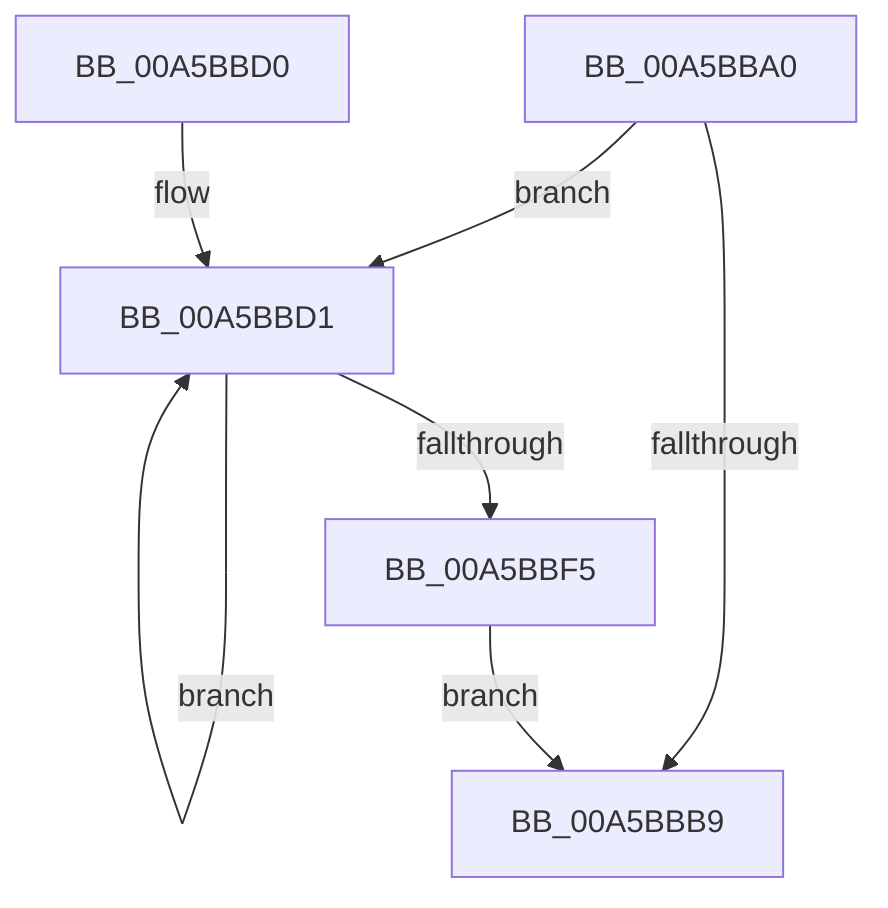

# WdipSemFreeFrequentScenarioTable

- RVA: `0x00A5BBA0`–`0x00A5BBF7` (길이 `87` bytes)
- VA: `0x0000000140A5BBA0`
- 실행 섹션: `PAGE`
- PDB 이름 있음: `예`; PDB Function 태그: `아니요`
- unwind 정보 RVA: `0x0006D260`
- 디코드: `23`개 명령, `87/87` bytes 표시
- 미해석 바이트: `0` (있으면 어셈블리에 `.byte`로 보존)

> 이 문서는 커널 이미지의 기계어와 PDB 기호를 분석해 생성했습니다. 4번과 5번은 함수 원형과 자료형을 바이너리 사용 방식에서 추정한 C 해석이며 원본 소스 복구 결과는 아닙니다.

## 1. Dependencies

- 직접 호출 지점: **1**; 고유 호출 대상: **1**
- 직접 호출자로 확인된 함수: **1**
- RIP 상대 이미지 참조: **3**

### Outgoing calls
- `0x00A5BBE1` → [WdipSemFastFree](../70/WdipSemFastFree_function_0070303C.md) (function, `0x0070303C`)

### Direct callers
- [WdipSemSqmLogInflightLimitExceededDataPoints](WdipSemSqmLogInflightLimitExceededDataPoints_function_00A5BA80.md) at `0x00A5BB01`

### Static image references
- `0x00A5BBB1` → RVA `0x00F02440` (`.data`; read)
- `0x00A5BBB9` → RVA `0x00F02440` (`.data`; read/write)
- `0x00A5BBD1` → RVA `0x00F02040` (`.data`; read)

## 2. Other-region calls and transfers

- 다른 실행 섹션으로 향하는 call: **0**
- 별도 외부 분기/꼬리 이동을 확인하지 못했습니다.

## 3. Assembly (complete function range)

```asm
00A5BBA0  48 89 5C 24 08                  mov qword ptr [rsp + 8], rbx
00A5BBA5  48 89 74 24 10                  mov qword ptr [rsp + 0x10], rsi
00A5BBAA  57                              push rdi
00A5BBAB  48 83 EC 20                     sub rsp, 0x20
00A5BBAF  33 FF                           xor edi, edi
00A5BBB1  39 3D 89 68 4A 00               cmp dword ptr [rip + 0x4a6889], edi
00A5BBB7  77 18                           ja 0x140a5bbd1
00A5BBB9  83 25 80 68 4A 00 00            and dword ptr [rip + 0x4a6880], 0
00A5BBC0  48 8B 5C 24 30                  mov rbx, qword ptr [rsp + 0x30]
00A5BBC5  48 8B 74 24 38                  mov rsi, qword ptr [rsp + 0x38]
00A5BBCA  48 83 C4 20                     add rsp, 0x20
00A5BBCE  5F                              pop rdi
00A5BBCF  C3                              ret
00A5BBD0  CC                              int3
00A5BBD1  48 8D 35 68 64 4A 00            lea rsi, [rip + 0x4a6468]
00A5BBD8  B9 05 00 00 00                  mov ecx, 5
00A5BBDD  48 8B 14 FE                     mov rdx, qword ptr [rsi + rdi*8]
00A5BBE1  E8 56 74 CA FF                  call 0x14070303c
00A5BBE6  48 83 24 FE 00                  and qword ptr [rsi + rdi*8], 0
00A5BBEB  FF C7                           inc edi
00A5BBED  3B 3D 4D 68 4A 00               cmp edi, dword ptr [rip + 0x4a684d]
00A5BBF3  72 DC                           jb 0x140a5bbd1
00A5BBF5  EB C2                           jmp 0x140a5bbb9
```

## 4. C-style interpretation (structured pseudocode)

```c
__int64 __fastcall WdipSemFreeFrequentScenarioTable(void)
{
    __int64 result;
    __int64 v_rdi;
    __int64 v_rsp;
    unsigned __int64 v_stack_p10;
    unsigned __int64 v_stack_p8;

    v_stack_p8 = v_rbx;
    v_stack_p10 = v_rsi;
    v_rsp = (v_rsp) - (32);
    v_rdi = 0;
    if ((*(unsigned int *)(v_rip + 4876425)) > 0) goto loc_00A5BBD1;
loc_00A5BBB9:
    v_rsp = (v_rsp) + (32);
    return result;
loc_00A5BBD1:
    result = WdipSemFastFree(5, *(unsigned __int64 *)(v_rip + 4875368 + v_rdi * 8), a3, a4);
    v_rdi = (unsigned int)((v_rdi) + 1);
    if (((unsigned int)(v_rdi)) < (*(unsigned int *)(v_rip + 4876365))) goto loc_00A5BBD1;
    goto loc_00A5BBB9;
}
```

## 5. (Beta) C Style

```c
void WdipSemFreeFrequentScenarioTable(void)
{
    int64_t result;
    int64_t local_rdi;
    int64_t local_rsp;
    uint64_t v_stack_p10;
    uint64_t v_stack_p8;

    v_stack_p8 = local_rbx;
    v_stack_p10 = local_rsi;
    local_rsp = (local_rsp) - (32);
    local_rdi = 0;
    if ((*(uint32_t *)(v_rip + 0x4A6889)) > 0) goto loc_00A5BBD1;
loc_00A5BBB9:
    local_rsp = (local_rsp) + (32);
    return result;
loc_00A5BBD1:
    result = WdipSemFastFree(5, *(uint64_t *)(v_rip + 0x4A6468 + local_rdi * 8), a3, a4);
    local_rdi = (uint32_t)((local_rdi) + 1);
    if (((uint32_t)(local_rdi)) < (*(uint32_t *)(v_rip + 0x4A684D))) goto loc_00A5BBD1;
    goto loc_00A5BBB9;
}
```

## 6. Execution-region graph

[열기: 2D/3D 그래프와 함수 탐색 컨트롤 패널](../../../control-panel.html?section=page&rva=0x00A5BBA0&view=graph)

- 2D 그래프는 위에서 아래로 흐르고, 3D 그래프는 빈 공간을 드래그해 회전합니다. Shift+드래그는 이동, 휠은 확대·축소, 함수 노드 선택은 대상 보고서 이동입니다.

### Static fallback


